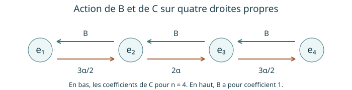

# École polytechnique — Première composition de mathématiques · Option M′ 1985 · Corrigé brut

*Corrigé rédigé par IA, non officiel. Signalez toute erreur.*

**Rédaction** · GPT-6.2 Astra Ultra · vitesse non renseignée

Soit $E$ un espace vectoriel réel de dimension $n\ge2$. Pour un endomorphisme $L$, on pose $L^0=I$. L’indice de nilpotence est le plus petit entier $p\ge1$ tel que $L^p=0$. Les produits d’endomorphismes se lisent de droite à gauche.

Le corrigé brut suit la numérotation imprimée (deux vues du recueil réunissant trois feuillets). [Fac-similé UPS m85xm1eb](https://prepas.org/index.php?module=Sujets&voir=get&file=doc-f86acae24894fabf9886) · [Notice annuelle de la session 1985](https://www.legifrance.gouv.fr/jorf/id/JORFTEXT000000697778).

## I. Noyaux successifs et décomposition d’un endomorphisme nilpotent

### Question I.1.a

On a $\ker L^i\subseteq\ker L^{i+1}$ et $\operatorname{Im}L^{i+1}\subseteq\operatorname{Im}L^i$. L’égalité de l’un des couples équivaut à l’égalité de ses dimensions. Par la formule du rang, elle équivaut alors à l’égalité des dimensions, puis des espaces, pour l’autre couple. Si $\operatorname{Im}L^{i+1}=\operatorname{Im}L^i$, une application de $L$ donne la même égalité au rang suivant. Par récurrence, $\operatorname{Im}L^j=\operatorname{Im}L^i$ pour tout $j\ge i$.

### Question I.1.b

Si deux noyaux consécutifs coïncidaient, l’image serait constante à partir de l’indice $i$, d’après I.1.a. Or une puissance assez élevée de $L$ est nulle. L’image stabilisée serait donc nulle et $\ker L^i=E$. Par contraposée, dès que $\ker L^i\ne E$, l’inclusion dans le noyau suivant est stricte.

### Question I.1.c

Pour $i<p$, on a $L^i\ne0$ et I.1.b impose un accroissement d’au moins une dimension. Entre $0=\dim\ker I$ et $n=\dim\ker L^p$ il y a $p$ accroissements stricts. Donc $p\le n$, et $L^n=0$. Si $p=n$, ces $n$ accroissements ont tous valeur $1$ et $\dim\ker L^i=i$ pour $0\le i\le n$.

### Question I.2.a

Comme $h<n$, le rang de $L^h$ est $n-h>0$ et $h<p$. Le noyau de $L^h$ a dimension $h$. Depuis l’indice zéro, il a reçu $h$ accroissements chacun au moins égaux à $1$. Tous valent donc $1$. Ainsi $\dim\ker L^j=j$ et $\operatorname{rg} L^j=n-j$ pour $1\le j\le h$.

### Question I.2.b

L’application $L:\operatorname{Im}L^i\to\operatorname{Im}L^{i+1}$ est surjective, et son noyau est $\operatorname{Im}L^i\cap\ker L$. Le théorème du rang donne

$$
\dim\operatorname{Im}L^i-\dim\operatorname{Im}L^{i+1}=\dim(\operatorname{Im}L^i\cap\ker L).
$$

### Question I.2.c

D’après I.2.a avec $j=1$, $\dim\ker L=1$. La perte de rang dans I.2.b est donc au plus $1$. Tant que l’image est non nulle, cette perte est strictement positive par I.1.a–b. Le rang prend ainsi successivement toutes les valeurs $n,n-1,\ldots,0$. L’indice de nilpotence est $p=n$.

### Question I.3.a

Posons $M=L|_F$. Puisque $F\ne0$ et $M$ est nilpotente, $\ker M$ est non nul. Il est contenu dans la droite $\ker L$, donc $\dim\ker M=1$. Pour $r=\dim F>1$, I.2 appliqué à $M$ avec $h=1$ donne l’indice $r$. Pour $r=1$, $M=0$ et l’indice est encore $r$. Ainsi $\dim\ker M^j=j$ pour $1\le j\le r$. Par le même raisonnement sur $E$, $\dim\ker L^j=j$. L’inclusion $\ker M^j\subseteq\ker L^j$ devient une égalité. En particulier $\ker L^r=\ker M^r=F$.

### Question I.3.b

Chaque $\ker L^j$ est stable car $L^jL=LL^j$. Réciproquement, tout sous-espace stable de dimension $r>0$ est $\ker L^r$ par I.3.a, et le sous-espace nul est $\ker L^0$. La liste complète est donc la chaîne des $\ker L^j$ pour $0\le j\le n$, avec exactement un sous-espace stable par dimension.

### Question I.4.a

Supposons $\sum_{i=0}^{p-1}a_iL^ie=0$ et choisissons le plus petit indice $j$ tel que $a_j\ne0$. Après application de $L^{p-1-j}$, tous les termes d’indice supérieur disparaissent et il reste $a_jL^{p-1}e=0$, contradiction. Les $p$ vecteurs forment donc une base de leur espace $G$. Cet espace est stable par $L$ et la restriction y a pour indice $p$.

### Question I.4.b

Pour toute forme $\ell$ et tout vecteur $v$, $((L^t)^i\ell)(v)=\ell(L^iv)$ par récurrence, donc $(L^t)^i=(L^i)^t$. Choisissons $e'$ tel que $e'(L^{p-1}e)\ne0$. Alors $(L^t)^{p-1}e'\ne0$ et $(L^t)^p=0$. Par l’argument de I.4.a dans le dual, les $p$ premières itérées de $e'$ sont libres tandis que les suivantes sont nulles. Ainsi $\dim H^*=p$. L’annulateur $H$ de $H^*$ dans $E$ a dimension $n-p$.

### Question I.4.c

Pour $v\in H$ et $\ell\in H^*$, on a $\ell(Lv)=(L^t\ell)(v)=0$, puisque $H^*$ est stable par $L^t$. Donc $H$ est stable par $L$. Si un élément non nul de $G$ s’écrit $v=\sum a_iL^ie$ et si $j$ est son premier coefficient non nul, alors $((L^t)^{p-1-j}e')(v)=a_je'(L^{p-1}e)\ne0$. Ainsi $v\notin H$. L’intersection est nulle et les dimensions ont pour somme $n$, donc $E=G\oplus H$.

### Question I.4.d

Si l’indice vaut $1$, $L=0$ et les droites d’une base donnent les sous-espaces cherchés. Si l’indice égale la dimension, une chaîne de longueur $n$ donnée par I.4.a engendre $E$ tout entier. Dans le cas intermédiaire, I.4.c isole un sous-espace $G$ dont dimension et indice valent $p$, et un supplémentaire stable $H$ de dimension strictement inférieure à $n$. Appliquons la récurrence à la restriction nilpotente sur $H$. Ses blocs, réunis à $G$, forment la somme directe voulue.

## II. Une relation de commutation et une base adaptée

### Question II.1.a

Par définition $[U,V]=UV-VU$. En développant, $[U,V]W+V[U,W]=UVW-VUW+VUW-VWU=UVW-VWU=[U,VW]$. Cette identité vaut pour tous les endomorphismes, sans hypothèse de commutation.

### Question II.1.b

À partir de $[A,B]=\alpha B$, II.1.a donne par récurrence $[A,B^k]=k\alpha B^k$. Pour $k=0$, les deux membres sont nuls. La linéarité permet donc d’écrire $[A,P(B)]=\alpha B P'(B)$. Si $B^k v=0$, on a $B^kAv=AB^kv-k\alpha B^kv=0$. Ainsi chaque noyau $\ker B^k$ est stable par $A$.

### Question II.1.c

Les puissances de $B$ appartiennent à un espace de dimension $n^2$, donc il existe un polynôme annulateur non nul. Prenons-en un unitaire $P$ de degré minimal $d$. Comme $[A,P(B)]=0$ et $\alpha\ne0$, on a $BP'(B)=0$. Le polynôme $dP-XP'$ annule $B$ et a degré strictement inférieur à $d$ s’il est non nul. Par minimalité, $dP=XP'$. Le coefficient de degré $j<d$ vérifie $(d-j)a_j=0$. Ainsi $P=X^d$ et $B^d=0$.

### Question II.2.a

Le rang $n-1$ de $B$ entraîne que son indice vaut $n$, d’après I.2. Le rang de $B^{n-1}$ vaut $1$. Choisissons $x\notin\ker B^{n-1}$ et posons $x_k=B^{n-k}x$. Les $x_k$ sont indépendants par I.4.a et $B^k x_j=0$ pour $j\le k$. Comme $\ker B^k$ a dimension $k$, $(x_1,\ldots,x_k)$ en est une base.

### Question II.2.b

La droite $\ker B$ est stable par $A$, donc $Ax_1=\lambda x_1$ pour un réel $\lambda$. Dans la base $(x_k)$, les noyaux successifs étant stables, la matrice de $A$ est triangulaire supérieure. Si $d_k$ est son coefficient diagonal en position $k$, le coefficient de $x_{k-1}$ dans $(AB-BA)x_k$ vaut $d_{k-1}-d_k$ pour $k\ge2$. Comme $Bx_k=x_{k-1}$, on trouve $d_k=\lambda-(k-1)\alpha$. Ces coefficients sont les valeurs propres, en particulier $\lambda-(n-1)\alpha$.

### Question II.2.c

Si $Av=\mu v$, alors $A(Bv)=B(Av)+\alpha Bv=(\mu+\alpha)Bv$. Ainsi $Bv$ est nul ou est vecteur propre de $A$ pour la valeur $\mu+\alpha$.

### Question II.2.d

Posons $\mu_n=\lambda-(n-1)\alpha$. Cette valeur ne figure pas parmi les $n-1$ premières entrées diagonales, puisque $\alpha\ne0$. La restriction à $\ker B^{n-1}$ ayant précisément ces entrées, un vecteur propre $e_n$ pour $\mu_n$ est extérieur à ce noyau. Les vecteurs $e_k=B^{n-k}e_n$ forment donc la base de II.2.a. Par II.2.c, $Ae_k=\mu_k e_k$ avec $\mu_k=\lambda-(k-1)\alpha$. Dans cette base, $A=\operatorname{diag}(\mu_1,\ldots,\mu_n)$ et $B$ a des $1$ juste au-dessus de la diagonale, tous les autres coefficients étant nuls.

## III. Trois endomorphismes liés par leurs commutateurs

### Question III.1

En développant avec II.1.a, on obtient $[A,[B,C]]=[[A,B],C]+[B,[A,C]]=(\alpha+\beta)[B,C]$. Mais $[B,C]=A$, donc le membre de gauche est $[A,A]=0$. Puisque $A\ne0$, il s’ensuit que $\alpha+\beta=0$.

### Question III.2.a

La somme des valeurs propres est $\operatorname{tr} A=\operatorname{tr}(BC)-\operatorname{tr}(CB)=0$. Or $\sum_{k=1}^n\mu_k=n\lambda-\alpha n(n-1)/2$. Ainsi $\lambda=\alpha(n-1)/2$ et $\mu_k=\alpha(n+1-2k)/2$. En dimension paire, aucun terme n’est nul et le rang est $n$. En dimension impaire, seul le terme central s’annule, d’où le rang $n-1$.

### Question III.2.b

Comme $[A,C]=-\alpha C$, le vecteur $Ce_k$ est nul ou de poids $\mu_k-\alpha$. Pour $k<n$, ce poids est $\mu_{k+1}$ et la droite propre est $\mathbb Re_{k+1}$. Pour $k=n$, le poids est absent, donc $Ce_n=0$. Écrivons $Ce_k=c_k e_{k+1}$ et posons $c_0=c_n=0$. Alors $[B,C]e_k=(c_k-c_{k-1})e_k$. Il faut et il suffit que $c_k=\sum_{j=1}^k\mu_j=\alpha k(n-k)/2$, ce qui donne bien $c_n=0$. La matrice de $C$ a ces coefficients juste sous la diagonale et zéro ailleurs. Les $n-1$ coefficients intérieurs sont non nuls, donc le rang est $n-1$. Enfin le saut de poids est $+\alpha$ pour $B$ et $-\alpha$ pour $C$, ce qui vérifie les deux commutateurs avec $A$. Les différences $c_k-c_{k-1}=\mu_k$ vérifient le troisième, y compris aux extrémités.

### Question III.2.c

Par I.3.b, tout sous-espace stable par $B$ est $\ker B^r=\operatorname{Vect}(e_1,\ldots,e_r)$ pour $0\le r\le n$. Si $0<r<n$, alors $Ce_r=c_r e_{r+1}$ avec $c_r\ne0$, ce qui sort de cet espace. Ainsi seuls $\{0\}$ et $E$ sont stables à la fois par $A,B,C$.

### Question III.3.a

Pour $i=1$ l’identité est $[B,C]=A$. Supposons-la obtenue pour $i$. Par II.1.a et $AC=C(A-2I)$,

$$
[B,C^{i+1}]=iC^{i-1}(A-(i-1)I)C+C^i A=(i+1)C^i(A-iI).
$$

Ainsi $[B,C^i]=iC^{i-1}(A-(i-1)I)$ pour tout $i\ge1$. Par II.1.c, $B$ et $C$ sont nilpotents, en utilisant respectivement les paramètres $2$ et $-2$. Posons $N=\ker B\ne0$ et choisissons le dernier $j\ge0$ tel que $C^jN\ne0$. Pour tout $v\in N$, $[B,C^{j+1}]v=0$, donc $C^jAv=jC^jv$. Or $AC^j=C^jA-2jC^j$ par II.1.b appliqué à $C$. Ainsi $A(C^jv)=-jC^jv$. Un choix de $v$ avec $C^jv\ne0$ fournit la valeur propre réelle $-j$.

### Question III.3.b

Comme $B$ est nilpotent et déplace le poids de $+2$, le dernier itéré non nul par $B$ d’un vecteur propre réel donne un vecteur $w\ne0$ tel que $Bw=0$ et $Aw=\mu w$. Soit $q$ le dernier indice tel que $C^q w\ne0$. En III.3.a avec $i=q+1$, $0=(q+1)(\mu-q)C^qw$, donc $\mu=q$. Les $C^j w$, $0\le j\le q$, ont pour poids respectifs $q-2j$, distincts, et sont donc libres. Leur espace est stable par $A$ et $C$. Il est aussi stable par $B$, puisque $Bw=0$ et

$$
BC^j w=j(q-j+1)C^{j-1}w\qquad(1\le j\le q).
$$

Par l’hypothèse de stabilité commune, cet espace non nul est $E$. Ainsi $q=n-1$, la famille est une base propre réelle de $A$, et les $q$ images non nulles sous $B$ sont indépendantes. Le rang de $B$ vaut $n-1$.
