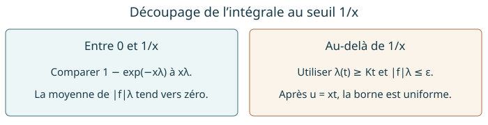

# École polytechnique — Deuxième composition de mathématiques · Option P′ 1985 · Corrigé brut

*Corrigé rédigé par IA, non officiel. Signalez toute erreur.*

**Rédaction** · GPT-6.2 Astra Ultra · vitesse non renseignée

On étudie l’intégrale impropre $\varphi(x)=\int_0^\infty f(t)e^{-x\lambda(t)}\,dt$. La fonction $\lambda$ est positive ou nulle, croissante au sens large et non bornée. La fonction réelle $f$ est intégrable sur tout segment de $[0,\infty[$. L’ensemble $E$ contient les réels $x$ pour lesquels l’intégrale converge.

Le corrigé brut suit la numérotation imprimée (recueil, pages 49 et 50, trois feuillets). [Fac-similé UPS m85xp2ea](https://prepas.org/index.php?module=Sujets&voir=get&file=doc-f36fee16d25ac80dd1e2) · [Notice annuelle de la session 1985](https://www.legifrance.gouv.fr/jorf/id/JORFTEXT000000697778).

## I. Intégrandes positives et domaine de convergence

### Question I.1

Ici $f\ge0$. Si $y\ge x$, on a $0\le f(t)e^{-y\lambda(t)}\le f(t)e^{-x\lambda(t)}$. Ainsi $x\in E$ implique $[x,\infty[\subseteq E$. Si $E$ est non vide et sans borne inférieure, il vaut $\mathbb R$. Sinon, pour $a=\inf E$, tout $y>a$ majore un élément de $E$, et $E$ vaut $]a,\infty[$ ou $[a,\infty[$ selon la convergence en $a$.

### Question I.2.a

Prenons $f(t)=e^{t\lambda(t)}$. Cette fonction monotone est bornée et intégrable sur tout segment. Pour tout réel fixé $x$, si $t\ge\max(0,x)$, alors $f(t)e^{-x\lambda(t)}=e^{(t-x)\lambda(t)}\ge1$. L’intégrale diverge donc pour tout $x$ et $E$ est vide.

### Question I.2.b

Par exemple, prenons $f(t)=e^{-\lambda(t)}$ pour $0\le t\le1$ et $f(t)=0$ ailleurs. Le produit à intégrer est borné sur $[0,1]$ pour tout $x\in\mathbb R$, puisque $\lambda$ y est bornée, et il s’annule au-delà. L’intégrale converge pour tout $x$, d’où $E=\mathbb R$.

### Question I.2.c

La dérivabilité assure la continuité de $\lambda$. Pour tout entier $k\ge k_0>\max(1,\lambda(0))$, notons $t_k$ le premier instant où $\lambda(t_k)=k$. Ces instants existent, augmentent strictement et tendent vers l’infini car $\lambda$ est bornée sur chaque segment. Sur $[t_k,t_{k+1}[$, prenons $f=m_k/(t_{k+1}-t_k)$ et posons $f=0$ avant $t_{k_0}$. Cette fonction est intégrable sur tout segment. Pour $x$ fixé, le poids sur cet intervalle est entre $e^{-|x|}e^{-xk}$ et $e^{|x|}e^{-xk}$. La convergence équivaut donc à celle de $\sum m_k e^{-xk}$. Le choix $m_k=1$ donne $E=]0,\infty[$. Le choix $m_k=k^{-2}$ inclut aussi $0$, mais pour $x<0$ les termes ne tendent pas vers zéro. On obtient $E=[0,\infty[$.

### Question I.3.a

Fixons $x\in E$. Pour $h\ge0$, l’intégrande au point $x+h$ est majoré par $f(t)e^{-x\lambda(t)}$, intégrable sur la demi-droite. Il tend ponctuellement vers cette même fonction lorsque $h\downarrow0$. Par convergence dominée, $\varphi(x+h)\to\varphi(x)$.

### Question I.3.b

Si $x$ est intérieur à $E$, il existe $b<x$ dans $E$. Pour $y$ dans un voisinage de $x$ contenu dans $[b,\infty[$, on a $0\le f e^{-y\lambda}\le f e^{-b\lambda}$. Le majorant est intégrable et la convergence ponctuelle a lieu quand $y\to x$. La convergence dominée donne la continuité de $\varphi$ en $x$.

### Question I.4.a

Avec $x_k=a+1/k$, les fonctions $f e^{-x_k\lambda}$ croissent vers $f e^{-a\lambda}$. Par convergence monotone, $\int_0^\infty f e^{-a\lambda}=\lim_k\varphi(x_k)$. Si $\varphi$ est bornée sur $E$, ce nombre est fini et $a\in E$.

### Question I.4.b

La fonction $\varphi$ est décroissante puisqu’il en est ainsi du poids. Sa limite à droite en $a$ est son supremum sur $E$. Par la même convergence monotone, ce supremum est $\int_0^\infty f e^{-a\lambda}$. Si $a\notin E$, la positivité impose que cette intégrale vaille $+\infty$. Ainsi $\varphi(x)\to+\infty$ lorsque $x\downarrow a$.

### Question I.5

Notons $\alpha_n$ les coefficients croissants du poids et $\ell$ la limite donnée. Pour tout $N$, en laissant $x\downarrow0$ dans la somme des $N$ premiers termes, on obtient $\sum_{n\le N}u_n\le\ell$. Les sommes partielles positives convergent donc vers un nombre $S\le\ell$. Réciproquement, $0\le e^{-x\alpha_n}\le1$ pour $x>0$ entraîne $\sum_n u_ne^{-x\alpha_n}\le S$. À la limite $\ell\le S$, d’où $\sum_nu_n=\ell$.

## II. Intégrandes de signe quelconque et limites à la borne

### Question II.1.a

On suppose ici $\lambda$ de classe $C^1$ et $f$ continue. Pour $y>0$, $\lambda'\ge0$ par croissance. Le poids $k_y(t)=y\lambda'(t)e^{-y\lambda(t)}$ vérifie $\int_0^Rk_y=e^{-y\lambda(0)}-e^{-y\lambda(R)}$. Comme $\lambda(R)\to\infty$, sa masse totale vaut $e^{-y\lambda(0)}$. Pour $G$ continue bornée, $\psi(y)=\int_0^\infty G(t)k_y(t)\,dt$ converge donc absolument, avec $|\psi(y)|\le\|G\|_\infty e^{-y\lambda(0)}$.

### Question II.1.b

Si $x\in E$, la primitive $F(t)=\int_0^t f(s)e^{-x\lambda(s)}ds$ est continue, bornée et tend vers $\varphi(x)$. Pour $y>0$, une intégration par parties sur $[0,R]$ donne

$$
\int_0^R f(t)e^{-(x+y)\lambda(t)}dt=F(R)e^{-y\lambda(R)}+\int_0^R F(t)k_y(t)\,dt .
$$

Le premier terme tend vers zéro, le second converge par II.1.a. Ainsi $x+y\in E$ et $\varphi(x+y)=\int_0^\infty Fk_y$. Les possibilités sont $\varnothing$, $\mathbb R$, $]a,\infty[$ et $[a,\infty[$. Toutes se rencontrent déjà avec $\lambda(t)=t$, en prenant respectivement $e^{t^2}$, une fonction continue à support compact, $e^{at}$ et $e^{at}/(1+t)^2$.

### Question II.2.a

Supposons $G(t)\to\ell$. La masse totale de $k_y$ tend vers $1$ quand $y\downarrow0$. Pour $T$ fixé, $\int_0^T k_y=e^{-y\lambda(0)}-e^{-y\lambda(T)}\to0$. Choisissons $T$ tel que $|G-\ell|\le\varepsilon$ après $T$. L’intégrale de $(G-\ell)k_y$ sur le segment tend vers zéro et sa partie restante est de valeur absolue au plus $\varepsilon e^{-y\lambda(0)}$. On conclut que $\psi(y)\to\ell$.

### Question II.2.b

Pour $x\in E$, la fonction $F$ de II.1.b a pour limite $\varphi(x)$. En appliquant II.2.a à cette fonction, on obtient $\lim_{y\downarrow0}\varphi(x+y)=\varphi(x)$. La continuité à droite vaut donc aussi aux points où la convergence de l’intégrale est seulement conditionnelle.

### Question II.3.a

Avec $\lambda(t)=t$ et $f(t)=\cos t$, l’exponentielle assure la convergence pour $x>0$. Pour $x\le0$, prenons $I_k=[2k\pi,2k\pi+\pi/3]$. Sur $I_k$, le cosinus vaut au moins $1/2$ et le poids vaut au moins $1$. L’intégrale sur $I_k$ vaut donc au moins $\pi/6$ malgré le départ vers l’infini. Le critère de Cauchy échoue. Ainsi $E=]0,\infty[$ et cet ensemble n’est pas fermé dans $\mathbb R$.

### Question II.3.b

On a $\varphi(x)=\operatorname{Re}\int_0^\infty e^{-(x-i)t}dt=\operatorname{Re}(1/(x-i))=x/(1+x^2)$. Ainsi $\lim_{x\downarrow0}\varphi(x)=0$ et $\varphi$ est bornée sur $E$ (son maximum est $1/2$). Pourtant $0\notin E$. En I.4.a, la positivité de $f$ rendait possible la convergence monotone. Ici, les oscillations du cosinus permettent la compensation qui donne une limite finie.

### Question II.3.c

Pour tout point $x\in E$, on a $x>0$ et $|\cos t|e^{-xt}\le e^{-xt}$. Le majorant a une intégrale égale à $1/x$. L’intégrale définissant $\varphi(x)$ est absolument convergente sur tout $E$.

### Question II.4.a

Avec $\lambda(t)=\sqrt t$, $\int_0^\infty e^{-x\sqrt t}dt=2\int_0^\infty ue^{-xu}du=2/x^2$ pour $x>0$. On a alors convergence absolue. Pour $x\le0$, sur les intervalles $I_k$ de II.3.a, le poids est au moins $1$, et les mêmes incréments empêchent la convergence. Ainsi $E=]0,\infty[$. La racine a une dérivée singulière à l’origine, mais l’intégrande de départ y est continue.

### Question II.4.b

L’intégration par parties sur $[\delta,R]$, avec passage aux limites $\delta\downarrow0$ et $R\to\infty$, donne pour $x>0$

$$
\varphi(x)=\frac{x}{2}\int_0^\infty \sin t\,\frac{e^{-x\sqrt t}}{\sqrt t}\,dt .
$$

Les termes de bord $\sin(t)e^{-x\sqrt t}$ tendent vers zéro aux deux extrémités. Sur $[0,1]$ l’intégrande restante est majorée en valeur absolue par $t^{-1/2}$. Sur $[1,\infty[$, $g_x(t)=e^{-x\sqrt t}/\sqrt t$ décroît vers zéro. Une primitive de $\sin t$ s’annulant en $1$ a valeur absolue au plus $2$, donc une nouvelle intégration par parties donne $\left|\int_1^\infty g_x(t)\sin t\,dt\right|\le2g_x(1)\le2$. La borne totale est uniforme en $x$ et le facteur $x/2$ donne la limite zéro.

### Question II.4.c

Comme $t/(1+t)=1-1/(1+t)$, l’expression demandée vaut $\varphi(x)-J(x)$ avec $J(x)=\int_0^\infty\cos t\,e^{-x\sqrt t}/(1+t)\,dt$. Pour tout $x\ge0$, le multiplicateur de $\cos t$ est décroissant vers zéro. En utilisant la primitive $\sin t-\sin T$ sur $[T,\infty[$, la queue de $J(x)$ est bornée en valeur absolue par $2/(1+T)$ uniformément en $x$. Sur $[0,T]$, la convergence dominée donne $J(x)\to J(0)$ pour la partie tronquée. En faisant ensuite tendre $T$ vers l’infini, on obtient $J(x)\to J(0)$. Avec II.4.b, la limite demandée existe et vaut $-\int_0^\infty \cos t/(1+t)\,dt$.

### Question II.5.a

Avec $\lambda(t)=\log(1+t)$, le poids vaut $(1+t)^{-x}$. Pour $x>0$, il décroît vers zéro. Comme $\sin t$ est une primitive bornée de $\cos t$, le critère de Dirichlet donne convergence. Pour $x\le0$, le poids est au moins $1$ sur les intervalles $I_k$ de II.3.a, ce qui contredit le critère de Cauchy. Donc $E=]0,\infty[$.

### Question II.5.b

Si $x>1$, la fonction $(1+t)^{-x}$ est intégrable, ce qui implique la convergence absolue. Si $0<x\le1$, sur $I_k$ on a $|\cos t|\ge1/2$ et $(1+t)^{-x}\ge(1+2k\pi+\pi/3)^{-x}$. Chaque contribution y est au moins un multiple positif de $k^{-x}$ pour $k\ge1$. La série de ces contributions diverge. L’ensemble de convergence absolue est $]1,\infty[$.

### Question II.5.c

Pour $x>0$, les termes de bord de $\sin t(1+t)^{-x}$ s’annulent à zéro et à l’infini. On obtient $\varphi(x)=x\int_0^\infty\sin t\,(1+t)^{-x-1}\,dt$. Le multiplicateur décroît de $1$ à $0$ et la primitive $1-\cos t$ est bornée par $2$. Par intégration par parties, l’intégrale restante est de valeur absolue au plus $2$. Par conséquent $|\varphi(x)|\le2x$ et la limite est zéro.

### Question II.6.a

Posons $D(x)=\int_0^{1/x}(1-e^{-x\lambda(t)})f(t)\,dt$. Pour $x>0$, on a $|D(x)|\le x\int_0^{1/x}|f(t)|\lambda(t)\,dt$. Or $|f|\lambda\to0$ à l’infini. Pour $\varepsilon>0$, choisissons $T$ assez grand pour que $|f|\lambda\le\varepsilon$ au-delà. Lorsque $1/x>T$, le majorant est au plus $x\int_0^T|f|\lambda+\varepsilon$, d’où $\lim_{x\downarrow0}D(x)=0$.

### Question II.6.b

Fixons $\varepsilon>0$. Pour $1/x$ assez grand et $t\ge1/x$, on a $\lambda(t)\ge Kt$ et $|f(t)|\lambda(t)\le\varepsilon$. La substitution $u=xt$ donne

$$
\int_{1/x}^{\infty}|f(t)|e^{-x\lambda(t)}dt\le\frac{\varepsilon}{K}\int_1^\infty \frac{e^{-Ku}}{u}\,du .
$$

Cette queue tend donc vers zéro quand $x\downarrow0$. Par II.6.a, la différence entre $\int_0^{1/x} f(t)\,dt$ et $\varphi(x)$ tend également vers zéro, car elle vaut $D(x)$ moins la queue pondérée. L’hypothèse $\varphi(x)\to\ell$ entraîne alors $\int_0^R f(t)\,dt\to\ell$ pour $R=1/x\to\infty$. Ainsi $0\in E$ et $\varphi(0)=\ell$.

### Question II.6.c

Si $\lambda(t)\ge Kt^\alpha$ pour $t$ assez grand, avec $\alpha>1$, la convergence de $f(t)\lambda(t)$ vers zéro assure en particulier $|f(t)|\lambda(t)\le1$ pour $t$ grand. Ainsi $|f(t)|\le K^{-1}t^{-\alpha}$ sur une demi-droite. Cette majoration et l’intégrabilité locale donnent directement la convergence absolue de $\int_0^\infty f$, donc $0\in E$. La convergence dominée par $|f|$ rend aussi $\varphi(0)=\lim_{x\downarrow0}\varphi(x)=\ell$.
