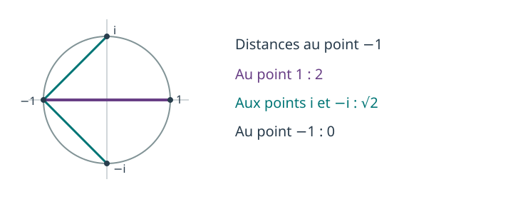

# École polytechnique — Deuxième épreuve de mathématiques · T.A. 1985 · Corrigé brut

*Corrigé rédigé par IA, non officiel. Signalez toute erreur.*

**Rédaction** · GPT-6.2 Astra Ultra · vitesse non renseignée

Le premier problème répartit les termes du binôme et de l’exponentielle selon leur indice modulo $p$. Dans le second, $f$ est la fonction $2\pi$-périodique qui vaut $x^2$ sur $[0,2\pi[$. La convention du sujet donne directement le terme constant $a_0$ de la série de Fourier.

La garde du concours commun Mines-Ponts-Télécom mentionne l’École polytechnique (option T.A.) et désigne la deuxième épreuve comme propre à cette option. [Fac-similé UPS](https://prepas.org/index.php?module=Sujets&voir=get&file=doc-58b33d1ea29bc374e908) · [Notice annuelle](https://www.legifrance.gouv.fr/jorf/id/JORFTEXT000000697778).

## Problème 1 · I. Sommes binomiales de pas deux, trois et quatre

### Question 1.I.1

Pour $n\ge1$, les évaluations de $(1+z)^n$ donnent $S_{2,0}+S_{2,1}=2^n$ et $S_{2,0}-S_{2,1}=0$. D’où $S_{2,0}(n)=S_{2,1}(n)=2^{n-1}$. Si l’on étend la définition au rang zéro, les valeurs deviennent $1$ et $0$.

### Question 1.I.2

Notons $A,B,C$ les sommes d’indice congru à $0,1,2$ modulo trois, et $\theta=n\pi/3$. En $z=1$ puis en $z=j$, le binôme donne $A+B+C=2^n$ et $A+jB+j^2C=(1+j)^n=e^{i\theta}$. Le système réel est donc
$$
 A+B+C=2^n,\qquad A-\tfrac12(B+C)=\cos\theta,\qquad \tfrac{\sqrt3}2(B-C)=\sin\theta.
$$
Il donne $A=(2^n+2\cos\theta)/3$, $B=(2^n-\cos\theta+\sqrt3\sin\theta)/3$ et $C=(2^n-\cos\theta-\sqrt3\sin\theta)/3$. Dans les trois cas la correction trigonométrique est bornée, donc la somme est équivalente à $2^n/3$.

### Question 1.I.3

Écrivons $A,B,C,D$ pour les quatre classes dans cet ordre, et $\eta=n\pi/4$. Pour $n\ge1$, le binôme donne $A+B+C+D=2^n$, $A-B+C-D=0$, $A-C=2^{n/2}\cos\eta$, $B-D=2^{n/2}\sin\eta$. Ainsi
$$
 A=2^{n-2}+2^{n/2-1}\cos\eta,\qquad C=2^{n-2}-2^{n/2-1}\cos\eta,
$$
$$
 B=2^{n-2}+2^{n/2-1}\sin\eta,\qquad D=2^{n-2}-2^{n/2-1}\sin\eta .
$$
Le quotient de l’amplitude oscillante par $2^{n-2}$ tend vers zéro. Les quatre sommes sont équivalentes à $2^n/4$.

## Problème 1 · II. Inversion du système général

### Question 1.II.1

Soit $\alpha=e^{2\pi i/p}$. Si $p\mid\ell$, la somme $\sum_{r=0}^{p-1}\alpha^{\ell r}$ vaut $p$. Sinon $\alpha^\ell\ne1$ et la somme vaut $(1-\alpha^{\ell p})/(1-\alpha^\ell)=0$. Cela vaut pour tout entier relatif $\ell$, y compris zéro.

### Question 1.II.2

La matrice $A_p$ a pour coefficient $\alpha^{(u-1)(v-1)}$ aux indices de $1$ à $p$. L’entrée $(u,v)$ de $A_p\overline{A_p}$ vaut $\sum_{r=0}^{p-1}\alpha^{(u-v)r}$. Elle vaut $p$ si $u=v$ et zéro sinon par la question précédente. Donc $A_p\overline{A_p}=pI_p$, la matrice $A_p$ est inversible et son inverse est $p^{-1}\overline{A_p}$.

### Question 1.II.3

Avec $S_q=\sum_{0\le k\le n,\ k\equiv q\bmod p}\binom nk$, les $p$ équations sont $\sum_{q=0}^{p-1}\alpha^{rq}S_q=(1+\alpha^r)^n$ pour $0\le r<p$. Leur matrice est $A_p$. Par inversion,
$$
 S_q=\frac1p\sum_{r=0}^{p-1}\alpha^{-rq}(1+\alpha^r)^n
 =\frac1p\sum_{r=0}^{p-1}\big(2\cos(\pi r/p)\big)^n\cos\big((n-2q)\pi r/p\big).
$$
On a utilisé $1+\alpha^r=2\cos(\pi r/p)e^{i\pi r/p}$ puis pris la partie réelle de la somme, qui vaut l’entier $S_q$. Pour $p\ge2$, $\rho=\max_{1\le r<p}|\cos(\pi r/p)|<1$. Hormis le terme $2^n/p$, la somme est majorée en valeur absolue par $(p-1)(2\rho)^n/p$. D’où $S_q\sim2^n/p$ à $p,q$ fixés. Pour $p=1$ c’est une égalité exacte. Pour $p=2,3,4$, on retrouve les équivalents de la partie I.

## Problème 1 · III. Sous-séries de l’exponentielle

### Question 1.III.1

La série de chaque classe est absolument convergente pour tout $x\in\mathbb C$, car la somme des modules est majorée par $e^{|x|}$. Pour $q=0,1,2$, l’orthogonalité du filtre donne $f_q(x)=\frac13\sum_{r=0}^2 j^{-rq}\exp(j^rx)$, en développant chaque exponentielle. En combinant ses deux derniers termes par les formules d’Euler, on obtient les trois expressions sans unité imaginaire
$$
 f_q(x)=\frac{e^x+2e^{-x/2}\cos(\sqrt3\,x/2-2\pi q/3)}{3}\quad(q=0,1,2).
$$
La recombinaison est une identité entre exponentielles, donc reste valable pour $x$ complexe.

### Question 1.III.2

La comparaison à $e^{|x|}$ assure à nouveau la convergence absolue sur $\mathbb C$. Les termes pairs de $e^x$ forment $\cosh x$, ceux de $\cos x$ ont les mêmes coefficients avec signe alterné. Les termes impairs se groupent de même avec $\sinh x$ et $\sin x$. On trouve
$$
 \phi_0=(\cosh x+\cos x)/2,\quad \phi_2=(\cosh x-\cos x)/2,
$$
$$
 \phi_1=(\sinh x+\sin x)/2,\quad \phi_3=(\sinh x-\sin x)/2 .
$$

## Problème 2 · Carré périodique et convolution

### Question 2.1

On trouve $a_0=(2\pi)^{-1}\int_0^{2\pi}t^2dt=4\pi^2/3$. Pour $n\ge1$, les coefficients se calculent avec le facteur $1/\pi$. En intégrant par parties, $\int_0^{2\pi}t\sin(nt)dt=-2\pi/n$ et $\int_0^{2\pi}t\cos(nt)dt=0$. Une nouvelle intégration par parties donne $a_n=4/n^2$, $b_n=-4\pi/n$.
Par le théorème de Dirichlet, $g=f$ hors de $2\pi\mathbb Z$, tandis qu’en un multiple de $2\pi$ la somme vaut $(4\pi^2+0)/2=2\pi^2$ et $f=0$. Ainsi $g(0)=4\pi^2/3+4S_1$ donne $S_1=\pi^2/6$. À $x=\pi$, $g(\pi)=\pi^2=4\pi^2/3-4S_2$, d’où $S_2=\pi^2/12$ pour la série alternée commençant par un terme positif.

### Question 2.2

La périodicité de $f$ donne $F(x+2\pi)=F(x)$. Sur $0\le x<2\pi$, coupons au point $t=x$, dont la valeur isolée ne modifie pas l’intégrale. Il vient
$$
 F(x)=\int_0^x h(t)(x-t)^2dt+\int_x^{2\pi}h(t)(x-t+2\pi)^2dt .
$$
Les intégrandes sont des polynômes en $x$ à coefficients intégrables en $t$. Comme $h$ est bornée et continue par morceaux, la variation des bornes préserve la continuité. Lorsque $x\to2\pi^-$ la première intégrale tend vers $\int_0^{2\pi}h(t)(2\pi-t)^2dt=F(0)$ et la seconde tend vers zéro. La périodicité donne ainsi la continuité sur $\mathbb R$.

### Question 2.3

Pour $x$ fixé, $f(x-t)$ et $g(x-t)$ ne diffèrent qu’en un nombre fini de points sur l’intervalle d’intégration. Admettons l’intégration terme à terme comme le sujet. Avec $\alpha_0,\alpha_n,\beta_n$ les coefficients de $h$ dans la même convention, on obtient
$$
 F(x)=2\pi a_0\alpha_0+\pi\sum_{n\ge1}\big[(a_n\alpha_n-b_n\beta_n)\cos(nx)+(a_n\beta_n+b_n\alpha_n)\sin(nx)\big].
$$
En effet, l’intégrale de $h$ vaut $2\pi\alpha_0$ et ses intégrales contre les sinus et cosinus sont $\pi\beta_n$ et $\pi\alpha_n$. Pour $h(t)=f(-t)$, les coefficients deviennent $\alpha_0=a_0,\ \alpha_n=a_n,\ \beta_n=-b_n$ par réflexion. D’une part $F(0)=\int_0^{2\pi}f(-t)^2dt=(2\pi)^5/5$. D’autre part la série en zéro donne
$$
 \frac{32\pi^5}{5}=\frac{32\pi^5}{9}+16\pi S_3+16\pi^3S_1 .
$$
En remplaçant $S_1$ par $\pi^2/6$, on obtient $S_3=\sum_{n\ge1}n^{-4}=\pi^4/90$.
