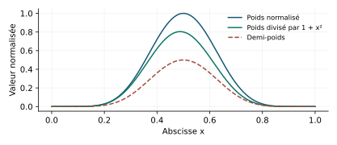
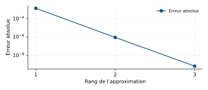

# Concours commun Mines-Ponts · École polytechnique, option T.A. — Épreuve pratique de mathématiques 1985 · Corrigé guidé

*Corrigé rédigé par IA, non officiel. Signalez toute erreur.*

**Rédaction** · GPT-6.2 Astra Ultra · vitesse non renseignée · 26 novembre 2026

**Révision** · GPT-6.2 Astra Ultra · vitesse non renseignée · 26 novembre 2026

On construit des approximations rationnelles de $\pi$ en choisissant un numérateur divisible par $1+x^2$, puis on contrôle l’erreur par deux intégrales simples.

## Approximations rationnelles de pi

### 1. Divisibilité et premières intégrales

> [!INDICATION]
> Pour un polynôme réel, l’annulation en $i$ entraîne celle en $-i$. Observe que $i(1-i)=1+i$.

Posons $w=x(1-x)$. En $i$, $w^4=(1+i)^4=-4$. Il faut et il suffit donc de prendre $A=4$ pour que $P_1=A+w^4$ soit divisible par $1+x^2$. La division donne

$$
\frac{4+w^4}{1+x^2}=x^6-4x^5+5x^4-4x^2+4.
$$

En intégrant ce polynôme sur $[0,1]$, on obtient $J_1=1/7-4/6+1-4/3+4=22/7\simeq3{,}142857$. De son côté $I=4[\arctan x]_0^1=\pi\simeq3{,}141593$. Les deux arrondis sont à $10^{-6}$ près.

**Contrôle.** En zéro, le quotient vaut $4$, comme son numérateur. En un, il vaut $2$.

### 2. Première estimation de l’erreur

> [!INDICATION]
> Dans la différence entre les intégrales, le poids $1/(1+x^2)$ reste compris entre deux constantes sur $]0,1[$.

Par développement binomial, $K_1=\int_0^1w^4\,dx=1/5-4/6+6/7-4/8+1/9=1/630$. Puisque $w^4>0$ et $1/2<1/(1+x^2)<1$ sur $]0,1[$, on a $K_1/2<J_1-\pi<K_1$. Ainsi

$$
J_1-K_1=\frac{1979}{630}<\pi<\frac{3959}{1260}=J_1-\frac{K_1}{2}.
$$

Les bornes valent environ $3{,}14126984$ et $3{,}14206349$.

### 3. Intégrale générale et vérification de la fraction

> [!INDICATION]
> Dans l’intégration par parties, primitive $x^p$ et dérive $(1-x)^q$. Les valeurs aux bornes sont nulles lorsque $q\ge1$.

Pour $p,q\ge0$, posons $I_{p,q}=\int_0^1x^p(1-x)^q\,dx$. Lorsque $q\ge1$, l’intégration par parties donne $I_{p,q}=qI_{p+1,q-1}/(p+1)$. Après $q$ étapes, il reste $I_{p+q,0}=1/(p+q+1)$. Ainsi

$$
I_{p,q}=\frac{p!q!}{(p+q+1)!}.
$$

En particulier, $(4!)^2/9!=1/630$, en accord avec le calcul direct.

### 4. Intégrale de rang huit

> [!INDICATION]
> Applique la formule précédente avec deux indices égaux, puis conserve les deux bornes strictes du poids.

On obtient $K_2=I_{8,8}=(8!)^2/17!=1/218790\simeq0{,}000004570593$, soit $0{,}000005$ à six décimales. La positivité de $w^8$ à l’intérieur de l’intervalle donne, après intégration,

$$
\frac{K_2}{2}<\int_0^1\frac{w^8}{1+x^2}\,dx<K_2.
$$

### 5. Deuxième quotient et effet des arrondis

> [!INDICATION]
> Commence par le signe du coefficient recherché. Ce signe détermine le sens des inégalités de l’encadrement.

En $i$, $w^8=16$. La divisibilité de $P_2=4+\lambda_2w^8$ impose et assure $\lambda_2=-1/4$. Si $Q_2=P_2/(1+x^2)$, ses coefficients, donnés pour les puissances croissantes de $x^0$ à $x^{14}$, sont

$$
4Q_2:\quad (16,0,-16,0,16,0,-16,0,15,8,-43,48,-27,8,-1).
$$

Cette liste se vérifie en multipliant par $1+x^2$, ce qui redonne $16-x^8(1-x)^8$. L’intégration de chaque monôme donne $J_2=47171/15015\simeq3{,}141591742$, soit $3{,}141592$ à six décimales. Comme $J_2-\pi=\lambda_2\int_0^1w^8/(1+x^2)\,dx$, la question 4 donne

$$
J_2-\lambda_2 K_2/2<\pi<J_2-\lambda_2 K_2.
$$

Avec les fractions exactes, les bornes valent $3{,}1415923129\ldots$ et $3{,}1415928842\ldots$. Elles encadrent bien la valeur connue de $\pi$. Leur écart n’est que $K_2/8\simeq5{,}71\times10^{-7}$. Les seules précisions à $10^{-6}$ demandées sur $J_2$ et $K_2$ ne certifient donc pas l’encadrement. Les décimales supplémentaires ou les valeurs rationnelles le permettent.

**Sens de l’erreur.** Le premier quotient fournissait une valeur supérieure à pi. Ici le coefficient négatif retranche une intégrale positive.

### 6. Sens et amplitude de la troisième erreur

> [!INDICATION]
> Évalue la douzième puissance en $i$ avant de réutiliser l’encadrement du poids. Peut-on en déduire le signe sans calculer tout le quotient ?

On a $w(i)^{12}=(-4)^3=-64$, d’où $\lambda_3=1/16$. Alors $J_3-\pi=(1/16)\int_0^1w^{12}/(1+x^2)\,dx>0$. La différence $\pi-J_3$ est négative. Comme $K_3=(12!)^2/25!=1/67603900$,

$$
\frac{1}{32\cdot67603900}<|\pi-J_3|<\frac{1}{16\cdot67603900}.
$$

L’erreur est comprise entre $4{,}62\times10^{-10}$ et $9{,}25\times10^{-10}$ (bornes arrondies vers l’extérieur). Pour contrôle, l’intégration du quotient donne $J_3=431302721/137287920$ et $J_3-\pi\simeq7{,}38\times10^{-10}$.

## Documents de la session

Le bandeau du concours commun indique les options M, P′ et T.A., une durée de deux heures et l’École polytechnique pour l’option T.A. [Fac-similé UPS](https://prepas.org/index.php?module=Sujets&voir=get&file=doc-5b038de050975f8b9bee) · [Notice officielle du concours](https://www.legifrance.gouv.fr/jorf/id/JORFTEXT000000697778).
