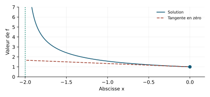
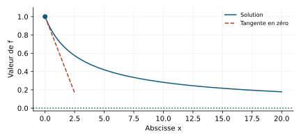

# Concours commun Mines-Ponts · École polytechnique, option T.A. — Mathématiques I 1985 · Corrigé guidé

*Corrigé rédigé par IA, non officiel. Signalez toute erreur.*

**Rédaction** · GPT-6.2 Astra Ultra · vitesse non renseignée · 26 novembre 2026

**Révision** · GPT-6.2 Astra Ultra · vitesse non renseignée · 26 novembre 2026

Les séries à coefficients binomiaux se déduisent d’une même solution de $x(x+2)y'+(x+1)y=1$. On note $U,V,W$ leurs sommes respectives et $\binom{2n}{n}$ le coefficient binomial central.

## I. Trois séries entières

### I.1. Calcul du rayon commun

> [!INDICATION]
> Compare deux coefficients consécutifs avant de prendre la limite. Les puissances de $n$ au dénominateur ont-elles un effet sur cette limite ?

Écrivons $C_n=\binom{2n}{n}$ et, pour $j=0,1,2$, $b_{n,j}=1/(n^j C_n)$, $n\ge1$. Les termes du sujet sont respectivement $b_{n,j}x^n$. Puisque $C_{n+1}/C_n=2(2n+1)/(n+1)$, le quotient $b_{n+1,j}/b_{n,j}$ tend vers $1/4$ dans les trois cas. Le rayon commun est $R=4$.

### I.2. Les six séries aux bornes

> [!INDICATION]
> À $-4$, distingue la convergence absolue de la convergence alternée. Pour invoquer le critère des séries alternées, vérifie aussi la décroissance.

La formule de Stirling donne $C_n\sim4^n/\sqrt{\pi n}$. À $4$, les termes de $U,V,W$ sont respectivement équivalents à $\sqrt{\pi n}$, $\sqrt{\pi/n}$ et $\sqrt\pi/n^{3/2}$. Les deux premières séries divergent, la troisième converge. À $-4$, le terme de $U$ ne tend toujours pas vers zéro. Celui de $V$ alterne et son module décroît vers zéro, car le rapport des modules vaut $2n/(2n+1)<1$. La convergence est conditionnelle. La série de $W$ converge absolument aux deux bornes.

## II. Résolution de l’équation différentielle

### II.1. Les trois intervalles de résolution

> [!INDICATION]
> Le coefficient de $y$ est la moitié de la dérivée du coefficient de $y'$. Quel facteur fait apparaître une dérivée de produit ?

Posons $z=1+x$, $D=z^2-1=x(x+2)$ et $s=\sqrt{|D|}$. L’équation $Dy'+zy=1$ devient $(sy)'=\operatorname{sgn}(D)/s$. Sur chacun des deux intervalles $x<-2$ et $x>0$, la primitive de $1/s$ est $\ln|z+s|$. Sur $-2<x<0$, la dérivée de $\arccos z$ vaut $-1/s$. On obtient toutes les solutions en choisissant séparément une constante réelle $C$ sur chaque intervalle,

$$
y(x)=\frac{C+\ln|z+s|}{s}\quad(D>0),\qquad y(x)=\frac{C+\arccos z}{s}\quad(D<0).
$$

**Vérification du signe.** En $x=-1$, le coefficient de $y$ s’annule et l’équation impose $y'=-1$. La dérivée de la formule du milieu donne bien cette valeur.

### II.2. Limites finies à gauche et à droite de zéro

> [!INDICATION]
> Le dénominateur tend vers zéro. Commence par imposer l’annulation du numérateur, puis utilise un paramétrage trigonométrique ou hyperbolique.

Dans les deux formules le terme non constant du numérateur tend vers zéro quand $x\to0$. Une limite finie impose donc $C=0$. À gauche, écrivons $1+x=\cos\theta$, $0<\theta<\pi$. À droite, écrivons $1+x=\cosh h$, $h>0$, avec $h=\ln(1+x+\sqrt{x(x+2)})$. Les seules candidates sont

$$
u(x)=\frac{\theta}{\sin\theta},\qquad v(x)=\frac{h}{\sinh h}.
$$

Les deux quotients tendent vers $1$, d’où $u(0)=v(0)=1$.

### II.3. Dérivabilité du raccord

> [!INDICATION]
> Un développement de $f$ donne sa dérivée en zéro. Réutilise ensuite l’équation pour établir que les dérivées latérales elles-mêmes convergent.

À gauche, $x=-\theta^2/2+O(\theta^4)$ et $u=1+\theta^2/6+O(\theta^4)$. À droite, $x=h^2/2+O(h^4)$ et $v=1-h^2/6+O(h^4)$. Le raccord vérifie donc $f(x)=1-x/3+O(x^2)$ des deux côtés. Ainsi $f(0)=1$ et $f'(0)=-1/3$. Pour $x\ne0$, $f'(x)=[1-(1+x)f(x)]/[x(x+2)]$ tend aussi vers $-1/3$. La fonction est de classe $C^1$ sur $]-2,+\infty[$ et vérifie l’équation en zéro.

### II.4. Unicité et obstacle en moins deux

> [!INDICATION]
> Cherche d’abord ce que la continuité en zéro impose aux constantes. Suis ensuite la branche ainsi déterminée jusqu’à son extrémité gauche.

Toute solution continue sur $]-2,+\infty[$ se restreint aux deux solutions à limite finie déterminées en II.2. La continuité fixe sa valeur en zéro. Elle coïncide donc avec $f$. Lorsque $x\to-2^+$, $\theta\to\pi$ et $\sin\theta=\sqrt{-x(x+2)}\sim\sqrt{2(x+2)}$. Ainsi $f(x)\sim\pi/\sqrt{2(x+2)}$. Aucune solution continue sur $\mathbb R$ ne peut prolonger ce raccord.

## III. Solution en série entière

### III.1. Coefficients, rayon et bornes

> [!INDICATION]
> Calcule séparément le coefficient constant et celui de $x^n$ pour $n\ge1$. Le facteur $2n+1$ réapparaît dans la formule fermée.

En substituant $\phi(x)=\sum_{n\ge0}a_nx^n$ dans l’équation, on obtient $a_0=1$ puis $(2n+1)a_n+na_{n-1}=0$. L’itération donne

$$
a_n=(-1)^n\frac{2^n(n!)^2}{(2n+1)!}=\frac{(-2)^n}{(2n+1)C_n}.
$$

Le rapport des modules tend vers $1/2$, donc $R_1=2$. La dérivation terme à terme à l’intérieur du disque justifie en retour l’équation. Aux bornes, $|a_n|2^n\sim\sqrt\pi/(2\sqrt n)$. À $-2$, tous les termes sont positifs et la série diverge. À $2$, la série alterne et les modules décroissent, leur rapport étant $(2n+2)/(2n+3)$. Elle converge conditionnellement.

**Premiers coefficients.** La série commence par $1-x/3+2x^2/15$. Elle confirme le raccord et donne directement la courbure en zéro.

### III.2. Identification avec le raccord

> [!INDICATION]
> La série donne en zéro la valeur initiale recherchée, même si le coefficient de $y'$ y est nul. Quelle unicité a déjà été établie ?

Sur $]-2,2[$, $\phi$ est une solution continue en zéro. La détermination des constantes de II.2 impose $\phi=f$ des deux côtés. En définissant aussi $\phi(2)$ par sa série convergente, le théorème d’Abel donné en préliminaire prolonge l’égalité en $2$. On a alors $\phi(2)=\operatorname{arcosh}(3)/\sqrt8$. La série diverge en $-2$ et pour $|x|>2$.

## IV. Calcul des six sommes

### IV.1. Somme des inverses des coefficients centraux

> [!INDICATION]
> Dans $B(x)=\phi(-x/2)$, quelle opération multiplie le coefficient de rang $n$ par $2n+1$ ?

Pour $|x|<4$, $B(x)=\sum_{n\ge0}x^n/[(2n+1)C_n]$. En dérivant dans le disque, $1+U=B+2xB'=\phi(-x/2)-x\phi'(-x/2)$. L’équation de $\phi$ fournit $x(4-x)B'+(2-x)B=2$. Par suite

$$
U(x)=\frac{x}{4-x}(1+B(x)).
$$

Voici la forme explicite utilisée dans toute cette partie. Pour $0<x<4$, posons $\theta=\arccos(1-x/2)$, alors $B(x)=\theta/\sin\theta$. Pour $-4<x<0$, posons $h=\operatorname{arcosh}(1-x/2)$, alors $B(x)=h/\sinh h$. En zéro, $B(0)=1$ et $U(0)=0$. À $x=1$, $\theta=\pi/3$. À $x=-1$, posons $L=\ln((3+\sqrt5)/2)$, de sorte que $\sinh L=\sqrt5/2$. Ainsi

$$
S_1=U(1)=\frac13+\frac{2\pi}{9\sqrt3},\qquad S_2=U(-1)=-\frac15-\frac{2L}{5\sqrt5}.
$$

### IV.2. Première primitive et sommes pondérées

> [!INDICATION]
> Décale l’indice du coefficient de $xB(x)/2$. Le rapport $C_n/C_{n-1}$ simplifie le calcul.

Pour $n\ge1$, le coefficient de $x^n$ dans $xB(x)/2$ vaut $1/[2(2n-1)C_{n-1}]=1/(nC_n)$. Ainsi $V=xB/2$ pour $|x|<4$. Explicitement, $V(x)=x\theta/(2\sin\theta)$ pour $x>0$, $V(x)=xh/(2\sinh h)$ pour $x<0$, et $V(0)=0$. L’extrémité $-4$ est incluse par continuité d’Abel, avec $h=\operatorname{arcosh}3$. Les substitutions $x=1,-1$ donnent

$$
S_3=\frac{\pi}{3\sqrt3},\qquad S_4=-\frac{L}{\sqrt5}.
$$

### IV.3. Deuxième primitive et sommes aux bornes

> [!INDICATION]
> Dérive $W$. Dans l’intégrale obtenue, essaie $1+t=\cos\theta$ sur la branche gauche et $1+t=\cosh h$ sur la branche droite.

La dérivation terme à terme donne $W'=V/x=B/2$ avec valeur $1/2$ en zéro. Puisque $W(0)=0$,

$$
W(x)=-\int_0^{-x/2}\phi(t)\,dt=\begin{cases}\theta^2/2&0<x<4,\\0&x=0,\\-h^2/2&-4<x<0.\end{cases}
$$

En effet, $\phi(t)\,dt=-\theta\,d\theta$ quand $1+t=\cos\theta$ et $\phi(t)\,dt=h\,dh$ quand $1+t=\cosh h$. La convergence aux deux bornes, établie en I.2, permet le passage à la limite par Abel. On trouve

$$
S_5=W(4)=\frac{\pi^2}{2},\qquad S_6=W(-4)=-\frac12\ln^2(3+2\sqrt2).
$$

**Contrôle de signe.** Le premier terme de $W(-4)$ vaut $-2$. La somme négative obtenue est cohérente avec l’alternance et la décroissance des modules.

## V. Variations et tracés

### V.1. Branche entre moins deux et zéro

> [!INDICATION]
> Pour $x<0$, quel est le signe de chaque terme après zéro, une ou deux dérivations de la série de $f$ ?

Pour $-2<x<0$, la série de $f$ a des termes positifs, celle de $f'$ des termes négatifs et celle de $f''$ des termes positifs. En zéro, $f(0)=1$, $f'(0)=-1/3$, $f''(0)=2a_2=4/15$. La branche est strictement décroissante et strictement convexe. Elle part de l’asymptote verticale $x=-2$ et atteint $(0,1)$ avec la tangente $y=1-x/3$.

### V.2. Variations de la branche positive

> [!INDICATION]
> Pour dériver le quotient hyperbolique, note $r=\sqrt{z^2-1}$ et $h=\ln(z+r)$. Le facteur du sujet élimine le dénominateur de $g'$.

Pour $z>1$, $g(z)=f(z-1)=h/r$, $r'=z/r$, $h'=1/r$. Alors $g'=(r-zh)/r^3$ et la fonction auxiliaire du sujet est $t=r^3g'/z=r/z-h$. Puisque $t(1)=0$ et $t'=-r/z^2<0$, $g'<0$ sur $]1,+\infty[$. Avec $g'(1)=-1/3$, cela établit la décroissance stricte de $f$ sur $[0,+\infty[$. Enfin $g(z)\sim\ln(2z)/z$, donc sa limite vaut zéro.

### V.3. Convexité et tracé sur la demi-droite

> [!INDICATION]
> Dans le numérateur de $g''$, dérive une première fois. Le signe s’obtient alors en étudiant $zh-r$ près de $1$.

En dérivant $g'$ on trouve

$$
g''(z)=\frac{(2z^2+1)h-3zr}{r^5}.
$$

Le numérateur vaut zéro en $1$ par continuité. Sa dérivée est $4(zh-r)$. Or $zh-r$ s’annule aussi en $1$ et a pour dérivée $h>0$. On conclut que $g''>0$ pour $z>1$, et $g''(1)=4/15$ d’après la série en zéro. La branche part de $(0,1)$ avec pente $-1/3$, reste positive et convexe, et admet l’axe des abscisses comme asymptote à droite.

## Documents de la session

Le bandeau du concours commun indique les options M, P′ et T.A., une durée de quatre heures et l’École polytechnique pour l’option T.A. [Fac-similé UPS](https://prepas.org/index.php?module=Sujets&voir=get&file=doc-8a883db834074792fefa) · [Notice officielle du concours](https://www.legifrance.gouv.fr/jorf/id/JORFTEXT000000697778).
