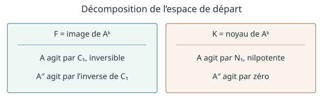

# École polytechnique — Deuxième composition de mathématiques · Option M′ 1986 · Corrigé brut

*Corrigé rédigé par IA, non officiel. Signalez toute erreur.*

**Rédaction** · GPT-6.2 Astra Ultra · vitesse non renseignée

Le sujet porte sur les matrices réelles et sur le système $Lx'+Mx=0$. Il distingue l’inverse $A'$ d’une matrice dans un groupe multiplicatif de matrices et l’opérateur $A''$ qui inverse la partie inversible de $A$ et annule sa partie nilpotente. L’espace de départ est $V=\mathbb R^n$, avec $n\ge1$, et $A^0=I_n$.

## Partie I — Groupes multiplicatifs de matrices

### Question I.1

Soit $G\subset M_n(\mathbb R)$ le groupe considéré. Pour tout $A\in G$, on a $\operatorname{rg}A=\operatorname{rg}(EA)\le\operatorname{rg}E$, et $\operatorname{rg}E=\operatorname{rg}(AA')\le\operatorname{rg}A$. Tous les éléments ont donc le même rang $r$. Si $r=0$, ils seraient tous nuls, contrairement à l’hypothèse $G\ne\{0\}$. Ainsi $1\le r\le n$.

### Question I.2.a

Le neutre vérifie $E^2=E$. Pour $x\in V$, on a $x=Ex+(x-Ex)$ avec $Ex\in\operatorname{Im}E$ et $E(x-Ex)=0$. De plus $E$ agit comme l’identité sur son image, donc un vecteur de son image annulé par $E$ est nul. Ainsi $V=\operatorname{Im}E\oplus\ker E$.

### Question I.2.b

Posons $F=\operatorname{Im}E$ et $K=\ker E$. Dans une base formée successivement d’une base de $F$ et d’une base de $K$, on a $E=\operatorname{diag}(I_r,0_{n-r})$, puisque ses restrictions valent l’identité et zéro. Si $r=n$, l’image est $V$ tout entier et $E=I_n$.

### Question I.2.c

De $EA=A$ on tire $\operatorname{Im}A\subset F$. De $AE=A$ on tire $K\subset\ker A$. Dans la même base que pour $E$, tout $A\in G$ s’écrit donc $\operatorname{diag}(A_1,0)$. La relation $AA'=A'A=E$ montre que $A_1$ est un automorphisme de $F$ et que $(A')_{|F}=A_1^{-1}$. L’ensemble des $A_1$ est un sous-groupe $H$ de $\mathrm{GL}_r(\mathbb R)$, et chaque élément de $H$ détermine exactement un élément de $G$.

Inversement, fixons une décomposition $V=F\oplus K$, $\dim F=r$, et un sous-groupe $H\subset\mathrm{GL}(F)$. Les opérateurs agissant par $h\in H$ sur $F$ et par zéro sur $K$ forment un groupe de rang constant $r$, dont le neutre est la projection sur $F$ parallèlement à $K$. Cette description, à changement de base près, vaut aussi pour $r=n$, où $K=0$.

### Question I.3.a

Si $A\ne0$ appartient à un tel groupe, la forme de I.2.c donne $\operatorname{rg}A=\operatorname{rg}A^2$. Puisque $\operatorname{Im}A^2\subset\operatorname{Im}A$ et $\ker A\subset\ker A^2$, l’égalité des rangs équivaut séparément à l’égalité des images et à celle des noyaux, par le théorème du rang et la dimension finie.

Sur $F=\operatorname{Im}A$, la restriction de $A$ a pour image $\operatorname{Im}A^2$ et pour noyau $F\cap\ker A$. L’égalité des images équivaut donc à la bijectivité de cette restriction, soit à $F\cap\ker A=\{0\}$. Les dimensions donnent alors $V=F\oplus\ker A$. Enfin, sous cette dernière hypothèse, $A$ agit sur $F$ par un automorphisme et sur $\ker A$ par zéro. I.2.c construit un groupe qui le contient. Les cinq propriétés sont équivalentes.

### Question I.3.b

La matrice $J=\left(\begin{smallmatrix}0&1\\0&0\end{smallmatrix}\right)$ a rang un et $J^2=0$. Elle échoue au critère d’égalité des rangs de I.3.a et n’appartient à aucun groupe multiplicatif de matrices.

### Question I.3.c

Sous les conditions de I.3.a, dans $V=\operatorname{Im}A\oplus\ker A$, on a $A=\operatorname{diag}(A_1,0)$ avec $A_1$ inversible. Posons $X=\operatorname{diag}(A_1^{-1},0)$. Le produit par blocs vérifie $AX=XA$, $X^2A=X$ et $A^2X=A$. Inversement, l’existence de $X$ donne $A=A^2X$, donc $\operatorname{Im}A\subset\operatorname{Im}A^2$. L’autre inclusion étant automatique, I.3.a s’applique.

### Question I.3.d

Tout $X$ admissible laisse stables $F=\operatorname{Im}A$ et $K=\ker A$ car il commute avec $A$. Sur $K$, l’identité $X=X^2A$ impose $X=0$. Sur $F$, $A_1$ est inversible et $A_1^2X_{|F}=A_1$ impose $X_{|F}=A_1^{-1}$. Comme $F\oplus K=V$, ces restrictions rendent $X$ unique.

### Question I.3.e

Dans $G$, $AA'=A'A=E$, $EA'=A'$ et $EA=A$. On en déduit $(A')^2A=A'$ et $A^2A'=A$. Par I.3.d, $A'=X$, de matrice $\operatorname{diag}(A_1^{-1},0)$ dans la base adaptée. Ses deux restrictions sont déterminées par $A$ seul, si bien que le choix du groupe contenant $A$ ne change pas $A'$.

### Question I.4.a

Pour $B=\left(\begin{smallmatrix}B_1&B_2\\0&0\end{smallmatrix}\right)$, $B_1$ inversible, l’image est $F=\mathbb R^r\times\{0\}$ et le noyau est $\{(-B_1^{-1}B_2v,v)\}$. Ils sont supplémentaires, donc $B$ appartient à un groupe. La projection de $(u,v)$ sur $F$ parallèlement au noyau est $(u+B_1^{-1}B_2v,0)$. On lui applique ensuite l’inverse de $B_{|F}$, d’où

$$
B'=\begin{pmatrix}B_1^{-1}&B_1^{-2}B_2\\0&0\end{pmatrix}.
$$

### Question I.4.b

Écrivons $A=UV$ avec

$$
U=\begin{pmatrix}1&0\\2&0\\0&1\end{pmatrix},\quad
V=\begin{pmatrix}1&2&1\\1&0&0\end{pmatrix},\quad
T=VU=\begin{pmatrix}5&1\\1&0\end{pmatrix}.
$$

Ici $U$ est injective, $V$ surjective, $\operatorname{Im}A=\operatorname{Im}U$ et $AU=UT$. Comme $T$ est inversible, $A$ est un automorphisme de son image. Un vecteur $Uz$ doit être envoyé par $A'$ sur $UT^{-1}z$, et un vecteur de $\ker V=\ker A$ doit être annulé. La matrice $UT^{-2}V$ a exactement ces actions. Comme $T^{-1}=\left(\begin{smallmatrix}0&1\\1&-5\end{smallmatrix}\right)$, il vient

$$
A'=\begin{pmatrix}-4&2&1\\-8&4&2\\21&-10&-5\end{pmatrix}.
$$

## Partie II — Inversion sur l’image stabilisée

### Question II.1.a

On cherche $X$ tel que $AX=XA$, $X^2A=X$ et $A^{i+1}X=A^i$ pour un entier $i\ge0$. Pour $\ell=0$, l’égalité voulue est $X=X$. Si $X^{\ell+1}A^\ell=X$, alors, grâce à la commutation, $X^{\ell+2}A^{\ell+1}=(X^{\ell+1}A^\ell)XA=X^2A=X$. Ainsi $X^{\ell+1}A^\ell=X$ pour tout $\ell\ge0$.

### Question II.1.b

Prenons $m\ge\max(i,j,1)$ pour les exposants de $X$ et $Y$. On a $A^{m+1}X=A^m=A^{m+1}Y$, donc $\operatorname{Im}A^{m+1}=\operatorname{Im}A^m=:F$. La restriction $A_F$ est surjective sur $F$, donc inversible. Ainsi $A^m$ est injective sur $F$, et $F$ est un supplémentaire de $K=\ker A^m$ par le théorème du rang.

Les candidats commutent avec $A$ et préservent $F$. Pour $w=A^mz$, $AXw=A^{m+1}Xz=w$ et $AYw=w$. Sur $F$, ils sont donc tous deux $A_F^{-1}$. Sur $K$, II.1.a impose $X=X^{m+1}A^m=0$ et de même $Y=0$. Ces descriptions montrent que $X^{m+1}$, $A^{m+1}$ et $Y$ commutent deux à deux. Leur produit agit par $A_F^{-1}$ sur $F$ et par zéro sur $K$. Il est donc égal aussi bien à $X$ qu’à $Y$, ce qui établit l’unicité.

### Question II.1.c

Si $\operatorname{Im}A=V$, $A$ est inversible et $A^{-1}$ satisfait les équations avec $i=0$. Si $\operatorname{Im}A=\operatorname{Im}A^2\ne\{0\}$, I.3 donne l’inverse de groupe $A'$, qui vérifie les équations avec $i=1$. Dans chaque cas II.1.b identifie l’unique solution à la matrice ainsi construite. Lorsque les deux hypothèses coïncident, $A'=A^{-1}$.

### Question II.1.d

Si $A^h=0$, l’égalité $X=X^{h+1}A^h$ donne $X=0$. Réciproquement $X=0$ satisfait la commutation et $X^2A=X$, ainsi que $A^{h+1}X=0=A^h$. La solution existe donc aussi pour $A$ nilpotente.

### Question II.2.a

Les sous-espaces $\operatorname{Im}A^j$ sont décroissants. Leurs dimensions étant comprises entre $0$ et $n$, deux images consécutives coïncident à un rang $k$, puis toutes les images suivantes coïncident en appliquant $A$. Sur $F=\operatorname{Im}A^k$, $A$ est surjective, donc inversible. Un vecteur de $F$ annulé par $A^k$ est par conséquent nul. Avec $\dim F+\dim\ker A^k=n$, on obtient $V=F\oplus\ker A^k$.

### Question II.2.b

Dans la suite de II, $A$ est singulière et non nilpotente. Le rang $s=\dim F$ est donc strictement positif, sinon $A^k=0$, et strictement inférieur à $n$, sinon $A$ serait surjective. Les deux sous-espaces $F$ et $K=\ker A^k$ sont stables par $A$. Dans leur base juxtaposée de matrice de passage $R$, on a $R^{-1}AR=\operatorname{diag}(C_1,N_1)$, avec $C_1\in\mathrm{GL}_s(\mathbb R)$ et $N_1^k=0$.

Écrivons dans cette même base $C=\operatorname{diag}(C_1,0)$ et $N=\operatorname{diag}(0,N_1)$. En base canonique, on conjugue ces blocs par $R$. Ils donnent $CN=NC=0$, $A=C+N$ et $\operatorname{Im}C=\operatorname{Im}C^2=F$.

### Question II.2.c

Par I.3.e, $C'$ vaut $\operatorname{diag}(C_1^{-1},0)$ dans la base adaptée. Cette matrice commute avec $A$ et satisfait $(C')^2A=C'$. Sur $F$, $A^{k+1}C'=A^k$ par inversion, et sur $K$ les deux côtés sont nuls puisque $N_1^k=0$. Cela donne l’existence de $X$ pour $i=k$. Par unicité,

$$
A''=C'=R\begin{pmatrix}C_1^{-1}&0\\0&0\end{pmatrix}R^{-1}.
$$

### Question II.2.d

Sur $F$, les valeurs propres de $C_1^{-1}$ sont exactement les inverses des valeurs propres de $C_1$, avec les mêmes multiplicités algébriques, comme on le voit en inversant une forme triangulaire complexe de $C_1$. Sur $K$, la matrice nilpotente $N_1$ et la matrice nulle ont pour seule valeur propre $0$, de multiplicité algébrique $n-s$. Ainsi le passage de $A$ à $A''$ inverse chaque valeur propre non nulle et conserve la multiplicité algébrique de zéro. L’espace propre de zéro pour $A''$ est $K$ tout entier.

### Question II.3.a

La conjugaison par $R$ commute à l’évaluation d’un polynôme, y compris de son terme constant. Par conséquent $R^{-1}p(A)R=\operatorname{diag}(p(C_1),p(N_1))$. D’après II.2.c, la condition nécessaire et suffisante est $p(C_1)=C_1^{-1}$ et $p(N_1)=0$.

### Question II.3.b

Notons $q_1(\xi)=\det(\xi I_s-C_1)$. On a $q_1(0)\ne0$, donc $q_1$ et $\xi^{k+1}$ sont premiers entre eux. L’algorithme d’Euclide étendu fournit $u,v\in\mathbb R[\xi]$ vérifiant $u q_1+v\xi^{k+1}=1$. Cayley–Hamilton donne $q_1(C_1)=0$, d’où $v(C_1)C_1^{k+1}=I_s$. Le choix

$$
p(\xi)=\xi^k v(\xi)
$$

donne $p(C_1)=C_1^{-1}$, et $p(N_1)=0$ puisque $N_1^k=0$. Ainsi $p(A)=A''$.

### Question II.3.c

Les blocs donnent $q(\xi)=\xi^{n-s}q_1(\xi)$. On calcule $q$, on en extrait la plus grande puissance de $\xi$, puis on détermine $k$ en comparant les rangs des puissances. Un inverse $v$ de $\xi^{k+1}$ modulo $q_1$ fournit alors $A''=A^k v(A)$.

Pour la matrice

$$
A=\begin{pmatrix}0&0&0&0\\1&0&0&0\\0&1&0&-1\\0&0&1&2\end{pmatrix},
$$

la forme triangulaire par blocs d’ordre deux donne $q(\xi)=\xi^2(\xi-1)^2$. L’image de $A$ est engendrée par $e_2,e_3,e_4$, celle de $A^2$ par $e_3,e_4$. Sur ce plan la restriction a pour matrice $\left(\begin{smallmatrix}0&-1\\1&2\end{smallmatrix}\right)$ et est inversible. Donc $k=2$ et $q_1=(\xi-1)^2$. Comme $(4-3\xi)\xi^3$ vaut $1$ en $\xi=1$ et y a une dérivée nulle, on prend $v=4-3\xi$. La multiplication donne

$$
A''=4A^2-3A^3=\begin{pmatrix}0&0&0&0\\0&0&0&0\\4&3&2&1\\-3&-2&-1&0\end{pmatrix}.
$$

## Partie III — Systèmes différentiels à matrice singulière

### Question III.1.a

L’équation est $Lx'+Mx=0$ avec $L$ singulière. Si $M$ est inversible, posons $A=-M^{-1}L$. Alors $x=Ax'$ et $A$ est singulière. Si $A$ est nilpotente, $R=I_n$, $N_1=A$ donnent le cas i. Sinon II.2.b donne une matrice constante de passage $R$ et les blocs $C_1,N_1$. Pour $y=R^{-1}x$, $y'=R^{-1}x'$. Par conséquent $x$ est solution si et seulement si $y=\operatorname{diag}(C_1,N_1)y'$, le cas ii.

### Question III.1.b

De $y=N_1y'$ on tire d’abord $y(t)\in\operatorname{Im}N_1$ pour tout $t$. Si $y$ prend ses valeurs dans $\operatorname{Im}N_1^j$, ses quotients de différences et donc sa dérivée y appartiennent, car ce sous-espace de dimension finie est fermé. L’équation impose alors $y(t)\in\operatorname{Im}N_1^{j+1}$. Par récurrence et nilpotence, $y=0$. La fonction nulle étant bien solution, $x=0$ est l’unique solution dans le cas i.

### Question III.1.c

Dans le cas ii, écrivons $y=(y_F,y_K)$. Alors $y_F'=C_1^{-1}y_F$, tandis que $y_K=N_1y_K'$ impose $y_K=0$ par III.1.b. Pour passer par $a$ à $t=0$, la condition nécessaire est donc $a\in F=\operatorname{Im}A^k$, soit $R^{-1}a=(b,0)$. Elle est suffisante, avec

$$
x(t)=R(e^{tC_1^{-1}}b,0)=e^{tA''}a .
$$

En effet $A''$ agit par $C_1^{-1}$ sur $F$ et par zéro sur $K$. Pour $a\notin F$, aucune solution ne prend cette valeur initiale.

### Question III.1.d

Dans le cas i, seule la donnée $a=0$ est admissible, avec une seule solution. Dans le cas ii, les composantes sur $K$ sont nulles et les composantes sur $F$ satisfont le système différentiel ordinaire à coefficients constants $y_F'=C_1^{-1}y_F$. La dérivée de $e^{-tC_1^{-1}}y_F(t)$ est nulle. Sa valeur initiale fixe donc toute la solution sur $\mathbb R$. Ainsi, chaque fois que le problème de Cauchy a une solution, celle-ci est unique.

### Question III.2

Supposons $\alpha L+M$ inversible, avec $M$ singulière. Posons $x(t)=e^{\alpha t}y(t)$. En substituant et en divisant par $e^{\alpha t}$, on obtient $Ly'+(\alpha L+M)y=0$. La matrice du terme d’ordre zéro y est inversible, et $y(0)=x(0)$, si bien que III.1 s’applique directement. Le passage $y\mapsto e^{\alpha t}y$ est bijectif. En particulier, pour $B=-(\alpha L+M)^{-1}L$ et $a$ dans l’image stabilisée de $B$, la solution vaut $x(t)=e^{\alpha t}e^{tB''}a$.

### Question III.3.a

Pour des réels $\alpha_0,\ldots,\alpha_n$ distincts, la fonction $x(t)=\sum_{i=0}^n e^{\alpha_i t}x_i$ vérifie l’équation et $x(0)=0$ si et seulement si

$$
(\alpha_i L+M)x_i=0\quad(0\le i\le n),\qquad \sum_{i=0}^n x_i=0.
$$

En effet la première condition résulte, après substitution, de l’indépendance linéaire des exponentielles. Celle-ci vaut aussi pour des coefficients vectoriels, en dérivant de zéro à l’ordre $n$ au point $0$ et en utilisant l’inversibilité de la matrice de Vandermonde.

Chaque $\alpha_i L+M$ est singulière. Choisissons $v_i\ne0$ dans son noyau. Ces $n+1$ vecteurs de $\mathbb R^n$ vérifient $\sum c_i v_i=0$ pour des scalaires non tous nuls. Alors $x_i=c_i v_i$ satisfont les conditions et ne sont pas tous nuls. Par l’indépendance précédente, $x$ est une solution non nulle de donnée initiale nulle. La solution n’est donc pas unique.

### Question III.3.b

S’il existait $\alpha$ tel que $\alpha L+M$ soit inversible, la substitution de III.2 ramènerait le système au cas de III.1, avec unicité pour la donnée $0$. Cela contredit III.3.a. Il n’existe donc aucun tel $\alpha$.

Algébriquement, $P(z)=\det(zL+M)$ est un polynôme de degré au plus $n$ par multilinéarité du déterminant. Les $n+1$ nombres distincts $\alpha_i$ en sont des racines. Il est identiquement nul, ce qui donne la même conclusion pour tout réel $z$.
