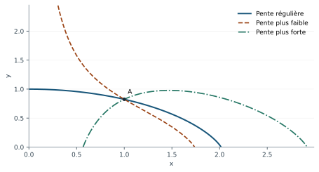
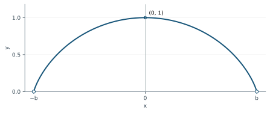

# École polytechnique — Première composition de mathématiques · Option M′ 1986 · Corrigé brut

*Corrigé rédigé par IA, non officiel. Signalez toute erreur.*

**Rédaction** · GPT-6.2 Astra Ultra · vitesse non renseignée · 26 novembre 2026

On étudie les solutions réelles de $xy''+2y'+x/y=0$ dans les régions où $y\ne0$. Dans le premier quadrant, la quantité $x^2y'$ donne le sens des variations. La dernière partie construit une solution régulière à l’origine de valeur donnée en $1$.

## Partie I — Symétries de l’équation

### I.1. Réflexion de la variable

Si $y$ est solution sur $I\subset]0,+\infty[$, posons $z(x)=y(-x)$ sur $-I$. Alors $z'=-y'(-x)$, $z''=y''(-x)$ et $xz''+2z'+x/z$ est l’opposé du membre de gauche de l’équation de $y$ en $-x$. La réflexion est sa propre inverse et donne toutes les solutions du côté négatif.

### I.2. Homothétie et maximalité

Pour $\lambda\ne0$, posons $y_\lambda(x)=\lambda y(x/\lambda)$ sur $\lambda I$. Sa dérivée est $y'(x/\lambda)$ et sa dérivée seconde vaut $y''(x/\lambda)/\lambda$. En posant $t=x/\lambda$, l’équation se réduit à $ty''(t)+2y'(t)+t/y(t)=0$. Les valeurs requises en $\lambda$ suivent en prenant $t=1$. La transformation inverse de rapport $1/\lambda$ ramènerait tout prolongement à un prolongement de $y$. Enfin l’unicité de Cauchy s’applique en $\lambda\ne0$, où $y_\lambda(\lambda)\ne0$.

### I.3. Les trois autres quadrants

Si $y>0$ est définie pour $x>0$, alors $y(-x)$ dans le quadrant $(-,+)$, $-y(-x)$ dans $(-,-)$ et $-y(x)$ dans $(+,-)$ sont solutions. En effet changer le signe de $y$ change celui des trois termes de l’équation. Les transformations sont involutives et préservent la maximalité.

## Partie II — Solutions maximales dans le premier quadrant

### II.1.a. Flux décroissant

Sur $I=]a,b[$, la dérivation donne $(x^2\varphi')'=2x\varphi'+x^2\varphi''=-x^2/\varphi<0$. On notera $F_\varphi(x)=x^2\varphi'(x)$. Cette fonction est strictement décroissante, même lorsque $\varphi'$ change de signe.

### II.1.b. Points stationnaires

En tout point stationnaire, $\varphi''=-1/\varphi<0$. Un tel point est un maximum local strict. Un minimum sur l’intervalle ouvert devrait être stationnaire, ce qui l’exclut.

### II.1.c. Sens de variation

Une fonction strictement décroissante a au plus un zéro. Si $F_\varphi$ garde un signe, $\varphi$ est monotone sur $I$. S’il s’annule en $a'$, $\varphi$ croît jusqu’à $a'$, puis décroît sur $[a',b[$.

### II.2.a. Pentes au point commun

Le champ $(v,-2v/x-1/y)$ est continûment différentiable en $(y,v)$ sur ce domaine. Deux solutions passant par le même couple $(y,v)$ en $x_0$ coïncident partout sur leur intervalle commun, par unicité locale puis prolongement. Deux trajectoires distinctes qui se rencontrent ont donc des pentes distinctes.

### II.2.b. Unicité du croisement

On a $w(x_0)=0$, $w'(x_0)>0$, puis $w>0$ juste à droite de $x_0$. S’il existe un autre zéro à droite, le premier $x_1$ est atteint par continuité et $w>0$ sur $]x_0,x_1[$. Or

$$
x^2w'(x)=x_0^2 w'(x_0)+\int_{x_0}^{x}\frac{t^2w(t)}{\varphi_1(t)\varphi_2(t)}\,dt .
$$

Ainsi $w'>0$ jusqu’en $x_1$, donc $w(x_1)>0$, contradiction. Sur tout l’intervalle commun à droite, $\varphi_2'>\varphi_1'$ et $\varphi_2>\varphi_1$. À gauche, le même raisonnement part de $w<0$ et intègre à rebours. Il donne $x^2w'(x)\ge x_0^2w'(x_0)>0$ et $w(x)<0$ pour $x<x_0$.

### II.3.a. Une borne sur une demi-droite

Sous l’hypothèse $b=+\infty$, pour $x\ge\gamma$ on a $F_\varphi(x)\le F_\varphi(\gamma)=K$. Après division par $x^2$ et intégration, $0<\varphi(x)\le\varphi(\gamma)+K(1/\gamma-1/x)\le M$, où $M=\varphi(\gamma)+\max(K,0)/\gamma$.

### II.3.b. Chute de la pente

L’inégalité $F_\varphi'(x)\le -x^2/M$ donne $F_\varphi(x)\le K-(x^3-\gamma^3)/(3M)$. Le flux tend vers $-\infty$ et ce majorant divisé par $x^2$ tend aussi vers $-\infty$. Par conséquent $\varphi'(x)\to-\infty$.

### II.3.c. Fin de la demi-droite

Il existe $X$ tel que $\varphi'\le-1$ sur $[X,+\infty[$. Pour $x>X+\varphi(X)$, l’inégalité $\varphi(x)\le\varphi(X)-(x-X)$ contredit la positivité. L’hypothèse d’une solution positive sur une demi-droite est impossible.

### II.4.a. Valeur au bord droit

On a $0\le a<b<\infty$. La majoration par intégration de $F_\varphi(x)\le F_\varphi(\gamma)$ est valable aussi lorsque $b$ est fini. Ainsi $\varphi$ est bornée à droite et, étant monotone près de $b$, a une limite $L\ge0$. Si $L>0$, la dérivée $-x^2/\varphi$ du flux est bornée près de $b$. Le flux, puis $\varphi'$, ont une limite finie. Avec $x=b>0$, $y=L>0$ et cette pente, le théorème de prolongement des solutions régulières contredit la maximalité. Donc $\varphi(b^-)=0$.

### II.4.b. Tangente verticale au bord droit

La décroissance du flux assure qu’il a une limite finie ou $-\infty$. Si $\varphi'$ avait une limite finie, on aurait $|\varphi'|\le C$ près de $b$, puis $0<\varphi(x)\le C(b-x)$. Pour $x_*>b/2$ suffisamment proche de $b$ et $x\in[x_*,b[$, il vient

$$
F_\varphi(x)\le F_\varphi(x_*)-\frac{b^2}{4C}\log\frac{b-x_*}{b-x}.
$$

Le membre de droite tend vers $-\infty$. La seule possibilité est donc $F_\varphi(b^-)=-\infty$ et $\varphi'(b^-)=-\infty$.

### II.5.a. Pente de la solution régulière

Le flux de $\psi$ tend vers zéro en $0$ car $\psi'$ y est continue. En intégrant, $x^2\psi'(x)=-\int_0^x t^2/\psi(t)\,dt$. Comme $\psi(0)>0$, il vient $\psi'(x)=-x/(3\psi(0))+o(x)$. Donc $\psi'(0)=0$ et $\psi'(c)<0$.

### II.5.b. Pente plus faible au croisement

Posons $D=c^2(\psi'(c)-\psi_1'(c))>0$. La comparaison à gauche donne $\psi_1>\psi$ et $F_{\psi_1}-F_\psi\le-D$ sur $]a_1,c[$. La fonction $\psi$ a un minimum strictement positif sur $[0,c]$. Ainsi $|F_{\psi_1}'|=x^2/\psi_1$ est borné et $F_{\psi_1}$ admet une limite finie à gauche. Si $a_1>0$, la pente puis la valeur auraient aussi des limites finies, avec une valeur positive, et la solution se prolongerait. Donc $a_1=0$.
Le flux de $\psi$ tend vers zéro. La différence des flux tend vers un nombre $-A\le-D<0$ et $\psi_1'(x)\sim-A/x^2\to-\infty$. De plus $F_{\psi_1}\le -D$ sur $]0,c]$, donc $\psi_1(x)\ge\psi_1(c)+D(1/x-1/c)$. En particulier $\psi_1\to+\infty$ et $x\psi_1(x)\ge D/2$ pour tout $x$ assez petit.

### II.5.c. Ordre du pôle à gauche

Pour $z(x)=x\psi_1(x)$, l’équation donne $z''=2\psi_1'+x\psi_1''=-x/\psi_1<0$. Le graphe d’une fonction concave est sous chacune de ses tangentes. Ainsi $z(x)\le z(c)+z'(c)(x-c)$, expression bornée sur $]0,b_1[$, où $b_1$ est fini. Comme $z'$ décroît, $z$ est monotone au voisinage de zéro et y admet une limite. Elle est finie par le majorant et strictement positive par la question précédente. Plus précisément, $-\psi_1'(x)\sim A/x^2$ donne $x\psi_1(x)\to A$ en intégrant entre $x$ et un point fixé puis en encadrant l’intégrale près de zéro.

### II.5.d. Pente plus forte au croisement

Cette fois $D=c^2(\psi_2'(c)-\psi'(c))>0$. Sur $]a_2,c]$, $F_{\psi_2}-F_\psi\ge D$ et, à gauche de $c$, $0<\psi_2<\psi$. Si $a_2=0$, alors $F_{\psi_2}\ge D/2$ près de zéro. Intégrer $\psi_2'\ge D/(2x^2)$ de $x$ à un point fixé force $\psi_2(x)$ à devenir négative. Donc $a_2>0$.
La solution est bornée par $\psi$ et monotone près de $a_2$ puisque son flux est monotone. Sa limite est zéro, car une limite positive bornerait $F_{\psi_2}'$ et permettrait le prolongement. Le flux a une limite à gauche, finie ou $+\infty$. Si elle était finie, la pente serait bornée et $\psi_2(x)\le C(x-a_2)$. En intégrant vers la gauche on obtiendrait $F_{\psi_2}(x)\ge F_{\psi_2}(r)+(a_2^2/C)\log((r-a_2)/(x-a_2))$ pour $x<r$ assez proches de $a_2$. Ainsi $\psi_2'(a_2^+)=+\infty$.

### II.6. Les trois types de trajectoires

Au point $A=(1,\psi(1))$, la pente régulière donne la branche qui atteint $x=0$ à hauteur finie avec tangente horizontale. Une pente plus faible donne à gauche une branche infinie avec $x\psi_1\to A_1>0$. Une pente plus forte donne une branche issue de l’axe horizontal en $a_2>0$, à tangente verticale. À droite du point commun, l’ordre des trois courbes s’inverse par rapport à la gauche. Toutes se terminent à une abscisse finie, en atteignant zéro avec une pente tendant vers $-\infty$.

## Partie III — Résolution avec valeur prescrite en 1

### III.1.a. Trois identités intégrales

Avec $\eta=\psi(1)>0$, on obtient, jusque $x=0$ par continuité,

$$
x^2\psi'(x)-\psi'(1)=\int_x^1\frac{t^2}{\psi(t)}\,dt,\qquad
x\psi'(x)+\psi(x)-\psi'(1)-\eta=\int_x^1\frac{t}{\psi(t)}\,dt .
$$

La première égalité en zéro donne $\psi'(1)=-\int_0^1 t^2/\psi(t)\,dt$. La seconde utilise $(x\psi'+\psi)'=-x/\psi$.

### III.1.b. Équation intégrale

Pour $x>0$, écrivons $f=1/\psi$ et $x\psi'(x)=-x^{-1}\int_0^x t^2f(t)\,dt$. En remplaçant $\psi'(1)$ et $x\psi'(x)$ dans la deuxième identité, il vient $\psi=\eta+Tf$, où

$$
Tf(x)=(1/x-1)\int_0^x t^2 f(t)\,dt+\int_x^1(t-t^2)f(t)\,dt .
$$

Le premier terme est $O(x^2)$ à l’origine. Le second tend vers $Tf(0)=\int_0^1(t-t^2)f(t)\,dt$. L’égalité vaut sur tout $[0,1]$.

### III.2.a. Régularité à l’origine

Pour $x>0$, les termes aux bornes mobiles se compensent, donnant

$$
(Tf)'(x)=-x^{-2}\int_0^x t^2 f(t)\,dt,\qquad
(Tf)''(x)=2x^{-3}\int_0^x t^2f(t)\,dt-f(x).
$$

Après $t=xs$, on trouve $(Tf)'(x)/x\to-f(0)/3$ et $(Tf)''(x)\to-f(0)/3$. La continuité déjà obtenue de $Tf$ et le théorème des accroissements finis donnent $(Tf)'(0)=0$. Le quotient précédent donne alors $(Tf)''(0)=-f(0)/3$. Les deux dérivées se prolongent continûment en zéro et les formules sont régulières jusque $1$.

### III.2.b. Positivité stricte

Pour $0\le x<1$, le noyau de $T$ est strictement positif pour $0<t<1$ (à $x>0$, ses deux expressions coïncident en $t=x$). Une fonction continue $f\ge0$ non nulle est strictement positive sur un sous-intervalle intérieur, donc $Tf(x)>0$ pour tout $x<1$. Seule $f\equiv0$ fait exception. En $x=1$, les deux termes sont nuls, donc $Tf(1)=0$ pour toute $f$.

### III.2.c. Norme de l’opérateur

Les intégrales sont linéaires, et la régularité établie donne $T:C([0,1])\to C^2([0,1])$. Par positivité, $|Tf|\le\|f\|_\infty T1$. Or $(T1)'=-x/3$, $T1(1)=0$, si bien que $T1(x)=(1-x^2)/6$. D’où $\|Tf\|_\infty\le\|f\|_\infty/6$, avec égalité pour $f=1$.

### III.3.a. Itérations bien définies

La constante $g_0=\eta$ est de classe $C^2$. Si $g_n\in C^2$ et $g_n\ge\eta$, alors $1/g_n$ est continue et positive. Ainsi $g_{n+1}=\eta+T(1/g_n)$ est de classe $C^2$, vaut $\eta$ en $1$ et vérifie $g_{n+1}\ge\eta$. Ces propriétés valent par récurrence.

### III.3.b. Emboîtement des bornes

On a $g_0\le g_1$ et $g_0\le g_2\le g_1$. Puisque $S$ renverse l’ordre point par point, $S^2$ le conserve. En appliquant $(S^2)^p$ à $g_0\le g_2$ et $g_0\le g_1$, les termes pairs sont croissants et $g_{2p}\le g_{2p+1}$. Appliquer $S$ à la croissance des termes pairs donne la décroissance des termes impairs.

### III.3.c. Limites simples

Pour chaque $x$, les termes pairs montent et les impairs descendent dans $[\eta,g_1(x)]$. Ils ont donc respectivement des limites $g(x)$ et $G(x)$, avec $\eta\le g(x)\le G(x)\le\eta+(1-x^2)/(6\eta)$. En particulier $g(1)=G(1)=\eta$.

### III.4.a. Borne des dérivées

Pour $x>0$ et $n\ge0$, $|g_{n+1}'(x)|\le x^{-2}\int_0^x t^2/\eta\,dt=x/(3\eta)$. La dérivée en zéro est nulle, tout comme celle de $g_0$. Le nombre $L=1/(3\eta)$ majore donc toutes les normes des dérivées.

### III.4.b. Partition commune

Prenons $m\ge1$ entier tel que $L/m\le\varepsilon$. Sur chacun des $m$ intervalles de longueur $1/m$, le théorème des accroissements finis donne $|g_n(y)-g_n(x)|\le L/m$. Par continuité, l’image est un intervalle, de longueur au plus $\varepsilon$, pour tout $n$.

### III.4.c. Convergence uniforme

Les limites simples $g,G$ sont $L$-lipschitziennes en passant à la limite dans l’inégalité des accroissements finis. Pour $\delta>0$, choisissons un pas $1/m$ tel que $L/m<\delta/3$. La convergence simple aux $m+1$ nœuds donne un rang commun à partir duquel les deux erreurs y sont inférieures à $\delta/3$. Pour tout autre $x$, prendre un nœud voisin et ajouter deux erreurs de déplacement majorées par $L/m$. Ainsi les erreurs uniformes sont inférieures à $\delta$ pour les deux sous-suites.

### III.4.d. Équations couplées des limites

Comme tous les dénominateurs sont au moins $\eta$, l’écart uniforme des inverses est au plus $\eta^{-2}$ fois celui des fonctions. La norme de $T$ est au plus $1/6$. Par convergence uniforme, la relation de récurrence fournit

$$
g=\eta+T(1/G),\qquad G=\eta+T(1/g).
$$

Les deux inverses étant continues, le membre de droite de chaque égalité est de classe $C^2$. Ainsi $g,G\in C^2([0,1])$.

### III.5.a. Conditions aux bornes

On a $u(0)=0$ par le facteur $x$, et $u(1)=0$ car $G(1)=g(1)=\eta$. La dérivation donne $u'(0)=G(0)-g(0)\ge0$. Sa valeur numérique sera nulle une fois démontrée l’égalité des deux limites.

### III.5.b. Équation de la différence

On a $(xTf)''=-xf$ pour $x>0$, puis en zéro par continuité. Les relations croisées donnent donc $(xG)''=-x/g$ et $(xg)''=-x/G$. En soustrayant,

$$
u''(x)=-\frac{u(x)}{g(x)G(x)} .
$$

### III.5.c. Identification et calcul de la solution

Le quotient continu atteint $R=\max_{[0,1]}G/g\ge1$. De $G\le Rg$ on tire $1/g\le R/G$. La positivité de $T$ et les équations couplées donnent

$$
G\le\eta+RT(1/G)=Rg-(R-1)\eta .
$$

En un point où $G=Rg$, cette inégalité implique $(R-1)\eta\le0$. Ainsi $R=1$, et comme $G\ge g$, on a $G=g$, $u\equiv0$ et $u'(0)=0$. Toute la suite itérée converge uniformément vers $\psi=g=G$. L’équation intégrale donne $\psi\ge\eta$, $\psi(1)=\eta$, $\psi'(0)=0$ et $(x\psi)''=-x/\psi$. C’est la solution cherchée. De plus, toute solution positive régulière de valeur $\eta$ en $1$ vérifie l’équation intégrale, donc est comprise entre $g_0$ et $g_1$, puis entre chaque paire d’itérés par renversement de l’ordre. Elle coïncide avec leur limite.

### III.6. Graphe passant par l’axe vertical

Partons de la solution régulière construite pour $\eta=1$ et appliquons l’homothétie de rapport $1/\psi(0)$. On obtient une solution $Y(0)=1$, $Y'(0)=0$, $Y''(0)=-1/3$. Le prolongement par parité est de classe $C^2$ et satisfait l’équation aussi en zéro. Pour justifier l’unicité près de zéro, deux solutions de même valeur initiale positive et de minorant commun $m>0$ vérifient

$$
y(x)=y(0)-\int_0^x s^{-2}\int_0^s t^2/y(t)\,dt\,ds .
$$

Sur $[0,h]$, leur différence en norme uniforme est au plus $h^2/(6m^2)$ fois cette même norme. Pour $h$ assez petit elle est nulle. La réflexion donne le résultat à gauche et l’unicité régulière prend le relais hors de zéro.
La branche positive normalisée décroît sur $]0,b[$. Elle se termine en $b<\infty$, à hauteur zéro et tangente verticale. Par parité le domaine maximal est $]-b,b[$, avec une tangente horizontale au sommet. Pour toute ordonnée initiale $s\ne0$, la solution est $y_s(x)=sY(x/|s|)$ sur $]-|s|b,|s|b[$. Une valeur nulle à l’origine est exclue du domaine de définition de $1/y$.

## Documents de la session

Le fac-similé m86xm1eb donne les pages 64 et 65 du recueil et quatre feuillets du sujet. La note UPS en bas de la dernière vue signale une difficulté en III.5.c. Le maximum de G/g permet de conclure cette question, avant le dessin demandé en III.6. [Fac-similé UPS](https://prepas.org/index.php?module=Sujets&voir=get&file=doc-6f8234ba13f28e1ec0fe) · [Notice officielle du concours](https://www.legifrance.gouv.fr/jorf/id/JORFTEXT000000330227)
