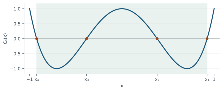
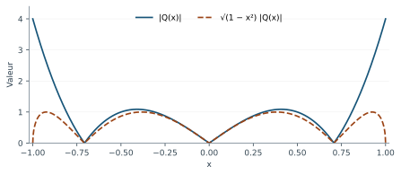

# École polytechnique — Deuxième composition de mathématiques · Option P′ 1986 · Corrigé guidé

*Corrigé rédigé par IA, non officiel. Signalez toute erreur.*

**Rédaction** · GPT-6.2 Astra Ultra · vitesse non renseignée · 26 novembre 2026

On note $\|f\|=\sup_{x\in\mathbb R}|f(x)|$. La norme $N$ des polynômes algébriques est prise sur $[-1,1]$. On passe des polynômes trigonométriques de fréquence au plus $n$ aux polynômes algébriques de degré au plus $n$, puis aux dérivées d’une fonction bornée.

## Partie I — Dérivées des polynômes trigonométriques

### I.1. Nombre de zéros sur une période

> [!INDICATION]
> Transformer les sinus et cosinus en puissances de $z=e^{ix}$, puis faire disparaître les puissances négatives.

Pour $f\in\mathcal T_n$, écrivons $f(x)=\sum_{j=-n}^n c_j e^{ijx}$, d’après les formules d’Euler. Alors $e^{inx}f(x)=P(e^{ix})$, où $P(z)=\sum_{j=-n}^n c_jz^{n+j}$ est de degré au plus $2n$. Sur un intervalle semi-ouvert de longueur $2\pi$, les $2n+1$ abscisses distinctes donnent autant de valeurs distinctes de $e^{ix}$. Si $f$ s’y annule, $P$ a plus de racines que son degré et est identiquement nul. Ainsi $f=0$ partout.

### I.2. Cas d’une seule fréquence

> [!INDICATION]
> Rechercher les amplitudes des deux sinusoïdes.

Pour $s(x)=a\sin(nx+b)$, $s'(x)=na\cos(nx+b)$. Le sinus et le cosinus atteignent les deux valeurs $\pm1$ puisque $n\ge1$. Donc $\|s'\|=n|a|=n\|s\|$, y compris pour $a=0$.

### I.3.a. Alternance imposée par les crêtes

> [!INDICATION]
> Évaluer $h$ aux extrema successifs de la sinusoïde de comparaison.

Posons $B=\|g'\|/n>\|g\|$ et $h(x)=B\sin(n(x-u))-g(x)$. Aux points $t_j=u+\pi/(2n)+j\pi/n$ pour $j=0,\ldots,2n$, on a $(-1)^j h(t_j)=B-(-1)^jg(t_j)>0$. Il y a au moins un zéro dans chacun des $2n$ intervalles ouverts successifs. Or $h\in\mathcal T_n$ et $h(t_0)>0$. D’après I.1, il y a exactement un zéro dans chacun et aucun autre sur une période. Les signes aux extrémités étant opposés, chacun de ces zéros est un changement de signe.

### I.3.b. Nombre de zéros de la dérivée

> [!INDICATION]
> Les deux extrémités de l’intervalle fermé comptent séparément dans cette question.

On a $h'(x)=nB\cos(n(x-u))-g'(x)$ et $h'(u)=0$ par l’hypothèse $g'(u)=\|g'\|$. Aussi $h'(u+2\pi)=0$. Par périodicité, $h$ a $2n$ zéros distincts dans $[u,u+2\pi[$. Entre deux zéros consécutifs, Rolle donne un zéro de $h'$ strictement intérieur. Ces $2n-1$ points et les deux extrémités donnent au moins $2n+1$ zéros sur l’intervalle fermé.

### I.3.c. Détermination de la fonction

> [!INDICATION]
> Le point $u$ est un maximum de $g'$. Combiner cette observation avec Rolle entre les zéros de $h'$.

De $g''(u)=0$ et du facteur $\sin(n(x-u))$ dans la dérivée seconde de la sinusoïde, on déduit $h''(u)=0$. Rolle appliqué aux $2n+1$ zéros de $h'$ donne $2n$ zéros intérieurs de $h''$. Avec $u$, il y en a donc au moins $2n+1$ sur $[u,u+2\pi[$. Par I.1, $h''\equiv0$. La fonction $h$ est affine et périodique, donc constante, et elle a un zéro. D’où $g(x)=B\sin(n(x-u))$.

**Comptage.** Les $2n$ points de Rolle sont strictement intérieurs, donc distincts de $u$, qui complète le compte sur l’intervalle semi-ouvert.

### I.3.d. Contradiction et première inégalité

> [!INDICATION]
> Faire intervenir la norme de la dérivée de la sinusoïde obtenue.

D’après I.2, cette expression impose $\|g'\|=n\|g\|$, en contradiction avec l’inégalité stricte. Pour un $f\in\mathcal T_n$ quelconque, la norme de $f'$ est atteinte par périodicité et continuité. En prenant $g=f$ ou $g=-f$, on peut supposer que la valeur atteinte est positive ou nulle. Une violation de $\|f'\|\le n\|f\|$ conduirait alors aux hypothèses incompatibles précédentes.

### I.4. Tous les ordres et égalité

> [!INDICATION]
> La dérivation conserve la fréquence maximale. Suivre aussi l’exemple à une fréquence.

Comme $f^{(j)}\in\mathcal T_n$ à tout rang, on peut appliquer successivement $\|f^{(j+1)}\|\le n\|f^{(j)}\|$. Il en résulte $\|f^{(k)}\|\le n^k\|f\|$ pour tout $k\ge0$. Pour $f(x)=\sin(nx)$, la dérivée d’ordre $k$ est $n^k\sin(nx+k\pi/2)$ et donne l’égalité à tout ordre.

## Partie II — Polynômes sur un segment

### II.1.a. Polynôme de Tchebychev

> [!INDICATION]
> Utiliser l’addition des cosinus pour faire apparaître une récurrence.

Posons $C_0=1$, $C_1=X$, $C_{j+1}=2X C_j-C_{j-1}$. Par la formule d’addition, $C_j(\cos t)=\cos(jt)$ à tout rang. La récurrence donne le degré $j$ pour $j\ge1$, et donc la fonction du sujet est le polynôme $C=C_n$ sur $[-1,1]$. Sa norme $N(C)$ vaut $1$, car $|C(\cos t)|\le1$ et $C(1)=1$.

### II.1.b. Valeur de la norme de la dérivée

> [!INDICATION]
> Différencier $C(\cos t)$ dans l’intérieur puis prendre la limite en $t=0$.

La formule d’addition du sinus donne $|\sin((j+1)t)|\le |\sin jt|+|\sin t|$. Par récurrence, $|\sin nt|\le n|\sin t|$. Pour $0<t<\pi$, $C'(\cos t)=n\sin(nt)/\sin t$, d’où $|C'|\le n^2$ à l’intérieur et, par continuité, aux extrémités. La limite en zéro donne $C'(1)=n^2$ et ainsi $N(C')=n^2$. Pour $n=0$, la dérivée est nulle.

### II.2.a. Intervalle entre les racines extrêmes

> [!INDICATION]
> Écrire d’abord les angles de toutes les racines et appliquer l’inégalité de II.1.b à l’un de ces angles.

Pour $n\ge1$, les $n$ racines rangées en décroissant sont $x_i=\cos\theta_i$, $\theta_i=(2i-1)\pi/(2n)$ pour $1\le i\le n$. Si $x\in[x_n,x_1]$, alors $\arccos x\in[\pi/(2n),\pi-\pi/(2n)]$. Donc $\sqrt{1-x^2}\ge\sin(\pi/(2n))\ge1/n$. La dernière inégalité résulte de $1=\sin(\pi/2)\le n\sin(\pi/(2n))$.

### II.2.b. Pente aux racines

> [!INDICATION]
> Quelle est la valeur absolue du sinus de $n\theta_i$ ?

Comme $\sin(n\theta_i)=(-1)^{i-1}$, on a $C'(x_i)=(-1)^{i-1}n/\sin\theta_i$. En particulier $|C'(x_i)|=n/\sqrt{1-x_i^2}$ et les racines sont simples.

### II.3.a. Interpolation aux racines de $C$

> [!INDICATION]
> Construire pour chaque racine un polynôme qui vaut $1$ en cette racine et $0$ aux autres.

Les polynômes $L_i(X)=C(X)/((X-x_i)C'(x_i))$ ont degré $n-1$ et satisfont $L_i(x_j)=1$ pour $j=i$, $0$ sinon. Pour $\deg Q\le n-1$, la différence $Q-\sum_iQ(x_i)L_i$ a au moins $n$ racines pour un degré au plus $n-1$. Elle est nulle, ce qui donne, pour $C(x)\ne0$, la formule imprimée

$$
Q(x)=\sum_{i=1}^n Q(x_i)\frac{C(x)}{(x-x_i)C'(x_i)} .
$$

### II.3.b. Passage de la norme pondérée à la norme uniforme

> [!INDICATION]
> Séparer la zone entre les deux racines extrêmes de ses deux compléments. En dehors des racines, examiner les signes des dénominateurs.

Sur $[x_n,x_1]$, II.2.a donne $|Q(x)|\le n M(Q)$, où $M(Q)=\max_{[-1,1]}\sqrt{1-x^2}|Q(x)|$. Ailleurs dans $[-1,1]$, les nombres $x-x_i$ sont tous du même signe. D’après II.2.b, $|Q(x_i)/C'(x_i)|\le M(Q)/n$. La formule de II.3.a donne alors

$$
|Q(x)|\le \frac{M(Q)}n |C(x)|\sum_{i=1}^n\frac1{|x-x_i|}
=\frac{M(Q)}n |C'(x)|\le n M(Q).
$$

L’égalité centrale suit de $C'/C=\sum_i1/(x-x_i)$ et du signe commun. Ainsi $N(Q)\le nM(Q)$ sur tout le segment.

**Cas d’égalité.** Pour $Q=C_n'/n$, on a $N(Q)=n$ et $M(Q)=1$, car $\sin t\,Q(\cos t)=\sin(nt)$.

### II.4.a. Borne de Bernstein sur le segment

> [!INDICATION]
> Quelle fonction trigonométrique obtient-on en composant un polynôme avec le cosinus ?

Pour $P$ de degré au plus $n$, $f(t)=P(\cos t)$ appartient à $\mathcal T_n$ par développement des puissances de $(e^{it}+e^{-it})/2$. Sa norme est $N(P)$. D’après I.4, $|P'(\cos t)\sin t|\le nN(P)$. En posant $t=\arccos x$ pour $-1<x<1$, il vient $|P'(x)|\le nN(P)/\sqrt{1-x^2}$.

### II.4.b. Inégalité pour les dérivées successives

> [!INDICATION]
> Appliquer d’abord la borne pondérée à $P'$, puis mettre à jour le degré à chaque dérivation.

On vient d’obtenir $M(P')\le nN(P)$. Comme $\deg P'\le n-1$, II.3.b donne $N(P')\le n^2N(P)$. Au rang $j$, le degré est au plus $n-j$, d’où $N(P^{(j+1)})\le(n-j)^2N(P^{(j)})$. Le produit des $k$ inégalités donne

$$
N(P^{(k)})\le\left(\frac{n!}{(n-k)!}\right)^2N(P),\qquad 0\le k\le n .
$$

Pour $k=0$ le produit est vide.

### II.4.c. Comparaison avec la norme des coefficients

> [!INDICATION]
> Une évaluation sur le segment majore le polynôme à partir de ses coefficients. Pour l’autre sens, exprimer un coefficient par une dérivée en zéro.

Écrivons $P=\sum_{j=0}^n a_jX^j$. Sur le segment, $|P|\le\sum |a_j|\le(n+1)N'(P)$. À l’inverse, $a_j=P^{(j)}(0)/j!$, donc II.4.b donne

$$
\frac1{n+1}\le\frac{N'(P)}{N(P)}\le\max_{0\le j\le n}\frac{(n!)^2}{j!((n-j)!)^2}\qquad(P\ne0).
$$

Les constantes sont indépendantes de $P$ et la borne inférieure est positive. Cela prouve l’équivalence, aussi pour $n=0$.

## Partie III — Fonctions dérivables sur la droite

### III.1.a. Polynôme de Taylor

> [!INDICATION]
> Le reste de Taylor est contrôlé sur tout segment de longueur au plus $1$, dans les deux directions.

Fixons $x\in\mathbb R$ et $P_x(y)=\sum_{j=0}^{n-1}f^{(j)}(x)y^j/j!$. Pour $|y|\le1$, l’inégalité de Taylor-Lagrange donne $|f(x+y)-P_x(y)|\le |y|^n\|f^{(n)}\|/n!$. On en déduit $N(P_x)\le\|f\|+\|f^{(n)}\|/n!$, uniformément en $x$.

### III.1.b. Bornes sur toutes les dérivées intermédiaires

> [!INDICATION]
> Appliquer l’estimation de la dérivée polynomiale au point $y=0$.

Pour $0<k<n$, $f^{(k)}(x)=P_x^{(k)}(0)$. Le polynôme $P_x$ est aussi de degré au plus $n$. II.4.b puis III.1.a donnent donc

$$
\|f^{(k)}\|\le \left(\frac{n!}{(n-k)!}\right)^2
\left(\|f\|+\frac{\|f^{(n)}\|}{n!}\right).
$$

Ainsi toutes les dérivées intermédiaires sont bornées sur la droite.

### III.2. Changement d’échelle

> [!INDICATION]
> Calculer les deux termes après division par $\lambda^k$, puis choisir $\lambda$ pour les rendre égaux.

Posons $A=\|f\|$, $B=\|f^{(n)}\|/n!$ et $D=(n!/(n-k)!)^2$. Appliquée à $f(\lambda x)$, $\lambda>0$, la borne précédente devient $\|f^{(k)}\|\le D(A\lambda^{-k}+B\lambda^{n-k})$. Si $A,B>0$, choisir $\lambda=(A/B)^{1/n}$ rend les termes égaux et donne

$$
\|f^{(k)}\|\le 2\frac{(n!)^{2-k/n}}{((n-k)!)^2}
\|f\|^{1-k/n}\|f^{(n)}\|^{k/n}.
$$

Si $A=0$, $f$ est nulle. Si $B=0$, prendre $\lambda\to+\infty$ dans la première inégalité pour obtenir $\|f^{(k)}\|=0$. La formule reste valable.

### III.3. Comparaison logarithmique

> [!INDICATION]
> Simplifier le quotient des deux majorants avant d’employer Stirling. Le degré majorant $n$ tend vers l’infini pour un ordre de dérivation $k$ fixé.

Pour $f\in\mathcal T_{n_0}$, $n\ge n_0$, I.4 donne $\|f^{(n)}\|\le n^n\|f\|$. Le majorant obtenu par III.2 est donc le majorant direct $n^k\|f\|$ multiplié par

$$
R_{n,k}=2\frac{(n!)^{2-k/n}}{((n-k)!)^2}.
$$

Comparons les constantes, ce qui inclut aussi la fonction nulle. Pour $k\ge1$ fixé et $n\to\infty$,

$$
\log R_{n,k}=\log 2+2\sum_{j=0}^{k-1}\log(n-j)-\frac{k}{n}\log(n!).
$$

La somme vaut $k\log n+O(1/n)$ et le rappel de Stirling donne $(\log(n!))/n=\log n-1+O((\log n)/n)$. Alors $\log R_{n,k}=k\log n+k+\log2+o(1)\sim k\log n$. Le passage par III.2 dégrade la borne directe d’un facteur équivalent à $2e^k n^k$.

**Vérification pour $k=1$.** Le facteur supplémentaire est exactement $2n^2/(n!)^{1/n}$, équivalent à $2en$.

## Documents de la session

Le fac-similé m86xp2ea reproduit les trois feuillets sur deux vues, pages 69 et 70 du recueil. La comparaison de III.3 applique la borne de I.4 avec n tendant vers l’infini et un ordre de dérivation k fixé. [Fac-similé UPS](https://prepas.org/index.php?module=Sujets&voir=get&file=doc-df264bd99fb65d03d220) · [Notice officielle du concours](https://www.legifrance.gouv.fr/jorf/id/JORFTEXT000000330227)
