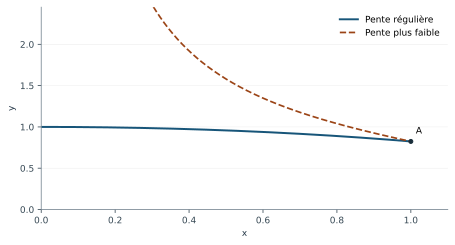
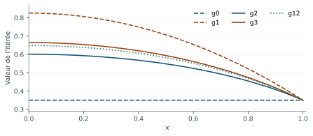

# École polytechnique — Première composition de mathématiques · Option P′ 1986 · Corrigé brut

*Corrigé rédigé par IA, non officiel. Signalez toute erreur.*

**Rédaction** · GPT-6.2 Astra Ultra · vitesse non renseignée · 26 novembre 2026

On travaille avec les solutions positives de $xy''+2y'+x/y=0$ pour $x>0$. La première partie situe leurs trajectoires. La seconde construit, pour chaque $\eta>0$, la branche régulière en zéro qui vaut $\eta$ en $1$.

## Partie I — Solutions positives et comparaison des pentes

### I.1.a. Flux décroissant

Sur $I=]a,b[$, la dérivation donne $(x^2\varphi')'=2x\varphi'+x^2\varphi''=-x^2/\varphi<0$. On notera $F_\varphi(x)=x^2\varphi'(x)$. Cette fonction est strictement décroissante, même lorsque $\varphi'$ change de signe.

### I.1.b. Points stationnaires

En tout point stationnaire, $\varphi''=-1/\varphi<0$. Un tel point est un maximum local strict. Un minimum sur l’intervalle ouvert devrait être stationnaire, ce qui l’exclut.

### I.1.c. Sens de variation

Une fonction strictement décroissante a au plus un zéro. Si $F_\varphi$ garde un signe, $\varphi$ est monotone sur $I$. S’il s’annule en $a'$, $\varphi$ croît jusqu’à $a'$, puis décroît sur $[a',b[$.

### I.2.a. Pentes au point commun

Le champ $(v,-2v/x-1/y)$ est continûment différentiable en $(y,v)$ sur ce domaine. Deux solutions passant par le même couple $(y,v)$ en $x_0$ coïncident partout sur leur intervalle commun, par unicité locale puis prolongement. Deux trajectoires distinctes qui se rencontrent ont donc des pentes distinctes.

### I.2.b. Unicité du croisement

On a $w(x_0)=0$, $w'(x_0)>0$, puis $w>0$ juste à droite de $x_0$. S’il existe un autre zéro à droite, le premier $x_1$ est atteint par continuité et $w>0$ sur $]x_0,x_1[$. Or

$$
x^2w'(x)=x_0^2 w'(x_0)+\int_{x_0}^{x}\frac{t^2w(t)}{\varphi_1(t)\varphi_2(t)}\,dt .
$$

Ainsi $w'>0$ jusqu’en $x_1$, donc $w(x_1)>0$, contradiction. Sur tout l’intervalle commun à droite, $\varphi_2'>\varphi_1'$ et $\varphi_2>\varphi_1$. À gauche, le même raisonnement part de $w<0$ et intègre à rebours. Il donne $x^2w'(x)\ge x_0^2w'(x_0)>0$ et $w(x)<0$ pour $x<x_0$.

### I.3.a. Pente de la solution régulière

Le flux de $\psi$ tend vers zéro en $0$ car $\psi'$ y est continue. En intégrant, $x^2\psi'(x)=-\int_0^x t^2/\psi(t)\,dt$. Comme $\psi(0)>0$, il vient $\psi'(x)=-x/(3\psi(0))+o(x)$. Donc $\psi'(0)=0$ et $\psi'(c)<0$.

### I.3.b. Pente plus faible au croisement

Posons $D=c^2(\psi'(c)-\psi_1'(c))>0$. La comparaison à gauche donne $\psi_1>\psi$ et $F_{\psi_1}-F_\psi\le-D$ sur $]a_1,c[$. La fonction $\psi$ a un minimum strictement positif sur $[0,c]$. Ainsi $|F_{\psi_1}'|=x^2/\psi_1$ est borné et $F_{\psi_1}$ admet une limite finie à gauche. Si $a_1>0$, la pente puis la valeur auraient aussi des limites finies, avec une valeur positive, et la solution se prolongerait. Donc $a_1=0$.
Le flux de $\psi$ tend vers zéro. La différence des flux tend vers un nombre $-A\le-D<0$ et $\psi_1'(x)\sim-A/x^2\to-\infty$. De plus $F_{\psi_1}\le -D$ sur $]0,c]$, donc $\psi_1(x)\ge\psi_1(c)+D(1/x-1/c)$. En particulier $\psi_1\to+\infty$.

### I.3.c. Pente plus forte au croisement

Cette fois $D=c^2(\psi_2'(c)-\psi'(c))>0$. Sur $]a_2,c]$, $F_{\psi_2}-F_\psi\ge D$ et, à gauche de $c$, $0<\psi_2<\psi$. Si $a_2=0$, alors $F_{\psi_2}\ge D/2$ près de zéro. Intégrer $\psi_2'\ge D/(2x^2)$ de $x$ à un point fixé force $\psi_2(x)$ à devenir négative. Donc $a_2>0$.
La solution est bornée par $\psi$ et monotone près de $a_2$ puisque son flux est monotone. Sa limite est zéro, car une limite positive bornerait $F_{\psi_2}'$ et permettrait le prolongement. Le flux a une limite à gauche, finie ou $+\infty$. Si elle était finie, la pente serait bornée et $\psi_2(x)\le C(x-a_2)$. En intégrant vers la gauche on obtiendrait $F_{\psi_2}(x)\ge F_{\psi_2}(r)+(a_2^2/C)\log((r-a_2)/(x-a_2))$ pour $x<r$ assez proches de $a_2$. Ainsi $\psi_2'(a_2^+)=+\infty$.

### I.4. Branches définies sur tout ]0, 1]

Au point $A=(1,\psi(1))$, une pente égale à $\psi'(1)$ donne exactement la solution régulière par unicité. Elle arrive en zéro à hauteur finie avec tangente horizontale. Toute pente inférieure donne une branche au-dessus de cette courbe sur $]0,1[$ et divergente en $0$. Ces deux types constituent tout le dessin demandé. Pour une pente supérieure, le bord gauche est $a_2>0$, ce qui exclut cette branche de la famille définie sur tout $]0,1]$.

### I.5. Homothétie et maximalité

Pour $\lambda>0$, posons $y_\lambda(x)=\lambda y(x/\lambda)$ sur $\lambda I$. Sa dérivée est $y'(x/\lambda)$ et sa dérivée seconde vaut $y''(x/\lambda)/\lambda$. En posant $t=x/\lambda$, l’équation se réduit à $ty''(t)+2y'(t)+t/y(t)=0$. Les valeurs requises en $\lambda$ suivent en prenant $t=1$. La transformation inverse de rapport $1/\lambda$ ramènerait tout prolongement à un prolongement de $y$. Enfin l’unicité de Cauchy s’applique en $\lambda>0$, où $y_\lambda(\lambda)\ne0$.

## Partie II — Construction de la solution régulière

### II.1.a. Trois identités intégrales

Avec $\eta=\psi(1)>0$, on obtient, jusque $x=0$ par continuité,

$$
x^2\psi'(x)-\psi'(1)=\int_x^1\frac{t^2}{\psi(t)}\,dt,\qquad
x\psi'(x)+\psi(x)-\psi'(1)-\eta=\int_x^1\frac{t}{\psi(t)}\,dt .
$$

La première égalité en zéro donne $\psi'(1)=-\int_0^1 t^2/\psi(t)\,dt$. La seconde utilise $(x\psi'+\psi)'=-x/\psi$.

### II.1.b. Équation intégrale

Pour $x>0$, écrivons $f=1/\psi$ et $x\psi'(x)=-x^{-1}\int_0^x t^2f(t)\,dt$. En remplaçant $\psi'(1)$ et $x\psi'(x)$ dans la deuxième identité, il vient $\psi=\eta+Tf$, où

$$
Tf(x)=(1/x-1)\int_0^x t^2 f(t)\,dt+\int_x^1(t-t^2)f(t)\,dt .
$$

Le premier terme est $O(x^2)$ à l’origine. Le second tend vers $Tf(0)=\int_0^1(t-t^2)f(t)\,dt$. L’égalité vaut sur tout $[0,1]$.

### II.2.a. Régularité à l’origine

Pour $x>0$, les termes aux bornes mobiles se compensent, donnant

$$
(Tf)'(x)=-x^{-2}\int_0^x t^2 f(t)\,dt,\qquad
(Tf)''(x)=2x^{-3}\int_0^x t^2f(t)\,dt-f(x).
$$

Après $t=xs$, on trouve $(Tf)'(x)/x\to-f(0)/3$ et $(Tf)''(x)\to-f(0)/3$. La continuité déjà obtenue de $Tf$ et le théorème des accroissements finis donnent $(Tf)'(0)=0$. Le quotient précédent donne alors $(Tf)''(0)=-f(0)/3$. Les deux dérivées se prolongent continûment en zéro et les formules sont régulières jusque $1$.

### II.2.b. Positivité stricte

Pour $0\le x<1$, le noyau de $T$ est strictement positif pour $0<t<1$ (à $x>0$, ses deux expressions coïncident en $t=x$). Une fonction continue $f\ge0$ non nulle est strictement positive sur un sous-intervalle intérieur, donc $Tf(x)>0$ pour tout $x<1$. Seule $f\equiv0$ fait exception. En $x=1$, les deux termes sont nuls, donc $Tf(1)=0$ pour toute $f$.

### II.2.c. Norme de l’opérateur

Les intégrales sont linéaires, et la régularité établie donne $T:C([0,1])\to C^2([0,1])$. Par positivité, $|Tf|\le\|f\|_\infty T1$. Or $(T1)'=-x/3$, $T1(1)=0$, si bien que $T1(x)=(1-x^2)/6$. D’où $\|Tf\|_\infty\le\|f\|_\infty/6$, avec égalité pour $f=1$.

### II.3.a. Itérations bien définies

La constante $g_0=\eta$ est de classe $C^2$. Si $g_n\in C^2$ et $g_n\ge\eta$, alors $1/g_n$ est continue et positive. Ainsi $g_{n+1}=\eta+T(1/g_n)$ est de classe $C^2$, vaut $\eta$ en $1$ et vérifie $g_{n+1}\ge\eta$. Ces propriétés valent par récurrence.

### II.3.b. Emboîtement des bornes

On a $g_0\le g_1$ et $g_0\le g_2\le g_1$. Puisque $S$ renverse l’ordre point par point, $S^2$ le conserve. En appliquant $(S^2)^p$ à $g_0\le g_2$ et $g_0\le g_1$, les termes pairs sont croissants et $g_{2p}\le g_{2p+1}$. Appliquer $S$ à la croissance des termes pairs donne la décroissance des termes impairs.

### II.3.c. Limites simples

Pour chaque $x$, les termes pairs montent et les impairs descendent dans $[\eta,g_1(x)]$. Ils ont donc respectivement des limites $g(x)$ et $G(x)$, avec $\eta\le g(x)\le G(x)\le\eta+(1-x^2)/(6\eta)$. En particulier $g(1)=G(1)=\eta$.

### II.3.d. Équations couplées des limites

Le sujet accorde ici la convergence uniforme des deux sous-suites. Leurs limites sont donc continues. Comme tous les dénominateurs sont au moins $\eta$, l’écart uniforme des inverses est au plus $\eta^{-2}$ fois celui des fonctions. La norme de $T$ est au plus $1/6$. Par convergence uniforme, la relation de récurrence fournit

$$
g=\eta+T(1/G),\qquad G=\eta+T(1/g).
$$

Les deux inverses étant continues, le membre de droite de chaque égalité est de classe $C^2$. Ainsi $g,G\in C^2([0,1])$.

### II.4.a. Conditions aux bornes

On a $u(0)=0$ par le facteur $x$, et $u(1)=0$ car $G(1)=g(1)=\eta$. La dérivation donne $u'(0)=G(0)-g(0)\ge0$. Sa valeur numérique sera nulle une fois démontrée l’égalité des deux limites.

### II.4.b. Équation de la différence

On a $(xTf)''=-xf$ pour $x>0$, puis en zéro par continuité. Les relations croisées donnent donc $(xG)''=-x/g$ et $(xg)''=-x/G$. En soustrayant,

$$
u''(x)=-\frac{u(x)}{g(x)G(x)} .
$$

### II.4.c. Identification et calcul de la solution

Le quotient continu atteint $R=\max_{[0,1]}G/g\ge1$. De $G\le Rg$ on tire $1/g\le R/G$. La positivité de $T$ et les équations couplées donnent

$$
G\le\eta+RT(1/G)=Rg-(R-1)\eta .
$$

En un point où $G=Rg$, cette inégalité implique $(R-1)\eta\le0$. Ainsi $R=1$, et comme $G\ge g$, on a $G=g$, $u\equiv0$ et $u'(0)=0$. Toute la suite itérée converge uniformément vers $\psi=g=G$. L’équation intégrale donne $\psi\ge\eta$, $\psi(1)=\eta$, $\psi'(0)=0$ et $(x\psi)''=-x/\psi$. C’est la solution cherchée. De plus, toute solution positive régulière de valeur $\eta$ en $1$ vérifie l’équation intégrale, donc est comprise entre $g_0$ et $g_1$, puis entre chaque paire d’itérés par renversement de l’ordre. Elle coïncide avec leur limite.

## Documents de la session

Le fac-similé m86xp1ea porte le cartouche marginal « Option P′ Math 1 ». La première vue contient les feuillets 1 et 2, la seconde le feuillet 3. Un premier relevé indiquait II.5.c. Le feuillet 3 se termine en II.4.c, juste avant la note UPS sur cette question. Le maximum de G/g fournit la conclusion. La convergence uniforme est admise dans cette option. [Fac-similé UPS](https://prepas.org/index.php?module=Sujets&voir=get&file=doc-e6a9f32840d67cdd58ac) · [Notice officielle du concours](https://www.legifrance.gouv.fr/jorf/id/JORFTEXT000000330227)
