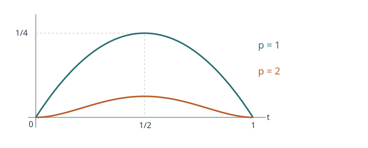

# École polytechnique — Deuxième épreuve de mathématiques · T.A. 1986 · Corrigé brut

*Corrigé rédigé par IA, non officiel. Signalez toute erreur.*

**Rédaction** · GPT-6.2 Astra Ultra · vitesse non renseignée

On travaille sur $[0,1]$ avec $f\in C^{n+1}$, $n\ge1$, et $x,x+h\in[0,1]$, $h>0$. On note $M_k(f)=\max_{[0,1]}|f^{(k)}|$. Le second volet étudie les polynômes par la différence $\Delta P(t)=P(t+1)-P(t)$.

La garde du concours commun Mines-Ponts-Télécom mentionne l’École polytechnique (option T.A.) et désigne la deuxième épreuve comme propre à cette option. [Fac-similé UPS](https://prepas.org/index.php?module=Sujets&voir=get&file=doc-36a623bbf4a4e3d7c85c) · [Notice annuelle](https://www.legifrance.gouv.fr/jorf/id/JORFTEXT000000330227).

## I. Identités aux deux extrémités d’un intervalle

### Question I.1.a

Pour le polynôme $P$ de degré $n$ et $u=0,1$, l’expression aux bornes est
$$
 F(0)=\sum_{k=0}^n(-h)^kP^{(n-k)}(0)f^{(k)}(x),\qquad F(1)=\sum_{k=0}^n(-h)^kP^{(n-k)}(1)f^{(k)}(x+h).
$$
La somme définissant $F(t)$ est de classe $C^1$, chaque dérivée $f^{(k)}$ pour $k\le n$ étant au moins de classe $C^1$. Lors de la dérivation, le terme $(-h)^kP^{(n-k+1)}(t)f^{(k)}(x+ht)$ annule le terme issu de la dérivation de $f^{(k-1)}$ au rang précédent pour $1\le k\le n$. Au rang zéro, $P^{(n+1)}=0$. Il reste donc $F'(t)=(-1)^n h^{n+1}P(t)f^{(n+1)}(x+ht)$.

### Question I.1.b

Posons $c=P^{(n)}(0)$, constant non nul, $f_0^{(k)}=f^{(k)}(x)$, $f_1^{(k)}=f^{(k)}(x+h)$ et $R_n(h)=\int_0^1P(t)f^{(n+1)}(x+ht)\,dt$. D’une part, $F(1)-F(0)=(-1)^nh^{n+1}R_n(h)$ par le théorème fondamental. D’autre part la différence des termes d’indice zéro vaut $c(f_1-f_0)$. En reportant les autres termes à droite, on obtient la relation (2) de l’énoncé
$$
 f_1-f_0=\sum_{k=1}^n\frac{(-1)^{k-1}h^k}{c}\big[P^{(n-k)}(1)f_1^{(k)}-P^{(n-k)}(0)f_0^{(k)}\big]+\frac{(-1)^nh^{n+1}}{c}R_n(h).
$$

### Question I.1.c

Pour $P(t)=(t-1)^n$, on a $c=n!$, $P^{(n-k)}(0)=(-1)^kn!/k!$ et $P^{(n-k)}(1)=0$ pour $1\le k\le n$. La relation précédente devient la formule de Taylor avec reste intégral
$$
 f(x+h)=\sum_{k=0}^n\frac{h^k}{k!}f^{(k)}(x)+\frac{h^{n+1}}{n!}\int_0^1(1-t)^n f^{(n+1)}(x+ht)\,dt .
$$
Comme $\int_0^1(1-t)^n\,dt=1/(n+1)$, on obtient $|R_n(h)|\le M_{n+1}(f)/(n+1)$. La contribution du reste à la formule de Taylor est donc majorée par $h^{n+1}M_{n+1}(f)/(n+1)!$.

### Question I.1.d

Pour tout $a\in\mathbb R$, $t\mapsto Q(a+t)$ est de degré au plus $n$, de dérivée d’ordre $k$ en zéro égale à $Q^{(k)}(a)$. Le coefficient de $t^k$ est donc $Q^{(k)}(a)/k!$, ce qui donne pour tout $t$ réel $Q(a+t)=\sum_{k=0}^n Q^{(k)}(a)t^k/k!$. C’est aussi Taylor avec un reste nul puisque $Q^{(n+1)}=0$.

### Question I.2.a

Pour $n=2p$, $P(t)=t^p(1-t)^p=\sum_{j=0}^p(-1)^j\binom pj t^{p+j}$. Par I.1.d, $P^{(k)}(0)=0$ pour $0\le k<p$, et pour $p\le k\le2p$,
$$
 P^{(k)}(0)=k!(-1)^{k-p}\binom p{k-p}.
$$
Puisque $P(1-t)=P(t)$, on trouve $P^{(k)}(1)=(-1)^kP^{(k)}(0)$, donc zéro pour $k<p$ et $k!(-1)^p\binom p{k-p}$ pour $k\ge p$.

### Question I.2.b

Notons $u=t(1-t)$, $I_p=\int_0^1u^pdt$. Pour $p\ge1$, la primitive mentionnée s’annule aux deux bords. Sa dérivée est $2u^p-p(2t-1)^2u^{p-1}$. Avec $(2t-1)^2=1-4u$, on obtient $(4p+2)I_p=pI_{p-1}$. Comme $I_0=1$, l’itération donne
$$
 I_p=\prod_{j=1}^p\frac{j}{2(2j+1)}=\frac{(p!)^2}{(2p+1)!}.
$$

### Question I.2.c

Sur $[0,1]$, $P\ge0$, donc $|R_{2p}(h)|\le I_p M_{2p+1}(f)$. Le terme ajouté à la formule est $h^{2p+1}R_{2p}(h)/[(-1)^p(2p)!]$. En conservant la notation $f_0,f_1$ de I.1.b, on obtient explicitement
$$
 n=2:\quad f_1-f_0=\tfrac h2(f_1'+f_0')-\tfrac{h^3}2R_2(h),
$$
$$
 n=4:\quad f_1-f_0=\tfrac h2(f_1'+f_0')-\tfrac{h^2}{12}(f_1''-f_0'')+\tfrac{h^5}{24}R_4(h).
$$
Les erreurs absolues sont au plus $h^3M_3(f)/12$ et $h^5M_5(f)/720$. La première formule approche l’intégrale de $f'$ par le trapèze, la seconde la corrige au moyen des dérivées secondes aux deux bornes. La symétrie rend nuls les coefficients des dérivées aux bornes d’ordre supérieur à $p$ tout en donnant une identité exacte pour tout polynôme $f$ de degré au plus $2p$.

## II. Différences de polynômes et génératrice

### Question II.1

Les égalités $P^{(k)}(1)=P^{(k)}(0)$ pour $0\le k\le n$ identifient les deux développements polynomiaux en $t$ de I.1.d. Donc $\Delta P=0$ et $P$ a période un. Un tel polynôme est borné, puisqu’il est borné sur $[0,1]$. Tout polynôme réel de degré strictement positif étant non borné, $P$ est constant. En particulier, les hypothèses sont incompatibles avec un degré exactement $n\ge1$.

### Question II.2

Le terme de degré $n$ s’annule toujours puisque $P^{(n)}$ est constant. Les conditions de la question annulent tous les coefficients de degrés $0$ à $n-2$. Il reste donc
$$
 \Delta P(t)=Ct^{n-1},\qquad C=\frac{P^{(n-1)}(1)-P^{(n-1)}(0)}{(n-1)!}.
$$
Pour $n=1$ la liste de conditions est vide et l’expression donne bien la différence constante.

### Question II.3

L’espace $E=\mathbb R_n[X]$ a dimension $n+1$. Dans la base $1,X,\dots,X^n$, et avec des indices de $0$ à $n$, la matrice de $u=\Delta$ a pour entrée $\binom ji$ si $0\le i<j\le n$, et zéro sinon, par le binôme. Pour $1\le j\le n$, les colonnes représentent des polynômes de degrés distincts $j-1$ et coefficients dominants $j$. Elles forment une base de $\mathbb R_{n-1}[X]$. C’est l’image et le rang est $n$. Le noyau, de dimension un, est constitué des constantes.
Pour tout $C$, il existe un antécédent $Q$ de $CX^{n-1}$, puis $P=Q-Q(0)$ est un antécédent nul en zéro. Deux tels antécédents diffèrent d’une constante nulle en zéro, donc coïncident. Le cas $C=0$ donne $P=0$.

### Question II.4

Avec $n\ge2$ et $P(0)=0$, $P(q)=C\sum_{r=0}^{q-1}r^{n-1}$ pour tout entier $q\ge0$ (somme vide pour $q=0$). Si $n=2$, cela donne $P(q)=Cq(q-1)/2$. Pour $n=3$, la somme des carrés donne $P(q)=Cq(q-1)(2q-1)/6$. Ces produits peuvent aussi se vérifier en prenant leur différence entre $q+1$ et $q$. Comme deux polynômes qui coïncident sur tous les entiers naturels sont identiques, on obtient pour tout $t$ les produits $Ct(t-1)/2$ et $Ct(t-1)(2t-1)/6$, respectivement.

### Question II.5.a

Pour $t\ne0$, $(e^t-1)/t=\sum_{j=0}^\infty t^j/(j+1)!$. En zéro la somme vaut $1$, valeur prescrite pour $h(0)$. Le rapport des modules des termes consécutifs est $|t|/(j+2)$, donc le rayon de convergence vaut $+\infty$.

### Question II.5.b

Pour tout réel $t$, $h(t)>0$ car $e^t-1$ et $t$ sont de même signe hors de zéro. Le quotient $g_x(t)=e^{xt}/h(t)$ est donc $C^\infty$ sur $\mathbb R$ et a un développement limité à tout ordre en zéro. Notons $a_k(x)$ le coefficient de $t^k$. On a $a_0(x)=1$ et $g_{x+1}(t)-g_x(t)=te^{xt}$, y compris en zéro. L’unicité des coefficients donne $a_k(x+1)-a_k(x)=x^{k-1}/(k-1)!$ pour $k\ge1$.
Pour établir la polynomialité, utilisons $g_x(t)=e^{xt}g_0(t)$. Le produit des développements limités donne $a_k(x)=\sum_{j=0}^k a_{k-j}(0)x^j/j!$. Comme $a_0(0)=1$, ce polynôme est de degré exactement $k$ et de coefficient dominant $1/k!$. Enfin, le coefficient de $t^k$ de $(e^t-1)g_x(t)=te^{xt}$ donne, pour tout $k\ge1$,
$$
 \sum_{q=0}^{k-1}\frac{a_q(x)}{(k-q)!}=\frac{x^{k-1}}{(k-1)!}.
$$
