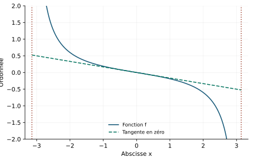
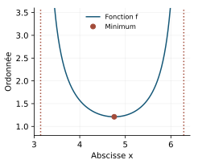

# Concours commun Mines-Ponts · École polytechnique, option T.A. — Épreuve pratique de mathématiques 1986 · Corrigé brut

*Corrigé rédigé par IA, non officiel. Signalez toute erreur.*

**Rédaction** · GPT-6.2 Astra Ultra · vitesse non renseignée · 26 novembre 2026

**Révision** · GPT-6.2 Astra Ultra · vitesse non renseignée · 26 novembre 2026

La fonction étudiée est $f(x)=1/x-1/\sin x$, prolongée en zéro. Les angles sont exprimés en radians. Les figures vectorielles originales respectent une échelle de deux centimètres par unité.

## Développement en zéro et calcul intégral

### 1.a. Polynôme de degré quatre

La fonction $f(x)=1/x-1/\sin x$, prolongée par $f(0)=0$, est impaire. Or $\sin x/x=1-x^2/6+x^4/120+O(x^6)$, donc $x/\sin x=1+x^2/6+7x^4/360+O(x^6)$. Ainsi

$$
f(x)=-x/6-7x^3/360+O(x^5).
$$

Les coefficients du polynôme $P$ sont $A=C=0$, $B=-1/6$, $D=-7/360$. Le coefficient de degré quatre est également nul.

### 1.b. Valeurs par défaut des deux intégrales

Une primitive de $f$ sur $]0,\pi/2]$ est $\ln[x/\tan(x/2)]$, dont la limite en zéro est $\ln2$. On a donc $I=\ln(\pi/4)<0$. De même $J=-\pi^2/48-7\pi^4/23040$. On trouve $|I|=0{,}2415644752\ldots$ et $|J|=0{,}2352115342\ldots$. Les valeurs à $10^{-4}$ par défaut sont respectivement **0,2415** et **0,2352**.

## Variations et courbure de l’arc central

### 2. Dérivée, factorisation et premier tracé

Aux points réguliers non nuls, $f'=-1/x^2+\cos x/\sin^2x$. Lorsque $\cos x>0$, son signe est celui de $\phi\psi$, où $\phi=x-\sin x/\sqrt{\cos x}$ et $\psi=x+\sin x/\sqrt{\cos x}$, car $x^2\cos x-\sin^2x=\cos x\,\phi\psi$. Pour $0<x<\pi/2$, posons $r=\sqrt{\cos x}\in]0,1[$. Alors

$$
\phi'=\frac{2r^3-r^4-1}{2r^3}=-\frac{(r-1)(r^3-r^2-r-1)}{2r^3}<0.
$$

En effet $r^3-r^2\le0$. On a $\phi(0)=0$ et $\psi>0$, donc $f'<0$. Lorsque $\pi/2\le x<\pi$, $\cos x\le0$ donne encore $f'<0$. La parité de $f'$ et $f'(0)=-1/6$ complètent la preuve. Sur $]-\pi,\pi[$ la fonction décroît strictement de $+\infty$ à $-\infty$, avec centre de symétrie à l’origine et tangente $y=-x/6$.

### 3.a. Seconde dérivée et fonction auxiliaire

Pour $0<x<\pi$,

$$
f''(x)=\frac{2}{x^3}-\frac{1+\cos^2x}{\sin^3x}.
$$

Son signe est celui de $2\sin^3x-(1+\cos^2x)x^3$, donc celui de $s(x)=\sin x\,[2/(1+\cos^2x)]^{1/3}-x$, par stricte croissance de la racine cubique. Le prolongement analytique à l’origine donne $f''(0)=0$.

### 3.b. Signe sur la seconde moitié

Pour $\pi/2\le x<\pi$, le premier terme est au plus $2^{1/3}<\pi/2\le x$. Ainsi $s(x)<0$ et $f''(x)<0$.

### 3.c. Polynôme de degré neuf et signe sur la première moitié

Pour $m=\cos x\in[0,1]$, la dérivée vaut

$$
s'(x)=\frac{2^{1/3}m(5+m^2)}{3(1+m^2)^{4/3}}-1.
$$

Son signe est celui de $Q(m)=2m^3(5+m^2)^3-27(1+m^2)^4$. Sous forme développée,

$$
Q(m)=2m^9-27m^8+30m^7-108m^6+150m^5-162m^4+250m^3-108m^2-27.
$$

Les coefficients entiers ont pour PGCD $1$. On calcule $Q(1)=Q'(1)=0$, $Q''(1)=-1008$. La racine $1$ est exactement double. La division donne $Q=(m-1)^2R$, où

$$
R=2m^7-23m^6-18m^5-121m^4-74m^3-189m^2-54m-27.
$$

Sur $[0,1]$, $m^6(2m-23)\le0$, les autres termes étant négatifs ou nuls avec constante $-27$. Donc $R<0$, $s'<0$ pour $0<x\le\pi/2$ et $s'(0)=0$. La fonction $s$ décroît depuis $s(0)=0$, d’où $f''<0$ sur $]0,\pi/2[$. Avec 3.b et l’imparité, le graphe est strictement convexe sur $]-\pi,0[$ et strictement concave sur $]0,\pi[$.

## Étude de l’arc suivant

### 4.a. Existence et unicité du minimum

Sur $]\pi,2\pi[$, $\sin x<0$. L’expression de 3.a donne $f''>0$, donc $f'$ croît strictement. Le terme $\cos x/\sin^2x$ tend vers $-\infty$ en $\pi^+$ et vers $+\infty$ en $(2\pi)^-$. Par continuité, $f'$ possède un seul zéro $x_0$. La fonction décroît puis croît et atteint donc en $x_0$ son unique minimum. Puisque $f'(3\pi/2)<0$, $x_0>3\pi/2$.

### 4.b. Valeurs de l’abscisse et du minimum

Une dichotomie sur $[3\pi/2,5]$ donne $H(4{,}7565172)\simeq-9{,}981\times10^{-7}$ et $H(4{,}7565173)\simeq1{,}313\times10^{-6}$. Ainsi $4{,}7565172<x_0<4{,}7565173$. En évaluant $1/x-1/\sin x$ dans ce court intervalle, on trouve $1{,}2112122<f(x_0)<1{,}2112124$. À six décimales, $x_0\simeq4{,}756517$ et $f(x_0)\simeq1{,}211212$.

### 4.c. Convexité sur tout l’intervalle

Les deux contributions $2/x^3$ et $-(1+\cos^2x)/\sin^3 x$ sont strictement positives. L’arc est donc strictement convexe sur $]\pi,2\pi[$, jusque de part et d’autre du minimum.

### 5. Tracé entre les deux asymptotes

À chaque extrémité de $]\pi,2\pi[$, $-1/\sin x$ tend vers $+\infty$. Les droites $x=\pi$ et $x=2\pi$ sont asymptotes verticales. Entre elles, la branche possède une tangente horizontale au point $(4{,}756517\ldots,1{,}211212\ldots)$, vers lequel elle descend avant de remonter. Les deux figures ont des axes orthonormés. Leurs SVG, imprimés à leur taille native, donnent les deux centimètres par unité demandés.

## Documents de la session

Le bandeau du concours commun indique les options M, P′ et T.A., une durée de deux heures et l’École polytechnique pour l’option T.A. Les deux pages du sujet sont reproduites côte à côte sur le même feuillet numérisé. [Fac-similé UPS](https://prepas.org/index.php?module=Sujets&voir=get&file=doc-a909b354df14e5dbb4a6) · [Notice officielle du concours](https://www.legifrance.gouv.fr/jorf/id/JORFTEXT000000330227).
