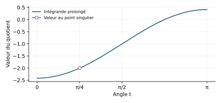
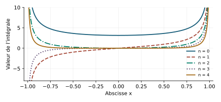

# Concours commun Mines-Ponts · École polytechnique, option T.A. — Mathématiques I 1986 · Corrigé brut

*Corrigé rédigé par IA, non officiel. Signalez toute erreur.*

**Rédaction** · GPT-6.2 Astra Ultra · vitesse non renseignée · 26 novembre 2026

**Révision** · GPT-6.2 Astra Ultra · vitesse non renseignée · 26 novembre 2026

Pour un entier $n\ge0$, l’inconnue $x$ intervient dans le dénominateur de $I_n(x)=\int_0^\pi \cos(nt)/(1-x\cos t)\,dt$. Les cinq groupes de questions sont ceux du fac-similé.

## 1. Domaine et symétrie

### 1.a. Convergence de l’intégrale

On étudie $I_n(x)=\int_0^\pi \cos(nt)/(1-x\cos t)\,dt$, $n\ge0$. Pour $|x|<1$ le dénominateur est strictement positif. Pour $x=1$, il est équivalent à $t^2/2$ près de zéro, où le numérateur tend vers $1$. Pour $x=-1$, le même phénomène se produit en $\pi$, avec numérateur $(-1)^n$. Ces deux valeurs sont exclues.

Si $|x|>1$, le seul zéro du dénominateur se situe en $\alpha=\arccos(1/x)\in]0,\pi[$. Il est simple, car $x\sin\alpha\ne0$. Si $\cos(n\alpha)\ne0$, l’intégrande a un pôle simple et les intégrales unilatérales divergent. Si $\cos(n\alpha)=0$, le quotient se prolonge par la valeur $-n\sin(n\alpha)/(x\sin\alpha)$ et l’intégrale converge. Ainsi $D_0=]-1,1[$ et, pour $n\ge1$, on ajoute à cet intervalle les nombres $1/\cos\alpha$, où $\alpha=(2j-1)\pi/(2n)$, $1\le j\le n$ et $\alpha\ne\pi/2$.

### 1.b. Parité

La réflexion $\alpha\mapsto\pi-\alpha$ apparie les valeurs isolées opposées du domaine. Dans l’intégrale, $t=\pi-s$ donne $I_n(-x)=(-1)^n I_n(x)$ sur tout $D_n$. La fonction est paire pour $n$ pair, impaire pour $n$ impair.

## 2. Calcul de l’intégrale dans l’intervalle central

### 2.a. Deux valeurs initiales

Pour $|x|<1$, posons $s=\sqrt{1-x^2}$. La substitution indiquée donne $I_0=2\int_0^\infty[(1-x)+(1+x)u^2]^{-1}du=\pi/s$. Pour $x\ne0$, $I_1=(I_0-\pi)/x=\pi x/[s(1+s)]$. Cette dernière expression vaut aussi $0=I_1(0)$ en zéro.

### 2.b. Récurrence en l’indice

On obtient pour $|x|<1$ et $n\ge1$,

$$
x(I_{n+1}+I_{n-1})=2\int_0^\pi\frac{x\cos t\cos(nt)}{1-x\cos t}\,dt=2 I_n,
$$

car $\int_0^\pi\cos(nt)\,dt=0$. La relation reste valable en $x=0$, où tous les $I_n(0)$ d’indice positif sont nuls.

### 2.c. Formule pour tout indice

Posons $q=x/(1+s)$. Alors $|q|<1$, $x(1+q^2)=2q$ et $I_1=qI_0$. La suite $(I_0q^n)$ satisfait la même récurrence et a les mêmes deux premières valeurs. Pour $x\ne0$, la récurrence détermine tous les termes. En zéro l’intégration directe complète le résultat,

$$
I_n(x)=\frac{\pi}{\sqrt{1-x^2}}\left(\frac{x}{1+\sqrt{1-x^2}}\right)^n,
$$

avec $q^0=1$ y compris en zéro.

## 3. Séries génératrices et série de Fourier

### 3.a. Développements des deux fractions

Posons $D(x,t)=1-2x\cos t+x^2$. Le produit des deux séries géométriques de raisons $xe^{it}$ et $xe^{-it}$ est absolument convergent. Il donne $D^{-1}=\sum_{m\ge0}A_m(t)x^m$, avec $A_m=\sum_{j=0}^m e^{i(m-2j)t}$. Si $\sin t\ne0$, $A_m=\sin((m+1)t)/\sin t$. Pour $t=k\pi$, $A_m=(m+1)(-1)^{km}$. Avec $A_{-1}=A_{-2}=0$, $A_m-A_{m-2}=2\cos(mt)$ pour $m\ge1$, d’où

$$
\frac{1-x^2}{D(x,t)}=1+2\sum_{m\ge1}x^m\cos(mt).
$$

### 3.b. Coefficients de Fourier du noyau hyperbolique

Pour $a>0$, on a $D(r,t)=2r(\cosh a-\cos t)$ et $1-r^2=2r\sinh a$. La série demandée est donc

$$
\frac{1}{\cosh a-\cos t}=\frac{1}{\sinh a}\left(1+2\sum_{m\ge1}e^{-ma}\cos(mt)\right).
$$

La convergence absolue uniforme en $t$ et l’orthogonalité trigonométrique identifient les coefficients de Fourier.

### 3.c. Seconde évaluation de l’intégrale

Pour ce choix, $x\sinh a=s$ et $e^{-a}=\cosh a-\sinh a=(1-s)/x=q$. En multipliant la série de 3.b par $\cos(nt)/x$ et en intégrant de $0$ à $\pi$, l’orthogonalité laisse $\pi/s$ pour $n=0$ et $\pi q^n/s$ pour $n\ge1$. L’intégration terme à terme est licite par convergence uniforme. La parité prolonge ces valeurs à $-1<x<0$, et les valeurs en zéro résultent de l’intégrale directe.

## 4. Division euclidienne et points isolés

### 4.a. Produit avec une queue de série

Pour $0<t<\pi$, posons $A_m=\sin((m+1)t)/\sin t$. Ils vérifient $A_{m+1}=2\cos t\,A_m-A_{m-1}$. Pour $|y|>1$ la queue est absolument convergente, d’où, en identifiant les puissances de $y$,

$$
(y^2-2y\cos t+1)\sum_{n\ge p+1}A_n y^{p-n}=A_{p+1}y+(A_{p+2}-2\cos t\,A_{p+1})=A_{p+1}y-A_p.
$$

### 4.b. Quotient et reste

Par 3.a évaluée en $1/y$, le produit du trinôme par $\sum_{n\ge0}A_n y^{p-n}$ vaut $y^{p+2}$. La division de $X^{p+2}$ par $X^2-2X\cos t+1$ a donc pour quotient $Q(X)=\sum_{n=0}^p A_nX^{p-n}$ et pour reste $R(X)=A_{p+1}X-A_p$. L’égalité polynomiale résulte de sa validité pour tout $y>1$. Pour tout $t\in\mathbb R$, les $A_n$ sont donnés par la somme finie de 3.a, donc continus. Les formules valent aussi pour $t=k\pi$, où $A_n=(n+1)(-1)^{kn}$.

### 4.c. Intégrale en un point isolé du domaine

Soit $\alpha=(2k-1)\pi/(2n)$ avec $1\le k\le\lfloor n/2\rfloor$. Posons $c=\cos\alpha$ et $J_m=\int_0^\pi[\cos(mt)-\cos(m\alpha)]/(\cos t-c)\,dt$, le quotient étant prolongé en $\alpha$. On a $J_0=0$, $J_1=\pi$. La relation de récurrence des cosinus donne, pour $m\ge1$, $J_{m+1}=2cJ_m-J_{m-1}+2\int_0^\pi\cos(mt)\,dt=2cJ_m-J_{m-1}$. Ainsi $J_m=\pi\sin(m\alpha)/\sin\alpha$. Comme $\cos(n\alpha)=0$ et $1-\cos t/c=-(\cos t-c)/c$,

$$
I_n(1/c)=-cJ_n=(-1)^k\pi\cot\alpha.
$$

## 5. Coefficients, limites et tracés

### 5.a. Moments trigonométriques

L’expansion $\cos^p t=2^{-p}\sum_{j=0}^p\binom pj e^{i(p-2j)t}$ est réelle. Par symétrie elle se réécrit en remplaçant chaque exponentielle par son cosinus. Pour $n>0$, les fréquences $n$ et $-n$ fournissent chacune $\pi/2$ après multiplication par $\cos(nt)$ et intégration. Pour $n=0$, la fréquence zéro seule donne $\pi$. Dans les deux cas,

$$
\int_0^\pi\cos(nt)\cos^p t\,dt=\begin{cases}\displaystyle\frac{\pi}{2^p}\binom p{(p-n)/2}&p\ge n,\ p-n\text{ pair},\\0&\text{sinon}.\end{cases}
$$

### 5.b. Série entière de la restriction

Pour $|x|<1$, la série géométrique de raison $x\cos t$ converge uniformément et absolument en $t$. On peut intégrer après multiplication par $\cos(nt)$. Avec $p=n+2j$, il vient

$$
I_n(x)=\pi\sum_{j=0}^\infty\binom{n+2j}{j}\left(\frac{x}{2}\right)^{n+2j}.
$$

Le rayon vaut exactement $1$, puisque la formule de 2.c diverge en valeur absolue quand $x\to1^-$.

### 5.c. Limites en l’indice et en la variable

Pour $0<x<1$, les $I_n=(\pi/s)q^n$ forment une suite positive strictement décroissante vers zéro, car $0<q<1$. À $n$ fixé,

$$
I_n-I_{n+1}=\pi q^n\frac{1-q}{s},\qquad \frac{1-q}{s}=\frac{1+(1-x)/s}{1+s}\longrightarrow1,
$$

car $(1-x)/s=s/(1+x)$. La limite demandée est donc $\pi$ pour tout $n\ge0$.

### 5.d. Variations, concavité et cinq graphes

Les coefficients non nuls de la série de 5.b sont positifs et des exposants arbitrairement grands y figurent. La dérivation terme à terme donne donc $I_n'>0$ et $I_n''>0$ sur $]0,1[$. Pour $n$ pair, $I_n$ est strictement décroissante sur $]-1,0]$, strictement croissante sur $[0,1[$ et strictement convexe sur tout l’intervalle. Son minimum vaut $\pi$ si $n=0$, zéro sinon. Pour $n$ impair, $I_n$ est strictement croissante sur $]-1,1[$, strictement concave à gauche, strictement convexe à droite, avec inflexion en $(0,0)$.

À l’origine $I_n(x)\sim\pi(x/2)^n$ pour $n>0$. Seul $I_1$ y a une pente non nulle, égale à $\pi/2$. À droite toutes les courbes tendent vers $+\infty$ en $1$. En $-1$, leur limite est $+\infty$ pour $n$ pair et $-\infty$ pour $n$ impair. Le tracé superpose $I_0$ à $I_4$ sur leur intervalle commun $]-1,1[$.

## Documents de la session

Le bandeau du concours commun indique les options M, P′ et T.A., une durée de quatre heures et l’École polytechnique pour l’option T.A. [Fac-similé UPS](https://prepas.org/index.php?module=Sujets&voir=get&file=doc-699d5241caba6508188d) · [Notice officielle du concours](https://www.legifrance.gouv.fr/jorf/id/JORFTEXT000000330227).
