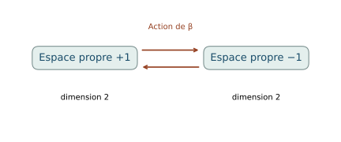
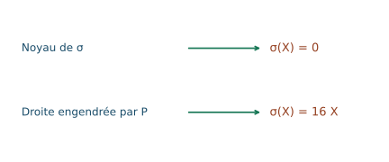

# École polytechnique — Deuxième composition de mathématiques · M′ et P′ 1987 · Corrigé guidé

*Corrigé rédigé par IA, non officiel. Signalez toute erreur.*

**Rédaction** · GPT-6.2 Astra Ultra · vitesse non renseignée · 26 novembre 2026

**Révision** · GPT-6.2 Astra Ultra · vitesse non renseignée · 26 novembre 2026

On travaille dans $\mathcal A=M_4(\mathbb C)$, avec $I=I_4$. Les rubriques marquées P′ ou M′ suivent les feuillets propres à cette option. Les autres sont communes. Les deux parcours se rejoignent dans la partie IV.

## I. Deux involutions qui anticommutent

### I.1.a. Cyclicité de la trace

> [!INDICATION]
> Écrire le terme diagonal d’un produit avec deux indices.

Si $A=(a_{ij})$ et $B=(b_{ij})$, alors $\operatorname{Tr}(AB)=\sum_{i,j}a_{ij}b_{ji}=\sum_{j,i}b_{ji}a_{ij}=\operatorname{Tr}(BA)$. En regroupant les facteurs, cette identité autorise également une permutation cyclique dans la trace d’un produit plus long.

### I.1.b. Détection d’une matrice non nulle

> [!INDICATION]
> Utiliser une matrice élémentaire ayant ses indices en ordre inverse.

Si $a_{ij}\ne0$, prenons $B=E_{ji}$, où $E_{uv}$ a un seul coefficient non nul, en ligne $u$, colonne $v$, égal à un. Alors $\operatorname{Tr}(AB)=a_{ij}\ne0$. On pourrait également prendre $B=A^*$, ce qui donnerait $\sum_{i,j}|a_{ij}|^2>0$.

### I.2.a. Traces des involutions

> [!INDICATION]
> Dans le mot $BAB$, déplacer une fois le premier facteur, puis employer l’anticommutation.

On a $A^2=B^2=I$ et $AB=-BA$. Par cyclicité, $\operatorname{Tr}(BAB)=\operatorname{Tr}(AB^2)=\operatorname{Tr}A$, tandis que $BAB=-AB^2=-A$. Ainsi $\operatorname{Tr}A=0$. En échangeant $A$ et $B$, on obtient $\operatorname{Tr}B=0$.

### I.2.b. Valeurs propres et multiplicités

> [!INDICATION]
> Exploiter le polynôme annulateur et la trace.

Le polynôme $X^2-1$ annule chacune des matrices. Ses racines étant simples, elles sont diagonalisables et leurs valeurs propres possibles sont $1,-1$. Leur trace nulle impose des multiplicités égales. Comme la dimension est quatre, chacune des deux valeurs propres a multiplicité deux.

### I.2.c. Troisième involution

> [!INDICATION]
> Déplacer le second $A$ vers la gauche dans le carré du produit.

On a $(iAB)^2=-ABAB=A^2B^2=I$. D’autre part $A(iAB)=iB$ et $(iAB)A=-iB$, tandis que $B(iAB)=-iA$ et $(iAB)B=iA$. La nouvelle involution anticommute donc avec les deux autres. I.2.a et I.2.b donnent $\operatorname{Tr}(iAB)=0$, donc $\operatorname{Tr}(AB)=0$, et les valeurs propres $1,-1$ de $iAB$ ont multiplicité deux.

### I.3.a. Dimensions des espaces propres

> [!INDICATION]
> Associer chaque plan au signe de sa valeur propre.

Les points fixes de $\alpha$ et de $\beta$ forment leurs espaces propres pour $+1$. Les autres espaces propres maximaux sont ceux pour $-1$. D’après I.2.b, $P_\alpha,P_\beta,\Pi_\alpha,\Pi_\beta$ ont tous dimension deux.

### I.3.b. Description géométrique

> [!INDICATION]
> Décomposer chaque vecteur en composantes propres.

La décomposition $\mathbb C^4=P_\alpha\oplus\Pi_\alpha$ donne $\alpha(u+v)=u-v$ pour $u\in P_\alpha$, $v\in\Pi_\alpha$. Ainsi $\alpha$ est la symétrie suivant $P_\alpha$ parallèlement à $\Pi_\alpha$. De même $\beta$ est la symétrie suivant $P_\beta$ parallèlement à $\Pi_\beta$.

### I.3.c. Intersections deux à deux

> [!INDICATION]
> Un vecteur propre commun permettrait de calculer $\alpha\beta$ dans les deux ordres.

Les deux espaces propres d’une même involution ont intersection nulle. Si un vecteur $v$ est propre pour les deux involutions avec signes $\varepsilon,\eta$, alors $\alpha\beta v=\varepsilon\eta v=\beta\alpha v$. L’anticommutation donne $2\varepsilon\eta v=0$, donc $v=0$. Les six intersections deux à deux sont réduites à zéro.

### I.3.d. Échange des plans

> [!INDICATION]
> Appliquer l’anticommutation à un vecteur fixe et utiliser l’inversibilité.

Si $\beta v=v$, alors $\beta(\alpha v)=-\alpha(\beta v)=-\alpha v$. Donc $\alpha(P_\beta)\subset\Pi_\beta$, et l’égalité suit des dimensions et de l’inversibilité de $\alpha$. De même $\beta(P_\alpha)=\Pi_\alpha$. Chacune des deux involutions réalise également l’échange en sens inverse.

## II. Quatre générateurs et une base de seize matrices

### II.1.a. Produits de deux générateurs

> [!INDICATION]
> Appliquer successivement les résultats de I.2 aux couples de générateurs.

Les quatre $A_p$ sont des involutions et chacun anticommute avec au moins un des trois autres. Ils sont donc de trace nulle, de spectre $\{-1,1\}$ avec multiplicité deux pour chaque signe. Il en va de même des six produits $iA_pA_q$ indiqués, par I.2.c pour chaque paire $p<q$.

### II.1.b. Produits de trois générateurs

> [!INDICATION]
> Compter les échanges nécessaires pour inverser l’ordre d’un mot de longueur trois.

Pour trois générateurs distincts, $(A_pA_qA_r)^2=(-1)^3I=-I$ car le second exemplaire du mot se remet en ordre inverse par trois échanges. Le carré de $iA_pA_qA_r$ est donc $I$. Le générateur manquant anticommute avec ce produit, car il traverse trois facteurs distincts. Pour $A_{11},A_{12},A_{13},A_{14}$, les indices manquants sont respectivement $1,2,3,4$. D’après I.2, la trace vaut zéro et les valeurs propres $1,-1$ ont chacune multiplicité deux.

### II.1.c. Produit des quatre générateurs

> [!INDICATION]
> Faire traverser à un générateur les trois autres.

Posons $G=A_{15}=A_1A_2A_3A_4$. Son carré est $(-1)^{4\cdot3/2}I=I$. Chacun des générateurs anticommute avec $G$, puisqu’il change trois fois de signe en traversant les autres. Par I.2, $\operatorname{Tr}G=0$ et ses valeurs propres sont $1,-1$, doubles.

### II.2.a. Trace des produits de base

> [!INDICATION]
> Repérer les indices présents dans exactement un des deux mots.

À chaque $A_j$ associons l’ensemble $S_j$ des indices qui le composent, avec $A_0=I$ et $S_0=\varnothing$. Les seize ensembles sont distincts. Le produit $A_j A_k$, remis dans l’ordre croissant en utilisant $A_p^2=I$, est un scalaire non nul fois le mot de support $S_j\mathbin{\triangle}S_k$. Pour $j\ne k$ ce support est non vide, donc la trace est nulle par II.1. Pour $j=k$, le produit vaut $I$. Ainsi, y compris pour $j,k=0$,
$$
\operatorname{Tr}(A_jA_k)=4\delta_{jk}.
$$

**Exemple de réduction.** Le produit $(iA_1A_2)(iA_2A_3)$ vaut $-A_1A_3$. Son support est la différence symétrique des deux paires, donc sa trace est nulle.

### II.2.b. Base de l’algèbre

> [!INDICATION]
> Isoler un coefficient en multipliant par le mot de même indice.

Si $\sum_j c_j A_j=0$, alors $\operatorname{Tr}(A_k\sum_j c_jA_j)=4c_k=0$ pour chaque $k$. Les seize matrices sont libres dans l’espace de dimension $4^2=16$, donc forment une base de $\mathcal A$. Plus généralement la coordonnée de $X$ en $A_k$ est $\operatorname{Tr}(A_k X)/4$.

### II.2.c. Commutant des générateurs

> [!INDICATION]
> Passer des quatre générateurs aux seize mots puis aux matrices élémentaires.

Une matrice qui commute avec les quatre générateurs commute avec tous leurs produits, donc par linéarité avec tout $\mathcal A$. En commutant avec chaque $E_{ii}$, elle doit être diagonale. La commutation avec $E_{ij}$ impose alors l’égalité des entrées diagonales d’indices $i,j$. Les matrices cherchées sont exactement les scalaires $\lambda I$.

### II.3 (P′). Matrices explicites

> [!INDICATION]
> Repérer dans les trois matrices hors diagonale les blocs de taille deux.

Dans les matrices imprimées au feuillet 2, $H_1=\operatorname{diag}(1,1,-1,-1)$. Si $u=(z_1,z_2)^t$ et $v=(z_3,z_4)^t$, les trois autres envoient $(u,v)$ sur $(m_pv,m_pu)$ avec
$$
m_2=\begin{pmatrix}0&1\\1&0\end{pmatrix},\quad
m_3=\begin{pmatrix}1&0\\0&-1\end{pmatrix},\quad
m_4=\begin{pmatrix}0&i\\-i&0\end{pmatrix}.
$$
Explicitement $H_2 z=(z_4,z_3,z_2,z_1)^t$, $H_3 z=(z_3,-z_4,z_1,-z_2)^t$ et $H_4 z=(iz_4,-iz_3,iz_2,-iz_1)^t$. Chaque $m_p$ a carré $I_2$, donc chaque $H_p$ a carré $I_4$. Multiplier par $H_1$ avant ou après l’échange des deux blocs donne deux résultats opposés. Enfin $m_2m_3=im_4$, $m_3m_4=im_2$, $m_4m_2=im_3$ et les produits inversés ont le signe contraire. Ainsi $H_pH_q=-H_qH_p$ aussi pour $2\le p<q\le4$.

### II.3 (M′). Matrices données par blocs

> [!INDICATION]
> Multiplier les blocs diagonaux et les blocs antidiagonaux séparément.

Pour les blocs du feuillet 3, $m_1=I_2$ et les trois autres sont ceux affichés dans la rubrique P′. Par multiplication, $m_p^2=I_2$ et $m_2m_3=-m_3m_2=im_4$. Les deux autres relations se déduisent en multipliant celle-ci par $m_2$ ou $m_3$ et en utilisant leurs carrés. Ainsi, pour $p,q\ge2$,
$$
H_pH_q=\operatorname{diag}(m_pm_q,m_pm_q).
$$
On retrouve $I_4$ pour $p=q$ et l’anticommutation pour $p\ne q$. Enfin $H_1^2=I_4$ et $H_1H_p$ est la matrice par blocs de diagonale nulle, de blocs hors diagonale $m_p,-m_p$ dans cet ordre, tandis que $H_pH_1=-H_1H_p$. Les six couples satisfont les conditions.

## III. Conjugaison des systèmes de générateurs

### III.1.a. Changement de base

> [!INDICATION]
> Conjuguer toute l’identité de carré ou d’anticommutation.

Pour $L$ inversible, $(L^{-1}A_p L)^2=L^{-1}A_p^2 L=I$. L’anticommutateur des transformées vaut $L^{-1}(A_pA_q+A_qA_p)L=0$ pour $p\ne q$. Les quatre matrices transformées vérifient donc les mêmes hypothèses.

### III.1.b. Changement simultané de signe

> [!INDICATION]
> Employer le mot de longueur quatre.

Le produit $G=A_1A_2A_3A_4$ est inversible et anticommute avec chacun des $A_p$, donc $G^{-1}A_pG=-A_p$. Tout multiple non nul de $G$ convient. Ce sont toutes les solutions car si $L$ convient, $LG^{-1}$ commute avec les quatre générateurs et est scalaire par II.2.c.

### III.2.a. Constantes de multiplication

> [!INDICATION]
> Comparer les réductions de mots dans les systèmes A et B.

Les deux bases obéissent exactement aux mêmes règles de réduction et utilisent les mêmes puissances de $i$ dans leurs définitions. Si $\ell$ désigne l’indice de $S_h\triangle S_k$, alors $A_hA_k=\lambda_{h,k}A_\ell$ et $B_hB_k=\lambda_{h,k}B_\ell$. En particulier $\lambda'_{h,k}=\lambda_{h,k}$. Comme chaque matrice de base est sa propre inverse, $(A_hA_k)^{-1}=A_kA_h=\lambda_{h,k}^{-1}A_\ell$. Par conséquent $\lambda_{h,k}\lambda_{k,h}=1$. Pour $h$ fixé, $k\mapsto\ell$ est une permutation, la différence symétrique avec un ensemble fixé étant involutive.

### III.2.b (P′). Invariance de la somme

> [!INDICATION]
> Regrouper les deux facteurs scalaires après multiplication de chaque côté.

Pour $M=\sum_{k=0}^{15} A_kXB_k$, l’expression $A_h M B_h$ remplace chaque terme par $(A_hA_k)X(B_kB_h)=\lambda_{h,k}\lambda_{k,h} A_\ell X B_\ell=A_\ell X B_\ell$. La permutation de III.2.a laisse la somme inchangée. Ainsi $A_h M B_h=M$, ou encore $A_h M=M B_h$.

### III.2.c (P′). Existence d’une matrice élémentaire convenable

> [!INDICATION]
> Calculer la trace de l’application linéaire de l’espace des matrices qui envoie $X$ sur $M$.

Dans la base $(E_{ij})$, le coefficient de $E_{ij}$ dans $D E_{ij} F$ vaut $D_{ii}F_{jj}$. L’endomorphisme $X\mapsto DXF$ a donc pour trace $\operatorname{Tr}(D)\operatorname{Tr}(F)$. La trace de $X\mapsto M$ vaut alors $\sum_k\operatorname{Tr}(A_k)\operatorname{Tr}(B_k)=4\cdot4=16$, car seul $k=0$ subsiste. Cet endomorphisme est non nul, donc il envoie au moins une des seize matrices élémentaires sur un $M\ne0$.

### III.2.d (P′). Matrice d’entrelacement inversible

> [!INDICATION]
> Former une somme dans l’ordre inverse et tester la trace contre le $M$ non nul.

Pour $N=\sum_k B_kYA_k$, la même preuve donne $B_hN=NA_h$. Alors $A_hMN=MB_hN=MNA_h$, de sorte que $MN$ est scalaire par II.2.c. Par cyclicité et III.2.b,
$$
\operatorname{Tr}(MN)=\sum_k\operatorname{Tr}(A_kMB_kY)=16\operatorname{Tr}(MY).
$$
Choisissons l’un des $X$ de III.2.c et, par I.1.b, un $Y$ tel que $\operatorname{Tr}(MY)\ne0$. Le produit $MN$ est un scalaire non nul fois $I$. Ainsi $M$ est inversible, et son entrelacement donne $B_h=M^{-1}A_h M$ pour tout $h$.

### III.2.b (M′). Trois opérateurs de moyenne

> [!INDICATION]
> Traiter les trois sommes par la même permutation des indices.

Notons $\rho(X)=\sum_k A_kXA_k$, $\sigma(X)=\sum_k A_kXB_k$, $\tau(X)=\sum_k B_kXA_k$, où $0\le k\le15$. Dans $A_h\sigma(X)B_h$, chaque terme se réduit à $A_\ell X B_\ell$ avec le coefficient $\lambda_{h,k}\lambda_{k,h}=1$. Comme $\ell$ parcourt tous les indices, la somme vaut $\sigma(X)$. En prenant le même système de part et d’autre, ou en échangeant $A,B$, on obtient $A_h\rho(X)A_h=\rho(X)$ et $B_h\tau(X)A_h=\tau(X)$. En sommant chacune de ces égalités sur $h$, chaque opérateur $S$ vérifie $S^2=16S$. Le polynôme réel demandé est $X(X-16)$.

### III.2.c (M′). Commutation et matrices scalaires

> [!INDICATION]
> Transformer les égalités d’invariance en relations d’entrelacement.

Les matrices $\rho(X)$ commutent avec tous les $A_h$. D’autre part $A_h\sigma(X)=\sigma(X)B_h$ et $B_h\tau(Y)=\tau(Y)A_h$. Ainsi $\sigma(X)\tau(Y)$ commute aussi avec tous les $A_h$. Les deux types de matrices sont, par II.2.c, des multiples de $I$ et commutent donc avec toute l’algèbre.

### III.2.d (M′). Action de la première moyenne

> [!INDICATION]
> Prendre la trace de chaque terme dans le multiple de l’identité.

La cyclicité donne $\operatorname{Tr}(\rho(X))=\sum_k\operatorname{Tr}(A_k^2X)=16\operatorname{Tr}X$. Le multiple de $I$ de cette trace est $\rho(X)=4\operatorname{Tr}(X)I$. L’image est $\mathbb CI$, le noyau est l’hyperplan des matrices de trace nulle. Comme $\rho(I)=16I$ et $\rho(A_j)=0$ pour $j>0$, la matrice de $\rho$ dans la base ordonnée $(A_0,\ldots,A_{15})$ est $\operatorname{diag}(16,0,\ldots,0)$. Les valeurs propres sont donc $16$ et $0$, de multiplicités $1$ et $15$.

### III.2.e (M′). Inversibilité dans l’image

> [!INDICATION]
> Utiliser la trace non dégénérée contre une image non nulle de $\sigma$.

Pour $M=\sigma(X)$, l’identité $A_k M B_k=M$ donne $\operatorname{Tr}(M\tau(Y))=\sum_k\operatorname{Tr}(A_kMB_kY)=16\operatorname{Tr}(MY)$. Si $M\ne0$, I.1.b fournit $Y$ tel que cette trace soit non nulle. Comme $M\tau(Y)$ est scalaire, il est alors inversible. En dimension finie cela entraîne l’inversibilité de $M$.

### III.2.f (M′). Trace, rang et spectre de la deuxième moyenne

> [!INDICATION]
> Extraire la coordonnée diagonale de $\sigma(A_j)$ et utiliser $\rho$.

La coordonnée d’indice $j$ de $\sigma(X)$ est $\operatorname{Tr}(A_j\sigma(X))/4$ par II.2.b. Notons $\operatorname{tr}_{\mathcal A}$ la trace d’un endomorphisme de l’espace des matrices. En remplaçant $X$ par $A_j$ et en sommant les coordonnées diagonales, nous obtenons
$$
\operatorname{tr}_{\mathcal A}\sigma
=\frac14\sum_{j,k}\operatorname{Tr}(A_jA_kA_jB_k)
=\frac14\sum_k\operatorname{Tr}(\rho(A_k)B_k)=16 .
$$
Seul $k=0$ contribue et $\rho(I)=16I$. Le polynôme annulateur à racines simples de III.2.b rend $\sigma$ diagonalisable, avec valeurs propres possibles $0,16$. La trace impose une seule occurrence de $16$ et quinze occurrences de $0$. En particulier le rang est un.

### III.3.a (M′). Description de tous les conjugateurs

> [!INDICATION]
> Reconnaître l’espace propre pour la valeur seize.

Si $B_p=M^{-1}A_p M$ pour $1\le p\le4$, alors le même changement de base transforme tous les mots, donc $A_k M B_k=M$ pour tout $k$. Il s’ensuit que $\sigma(M)=16M$ et que $M$ est dans l’image. Réciproquement tout $M$ non nul de l’image est inversible par III.2.e et $A_k M B_k=M$ par III.2.b, d’où les conjugaisons. Cette image est de dimension un par III.2.f. En choisissant un de ses éléments non nuls $P$, tous les conjugateurs sont donc les $cP$ avec $c\in\mathbb C^*$.

### III.3.b (M′). Hyperplan noyau

> [!INDICATION]
> Remplacer $B_k$ par $P^{-1}A_kP$ dans la deuxième moyenne.

La substitution donne $\sigma(X)=\rho(XP^{-1})P=4\operatorname{Tr}(XP^{-1})P$. Ainsi $\ker\sigma=\{X\,:\,\operatorname{Tr}(XP^{-1})=0\}$. En particulier $P$ n’appartient pas à cet hyperplan et $\mathcal A=\ker\sigma\oplus\mathbb CP$.

### III.4.a (M′). Conjugaison des matrices du modèle

> [!INDICATION]
> Construire un produit qui commute avec les trois premiers facteurs et change le signe du quatrième.

Choisissons $U=H_1H_2H_3$. Ce produit commute avec chacun de ses trois facteurs puisqu’il faut deux échanges, et anticommute avec $H_4$ puisqu’il en faut trois. Les $H_p$ ont deux valeurs propres $-1$ et deux $+1$, donc $\det U=1$. Les trois premiers $H_p$ sont réels, le quatrième est imaginaire pur. Ainsi $\overline{H_p}=U^{-1}H_pU$ pour chaque $p$. On a aussi $\overline U=U$ et $U^2=-I$.

### III.4.b (M′). Transport à une autre base

> [!INDICATION]
> Conjuguer l’égalité liant $A_p$ à $H_p$ et y introduire $U$.

De $H_p=Q^{-1}A_pQ$, on déduit $A_p=QH_pQ^{-1}$. Par conjugaison des coefficients et III.4.a,
$$
\overline{A_p}=\overline Q\,U^{-1}H_pU\,\overline Q^{-1}
=V^{-1}A_pV,\qquad V=QU\,\overline Q^{-1}.
$$
Comme $\det U=1$, $\det V=\det Q/\overline{\det Q}$ est de module un. Enfin $V\overline V=QU\overline U Q^{-1}=Q(-I)Q^{-1}=-I$.

**Contrôle de la conjugaison.** Pour $Q=I$, la formule doit rendre $V=U$. Le produit avec sa conjuguée vaut déjà $-I$ pour ce modèle.

### III.4.c (M′). Cas hermitien

> [!INDICATION]
> Prendre l’adjoint de la relation d’entrelacement et examiner un produit positif.

Les matrices $A_p$ et $\overline{A_p}$ sont hermitiennes. De $A_p V=V\overline{A_p}$ et de son adjointe on tire $A_p VV^*=VV^* A_p$. Alors $VV^*=cI$ par II.2.c, avec $c>0$. Son déterminant vaut $|\det V|^2=1$, donc $c=1$ et $V=(V^*)^{-1}$. De $V\overline V=-I$ et de $V^{-1}=V^*$, on obtient $\overline V=-V^*$, soit $V^t=-V$.

Les matrices $H_p$ sont également hermitiennes. De $A_pQ=QH_p$ et de l’adjointe, on déduit de même que $QQ^*$ est une matrice scalaire $dI$, $d>0$. En divisant $Q$ par $\sqrt d$, on garde toutes les conjugaisons et l’on obtient une matrice unitaire.

## IV. Changement orthogonal et équation des ondes

### IV.1.a. Nouvelles relations de Clifford

> [!INDICATION]
> Utiliser l’anticommutateur des générateurs et l’orthonormalité des lignes.

Écrivons $C_p=\sum_r t_{pr}A_r$. Comme $A_rA_s+A_sA_r=2\delta_{rs}I$, la bilinéarité donne
$$
C_pC_q+C_qC_p=2\sum_r t_{pr}t_{qr}I=2\delta_{pq}I.
$$
Les lignes de $T$ sont en effet orthonormales. Ainsi $C_p^2=I$ et l’anticommutateur est nul pour $p\ne q$.

### IV.1.b. Conjugaison associée à la rotation ou à la réflexion

> [!INDICATION]
> Reconnaître le deuxième système de générateurs de la partie III.

Les quatre $C_p$ sont dans $\mathcal A$ et remplissent les hypothèses de II.1 par IV.1.a. La conjugaison simultanée démontrée en III.2.d pour P′ ou en III.3.a pour M′ fournit donc une matrice inversible $R$ telle que $C_p=R^{-1}A_pR$ pour tous les indices.

### IV.2. Passage à l’équation du second ordre

> [!INDICATION]
> Composer deux fois l’opérateur spatial du premier ordre.

Posons $D=\sum_{p=1}^4 A_p\partial_{x_p}$. La commutation des dérivées mixtes et les relations de II.1 annulent les termes croisés, chacun multiplié par $A_pA_q+A_qA_p$. Comme $A_p^2=I$, il reste $D^2\Phi=\sum_{p=1}^4\partial_{x_p}^2\Phi$. Si $\partial_{x_0}\Phi=D\Phi$, la constance des $A_p$ donne $\partial_{x_0}^2\Phi=D\partial_{x_0}\Phi=D^2\Phi$. Ainsi $\Phi$ vérifie l’équation $E_1$ sur le même ouvert.

### IV.3. Transformation d’une solution

> [!INDICATION]
> Repérer l’indice de ligne de la matrice orthogonale dans la règle de chaîne.

Posons $y=\Theta x=(x_0,Tx_{\rm spatial})$ et $\Psi(x)=R^{-1}\Phi(y)$. L’ouvert de définition est $\Theta^{-1}(\Omega)$ et $\Psi$ y est lisse. Pour $p\ge1$, la règle de chaîne donne $\partial_{x_p}\Psi=R^{-1}\sum_q t_{qp}(\partial_{y_q}\Phi)(y)$, tandis que $\partial_{x_0}\Psi=R^{-1}(\partial_{y_0}\Phi)(y)$. Par IV.1.b, $C_qR^{-1}=R^{-1}A_q$. Il en résulte
$$
\sum_p A_p\partial_{x_p}\Psi
=\sum_q C_qR^{-1}(\partial_{y_q}\Phi)(y)
=R^{-1}\sum_q A_q(\partial_{y_q}\Phi)(y)
=\partial_{x_0}\Psi .
$$
La fonction transformée vérifie donc bien $E_2$.

## Documents de la session

Le fac-similé commun de quatre heures réunit six feuillets aux pages 70 à 72 du recueil. Les annotations distinguent les options aux feuillets 2 à 5.

La saisie secondaire présente II.3 par blocs et, dans la suite de III, conserve le parcours P′. Le fac-similé fournit les deux parcours. [Transcription UPS](https://prepas.org/index.php?module=Sujets&voir=get&file=doc-cec458a13fd64729f0f8)

[Fac-similé UPS](https://prepas.org/index.php?module=Sujets&voir=get&file=doc-552210a87f999bf46b1e) · [Notice officielle du concours](https://www.legifrance.gouv.fr/jorf/id/JORFTEXT000000516456)
