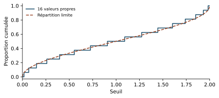
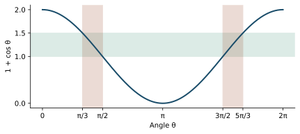

# École polytechnique — Première composition de mathématiques · M′ 1987 · Corrigé guidé

*Corrigé rédigé par IA, non officiel. Signalez toute erreur.*

**Rédaction** · GPT-6.2 Astra Ultra · vitesse non renseignée · 26 novembre 2026

**Révision** · GPT-6.2 Astra Ultra · vitesse non renseignée · 26 novembre 2026

Les valeurs propres sont comptées avec leur multiplicité. Pour une fonction réelle continue, non négative, périodique de période $2\pi$ et non identiquement nulle, $c_j$ désigne son coefficient de Fourier calculé avec $e^{-ij\theta}$. On note $m$ et $M$ ses valeurs extrêmes.

## I. Forme hermitienne et localisation du spectre

### I.1. Représentation intégrale

> [!INDICATION]
> Développer le carré du module et comparer le coefficient de chaque produit.

Posons $P_z(w)=\sum_{p=0}^n z_p w^p$. Comme $f$ est réelle, $c_{-j}=\overline{c_j}$. Les coefficients de la matrice $(c_{p-q})_{q,p}$ sont donc conjugués de ceux de sa transposée. Sa forme hermitienne est donnée par
$$
H_n(f)(z)=\sum_{p,q=0}^n c_{p-q}z_p\overline{z_q}
=\frac1{2\pi}\int_0^{2\pi} f(\theta)|P_z(e^{-i\theta})|^2\,d\theta.
$$
La deuxième égalité provient de l’intégration de la somme finie obtenue en développant le produit.

### I.2.a. Nombre maximal de zéros

> [!INDICATION]
> Repérer les racines du polynôme qui sont sur le cercle unité.

Lorsque $z\ne0$, le polynôme $P_z$ est non nul et de degré au plus $n$. Les $e^{-i\theta}$ sont distincts pour $\theta\in[0,2\pi[$. Il y a donc au plus $n$ zéros. Cette borne est atteinte en prenant pour $P_z$ le produit de $n$ facteurs associés à des points distincts du cercle. Pour $n=0$, une constante non nulle donne zéro racine.

### I.2.b. Positivité stricte

> [!INDICATION]
> Utiliser un intervalle sur lequel la fonction est strictement positive.

Puisque $f$ est continue, positive au sens large et non identiquement nulle, elle est strictement positive sur un intervalle ouvert. Si $z\ne0$, les zéros de $P_z(e^{-i\theta})$ y sont en nombre fini. L’intégrande continu et positif au sens large est strictement positif près d’un point de cet intervalle. Son intégrale est donc strictement positive.

### I.3.a. Encadrement

> [!INDICATION]
> Calculer d’abord les coefficients de Fourier de la constante un.

Pour $f=1$, seul $c_0=1$ subsiste. Ainsi $A_n(1)=I$ et $H_n(1)(z)=\|z\|^2$. Dans l’intégrale de I.1, multiplier $m\le f\le M$ par $|P_z|^2$ puis intégrer donne $m\|z\|^2\le H_n(f)(z)\le M\|z\|^2$.

### I.3.b. Cas de stricte inégalité

> [!INDICATION]
> Appliquer I.2.b à deux différences non négatives.

Lorsque $f$ est non constante, $f-m$ et $M-f$ sont continues, non négatives et non identiquement nulles. Pour $z\ne0$, I.2.b appliquée à chacune donne les deux inégalités strictes. Si $z=0$ ou si $f$ est constante, les trois termes sont égaux.

### I.4. Bornes spectrales

> [!INDICATION]
> Évaluer la forme sur un vecteur propre de norme un.

L’endomorphisme hermitien a des valeurs propres réelles. Sur un vecteur propre unitaire associé à $\lambda$, la forme vaut $\lambda$. Si $f$ varie, $m<\lambda<M$. Si $f=c$ est constante, $A_n(f)=cI$, donc sa seule valeur propre est $m=M=c>0$, de multiplicité $n+1$.

## II. Déterminant et moyenne logarithmique

### II.1.a. Récurrence du déterminant

> [!INDICATION]
> Développer le déterminant tridiagonal suivant la première ligne.

Posons $r=\sqrt{a_1^2+b_1^2}$. Les seuls coefficients possibles sont $c_0=a_0$, $c_1=a_1-ib_1$ et $c_{-1}=\overline{c_1}$. Pour le déterminant $\Delta_j$ de taille $j$, le développement suivant la première ligne puis la première colonne du mineur hors diagonale donne
$$
\Delta_0=1,\quad \Delta_1=a_0,\quad \Delta_j=a_0\Delta_{j-1}-r^2\Delta_{j-2}\quad(j\ge2).
$$
Comme $f$ a pour minimum $a_0-2r\ge0$ et n’est pas identiquement nulle, $a_0>0$ et les racines $\alpha\ge\beta$ de $X^2-a_0X+r^2$ sont réelles, non négatives. En substituant dans la récurrence avec ses deux conditions initiales, on trouve
$$
D_n=\Delta_{n+1}=
\begin{cases}(\alpha^{n+2}-\beta^{n+2})/(\alpha-\beta)&\alpha>\beta,\\
(n+2)\alpha^{n+1}&\alpha=\beta.\end{cases}
$$

**Vérification en petite dimension.** Pour $n=1$, les deux expressions redonnent le déterminant $a_0^2-r^2$ de la matrice de taille deux.

### II.1.b. Extremums du symbole

> [!INDICATION]
> Réécrire amplitude et terme constant avec la somme et le produit des racines.

On a $a_0=\alpha+\beta$, $r=\sqrt{\alpha\beta}$. Pour $r>0$, choisissons $\delta$ tel que $a_1=r\cos\delta$, $b_1=r\sin\delta$. Alors $f=a_0+2r\cos(\theta-\delta)$, d’où
$$
m=(\sqrt\alpha-\sqrt\beta)^2,\qquad M=(\sqrt\alpha+\sqrt\beta)^2.
$$
Les mêmes expressions conviennent pour $r=0$, où $\beta=0$ et $f=\alpha$.

### II.1.c. Croissance du déterminant

> [!INDICATION]
> Isoler la puissance de la plus grande racine.

Si $\alpha>\beta$, on a $D_n=\alpha^{n+1}(1-(\beta/\alpha)^{n+2})/(1-\beta/\alpha)$. Le dernier facteur tend vers une constante strictement positive. Si $\alpha=\beta$, il est remplacé par $n+2$. Dans les deux cas, la racine d’ordre $n+1$ de ce facteur tend vers $1$, donc la limite demandée vaut $\alpha$.

### II.2.a. Singularités logarithmiques

> [!INDICATION]
> Comparer le logarithme près de chaque zéro à celui de la distance au zéro.

Pour $\rho=1$, l’argument du logarithme est $4\sin^2(\psi/2)$ et se comporte comme le carré de la distance à $0$ ou à $2\pi$. Pour $\rho=-1$, c’est $4\cos^2(\psi/2)$, avec le même comportement en $\pi$. Puisque $\int_0^\varepsilon|\ln u|\,du$ est finie, les intégrales existent, même absolument.

### II.2.b. Doublement de l’angle

> [!INDICATION]
> Multiplier les facteurs correspondant à deux angles qui diffèrent de $\pi$.

La translation de $\pi$ sur une période montre $I(-\rho)=I(\rho)$. Le produit des deux arguments est $1-2\rho^2\cos(2\psi)+\rho^4$. En intégrant le logarithme du produit et en changeant de variable, la périodicité donne $2I(\rho)=I(\rho^2)$, y compris aux extrémités par II.2.a. Si $|\rho|<1$, les intégrandes de $I(\rho^{2^k})$ tendent uniformément vers zéro, et $I(\rho)=2^{-k}I(\rho^{2^k})=0$ à la limite. Pour $\rho=1$, l’identité donne directement $I(1)=0$, puis $I(-1)=0$.

### II.2.c. Moyenne du logarithme

> [!INDICATION]
> Factoriser le symbole par la plus grande racine.

Si $r>0$, la forme de II.1.b donne
$$
f(\theta)=\alpha\bigl(1+2\sqrt{\beta/\alpha}\cos(\theta-\delta)+\beta/\alpha\bigr).
$$
Après translation, l’intégrale de son logarithme est $2\pi\ln\alpha+I(-\sqrt{\beta/\alpha})=2\pi\ln\alpha$. L’égalité reste valable pour $\alpha=\beta$ grâce à l’intégrabilité en II.2.a et pour $r=0$ par intégration de la constante.

### II.2.d. Moyenne spectrale

> [!INDICATION]
> Remplacer la somme des logarithmes des valeurs propres par un seul logarithme.

Les valeurs propres $\lambda_0,\ldots,\lambda_n$ sont strictement positives par I.2.b. Leur produit est $D_n$. Ainsi leur logarithme moyen vaut $\ln(D_n^{1/(n+1)})$ et tend vers $\ln\alpha=(2\pi)^{-1}\int_0^{2\pi}\ln f$.

## III. Répartition des valeurs propres

### III.1.a. Série génératrice

> [!INDICATION]
> Développer séparément $\ln(1+t\lambda_r)$.

Pour $|t|<1/M$, chaque $|t\lambda_r|<1$ et les séries logarithmiques convergent absolument. En les sommant sur $r$ puis en divisant par $n+1$, on obtient
$$
\Phi_n(t)=\frac1{n+1}\sum_{r=0}^n\ln(1+t\lambda_r)
=\frac1{n+1}\ln D_n(1+tf).
$$
En effet $A_n(1+tf)=I+tA_n(f)$ et tous ses facteurs spectraux sont positifs.

### III.1.b. Fonction limite

> [!INDICATION]
> Appliquer la partie II au symbole positif $1+tf$.

Pour $t$ fixé dans l’intervalle indiqué, $1+tf$ est strictement positif et encore de la forme de II.1. II.2.d donne
$$
\Phi(t)=\lim_n\Phi_n(t)=\frac1{2\pi}\int_0^{2\pi}\ln(1+tf(\theta))\,d\theta
=\sum_{k\ge1}\frac{(-1)^{k-1}t^k}{2\pi k}\int_0^{2\pi}f(\theta)^k\,d\theta .
$$
Le passage sous l’intégrale résulte de la convergence uniforme absolue, chaque terme étant majoré par $(|t|M)^k/k$.

### III.1.c. Convergence des moments

> [!INDICATION]
> Identifier les coefficients d’une sous-suite convergente en contrôlant ses restes.

Notons $u_{n,k}=(n+1)^{-1}\sum_r\lambda_r^k$. Comme $0\le u_{n,k}\le M^k$, de toute sous-suite d’indices $n$ on peut extraire, par extractions successives pour $k=1,2,\ldots$ puis choix diagonal, une sous-suite où tous les $u_{n,k}$ convergent, vers des $u_k$. Pour $|t|<1/M$, la majoration $\sum (|t|M)^k/k<\infty$ permet de passer à la limite dans $\Phi_n$ le long de cette sous-suite. L’unicité du développement en série entière de $\Phi$ impose alors $u_k=(2\pi)^{-1}\int f^k$ pour chaque $k$. Toute sous-suite admettant une sous-suite avec cette même limite, chacun des moments converge vers la valeur annoncée.

**Pourquoi extraire ?** La convergence ponctuelle d’une suite de séries sur un intervalle réel ne suffit pas, à elle seule, pour dériver leur limite. Ici les majorants $M^k$ contrôlent simultanément toutes les queues.

### III.2. Fonctions continues du spectre

> [!INDICATION]
> Quantifier l’erreur uniforme dans la somme et dans l’intégrale.

L’égalité limite est vraie pour les polynômes par III.1.c et par la normalisation de la constante. Soit $F$ continue sur $[m,M]$ et choisissons $P$ tel que $\|F-P\|_\infty<\varepsilon$. Substituer $F$ à $P$ dans la somme normalisée puis dans l’intégrale normalisée coûte au plus $2\varepsilon$ au total. La limite supérieure de l’écart en valeur absolue est au plus $2\varepsilon$. En laissant $\varepsilon$ décroître vers zéro, la limite est établie.

### III.3.a. Comptage dans un intervalle

> [!INDICATION]
> Lisser les deux sauts de l’indicatrice et examiner leurs antécédents.

Encadrons $\mathbf1_{[a,b]}$ par deux fonctions continues à valeurs dans $[0,1]$. La minorante vaut un sur $[a+\varepsilon,b-\varepsilon]$, zéro hors de $[a,b]$, avec des raccords affines. La majorante vaut un sur $[a,b]$, zéro hors de $[a-\varepsilon,b+\varepsilon]$, avec les mêmes raccords. Prenons $\varepsilon$ assez petit pour que ces intervalles restent dans $[m,M]$. Leurs moyennes spectrales convergent par III.2. Comme $m<a<b<M$, le symbole est non constant et les niveaux $a,b$ ont chacun deux antécédents par période. Les deux intégrales d’encadrement tendent par convergence dominée vers $(2\pi)^{-1}\int\mathbf1_{[a,b]}(f(\theta))\,d\theta$. Ceci donne la même limite pour la moyenne de l’indicatrice.

### III.3.b. Comptage d’un niveau isolé

> [!INDICATION]
> Enfermer le point dans des intervalles dont la longueur décroît vers zéro.

La fréquence du niveau $a$ est minorée par zéro et majorée par celle de $[a-\varepsilon,a+\varepsilon]$. Lorsque $\varepsilon\downarrow0$, l’intégrale de la majorante converge vers la mesure normalisée de $f^{-1}(\{a\})$, nulle puisque cet ensemble est fini sur une période. La limite demandée vaut zéro.

### III.3.c. Proportion limite

> [!INDICATION]
> Lire l’intégrale d’une indicatrice comme une longueur.

Avec les multiplicités, le numérateur est exactement $\sum_r\mathbf1_{[a,b]}(\lambda_r)$. III.3.a donne donc
$$
\tau=\frac{\operatorname{longueur}(\{\theta\in[0,2\pi[\,:\,a\le f(\theta)\le b\})}{2\pi}.
$$

### III.3.d. Intervalle ouvert

> [!INDICATION]
> Enlever les fréquences des deux extrémités.

Remplacer $[a,b]$ par $]a,b[$ retranche seulement les fréquences des valeurs $a$ et $b$. Toutes deux tendent vers zéro par III.3.b. La limite vaut encore $\tau$.

### III.3.e. Application numérique

> [!INDICATION]
> Repérer les angles où le cosinus est compris entre $0$ et $1/2$.

Ici $f(\theta)=1+\cos\theta$. La condition $1\le f\le3/2$ équivaut à $\theta\in[\pi/3,\pi/2]\cup[3\pi/2,5\pi/3]$ dans une période. La longueur totale est $2(\pi/2-\pi/3)=\pi/3$. La proportion demandée vaut donc $\tau=1/6\simeq0{,}1667$.

## Documents de la session

Les quatre feuillets de cette épreuve de quatre heures figurent aux pages 66 et 67 du recueil.

[Fac-similé UPS](https://prepas.org/index.php?module=Sujets&voir=get&file=doc-1e53022cf87337a94d07) · [Notice officielle du concours](https://www.legifrance.gouv.fr/jorf/id/JORFTEXT000000516456)
