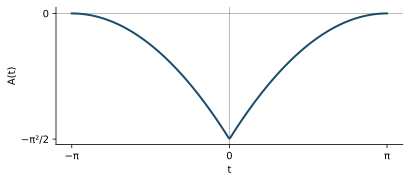
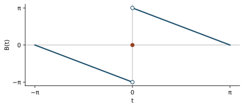
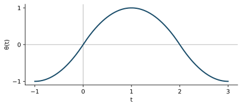

# École polytechnique — Première composition de mathématiques · P′ 1987 · Corrigé guidé

*Corrigé rédigé par IA, non officiel. Signalez toute erreur.*

**Rédaction** · GPT-6.2 Astra Ultra · vitesse non renseignée · 26 novembre 2026

**Révision** · GPT-6.2 Astra Ultra · vitesse non renseignée · 26 novembre 2026

Les normes sont les normes du supremum sur la droite réelle. Les fonctions de $\mathcal C_2$ sont de classe $C^2$, bornées avec leurs deux premières dérivées. Pour $\mathcal C_3$ ou $\mathcal E_3$, la dérivée troisième est en outre bornée et respectivement continue ou en escalier, hors d’un ensemble localement fini de points de raccord.

## I. Deux noyaux périodiques

### I.1.a. Intégrale de A

> [!INDICATION]
> Construire une fonction bornée qui coïncide avec un polynôme cubique sur l’intervalle.

Prenons $f(t)=t^3/6$ au voisinage de $[-\pi,\pi]$, prolongée par multiplication par une fonction lisse à support compact égale à un sur ce voisinage. Elle appartient à $\mathcal C_3$, avec $f'''=1$ sur l’intervalle, $f'(0)=0$ et $f(\pm\pi)=\pm\pi^3/6$. L’identité donnée entraîne $\int_{-\pi}^{\pi} A(t)\,dt=-\pi^3/3$.

### I.1.b. Série de Fourier et unicité

> [!INDICATION]
> Prendre successivement un sinus et un cosinus dans l’identité.

Écrivons la série $a_0/2+\sum_{n\ge1}(a_n\cos nt+b_n\sin nt)$. La question précédente donne $a_0=-\pi^2/3$. Pour $f(t)=\sin nt$, l’identité donne $-n^3\pi a_n=2\pi n$. Pour $f(t)=\cos nt$, elle donne $n^3\pi b_n=0$. On obtient donc
$$
-\frac{\pi^2}{6}-2\sum_{n\ge1}\frac{\cos nt}{n^2}.
$$
Par le théorème de Dirichlet pour une fonction périodique de classe $C^1$ par morceaux, sa somme en $t$ vaut $(A(t^-)+A(t^+))/2$. En tout point de continuité elle vaut $A(t)$. En particulier, lorsque $A$ est continue, la série la détermine partout, d’où son unicité.

### I.1.c. Expression et graphe

> [!INDICATION]
> Soustraire les formules de Taylor aux points $\pi$ et $-\pi$.

La formule avec reste intégral est
$$
f(x)=f(0)+xf'(0)+x^2 f''(0)/2+\int_0^x (x-t)^2 f'''(t)/2\,dt.
$$
La soustraction aux deux extrémités donne l’identité de l’énoncé avec $A(t)=-(\pi-|t|)^2/2$ pour $|t|\le\pi$. Son prolongement périodique est continu, de classe $C^1$ par morceaux. L’unicité de I.1.b conclut. La courbe est paire et relie les deux zéros $-\pi,\pi$ au point anguleux $(0,-\pi^2/2)$.

### I.2.a. Dérivation de la série

> [!INDICATION]
> Identifier la série dérivée à la série de Fourier de la dérivée par morceaux.

Sur chaque intervalle de régularité, $A'(t)=\operatorname{sgn}(t)\pi-t$ pour $0<|t|<\pi$. L’intégration par parties par morceaux, avec annulation des termes de bord grâce à la continuité et à la périodicité de $A$, donne les coefficients de Fourier de $A'$ en dérivant ceux de $A$. La série $2\sum_{n\ge1}\sin(nt)/n$ converge par Dirichlet vers $A'(t)$ en chaque point de $[-\pi,\pi]\setminus\{0\}$, extrémités comprises où la dérivée périodique vaut zéro. En zéro les dérivées latérales diffèrent.

### I.2.b. Somme et graphe

> [!INDICATION]
> Aux points de saut, prendre la demi-somme des limites latérales.

La somme est $B(t)=-\pi-t$ pour $-\pi\le t<0$, $B(0)=0$ et $B(t)=\pi-t$ pour $0<t\le\pi$. Les deux segments ont pente $-1$. Les valeurs limites $-\pi,\pi$ en zéro sont représentées par des points ouverts et la valeur effective y est nulle.

### I.2.c. Identité de dérivation

> [!INDICATION]
> Sur les deux demi-intervalles, intégrer par parties puis additionner.

Puisque $B=A'$ sauf en zéro, la continuité de $A$ annule la contribution de raccord et $A(\pm\pi)=0$ annule les autres termes de bord. Ainsi
$$
\int_{-\pi}^\pi B(t)f''(t)\,dt=-\int_{-\pi}^\pi A(t)f'''(t)\,dt
=f(\pi)-f(-\pi)-2\pi f'(0).
$$

**Contrôle de signe.** Pour $f(t)=\sin t$, le membre de droite vaut $-2\pi$. Le premier coefficient sinus de $B$ vaut deux et $f''=-\sin$, ce qui redonne $-2\pi$.

### I.2.d. Liberté dans le choix du noyau

> [!INDICATION]
> Tester la différence de deux noyaux sur une fonction lisse localisée.

Si $C$ convient aussi, $\int(C-B)f''=0$ pour toute $f\in\mathcal C_3$. Toute fonction lisse $u$ à support compact dans $]-\pi,\pi[$ est la dérivée seconde sur l’intervalle d’une fonction admissible. Il suffit de prendre une primitive double, puis de la multiplier, hors de l’intervalle, par une coupure lisse à support compact égale à un sur un voisinage de celui-ci. Un test $u\ge0$ localisé près d’un point de continuité où $C-B$ serait non nul donnerait une intégrale non nulle. Ainsi $C=B$ sur les morceaux ouverts de continuité, donc sauf éventuellement en un nombre fini de points. Réciproquement, de telles modifications ponctuelles ne changent aucune intégrale.

## II. Inégalité avec la dérivée seconde

### II.1.a. Différence avant

> [!INDICATION]
> Isoler la dérivée première dans la formule de Taylor à l’ordre un.

L’intégration de $f''$ avec reste donne $f(a+T)=f(a)+Tf'(a)+\int_0^T(T-t)f''(a+t)\,dt$. Après transposition, le noyau continu est $H_1(t)=t-T$.

### II.1.b. Première majoration

> [!INDICATION]
> Calculer l’intégrale de la valeur absolue de $H_1$.

Écrivons $F=\|f\|$, $D=\|f''\|$. Comme $\int_0^T(T-t)\,dt=T^2/2$, II.1.a donne $T|f'(a)|\le2F+DT^2/2$. En prenant le supremum, $\|f'\|\le2F/T+DT/2$.

### II.2.a. Différence centrée

> [!INDICATION]
> Soustraire au développement à droite celui pris à gauche.

En écrivant Taylor à $a+T$ puis à $a-T$, on obtient
$$
2Tf'(a)=f(a+T)-f(a-T)+\int_{-T}^T H_2(t)f''(a+t)\,dt,
$$
où $H_2(t)=t+T$ à gauche de zéro et $H_2(t)=t-T$ à droite. On peut prendre $H_2(0)=0$. Les tests par primitives doubles de I.2.d montrent que tout autre noyau de classe $C^1$ par morceaux coïncide avec celui-ci sauf éventuellement en un nombre fini de points. Il y a donc liberté sur les valeurs isolées.

### II.2.b. Gain de la différence centrée

> [!INDICATION]
> Les deux morceaux de $|H_2|$ ont des aires égales.

L’intégrale de $|H_2|$ vaut $T^2$. On en tire $\|f'\|\le F/T+DT/2$. Par rapport à II.1.b, le terme provenant des valeurs de $f$ est divisé par deux, celui provenant de la courbure est identique.

### II.2.c. Choix du pas

> [!INDICATION]
> Équilibrer $F/T$ et $DT/2$.

Si $f$ est non constante, $F,D>0$ car une fonction affine bornée est constante. La somme minimale est atteinte lorsque $T_0=\sqrt{2F/D}$, et
$$
\|f'\|\le\sqrt{2FD}.
$$
Si $f$ est constante, l’inégalité donne $0\le0$. Pour une constante non nulle, l’infimum de la borne en $T$ est obtenu à la limite $T\to\infty$. Pour la fonction nulle, tout $T>0$ convient.

### II.3.a. Normalisation

> [!INDICATION]
> Écrire les normes après dilatation de l’argument.

Pour $g(t)=\mu f(\lambda t)$ avec $\lambda\ne0$, $\|g\|=|\mu|F$ et $\|g''\|=|\mu|\lambda^2D$. Pour $f$ non constante, prendre $\mu=1/F$ et $\lambda=\sqrt{2F/D}$ donne les valeurs $1$ et $2$. La formulation « toute fonction » de l’énoncé nécessite cette restriction. Les constantes restent constantes sous ce changement de variables et ne peuvent donner $\|g''\|=2$.

### II.3.b. Valeurs normalisées

> [!INDICATION]
> Appliquer directement II.2.c à $g$.

Avec $F_g=1$ et $D_g=2$, le pas optimal vaut $T_0=1$ et la majoration devient $\|g'\|\le2$.

### II.4.a. Extension à une dérivée en escalier

> [!INDICATION]
> Découper l’intégrale aux points de changement de la dérivée.

Sur un intervalle compact il y a seulement un nombre fini de points de raccord. On applique les intégrations par parties sur chaque sous-intervalle puis on additionne. Les termes intérieurs se compensent par continuité de $\theta$ et de $\theta'$ lorsque l’on reconstitue les formules de Taylor à gauche et à droite. La formule centrée reste donc valable, avec l’intégrale ordinaire de la dérivée définie par morceaux.

### II.4.b. Fonction extrémale et graphe

> [!INDICATION]
> Chercher une parabole qui parte de zéro avec pente deux et revienne à zéro en deux.

Posons $\theta(t)=2t-t^2$ sur $[0,2]$ et étendons par $\theta(t+2)=-\theta(t)$ sur $\mathbb R$. La symétrie $\theta(2-t)=\theta(t)$ assure l’imparité et le prolongement a période $4$. Les valeurs et les pentes se raccordent, car $\theta(0)=\theta(2)=0$ et $\theta'(0)=-\theta'(2)=2$. On obtient $\|\theta\|=1$, $\theta'(0)=2$, $\|\theta''\|=2$. Sur $[-1,3]$ les trois morceaux paraboliques passent par les points $(-1,-1),(0,0),(1,1),(2,0),(3,-1)$.

### II.4.c. Approximation régulière

> [!INDICATION]
> Faire varier la fonction d’une petite translation puis en prendre la moyenne.

Pour $\delta=\varepsilon/2$, posons $g_\varepsilon(t)=(2\delta)^{-1}\int_{-\delta}^{\delta}\theta(t-u)\,du$. Cette moyenne est impaire et $4$-périodique. Sa dérivée seconde est $(\theta'(t+\delta)-\theta'(t-\delta))/(2\delta)$, continue. Comme $\theta$ et $\theta'$ sont $2$-lipschitziennes, la moyenne des écarts est au plus $(2\delta)^{-1}\int_{-\delta}^{\delta}2|u|\,du=\delta\le\varepsilon$, pour la fonction et sa dérivée. La dérivée seconde a norme au plus deux par la même propriété de $\theta'$, et vaut $-2$ en $1$ car $[1-\delta,1+\delta]\subset]0,2[$. Ainsi $g_\varepsilon\in\mathcal C_2$ vérifie les trois contraintes.

### II.4.d. Optimalité

> [!INDICATION]
> Passer à la limite dans une inégalité avec une constante universelle.

Si $\|f'\|\le C\sqrt{\|f\|\|f''\|}$ pour toute $f\in\mathcal C_2$, II.4.c donne à la limite $2\le C\sqrt2$ puisque $\|g_\varepsilon\|\to1$ et $\|g_\varepsilon'\|\to2$. Donc $C\ge\sqrt2$. II.2.c atteint cette constante dans la majoration universelle.

## III. Inégalités avec la dérivée troisième

### III.1.a. Première dérivée et reste cubique

> [!INDICATION]
> Soustraire les deux formules de Taylor à l’ordre deux.

Avec $f_\pm=f(a\pm T)$, la soustraction donne
$$
2Tf'(a)=f_+-f_-+\int_{-T}^T K_1(t)f'''(a+t)\,dt,\qquad
K_1(t)=-\tfrac12(T-|t|)^2.
$$
Les termes en $f''(a)$ se compensent. En réalisant tout test lisse comme dérivée troisième sur l’intervalle par trois primitives puis une coupure, comme en I.2.d, on obtient l’unicité aux points de continuité. Dans la classe par morceaux, des changements en un nombre fini de points sont possibles. Le représentant continu est unique.

### III.1.b. Passage à la classe en escalier

> [!INDICATION]
> Examiner les termes de raccord jusqu’à l’ordre deux.

Pour $f\in\mathcal E_3$, la dérivée troisième est constante sur chaque morceau, en nombre fini sur $[a-T,a+T]$. Les intégrations sur ces morceaux se recollent par continuité de $f,f',f''$. On retrouve les deux formules de Taylor avec reste intégral et donc III.1.a.

### III.1.c. Majoration optimale en T

> [!INDICATION]
> Utiliser $\int|K_1|=T^3/3$ et dériver la borne.

Posons $J=\|f'''\|$. D’après III.1.a, $\|f'\|\le F/T+JT^2/6$. Pour $F,J>0$, la dérivée s’annule en $T=(3F/J)^{1/3}$, minimum global, d’où
$$
\|f'\|\le\frac{3^{2/3}}2 F^{2/3}J^{1/3}.
$$
Pour $F=1$, $J=24$, le pas vaut $1/2$ et la borne vaut $3$. Si $J=0$, $f''$ est constante, donc $f$ est un polynôme borné et se réduit à une constante. Si $F=0$ tout est nul.

### III.1.d. Spline cubique extrémale

> [!INDICATION]
> Chercher une cubique impaire ayant pente trois en zéro et tangente horizontale en $1/2$.

Sur $[-1/2,1/2]$, prenons $h(t)=3t-4t^3$, puis prolongeons par $h(t+1)=-h(t)$. Les valeurs aux bornes sont $-1,1$, les dérivées premières sont nulles, et les dérivées secondes ont les valeurs opposées $12,-12$. Les raccords donnent donc $h\in C^2$ de période deux. La dérivée troisième vaut alternativement $-24$ et $24$ sur les intervalles ouverts et $h'\ge0$ sur le morceau initial. Ainsi $h\in\mathcal E_3$, $\|h\|=1$, $\|h'''\|=24$ et $h'(0)=3$.

**Contrôle au raccord.** La dérivée seconde atteint déjà $12$ en module aux extrémités du morceau initial. Cette même spline rend donc exacte la borne sur la deuxième dérivée de III.2.b.

### III.2.a. Noyau de la dérivée seconde

> [!INDICATION]
> Additionner cette fois les deux formules de Taylor.

Les termes du premier ordre se compensent et ceux du second ordre totalisent $T^2 f''(a)$. On obtient
$$
T^2f''(a)=f_++f_--2f(a)+\int_{-T}^T K_2(t)f'''(a+t)\,dt
$$
avec $K_2(t)=(T+t)^2/2$ pour $-T\le t<0$, $K_2(t)=-(T-t)^2/2$ pour $0<t\le T$. On peut poser $K_2(0)=0$. La preuve par morceaux de III.1.b vaut aussi pour cette somme.

### III.2.b. Borne pour la dérivée seconde

> [!INDICATION]
> Minimiser une somme en $T^{-2}$ et en $T$.

Comme $\int|K_2|=T^3/3$, on a $\|f''\|\le4F/T^2+JT/3$. Si $F,J>0$, le minimum est atteint en $T=(24F/J)^{1/3}$, par dérivation, et donne $\|f''\|\le3^{1/3}F^{1/3}J^{2/3}$. Les cas nuls sont ceux de III.1.c. Pour $F=1$, $J=24$, le pas vaut $1$ et la borne vaut $12$.

### III.3.a. Saturation des deux normes

> [!INDICATION]
> Examiner la stricte croissance de la borne en chacune des normes.

Pour $F\le1$, $J\le24$, la borne de III.1.c vaut au plus $3$. Si l’un de $F,J$ est strictement inférieur à sa borne, le produit $F^{2/3}J^{1/3}$ est strictement inférieur à $24^{1/3}$. Comme $\|f'\|=3$, cela est impossible. Ainsi $F=1$ et $J=24$.

### III.3.b. Maximum atteint

> [!INDICATION]
> À $T=1/2$, suivre le signe de chaque terme qui rend l’inégalité stricte.

Quitte à changer $f$ en $-f$, supposons $f'(a)=3$. Dans III.1.a avec $T=1/2$, la différence $f_+-f_-$ est au plus $2$ et l’intégrale est au plus $24\int|K_1|=1$. L’égalité exige $\int |K_1|(24+f'''(a+t))\,dt=0$. Le poids est strictement positif à l’intérieur, donc $f'''=-24$ sur chaque morceau ouvert, par continuité ou constance par morceaux. Aux extrémités la même valeur s’impose lorsque la dérivée existe, par sa valeur unilatérale. Le changement de signe initial donne l’autre cas $+24$. En intégrant sur une longueur un, les valeurs de $f''$ aux extrémités diffèrent de $24$ en valeur absolue. Ainsi $2\|f''\|\ge24$ et III.2.b donne $\|f''\|=12$.

### III.3.c. Supremum non atteint

> [!INDICATION]
> Écarter une petite bande de chaque côté pour minorer le poids quadratique.

Après changement de signe éventuel, choisissons $a_n$ tel que $f'(a_n)\to3$. Posons $T=1/2$ et $w(t)=(T-|t|)^2/2$. L’identité III.1.a donne
$$
0\le\int_{-T}^T w(t)(24+f'''(a_n+t))\,dt
=1+f(a_n+T)-f(a_n-T)-f'(a_n)\le3-f'(a_n)\to0 .
$$
Pour $0<\alpha<T$, le poids vaut au moins $\alpha^2/2$ sur $[-T+\alpha,T-\alpha]$. L’intégrale sans poids de $24+f'''$ y tend donc vers zéro. Par intégration par morceaux, $f''(a_n+T-\alpha)-f''(a_n-T+\alpha)\to-24(1-2\alpha)$. Ainsi $2\|f''\|\ge24(1-2\alpha)$. En laissant $\alpha$ tendre vers zéro et en appliquant III.2.b, on obtient $\|f''\|=12$, même lorsque la pente extrême n’est atteinte en aucun point.

## Documents de la session

Les quatre feuillets de cette épreuve de quatre heures figurent aux pages 68 et 69 du recueil.

La saisie secondaire assortie d’un corrigé inverse le signe du dernier membre en I.2.c. Le signe retenu ici découle de l’intégration par parties et se vérifie sur le sinus. [Document secondaire UPS](https://prepas.org/index.php?module=Sujets&voir=get&file=doc-fac52f52cb4d2a9b6829)

[Fac-similé UPS](https://prepas.org/index.php?module=Sujets&voir=get&file=doc-20cd4cac870f6454738b) · [Notice officielle du concours](https://www.legifrance.gouv.fr/jorf/id/JORFTEXT000000516456)
