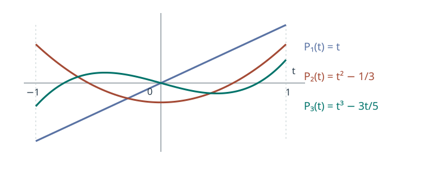

# École polytechnique — Deuxième épreuve de mathématiques · T.A. 1987 · Corrigé guidé

*Corrigé rédigé par IA, non officiel. Signalez toute erreur.*

**Rédaction** · GPT-6.2 Astra Ultra · vitesse non renseignée

Sur $]a,b[$, on se donne $A(t)=(t-a)(t-b)$ et $B(t)=\alpha(t-b)+\beta(t-a)$ avec $\alpha,\beta>0$. On cherche les polynômes propres de $u_{\alpha,\beta}(x)=Ax''+Bx'$. Une solution unitaire a un coefficient dominant égal à un.

La garde du concours commun Mines-Ponts-Télécom mentionne l’École polytechnique (option T.A.) et désigne la deuxième épreuve comme propre à cette option. [Fac-similé UPS](https://prepas.org/index.php?module=Sujets&voir=get&file=doc-0a94eca6e44a56de85b3) · [Notice annuelle](https://www.legifrance.gouv.fr/jorf/id/JORFTEXT000000516456).

## I. Construction algébrique des solutions polynomiales

### Question I.1

> [!INDICATION]
> Si $x(t)$ commence en degré $n$ par $ct^n$, examiner le coefficient de ce degré dans l’équation.

Les coefficients dominants de $A$ et $B$ sont $1$ et $\alpha+\beta$. Pour un polynôme de degré $n$ et de coefficient dominant $c\ne0$, le coefficient de $t^n$ dans $Ax''+Bx'-\lambda x$ est $c[n(n-1)+n(\alpha+\beta)-\lambda]$. Il doit s’annuler. Ainsi $\lambda=\lambda_n=n(n-1+\alpha+\beta)$. Pour une constante non nulle cela impose bien $\lambda_0=0$.

### Question I.2

> [!INDICATION]
> Étudier les différences successives, y compris la première.

On a $\lambda_{n+1}-\lambda_n=2n+\alpha+\beta>0$ pour tout $n\ge0$. Les valeurs sont donc strictement croissantes et distinctes. En particulier $\lambda_n>0$ pour $n\ge1$.

### Question I.3.a

> [!INDICATION]
> Combiner le critère de degré et la valeur propre zéro.

Pour $E_0$, toute solution polynomiale non nulle doit avoir un degré $m$ tel que $\lambda_m=0$, ce qui impose $m=0$. Réciproquement toute constante a ses deux premières dérivées nulles et convient. Les solutions sont toutes les constantes, y compris zéro.

### Question I.3.b

> [!INDICATION]
> Dériver l’équation et calculer les nouveaux coefficients de $y'$ et de $y$.

Posons $y=x'$. La dérivation de $Ax''+Bx'=\lambda_nx$ donne $Ay''+(A'+B)y'=(\lambda_n-B')y$. On a $A'=(t-a)+(t-b)$, donc $A'+B=(\alpha+1)(t-b)+(\beta+1)(t-a)$, et $B'=\alpha+\beta$. Enfin $\lambda_n-(\alpha+\beta)=(n-1)(n+\alpha+\beta)$ est exactement $\lambda_{n-1}$ pour les paramètres $\alpha+1,\beta+1$. La dérivée est donc une solution de l’équation décalée.

### Question I.3.c

> [!INDICATION]
> La dérivée de $Ay'+By$ fait apparaître précisément l’équation décalée.

Pour $y$ solution de cette équation, posons $x=(Ay'+By)/\lambda_n$, ce qui est possible pour $n\ge1$. Alors $\lambda_n x'=Ay''+(A'+B)y'+B'y=(\lambda_n-B')y+B'y=\lambda_n y$. On a donc $x'=y$ et, par construction, $Ax''+Bx'=Ay'+By=\lambda_nx$. C’est la solution polynomiale cherchée.

### Question I.3.d

> [!INDICATION]
> Dans la récurrence, permettre aux paramètres de varier et choisir la dérivée de coefficient dominant $n$.

Au rang zéro, prenons $P_0=1$ pour tous les paramètres positifs. Supposons disponibles les polynômes unitaires au rang $n-1$ pour tous ces paramètres. Pour $(\alpha,\beta)$ fixés, choisissons $y=nP_{n-1}^{(\alpha+1,\beta+1)}$. La construction de I.3.c fournit un polynôme propre $x$ dont la dérivée a pour terme dominant $nt^{n-1}$. Par conséquent $x$ est de degré $n$ et unitaire. La récurrence est établie.

### Question I.3.e

> [!INDICATION]
> Soustraire deux solutions unitaires de même degré. Quel degré la différence pourrait-elle avoir ?

Si deux solutions unitaires de degré $n$ existent, leur différence vérifie la même équation et a degré strictement inférieur à $n$ si elle n’est pas nulle. Par I.1, elle obligerait à $\lambda_m=\lambda_n$ pour un $m<n$, impossible par I.2. La solution unitaire $P_n$ est unique.

## II. Multiplicateur, formule de Rodrigues et orthogonalité

### Question II.1.a

> [!INDICATION]
> Développer les deux membres pour un polynôme quelconque, puis tester sur le polynôme identité.

Pour toute fonction lisse non identiquement nulle $f$ et tout polynôme $x$, la différence $(fAx')'-f(Ax''+Bx')$ est $[(fA)'-fB]x'$. Elle est nulle pour tout $x$ si $(fA)'=fB$. Réciproquement, prendre $x(t)=t$ impose ce même critère.

### Question II.1.b

> [!INDICATION]
> Résoudre l’équation du premier ordre sans diviser par une fonction dont on ignore encore les zéros.

Comme $A\ne0$ sur l’intervalle, le critère s’écrit $f'=((B-A')/A)f$. Or
$$
 \frac{B-A'}{A}=\frac{\alpha-1}{t-a}+\frac{\beta-1}{t-b}.
$$
La fonction positive $r(t)=(t-a)^{\alpha-1}(b-t)^{\beta-1}$ a exactement cette dérivée logarithmique. Donc $(f/r)'=0$, soit $f=cr$. Réciproquement, tout $cr$ pour $c\ne0$ vérifie le critère et est un multiplicateur.

### Question II.2.a

> [!INDICATION]
> L’ajout de $p$ à chacun des paramètres multiplie le poids positif par deux puissances de degré $p$.

Si $f=cr$ est multiplicateur, alors $fA^p=c(-1)^p(t-a)^{\alpha+p-1}(b-t)^{\beta+p-1}$. C’est un multiple non nul du poids des paramètres $\alpha+p,\beta+p$, donc le multiplicateur demandé.

### Question II.2.b

> [!INDICATION]
> Appliquer successivement la forme en divergence à $P_n$, puis à chacune de ses dérivées avec les paramètres décalés.

Posons $y_j=D^jP_n$, $w_j=fA^j$ avec $0\le j\le n$. Par I.3.b itérée, $y_j$ est propre pour les paramètres $\alpha+j,\beta+j$ avec la valeur
$$
 L_j=(n-j)(n+j-1+\alpha+\beta).
$$
Pour $j<n$, $L_j>0$, et la propriété du multiplicateur $w_j$ donne $(w_{j+1}y_{j+1})'=L_jw_jy_j$. Pour $p=1$ on a donc $(w_1y_1)'=L_0 fP_n$. Si $D^p(w_py_p)=(\prod_{j=0}^{p-1}L_j)fP_n$, dériver $p$ fois l’identité au rang $p$ donne le même résultat au rang $p+1$ avec le facteur supplémentaire $L_p$. Ainsi $D^p(fA^pD^pP_n)$ est proportionnel à $fP_n$, avec facteur non nul, pour $1\le p\le n$.

### Question II.2.c

> [!INDICATION]
> Au dernier rang, la dérivée d’ordre $n$ du polynôme unitaire est constante.

Prenons $f=r$ puis $p=n$. Pour $n\ge1$, $D^nP_n=n!$ et la question précédente donne $D^n(rA^n)=k_nrP_n$ avec $k_n=(\prod_{j=0}^{n-1}L_j)/n!\ne0$. Pour $n=0$, $P_0=1$ donne le même résultat avec $k_0=1$.

### Question II.3

> [!INDICATION]
> Développer par Leibniz. Après division par $r$, convertir les puissances de $b-t$ en puissances de $t-b$ avant de lire le coefficient dominant.

Pour $v\in\mathbb R$ et $j\ge0$, notons $(v)_{\underline j}=v(v-1)\cdots(v-j+1)$, avec produit vide égal à $1$. Comme $rA^n=(-1)^n(t-a)^{n+\alpha-1}(b-t)^{n+\beta-1}$, la dérivation de Leibniz donne
$$
 D^n(rA^n)=r(t)\sum_{j=0}^n c_j(t-a)^{n-j}(t-b)^j,
$$
$$
 c_j=\binom nj(n+\alpha-1)_{\underline j}\,(n+\beta-1)_{\underline{n-j}} .
$$
En effet $j$ dérivations touchent le premier facteur, $n-j$ le second. Le signe de ces dernières s’annule avec le signe initial et celui de $(b-t)^j=(-1)^j(t-b)^j$. Chaque polynôme de la somme est unitaire. Le coefficient dominant après division par $r$ vaut donc $\sum c_j=k_n$. On peut l’évaluer directement par II.2.c en simplifiant les facteurs $n-j$ avec $n!$, ce qui donne
$$
 k_n=\prod_{j=0}^{n-1}(n+j-1+\alpha+\beta),\qquad
 P_n(t)=\sum_{j=0}^n\frac{c_j}{k_n}(t-a)^{n-j}(t-b)^j .
$$
Les $n+1$ termes de la base indiquée ont des ordres d’annulation distincts en $a$, donc sont indépendants.

### Question II.4.a

> [!INDICATION]
> Tester séparément l’intégrabilité près de chaque extrémité et la positivité pour un polynôme non nul.

Sur $[a,b]$, les polynômes sont bornés. À gauche le poids $r$ est équivalent à une constante positive fois $(t-a)^{\alpha-1}$, à droite à une constante positive fois $(b-t)^{\beta-1}$. Les deux exposants sont supérieurs à $-1$, donc $\int_a^b rxy$ converge absolument. Cette forme est bilinéaire et symétrique. Si $x$ est non nul, il existe un segment intérieur sur lequel $|x|$ est minoré par une constante strictement positive. Ainsi $\int_a^b rx^2>0$. La forme est un produit scalaire.

### Question II.4.b

> [!INDICATION]
> Intégrer la forme en divergence sur un segment intérieur, puis examiner $rA$ aux bornes.

Puisque $(rAx')'=r\,u_{\alpha,\beta}(x)$, l’intégration par parties donne un terme de bord $rAx'y$ et l’intégrale $-\int_a^b rAx'y'$. Or $rA=-(t-a)^\alpha(b-t)^\beta$ tend vers zéro aux deux extrémités, et les facteurs polynomiaux restent bornés. Les intégrales convergent, ce qui justifie le passage à l’intervalle ouvert entier. On obtient
$$
 (u_{\alpha,\beta}(x)\mid y)=-\int_a^b A(t)r(t)x'(t)y'(t)\,dt=(x\mid u_{\alpha,\beta}(y)).
$$

### Question II.4.c

> [!INDICATION]
> Utiliser la symétrie de l’opérateur sur deux de ses vecteurs propres.

D’une part $(u(P_n)\mid P_m)=\lambda_n(P_n\mid P_m)$, d’autre part $(P_n\mid u(P_m))=\lambda_m(P_n\mid P_m)$. L’égalité de II.4.b donne $(\lambda_n-\lambda_m)(P_n\mid P_m)=0$. Si $n\ne m$, I.2 assure donc $(P_n\mid P_m)=0$.

### Question II.4.d

> [!INDICATION]
> Déplacer les $n$ dérivées sur le polynôme test. Vérifier que les termes de bord s’annulent même pour des exposants non entiers.

Posons $W=rA^n$ et $Q=D^nW/r$. La seule dérivation de Leibniz de II.3, indépendante de II.2, montre que $Q$ est un polynôme de degré au plus $n$. Pour $0\le j<n$, chaque terme de $D^j W$ présente en $a$ une puissance d’exposant au moins $\alpha+n-1-j\ge\alpha>0$, et en $b$ un exposant au moins $\beta+n-1-j\ge\beta>0$. Ces dérivées tendent donc vers zéro aux deux bornes. À l’ordre $n$, les exposants minimaux restent supérieurs à $-1$, assurant l’intégrabilité. Ainsi, pour tout polynôme $y$ de degré $<n$, $n$ intégrations par parties donnent
$$
 (Q\mid y)=\int_a^b D^nW\,y=(-1)^n\int_a^b W D^ny=0 .
$$
Pour voir sans calcul de coefficients que $Q$ est non nul, choisissons $y(t)=t^n$ dans l’identité d’intégration par parties. Alors $(Q\mid t^n)=(-1)^nn!\int_a^b W>0$, car $(-1)^nW>0$ sur l’intervalle. Les polynômes $P_0,\dots,P_n$, de degrés distincts et unitaires, forment une base orthogonale de $\mathbb R_n[t]$. Orthogonal à tous les degrés inférieurs, $Q$ est donc un multiple non nul de $P_n$. Cela redonne II.2.c, avec le cas $n=0$ immédiat.
