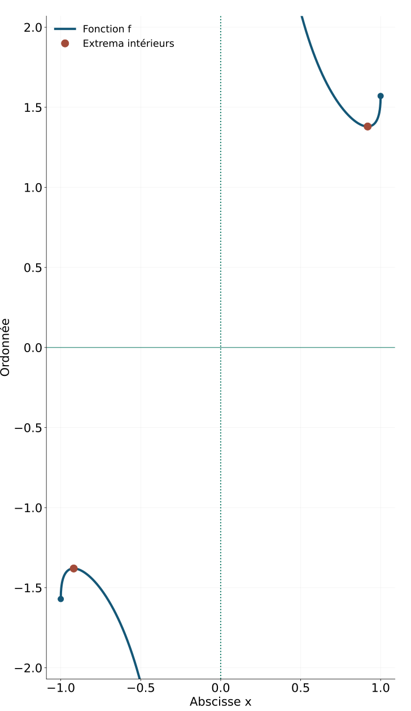
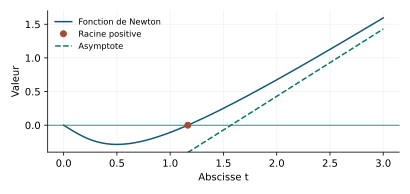

# Concours commun Mines-Ponts · École polytechnique, option T.A. — Épreuve pratique de mathématiques 1987 · Corrigé brut

*Corrigé rédigé par IA, non officiel. Signalez toute erreur.*

**Rédaction** · GPT-6.2 Astra Ultra · vitesse non renseignée · 26 novembre 2026

**Révision** · GPT-6.2 Astra Ultra · vitesse non renseignée · 26 novembre 2026

La fonction $f(x)=\arcsin(x)/x^2$ est étudiée avec les angles en radians. Les encadrements justifient les précisions numériques demandées.

## Dérivées et variations

### 1. Domaine de dérivabilité

La fonction $f(x)=\arcsin(x)/x^2$ est définie sur $[-1,0[\,\cup\,]0,1]$. Elle est dérivable sur $]-1,0[\,\cup\,]0,1[$ et

$$
f'(x)=\frac{1}{x^2\sqrt{1-x^2}}-\frac{2\arcsin x}{x^3}.
$$

Aux extrémités, $\arcsin$ possède une demi-tangente verticale et $1/x^2$ y est régulière et non nulle. Les dérivées unilatérales de $f$ en $\pm1$ ne sont donc pas finies. La fonction est impaire et sa dérivée est paire.

### 2.a. Variations de la dérivée renormalisée

Pour $0<x<1$, $g(x)=x/\sqrt{1-x^2}-2\arcsin x$ tend vers zéro en zéro, conformément à $g(0)=0$. On obtient $g'=(2x^2-1)/(1-x^2)^{3/2}$. La fonction décroît de $0$ à $1-\pi/2<0$ sur $[0,1/\sqrt2]$, puis croît jusqu’à $+\infty$ en $1^-$.

### 2.b. Unicité du point critique positif

La stricte décroissance exclut tout zéro dans $]0,1/\sqrt2]$. Sur $]1/\sqrt2,1[$, la continuité, la stricte croissance et les valeurs aux bornes assurent exactement un zéro $\alpha$. Le facteur $x^3$ est strictement positif, donc $f'$ a dans $]0,1[$ cet unique zéro, avec $\sqrt2/2<\alpha<1$.

### 2.c. Tableau de variations de la fonction

Sur $]0,\alpha]$, $f$ décroît de $+\infty$ à $f(\alpha)$, car $f(x)\sim1/x$ en zéro. Puis elle croît jusqu’à $f(1)=\pi/2$. Par imparité, sur $[-1,-\alpha]$ elle croît de $-\pi/2$ à $-f(\alpha)$, puis décroît vers $-\infty$ sur $[-\alpha,0[$.

### 3.a. Expression de la seconde dérivée

Les fonctions $\arcsin$, $1/x$ et $1/\sqrt{1-x^2}$ sont lisses sur $]0,1[$. On a donc $f\in C^2$ sur cet intervalle et

$$
f''(x)=\frac{1}{x(1-x^2)^{3/2}}-\frac{4}{x^3\sqrt{1-x^2}}+\frac{6\arcsin x}{x^4}.
$$

### 3.b. Variations de la seconde dérivée renormalisée

Pour $0<x<1$, $h=x^4f''=xg'-3g$, de limite $0$ en zéro. En dérivant on obtient

$$
h'(x)=\frac{6x^4-5x^2+2}{(1-x^2)^{5/2}}.
$$

Le trinôme $6u^2-5u+2$ a un discriminant $25-48<0$ et un coefficient dominant positif. Ainsi $h$ croît strictement de $0$ à $+\infty$ (le terme en $(1-x^2)^{-3/2}$ domine dans $h$). Alors $f''>0$ sur la branche positive et, par imparité, $f''<0$ sur la branche négative.

## Deux itérations de point fixe et premier tracé

### 4.a. Équation trigonométrique et première estimation

L’application $y\mapsto\sin y$ est bijective de $]0,\pi/2[$ sur $]0,1[$. La relation $g(\sin y)=\tan y-2y$ montre que $\beta=\arcsin\alpha$ y est l’unique solution de $\tan y=2y$. Aux bornes $1{,}16$ et $1{,}17$, la différence vaut respectivement $-0{,}02420\ldots$ et $0{,}01998\ldots$. Ainsi $1{,}16<\beta<1{,}17$ et $1{,}2$ l’approche à mieux que $10^{-1}$.

### 4.b. Instabilité de l’itération directe

Pour $T(u)=\tan u/2$, on a $T'(\beta)=1/(2\cos^2\beta)=(1+4\beta^2)/2>1$. Par continuité, $T'$ est minorée par un nombre strictement supérieur à $1$ près de $\beta$. Le théorème des accroissements finis montre que toute erreur non nulle y est amplifiée tant que les itérés restent dans ce voisinage. Le point fixe est répulsif et ne fournit pas une méthode stable pour l’approximer.

### 4.c. Itération inverse et précision garantie

Posons $V(v)=\arctan(2v)$. Le segment $[1,2]$ est stable car $1<\arctan2\le V(v)\le\arctan4<2$. Sur ce segment $0<V'=2/(1+4v^2)\le2/5$. Comme $V(\beta)=\beta$, l’inégalité des accroissements finis itérée donne

$$
|v_n-\beta|\le (2/5)^n|2-\beta|<(2/5)^n.
$$

On a donc convergence, avec $k=2/5$. Or $(2/5)^{21}<4{,}40\times10^{-9}$. Le rang $N=21$ suffit. À partir de $v_0=2$, on trouve $v_1=1{,}3258176637\ldots$, $v_{15}=1{,}16556119598\ldots$ et $v_{21}=1{,}16556118522\ldots$. Ainsi $1{,}1655611852$ approche $\beta$ à moins de $4{,}5\times10^{-9}$. Un calcul à douze décimales par pas ajoute au plus $10^{-12}/(1-2/5)$ à l’erreur.

### 4.d. Approximation de l’abscisse et de l’ordonnée

On a $\alpha=\sin\beta$ et $f(\alpha)=\beta/\sin^2\beta=\beta+1/(4\beta)$. Sur $[1,2]$, les dérivées de $\sin y$ et de $y+1/(4y)$ sont en module au plus $1$. L’erreur sur l’angle majore donc celle sur chaque image, avant arrondi. Avec le résultat de 4.c, on obtient

$$
\alpha\simeq0{,}919009722,\qquad f(\alpha)\simeq1{,}380050140,
$$

chaque erreur étant au plus $5\times10^{-9}$ en tenant compte de l’arrondi final à neuf décimales.

### 5. Tracé des deux branches

Le graphe possède l’asymptote verticale $x=0$, des demi-tangentes verticales aux points $(\pm1,\pm\pi/2)$ et des tangentes horizontales aux points opposés $(\alpha,f(\alpha))$ et $(-\alpha,-f(\alpha))$. La branche positive est convexe et la branche négative concave. Les deux axes ont la même échelle. Pour retrouver les dix centimètres par unité demandés sur le papier, imprimer le SVG du tracé à sa taille native. Le PDF en donne une réduction.

## Méthode de Newton et intégrale

### 6.a. Variations et allure de la fonction de Newton

Pour $t\ge0$, $\varphi(t)=t-\arctan(2t)$ vérifie $\varphi'=(4t^2-1)/(1+4t^2)$ et $\varphi''=16t/(1+4t^2)^2$. Elle part de $0$ avec pente $-1$, décroît jusqu’au minimum $1/2-\pi/4$ en $1/2$ puis croît jusqu’à $+\infty$, en s’annulant en $\beta$. Elle est strictement convexe et possède l’asymptote oblique $y=t-\pi/2$ à droite. Elle reste au-dessus de cette droite.

### 6.b. Position de l’intersection avec la tangente

Sur $[1,+\infty[$, $\varphi'>0$, donc $\psi(t)=t-\varphi(t)/\varphi'(t)$ y est définie. Si $t\ge\beta$, la convexité donne $0=\varphi(\beta)\ge\varphi(t)+\varphi'(t)(\beta-t)$, soit $\psi(t)\ge\beta$. De plus, $\varphi(t)\ge0$, d’où $\psi(t)\le t$, avec inégalité stricte si $t>\beta$.

### 6.c. Convergence depuis 1,2

Comme $w_0=1{,}2>\beta$, la question précédente donne $\beta\le w_{n+1}\le w_n$. La suite décroît et admet une limite $L\ge\beta$. La continuité de $\psi$ entraîne $L=\psi(L)$, donc $\varphi(L)=0$. Le seul zéro dans $[\beta,1{,}2]$ est $\beta$, d’où $w_n\to\beta$.

### 6.d. Arrêt certifié de Newton

Les pas successifs donnent $w_1=1{,}16592336133679\ldots$, $w_2=1{,}16556122804721\ldots$ et $w_3=1{,}16556118520721\ldots$. On trouve $\varphi(w_2-10^{-8})>2{,}26\times10^{-8}$, tandis que $-6{,}90\times10^{-9}<\varphi(w_3-10^{-8})<-6{,}88\times10^{-9}$. Ces signes peuvent être certifiés en écrivant $\arctan(2t)=\pi/2-\arctan(1/(2t))$ et en sommant 25 termes de la série alternée de l’arctangente. Ici $1/(2t)<1/2$, d’où un reste inférieur à $2^{-51}/51$. La croissance de $\varphi$ et la décroissance des $w_n$ donnent $w_n-10^{-8}<\beta\le w_n$ à partir du rang 3. Par exemple, $1{,}16556118$, situé entre les deux bornes du rang 3, est précis à $10^{-8}$.

### 7.a. Expression exacte de l’aire

Dans $I=\int_\alpha^1\arcsin(t)/t^2\,dt$, une intégration par parties effectuée d’abord jusqu’à $b<1$ donne le terme de bord $[-\arcsin(t)/t]_\alpha^b$ et l’intégrale de $1/(t\sqrt{1-t^2})$. Cette dernière converge en $1$. En posant $t=\sin y$, sa valeur limite est $[\ln\tan(y/2)]_\beta^{\pi/2}$. Ainsi

$$
I=\frac{\beta}{\sin\beta}-\frac{\pi}{2}-\ln\tan(\beta/2).
$$

### 7.b. Valeur à sept décimales

Si $H(y)=y/\sin y-\pi/2-\ln\tan(y/2)$, alors $H'=-y\cos y/\sin^2y$. Sur $[1{,}16,1{,}17]$, $|H'|\le 1{,}17\cos(1{,}16)/\sin^2(1{,}16)<0{,}57$. L’erreur de $10^{-8}$ sur $\beta$ induit moins de $5{,}7\times10^{-9}$ sur $I$. L’évaluation donne $I=0{,}11428753\ldots$, soit **0,1142875** à $10^{-7}$ près, arrondi inclus.

## Documents de la session

Le bandeau du concours commun indique les options M, P′ et T.A., une durée de deux heures et l’École polytechnique pour l’option T.A. [Fac-similé UPS](https://prepas.org/index.php?module=Sujets&voir=get&file=doc-ecb11c92844c565b0509) · [Notice officielle du concours](https://www.legifrance.gouv.fr/jorf/id/JORFTEXT000000516456).
