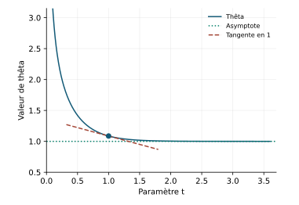
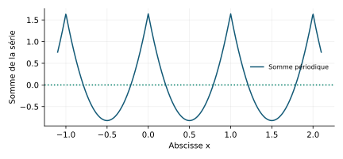

# Concours commun Mines-Ponts · École polytechnique, option T.A. — Mathématiques I 1987 · Corrigé brut

*Corrigé rédigé par IA, non officiel. Signalez toute erreur.*

**Rédaction** · GPT-6.2 Astra Ultra · vitesse non renseignée · 26 novembre 2026

**Révision** · GPT-6.2 Astra Ultra · vitesse non renseignée · 26 novembre 2026

Pour $t>0$, on pose $\Theta(t)=\sum_{n\in\mathbb Z}e^{-\pi n^2t}$. La première partie exploite la gaussienne. La seconde établit la formule sommatoire pour une classe de fonctions plus large.

## I. Étude de la fonction thêta

### I.1.a. Convergence absolue

Pour $t>0$, posons $q=e^{-\pi t}\in]0,1[$. Pour $n\ge1$, $0<q^{n^2}\le q^n$. La série géométrique converge, donc la série bilatérale converge absolument et $\Theta(t)=1+2\sum_{n\ge1}e^{-\pi n^2t}$.

### I.1.b. Continuité

Pour $t\ge\delta>0$, chaque terme est majoré par $e^{-\pi n^2\delta}$. La convergence est normale sur chaque $[\delta,+\infty[$. Une somme uniforme de fonctions continues est continue, donc $\Theta$ est continue sur $]0,+\infty[$.

### I.1.c. Dérivabilité à tous les ordres

À l’ordre $j\ge1$, le terme dérivé est $(-\pi n^2)^j e^{-\pi n^2t}$. Sur $[\delta,+\infty[$ son module est majoré par $\pi^j n^{2j}e^{-\pi n^2\delta}$, terme d’une série convergente par le critère du quotient. Le théorème de dérivation des séries s’applique à chaque ordre. Ainsi $\Theta\in C^\infty$ et ses dérivées s’obtiennent terme à terme.

### I.1.d. Monotonie et convexité

Pour tout $t>0$, $\Theta'(t)=-2\pi\sum_{n\ge1} n^2e^{-\pi n^2t}<0$ et $\Theta''(t)=2\pi^2\sum_{n\ge1}n^4e^{-\pi n^2t}>0$. La courbe est strictement décroissante et strictement convexe.

### I.2.a. Majoration du reste gaussien

Pour $k\ge1$ et $j\ge0$, $(k+j)^2\ge k^2+2kj$. En sommant une progression géométrique,

$$
0<R_k(t)=\sum_{n\ge k}e^{-\pi n^2t}\le\frac{e^{-\pi k^2t}}{1-e^{-2\pi kt}}.
$$

### I.2.b. Limite à l’infini

On a $\Theta(t)-1=2R_1(t)$. La majoration précédente tend vers zéro quand $t\to+\infty$. Par encadrement, $\Theta(t)\to1$ par valeurs supérieures.

### I.2.c. Précision des deux premiers termes

Pour $t\ge1$, l’écart à $1+2e^{-\pi t}$ est $2R_2(t)$. Il est positif et majoré par $2e^{-4\pi t}/(1-e^{-4\pi t})\le2/(e^{4\pi}-1)<7\times10^{-6}<10^{-5}$.

### I.3.a. Transformée de la gaussienne à l’origine

Fixons $t>0$ et $f(x)=e^{-\pi tx^2}$. L’intégrande de $\widehat f(u)=\int_{\mathbb R}f(x)e^{-2i\pi ux}\,dx$ a pour module $f(x)$, intégrable. En posant $v=\sqrt{\pi t}\,x$, l’intégrale gaussienne $\int_{\mathbb R}e^{-v^2}\,dv=\sqrt\pi$ donne $\widehat f(0)=1/\sqrt t$.

### I.3.b. Dérivation en fréquence

Sa dérivée en $u$ est $-2i\pi x f(x)e^{-2i\pi ux}$, dominée par $2\pi |x|e^{-\pi tx^2}$, intégrable sur $\mathbb R$. La dérivation sous le signe intégral et la continuité dominée donnent $\widehat f\in C^1$ et $\widehat f'(u)=-2i\pi\int_{\mathbb R}xf(x)e^{-2i\pi ux}\,dx$.

### I.3.c. Équation différentielle de la transformée

Comme $f'=-2\pi txf$, on trouve $\widehat f'(u)=(i/t)\int_{\mathbb R}f'(x)e^{-2i\pi ux}\,dx$. L’intégration par parties a un terme de bord nul par décroissance gaussienne. L’intégrale vaut $2i\pi u\widehat f(u)$, d’où $\widehat f'(u)=-(2\pi u/t)\widehat f(u)$.

### I.3.d. Valeur en toute fréquence

La dérivée de $e^{\pi u^2/t}\widehat f(u)$ est nulle. La valeur en zéro calculée en I.3.a fixe la constante. Ainsi $\widehat f(u)=t^{-1/2}e^{-\pi u^2/t}$ pour tout réel $u$.

### I.4.a. Périodisation gaussienne

Posons $F(x)=\sum_{p\in\mathbb Z}f(x+p)$. Pour $0\le x\le1$ et $|p|\ge2$, $|x+p|\ge |p|-1$. Le majorant $e^{-\pi t(|p|-1)^2}$ est sommable. La série converge normalement sur $[0,1]$, donc sa somme y est continue. Pour chaque réel, on ramène la série à cette période par décalage d’indice, justifié par la convergence absolue. On a $F(x+1)=F(x)$ et les valeurs aux bornes se raccordent. La fonction est continue sur $\mathbb R$.

### I.4.b. Développement en série de Fourier

Sur $[0,1]$, $|f'(x+p)|\le 2\pi t(|p|+1)e^{-\pi t(|p|-1)^2}$ dès que $|p|\ge2$. La série des dérivées converge normalement et se raccorde par le même décalage. Ainsi $F$ est de classe $C^1$ et périodique. Le théorème de convergence de Dirichlet identifie sa série de Fourier à $F$ en tout point.

### I.4.c. Calcul des coefficients

La convergence uniforme permet l’intégration terme à terme contre $e^{-2i\pi nx}$. Le changement $v=x+p$ dans chaque intégrale donne

$$
c_n=\sum_{p\in\mathbb Z}\int_p^{p+1}f(v)e^{-2i\pi nv}\,dv=\widehat f(n)=t^{-1/2}e^{-\pi n^2/t}.
$$

La réunion des intervalles recouvre la droite et $f$ est intégrable. Les coefficients ainsi trouvés sont absolument sommables.

### I.4.d. Identité de transformation

En zéro, la somme de définition donne $F(0)=\Theta(t)$. La série de Fourier donne $F(0)=\sum_nc_n=t^{-1/2}\Theta(1/t)$. Ainsi $\Theta(t)=t^{-1/2}\Theta(1/t)$ pour tout $t>0$.

### I.5.a. Encadrement et limite en zéro

Pour $0<t\le1$, I.2.c donne

$$
\frac{1+2e^{-\pi/t}}{\sqrt t}\le\Theta(t)\le\frac{1+2e^{-\pi/t}+10^{-5}}{\sqrt t}.
$$

Pour obtenir la limite additive, I.2.a donne plus précisément $0\le\Theta(t)-t^{-1/2}\le 2e^{-\pi/t}/[\sqrt t(1-e^{-2\pi/t})]\to0$. En particulier $\Theta(t)\sim t^{-1/2}$.

### I.5.b. Valeur et pente au point fixe

En dérivant, $\Theta'(t)=-\Theta(1/t)/(2t^{3/2})-\Theta'(1/t)/t^{5/2}$. En $1$, on obtient $\Theta'(1)=-\Theta(1)/4$. D’après I.2.a,

$$
0<\Theta(1)-(1+2e^{-\pi}+2e^{-4\pi})\le \frac{2e^{-9\pi}}{1-e^{-6\pi}}<1{,}1\times10^{-12}.
$$

À $10^{-5}$ près, $\Theta(1)\simeq1{,}08643$ et $\Theta'(1)\simeq-0{,}27161$.

### I.5.c. Courbe représentative

Dans un repère orthonormal, la courbe est définie pour $t>0$. Elle descend de $+\infty$ vers $1$, en restant au-dessus de $1$ et de ses tangentes. L’axe $t=0$ est asymptote verticale, et $y=1$ asymptote horizontale. La tangente en $1$ a pour équation $y=\Theta(1)[1-(t-1)/4]$.

## II. Formule sommatoire de Poisson

### II.1.a. Continuité et norme de la transformée

Soit $f\in C^2(\mathbb R,\mathbb C)$ telle que $f,f',f''$ soient absolument intégrables. On note $N_1(g)=\int_{\mathbb R}|g|$ et $N_\infty(g)=\sup_{\mathbb R}|g|$. La convergence dominée par $|f|$ donne la continuité de $\widehat f$. L’inégalité triangulaire donne $|\widehat f(u)|\le N_1(f)$ pour chaque $u$, donc $N_\infty(\widehat f)\le N_1(f)$.

### II.1.b. Transformées des deux dérivées

Si $g$ et $g'$ sont intégrables et $g\in C^1$, le critère de Cauchy appliqué à $g(v)-g(u)=\int_u^vg'$ assure des limites finies aux deux infinis. Elles valent zéro puisque $|g|$ est intégrable. Appliqué successivement à $g=f$ et $g=f'$, ce fait annule les termes de bord. Deux intégrations par parties donnent

$$
\widehat{f'}(u)=2i\pi u\widehat f(u),\qquad \widehat{f''}(u)=(2i\pi u)^2\widehat f(u).
$$

### II.1.c. Sommabilité des valeurs entières

Pour $n\ne0$, $|\widehat f(n)|\le N_1(f'')/(4\pi^2 n^2)$. La série positive en $1/n^2$ converge, et $|\widehat f(0)|\le N_1(f)$. D’où la convergence absolue de $\sum_{n\in\mathbb Z}\widehat f(n)$.

### II.2.a. Contrôle d’une valeur par une intégrale locale

Pour $a=x+p$, le théorème fondamental donne

$$
\left|f(a)-\int_a^{a+1}f(s)\,ds\right|\le\int_a^{a+1}\int_a^s|f'(v)|\,dv\,ds\le\int_a^{a+1}|f'(v)|\,dv.
$$

Ainsi $|f(a)|\le\int_a^{a+1}(|f|+|f'|)$. En sommant pour $p\in\mathbb Z$, ces intervalles se juxtaposent, ce qui donne $\sum_p |f(x+p)|\le N_1(f)+N_1(f')<\infty$.

### II.2.b. Périodicité, continuité et borne uniforme

Sur $[0,1]$, $\sup_x|f(x+p)|\le\int_p^{p+2}(|f|+|f'|)$. La somme des majorants vaut $2(N_1(f)+N_1(f'))$. Cette convergence normale donne une somme continue. La convergence absolue permet le décalage d’indice qui rend $F$ périodique, d’où la continuité sur toute la droite. La majoration ponctuelle plus précise de II.2.a donne $N_\infty(F)\le N_1(f)+N_1(f')$.

### II.2.c. Dérivée de la somme périodisée

La suite $\sup_{[0,1]}|f'(x+p)|$ est majorée par $\int_p^{p+2}(|f'|+|f''|)$, sommable en $p$. Les dérivées convergent donc normalement. La dérivation terme à terme donne $F'(x)=\sum_p f'(x+p)$, continue et périodique par raccord aux entiers. Ainsi $F\in C^1(\mathbb R)$.

### II.3.a. Série de Fourier et formule de Poisson

L’intégration terme à terme sur $[0,1]$ est permise par II.2.b. La translation sur $[p,p+1]$ et l’intégrabilité absolue donnent $c_n=\int_{\mathbb R}f(v)e^{-2i\pi nv}\,dv=\widehat f(n)$. Le théorème de Dirichlet s’applique à $F$, périodique et de classe $C^1$. La convergence est même absolue et uniforme par II.1.c. Pour tout réel $x$,

$$
F(x)=\sum_{n\in\mathbb Z}\widehat f(n)e^{2i\pi nx},\qquad \sum_{p\in\mathbb Z} f(p)=\sum_{n\in\mathbb Z}\widehat f(n),
$$

la seconde identité correspondant à $x=0$.

### II.3.b. Extension au cas d’un angle en zéro

Supposons $f$ continue et $C^2$ sur chacune des deux demi-droites fermées, avec les mêmes trois intégrales finies, les dérivées étant prises de chaque côté. Posons $J=f'(0^+)-f'(0^-)$. La continuité et la borne de $\widehat f$ sont inchangées. Les limites en l’infini de $f,f'$ s’annulent comme en II.1.b. Sur les deux demi-droites, les termes en $f(0)$ se compensent, tandis que ceux en $f'(0)$ diffèrent. Avec $\lambda=2i\pi u$ on a

$$
\widehat{f'}(u)=\lambda\widehat f(u),\qquad \widehat{f''}(u)=\lambda^2\widehat f(u)-J.
$$

Il en découle $|\widehat f(n)|\le[N_1(f'')+|J|]/(4\pi^2 n^2)$ pour $n\ne0$. L’estimation locale de II.2.a reste valide même si l’intervalle traverse zéro, car $f$ est continue et l’on peut scinder l’intégrale de sa dérivée. La périodisée reste donc continue, absolument convergente, de période $1$ et soumise à la même borne. Sur chaque intervalle entre deux entiers, les termes y sont $C^1$ et leurs dérivées convergent normalement jusque chaque extrémité, en utilisant les valeurs unilatérales. En effet, sur une période seuls les termes touchant zéro exigent ce choix et les queues admettent le majorant de II.2.c. En chaque entier, $F'_+-F'_-=J$ car un seul terme rencontre zéro. Ainsi $F$ est $C^1$ par morceaux et continue, et elle est $C^1$ partout si $J=0$. Dirichlet donne encore sa valeur en chaque point, y compris aux raccords, et le calcul des coefficients de II.3.a reste valide.

### II.4.a. Série avec un paramètre positif

Pour $a>0$, la nouvelle fonction est continue et satisfait les hypothèses de II.3.b. En intégrant sur les demi-droites, on trouve

$$
\widehat f(n)=\frac{1}{2\pi(a+in)}+\frac{1}{2\pi(a-in)}=\frac{a}{\pi(a^2+n^2)}.
$$

Pour $0\le x<1$, la somme des translatées vaut $[e^{-2\pi ax}+e^{-2\pi a(1-x)}]/[1-e^{-2\pi a}]=\cosh(\pi a(1-2x))/\sinh(\pi a)$. En appariant les fréquences opposées dans la série de Fourier, cette somme vaut aussi $1/(\pi a)+(2a/\pi)\sum_{n\ge1}\cos(2\pi nx)/(n^2+a^2)$. On obtient

$$
\sum_{n\ge1}\frac{\cos(2\pi nx)}{n^2+a^2}=\frac{\pi}{2a}\frac{\cosh(\pi a(1-2x))}{\sinh(\pi a)}-\frac{1}{2a^2}.
$$

### II.4.b. Somme de la série limite

Lorsque $a\downarrow0$, le terme de rang $n$ est dominé par $1/n^2$, donc on peut passer à la limite sous la somme. Avec $z=\pi a$ et $b=1-2x$, $\cosh(bz)/\sinh z=z^{-1}[1+(b^2/2-1/6)z^2+O(z^4)]$. Après annulation des termes en $1/(2a^2)$, on obtient

$$
\sum_{n\ge1}\frac{\cos(2\pi nx)}{n^2}=\pi^2\left(x^2-x+\tfrac16\right),\qquad 0\le x<1.
$$

Sur toute la droite, la périodicité remplace $x$ dans le polynôme par sa partie fractionnaire. Les valeurs se raccordent aux entiers et les pentes y présentent un saut.

## Documents de la session

Le bandeau du concours commun indique les options M, P′ et T.A., une durée de quatre heures et l’École polytechnique pour l’option T.A. La saisie alternative de 1987 remanie la structure. La numérotation retenue suit les deux parties du fac-similé. [Fac-similé UPS](https://prepas.org/index.php?module=Sujets&voir=get&file=doc-d05c8e57f22779798fce) · [Notice officielle du concours](https://www.legifrance.gouv.fr/jorf/id/JORFTEXT000000516456).
