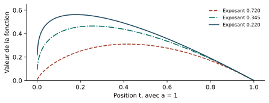
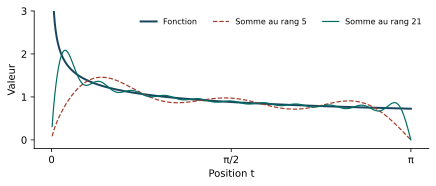

# École polytechnique — Deuxième composition de mathématiques M′ 1988 · Corrigé guidé

*Corrigé rédigé par IA, non officiel. Signalez toute erreur.*

**Rédaction** · GPT-6.2 Astra Ultra · vitesse non renseignée · 26 novembre 2026

**Révision** · GPT-6.2 Astra Ultra · vitesse non renseignée · 26 novembre 2026

On travaille sur $]0,a]$, $a>0$, avec des fonctions réelles continûment dérivables jusque $a$. Les poids dans les intégrales déterminent les comportements possibles au bord singulier $0$.

## I. Intégrabilité pondérée au voisinage de zéro

### I.1.a. Dérivée absolument intégrable

> [!INDICATION]
> Écris $f(t)$ à partir de $f(a)$. La convergence de l’intégrale impropre donne une valeur candidate pour la limite.

Puisque $f(t)=f(a)-\int_t^a f'(u)\,du$, l’intégrabilité de $|f'|$ donne la limite finie $f(a)-\int_0^a f'$. On a de plus $|f(t)|\le |f(a)|+\int_0^a |f'|$ sur tout $]0,a]$.

### I.1.b. Une première borne

> [!INDICATION]
> Pour $t\le u$, compare $t^\gamma$ et $u^\gamma$.

Si $\gamma>0$, la même identité donne $t^\gamma|f(t)|\le a^\gamma|f(a)|+\int_t^a u^\gamma|f'(u)|\,du$. Le membre de droite est majoré indépendamment de $t$ par hypothèse.

### I.1.c. Annulation de la limite pondérée

> [!INDICATION]
> Découpe maintenant au point $b$ proche de zéro plutôt qu’en $a$.

Pour $\varepsilon>0$, choisissons $b>0$ avec $\int_0^b u^\gamma|f'|<\varepsilon$. Pour $t\le b$, $t^\gamma |f(t)|\le t^\gamma|f(b)|+\varepsilon$. Faire tendre $t$ vers zéro puis $\varepsilon$ vers zéro donne $t^\gamma f(t)\to0$.

### I.1.d. Optimalité de la puissance

> [!INDICATION]
> Essaie une puissance négative dont l’exposant est strictement entre les deux seuils.

Pour $0<\delta<\gamma$, posons $p=\gamma-\delta/2$ et $f(t)=t^{-p}$. Alors $t^\gamma|f'|=p\,t^{\delta/2-1}$ est intégrable, tandis que $t^{\gamma-\delta}f(t)=t^{-\delta/2}\to+\infty$.

### I.2.a. Énergie finie sous le seuil critique

> [!INDICATION]
> Fais apparaître $u^\alpha f'(u)$ et $u^{-\alpha}$ dans l’intégrale.

Écrivons $D^2=\int_0^a u^{2\alpha}f'(u)^2\,du<\infty$. Pour $0<s<t\le a$ et $0\le\alpha<1/2$, Cauchy–Schwarz donne
$$|f(t)-f(s)|\le D\left(\frac{t^{1-2\alpha}-s^{1-2\alpha}}{1-2\alpha}\right)^{1/2}.$$
Le critère de Cauchy assure une limite finie en zéro. Ajouter une constante à $f$ conserve la dérivée et déplace librement cette limite.

### I.2.b. Au-dessus du seuil

> [!INDICATION]
> Applique l’estimation de Cauchy–Schwarz entre $t$ et un petit $b$ fixé, et conserve l’énergie locale.

Pour $\alpha>1/2$, posons $r=\alpha-1/2$. Pour $0<t<b$,
$$t^r|f(t)|\le t^r|f(b)|+\frac{1}{\sqrt{2r}}\left(\int_0^b u^{2\alpha} f'(u)^2\,du\right)^{1/2},$$
car $\int_t^b u^{-2\alpha}du\le t^{-2r}/(2r)$. La seconde quantité peut être rendue arbitrairement petite par choix de $b$. Ainsi $t^r f(t)\to0$. Si $0<\delta<r$, prenons $f(t)=t^{-p}$ pour $p=r-\delta/2$. Le poids de l’énergie est $p^2t^{-1+\delta}$, intégrable, alors que $t^{r-\delta}f(t)=t^{-\delta/2}\to+\infty$.

### I.2.c. Le cas critique

> [!INDICATION]
> Dans l’exemple logarithmique, pose $v=1+\ln(a/t)$.

Pour $\alpha=1/2$ et $f_1(t)=\ln(1+\ln(a/t))$, on a $f_1'=-1/[t(1+\ln(a/t))]$. Son énergie vaut $\int_0^a dt/[t(1+\ln(a/t))^2]=\int_1^\infty v^{-2}dv=1$. Pourtant $f_1(t)\to+\infty$. La fonction $f_2=1$ a une énergie nulle et une limite non nulle. À ce seuil, l’énergie finie n’impose donc ni une limite finie ni l’annulation en zéro.

**À la borne critique.** Écris $v=1+\ln(a/t)$. La primitive de $1/(tv^2)$ reste finie lorsque $t$ descend à zéro, alors que celle de $1/(tv)$ diverge.

### I.2.d. Intégrabilité absolue et exposant limite

> [!INDICATION]
> Le second facteur de Cauchy–Schwarz doit être de carré intégrable.

Pour tout $\delta>0$ et $\alpha\ge0$,
$$\int_0^a t^{\alpha-1/2+\delta}|f'|\,dt
\le D\left(\int_0^a t^{-1+2\delta}\,dt\right)^{1/2}<\infty.$$
Au seuil $\delta=0$, choisissons une primitive de $f'(t)=t^{-\alpha-1/2}/(1+\ln(a/t))$. Son énergie vaut $1$ comme en I.2.c. Mais $\int_0^a t^{\alpha-1/2}f'(t)dt=\int_1^\infty dv/v$ diverge. Pour $\alpha<1/2$, prendre $\delta=1/2-\alpha>0$ donne $\int |f'|<\infty$ et I.1.a redonne la limite en zéro.

## II. Espaces de fonctions et orthogonalité

### II.1.a. Inclusions et structures vectorielles

> [!INDICATION]
> Pour comparer les deux poids de $f^2$, observe que leur quotient vaut $t^2$.

Désormais $0<\alpha<1/2$. L’espace $\mathcal E$ est formé des fonctions $C^1$ de $]0,a]$ telles que $t^\alpha f\in L^2(0,a)$. Dans $\mathcal F$, on demande $t^{\alpha-1}f$ et $t^\alpha f'$ dans $L^2$, et $\mathcal G$ impose en plus $f(a)=0$. La stabilité par combinaison linéaire découle de celle de $L^2$. Comme $t^\alpha|f|\le a t^{\alpha-1}|f|$, on a $\mathcal F\subset\mathcal E$, et $\mathcal G$ est le noyau de l’évaluation en $a$ sur $\mathcal F$.

### II.1.b. Produit scalaire

> [!INDICATION]
> Justifie séparément l’existence de l’intégrale et la stricte positivité de la norme.

Pour $f,g\in\mathcal E$, $(f|g)=\int_0^a t^{2\alpha}f(t)g(t)\,dt$ existe par Cauchy–Schwarz. Il est bilinéaire, symétrique et positif. Si $(f|f)=0$, l’intégrande positif et continu est nul sur $]0,a]$, d’où $f=0$. La norme associée est $\|t^\alpha f\|_{L^2}$.

### II.1.c. Limite dans la norme et défaut de fermeture

> [!INDICATION]
> Étudie les exposants de l’intégrande près de zéro, puis compare-les à $-1$.

Posons $r=1/2-\alpha>0$. On lit $f_n(t)=(a-t)t^{r+1/n}$. En zéro, les deux intégrandes définissant $\mathcal F$ sont $O(t^{-1+2/n})$. Comme $f_n(a)=0$, $f_n\in\mathcal G$. La limite ponctuelle est $f_*(t)=(a-t)t^r$. Le facteur $t^{1/n}$ est majoré par $\max(1,a)$, et $t^{2\alpha} f_*^2=(a-t)^2t$ est intégrable. La convergence dominée donne $\|f_n-f_*\|\to0$. Or $t^{2\alpha-2}f_*^2=(a-t)^2/t$ diverge en intégrale à zéro. Ainsi $f_*\in\mathcal E\setminus\mathcal F$. Ni $\mathcal F$ ni $\mathcal G$ n’est fermé dans $\mathcal E$.

### II.2.a. Contrôle de la dérivée seconde

> [!INDICATION]
> Multiplie l’équation différentielle par $t^{\alpha+1}$.

Pour une solution $\psi=\psi_\lambda\in\mathcal F$ de $E_\lambda$, on a
$$t^{\alpha+1}\psi''=-2\alpha t^\alpha\psi'-\lambda t^{\alpha+1}\psi+\rho t^{\alpha-1}\psi.$$
Les premier et dernier termes appartiennent à $L^2$ par définition, celui du milieu également car $t^{\alpha+1}\psi=t^2t^{\alpha-1}\psi$. Ainsi $\int_0^a t^{2\alpha+2}\psi''(t)^2dt<\infty$.

### II.2.b. Terme de bord en zéro

> [!INDICATION]
> Dans $\chi'=\psi'' f+\psi'f'$, associe des facteurs dont les puissances de $t$ s’additionnent à $2\alpha$.

Avec $f\in\mathcal F$ et $\chi=\psi'f$, le produit $t^{2\alpha}|\psi'' f|$ est intégrable par Cauchy–Schwarz appliquée à $t^{\alpha+1}\psi''$ et $t^{\alpha-1}f$. Il en va de même de $t^{2\alpha}|\psi'f'|$ avec les deux facteurs pondérés par $t^\alpha$. On a donc $\int_0^a t^{2\alpha}|\chi'|<\infty$. Puisque $2\alpha>0$, I.1.c donne $\lim_{t\downarrow0}t^{2\alpha}\psi'(t)f(t)=0$.

### II.3.a. Identité de Lagrange

> [!INDICATION]
> Écris les deux équations sous la forme $(t^{2\alpha}\psi')'$ avant de soustraire.

L’équation pour $\psi_\nu$ donne $(t^{2\alpha}\psi_\nu')'=t^{2\alpha}(\rho/t^2-\nu)\psi_\nu$. Par la règle du produit,
$$
\left[t^{2\alpha}(\psi_\lambda\psi_\mu'-\psi_\mu\psi_\lambda')\right]'
=(\lambda-\mu)t^{2\alpha}\psi_\lambda\psi_\mu.
$$
Diviser par $\lambda-\mu\ne0$ fournit l’expression demandée.

### II.3.b. Orthogonalité des solutions

> [!INDICATION]
> Quels termes de bord survivent en zéro et en $a$ après intégration ?

Intégrons sur $[\varepsilon,a]$. Le crochet s’annule en $a$ puisque les deux fonctions appartiennent à $\mathcal G$. Ses deux termes tendent vers zéro en $\varepsilon$ par II.2.b. L’intégrale du produit converge dans $\mathcal E$. Le passage à la limite donne $(\lambda-\mu)(\psi_\lambda|\psi_\mu)=0$, d’où l’orthogonalité.

## III. Réduction à une équation à coefficients constants

### III.1.a. Facteurs de changement d’inconnue

> [!INDICATION]
> Le coefficient de $z'$ après division par $\theta$ détermine sa dérivée logarithmique.

Ici $a=\pi$ et $\rho=\alpha-\alpha^2$. Pour un changement inversible $y=\theta z$, $\theta$ ne s’annule pas. La régularité nécessaire à la substitution suit aussi de l’équation obtenue pour $\theta'/\theta$. Le coefficient de $z'$ est $2(\theta'/\theta+\alpha/t)$, qui doit être une constante $2c$. D’où $\theta(t)=Ct^{-\alpha}e^{ct}$, $C\in\mathbb R^*$, $c\in\mathbb R$. La substitution donne alors $z''+2cz'+(\lambda+c^2)z=0$, l’autre terme en $1/t^2$ s’annulant par le choix de $\rho$. Tous ces facteurs conviennent. L’absence de terme en $z'$ impose $c=0$.

### III.1.b. Solutions, conditions de bord et modes normés

> [!INDICATION]
> Avec $z=t^\alpha y$, le poids le plus singulier dans la définition de $\mathcal F$ devient $z^2/t^2$.

L’équation est $z''+\lambda z=0$. Pour $\lambda>0$, $z=A\cos(\sqrt\lambda t)+B\sin(\sqrt\lambda t)$. Pour $\lambda=0$, $z=A+Bt$. Dans chaque cas, toutes les solutions $y$ s’obtiennent par $y=t^{-\alpha}z$. Si $A\ne0$, $\int_0^\pi z^2/t^2$ diverge. Si $A=0$, $z=O(t)$ et $z'=O(1)$ en zéro, donc $z/t$ et $t^\alpha y'=z'-\alpha z/t$ sont de carré intégrable. Ce sont toutes les solutions dans $\mathcal F$.

Dans $\mathcal G$, il faut de plus $z(\pi)=0$. Pour $\lambda=0$ cela impose $B=0$. Pour $\lambda>0$ on obtient une solution non nulle exactement pour $\lambda=n^2$, $n=1,2,\ldots$. Avec $c_0=\sqrt{2/\pi}$, choisissons $\varphi_n(t)=c_0t^{-\alpha}\sin(nt)$. Les intégrales d’orthogonalité usuelles sur $[0,\pi]$ prouvent l’orthonormalité. Un seul mode par valeur propre suffit, puisque l’espace admissible est une droite.

### III.2.a. Coefficients de la puissance

> [!INDICATION]
> Le changement $z=t^\alpha y$ transporte le produit scalaire sur $L^2(0,\pi)$.

Pour $f(t)=t^{-\alpha}$, on a $\|f\|^2=\pi$ et
$$\widehat f_n=c_0\int_0^\pi\sin(nt)\,dt=c_0\,\frac{1-(-1)^n}{n}.$$

### III.2.b. Convergence ponctuelle et extrémité imprimée

> [!INDICATION]
> Évalue chaque somme partielle exactement en $\pi$ avant d’invoquer un théorème de Fourier.

Après multiplication par $t^\alpha$, on reconnaît la série de Fourier sinus de la constante $1$ sur $]0,\pi[$, c’est-à-dire celle du prolongement impair $2\pi$-périodique. Le théorème de Dirichlet donne $1$ sur l’intervalle ouvert et la demi-somme des limites au saut, soit zéro, en $\pi$. La série demandée converge donc vers $t^{-\alpha}$ pour $0<t<\pi$ et vers zéro en $\pi$. La convergence vers $f$ sur $]0,\pi]$ annoncée par le sujet est impossible, puisque $f(\pi)=\pi^{-\alpha}$.

La convergence n’est pas uniforme sur $]0,\pi]$, même vers cette limite corrigée, qui est discontinue en $\pi$. Sur $]0,\pi[$ elle n’est pas uniforme vers $f$ non plus. Pour chaque somme finie, $\sin(nt)=O(t)$ en zéro, donc cette somme est $O(t^{1-\alpha})$ alors que $f(t)\to+\infty$.

**Vérification à la main.** Au point $t=\pi/2$, seuls les indices impairs contribuent. Le développement de la constante $1$ fait intervenir la série alternée $1-1/3+1/5-\cdots=\pi/4$.

### III.2.c. Convergence dans la norme

> [!INDICATION]
> Une valeur en un point change-t-elle une intégrale de carré ?

Les fonctions $c_0\sin(nt)$ forment une base orthonormale de $L^2(0,\pi)$ par la théorie de Fourier (prolongement impair). Les sommes de la série sinus de $1$ convergent vers $1$ dans cet espace. Comme $\|u\|=\|t^\alpha u\|_{L^2}$, les sommes initiales convergent bien vers $f$ dans la norme de $\mathcal E$. La valeur en $\pi$ ne modifie pas le calcul de l’intégrale.

### III.3.a. Équivalent des coefficients de la seconde puissance

> [!INDICATION]
> Pose $u=nt$. Pour que la constante de l’équivalent soit non nulle, compare deux demi-périodes consécutives.

Pour $g=t^{-2\alpha}$, $\|g\|^2=\int_0^\pi t^{-2\alpha}dt<\infty$. On obtient
$$\widehat g_n=c_0 n^{\alpha-1}\int_0^{n\pi} u^{-\alpha}\sin u\,du.$$
L’intégrale impropre converge en zéro et en l’infini, en ce dernier point par le critère de Dirichlet. Sa valeur est positive. En effet, les intégrales de $u^{-\alpha}|\sin u|$ sur les intervalles successifs de longueur $\pi$ sont strictement décroissantes vers zéro, et le premier terme dépasse le deuxième. Par conséquent $\widehat g_n\sim A n^{\alpha-1}$, avec $A>0$ et $\beta=\alpha-1$.

### III.3.b. Série ordinaire et série des carrés

> [!INDICATION]
> Compare les exposants obtenus aux exposants critiques des séries de Riemann.

Puisque $-1<\alpha-1<-1/2$, les $\widehat g_n$ sont finalement positifs et leur série diverge vers $+\infty$. Les carrés ont un exposant $2\alpha-2<-1$, donc $\sum_n\widehat g_n^2$ converge.

### III.4.a. Série à coefficients absolument sommables

> [!INDICATION]
> Quelle borne de $t^{-\alpha}$ est disponible sur un intervalle qui reste à distance de zéro ?

Si $\sum_n|\gamma_n|<\infty$, la série $s(t)=c_0\sum_n\gamma_n\sin(nt)$ converge normalement sur $[0,\pi]$. Ainsi $\sum_n\gamma_n\varphi_n$ converge ponctuellement sur $]0,\pi]$ vers $k=t^{-\alpha}s$, et normalement sur chaque $[\eta,\pi]$ avec $\eta>0$, donc uniformément sur toute partie dont l’infimum est positif.

### III.4.b. La somme appartient-elle à l’espace prescrit ?

> [!INDICATION]
> La convergence de l’intégrale de carré suffit-elle pour assurer que la fonction possède une dérivée continue ?

La fonction $s=t^\alpha k$ est continue et bornée donc $\int_0^\pi t^{2\alpha}k^2<\infty$. Cependant l’énoncé exige aussi $k\in C^1(]0,\pi])$. Cela n’est pas automatique. Prenons $\gamma_n=(-1)^n/n^2$. Alors $s(\pi)=0$ et
$$s(\pi-h)=-c_0\sum_{n\ge1}\frac{\sin(nh)}{n^2}.$$
Pour $M=\lfloor\pi/(2h)\rfloor$, les $M$ premiers termes de la somme sans signe global sont au moins $(2h/\pi)\sum_{n=1}^M 1/n$. La queue a une valeur absolue au plus $1/M=O(h)$. Aussi $|s(\pi-h)|/h\to+\infty$. La dérivée gauche en $\pi$ n’existe pas comme nombre réel, et multiplier par $t^{-\alpha}$ ne corrige pas ce défaut. En général $k$ n’appartient donc pas à $\mathcal E$. Pour une suite à support fini, en revanche, $k\in\mathcal G\subset\mathcal E$.

### III.5.a. Unicité pour l’équation forcée

> [!INDICATION]
> La différence de deux solutions satisfait-elle une équation déjà étudiée ?

La différence de deux solutions dans $\mathcal G$ vérifie $E_0$. Par III.1.b elle est nulle. Il existe au plus une solution dans $\mathcal G$.

### III.5.b. Construction et dérivation terme à terme

> [!INDICATION]
> Sous le changement de III.1, le second membre est multiplié par $t^\alpha$. Quels sont les multiplicateurs de la dérivée seconde sur les sinus ?

Soit $L y=y''+(2\alpha/t)y'-(\rho/t^2)y$. On a $L\varphi_n=-n^2\varphi_n$. Choisissons $\beta_n=-\gamma_n/n^2$ et posons $z(t)=c_0\sum_{n\ge1}\beta_n\sin(nt)$. Les séries définissant $z,z',z''$ convergent normalement sur $[0,\pi]$, car $\sum n^2|\beta_n|=\sum|\gamma_n|<\infty$. On a $z''=s=t^\alpha k$. Par conséquent $h=t^{-\alpha}z$ est deux fois dérivable terme à terme sur tout $[\eta,\pi]$ et $Lh=t^{-\alpha}z''=k$ sur $]0,\pi]$.

### III.5.c. Appartenance à l’espace de bord

> [!INDICATION]
> Relis les conditions de $\mathcal F$ en termes de $z$ et vérifie la seconde extrémité.

Puisque $z(0)=0$ et $z'$ est bornée, $z(t)/t$ est bornée en zéro. Les deux fonctions $t^{\alpha-1}h=z/t$ et $t^\alpha h'=z'-\alpha z/t$ sont donc de carré intégrable. De plus $h(\pi)=0$ puisque chaque sinus s’y annule. Ainsi $h\in\mathcal G$, ce qui, avec III.5.a, établit existence et unicité.

**Comportement modèle.** Un mode isolé a la forme $t^{-\alpha}\sin(nt)$ et se comporte comme $nt^{1-\alpha}$ en zéro. Sa dérivée est alors de l’ordre de $t^{-\alpha}$, autorisé par le poids.

## Documents de la session

La garde donne l’option M′, le rang de la composition et une durée de quatre heures. Le fac-similé porte les pages 117 à 119. [Fac-similé UPS](https://prepas.org/index.php?module=Sujets&voir=get&file=doc-2e3e2a43d1bbd9828617) · [Notice officielle du concours](https://www.legifrance.gouv.fr/loda/id/JORFTEXT000000697782)
