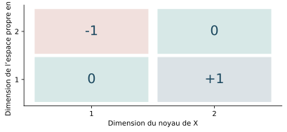
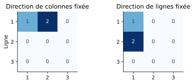

# École polytechnique — Première composition de mathématiques M′ 1988 · Corrigé brut

*Corrigé rédigé par IA, non officiel. Signalez toute erreur.*

**Rédaction** · GPT-6.2 Astra Ultra · vitesse non renseignée · 26 novembre 2026

**Révision** · GPT-6.2 Astra Ultra · vitesse non renseignée · 26 novembre 2026

Dans $E=\mathbb C^n$, avec $n\ge2$, on étudie des endomorphismes complexes de $M_n(\mathbb C)$. La notation $X^t$ désigne la transposée et $X^*$ l’adjointe. Le spectre est compté avec multiplicités algébriques.

## I. L’endomorphisme associé à la trace

### I.1. Sous-espaces propres et multiplicités

Tout $X\in M_n(\mathbb C)$ s’écrit de manière unique $X=(\operatorname{tr}X/n)I+X_0$, avec $\operatorname{tr}X_0=0$. Sur $\mathbb CI$, $\Gamma(X)=-X+(\operatorname{tr}X)I$ agit par $n-1$. Sur l’hyperplan des matrices de trace nulle, elle agit par $-1$. Ces valeurs sont distinctes pour $n\ge2$. Leurs espaces propres sont les deux termes de la somme directe et leurs multiplicités algébriques sont respectivement $1$ et $n^2-1$.

### I.2. Polynôme annulateur et inverse

La décomposition précédente donne une base propre et le polynôme annulateur $(T+1)(T-(n-1))$. Si $Y=\Gamma(X)$, alors $\operatorname{tr}Y=(n-1)\operatorname{tr}X$. Les deux valeurs propres étant non nulles, $\Gamma$ est inversible et
$$\Gamma^{-1}(Y)=-Y+\frac{\operatorname{tr}Y}{n-1}I.$$

### I.3.a. Cas d’une matrice inversible

Écrivons $t=\operatorname{tr}X$. On a $\ker\Gamma(X)=\ker(X-tI)$. Si $X$ est de rang $n$, les deux rangs sont égaux exactement quand $t\notin\operatorname{sp}X$. Si $t$ est valeur propre, le rang diminue de la dimension de l’espace propre correspondant.

### I.3.b. Cas singulier et portée des données spectrales

Posons $d_s=\dim\ker(X-sI)$, en convenant que $d_s=0$ hors du spectre. Alors
$$\operatorname{rg}\Gamma(X)-\operatorname{rg}X=d_0-d_t.$$
Les cas d’égalité, de diminution et d’augmentation correspondent respectivement à $d_0=d_t$, $d_0<d_t$ et $d_0>d_t$. Pour $t=0$, les rangs sont égaux. Pour $t\notin\operatorname{sp}X$, le rang augmente puisque $X$ est singulière.

L’énoncé définit le spectre avec les multiplicités algébriques. À elles seules, elles ne déterminent pas les $d_s$. Par exemple, en dimension cinq, prenons des blocs diagonaux $B_0,B_1,[-1]$, où chaque $B_i$ est soit $iI_2$, soit le bloc de Jordan de taille deux en $i$. Dans tous les cas le spectre est $(0,0,1,1,-1)$ et $t=1$. Or chacun des $d_0,d_1$ peut valoir $1$ ou $2$ indépendamment, ce qui réalise les trois signes.

### I.4. Calcul en dimension deux

Pour $X=\left(\begin{smallmatrix}a&b\\c&d\end{smallmatrix}\right)$, on obtient $\Gamma(X)=\left(\begin{smallmatrix}d&-b\\-c&a\end{smallmatrix}\right)=JX^tJ^*$, où $J=\left(\begin{smallmatrix}0&1\\-1&0\end{smallmatrix}\right)$. Le rang et le déterminant sont conservés, et le polynôme caractéristique est le même puisque la transposition et la similitude le préservent. Le spectre avec multiplicités est donc conservé.

Si $A$ est une autre matrice unitaire de déterminant $1$ vérifiant la formule, $J^*A$ commute avec toutes les transposées, donc avec toutes les matrices. Une telle matrice est scalaire (commuter avec les $E_{ii}$ impose la diagonalité, puis avec les $E_{ij}$ impose l’égalité des diagonales). Ainsi $A=cJ$. Son déterminant vaut $c^2$, d’où les deux solutions $J$ et $-J$.

## II. Applications linéaires qui conservent le rang

### II.5.a. Factorisation au rang un

Si $x,y\ne0$, l’application $u\mapsto x(y^tu)$ a pour image $\mathbb Cx$ et son rang vaut un. Réciproquement, dans une matrice de rang un, les colonnes sont des multiples $y_jx$ d’un même vecteur non nul $x$ et les $y_j$ ne sont pas tous nuls. D’où la forme $xy^t$.

### II.5.b. Factorisation au rang deux

La somme $xy^t+zw^t$ est le produit de $[x\ z]$ par la matrice de lignes $y^t,w^t$. Si les deux paires sont libres, le premier facteur est injectif et le second surjectif sur $\mathbb C^2$, donc le produit a rang deux. Réciproquement, choisir une base $x,z$ de l’image d’une matrice de rang deux fournit une écriture de cette forme. Ses deux lignes de coordonnées sont indépendantes puisque les colonnes engendrent toute l’image.

### II.6.a. Facteurs d’une image de rang un

La préservation du rang et II.5.a donnent $\Phi(xy^t)=pq^t$ avec $p,q\ne0$. Tous les autres couples sont $(cp,c^{-1}q)$, $c\ne0$, car la droite image fixe $p$ à un scalaire près, puis l’égalité des lignes fixe le second facteur.

### II.6.b. Une droite commune de lignes

La somme $\Phi((x_1+x_2)y_0^t)=p_1q_1^t+p_2q_2^t$ a rang au plus un. Puisque $p_1,p_2$ sont libres, II.5.b impose que $q_1,q_2$ soient colinéaires. Fixons $q_0=q_1$. Pour $x\ne0$, écrivons $\Phi(xy_0^t)=pq^t$. Le vecteur $p$ est indépendant d’au moins l’un des $p_i$. En ajoutant le produit correspondant, le même argument donne $q\parallel q_i$, donc $q\parallel q_0$. On absorbe le scalaire dans $p$. Pour $x=0$, on prend $p=0$.

### II.6.c. Linéarité et inversibilité du facteur

Le vecteur $p(x)$ dans $\Phi(xy_0^t)=p(x)q_0^t$ est unique. Par linéarité de $\Phi$, l’application $x\mapsto p(x)$ est linéaire, donc s’écrit $Ax$. Son noyau est nul puisque $x\ne0$ donne une image de rang un. Ainsi $A$ est inversible.

### II.7. Une droite commune de colonnes

Sous l’hypothèse de la question, toutes les images non nulles ont une même droite image, de directeur $p_0\ne0$. On peut donc écrire de manière unique $\Phi(xy_0^t)=p_0q(x)^t$. L’application $x\mapsto q(x)$ est linéaire par unicité et injective par conservation du rang. Si $B^t$ est sa matrice, alors $B$ est inversible et $\Phi(xy_0^t)=p_0x^tB$.

### II.8.a. Indépendance des deux vecteurs fixés

Sous l’hypothèse H, $p_0$ et $q_0$ sont non nuls par conservation du rang. Si $y'_0=cy_0$, $c\ne0$, alors $cAxq_0^t=p_0x^tB$ pour tout $x$. Pour $x\ne0$, cela imposerait $Ax\in\mathbb Cp_0$. C’est impossible puisque $A$ est surjective et $n\ge2$.

### II.8.b. Impossibilité de l’hypothèse mixte

Prenons $x=A^{-1}p_0$ et $x'$ indépendant de $x$. Puisque $y_0,y'_0$ sont libres, $xy_0^t+x'(y'_0)^t$ a rang deux. Son image vaut $p_0(q_0^t+(x')^t B)$ et a rang au plus un. Cela contredit l’hypothèse sur $\Phi$.

### II.9.a. Deuxième facteur proportionnel

Si $y=\lambda y_0$, alors $\Phi(xy^t)=\lambda Axq_0^t=Ax(\lambda q_0)^t$, y compris pour $\lambda=0$.

### II.9.b. Deuxième facteur indépendant

Pour $y$ indépendant de $y_0$, II.6–7 appliquées à $y$ laissent deux possibilités. La forme avec colonne fixée donnerait H, exclue en II.8. Ainsi $\Phi(xy^t)=A_1xq^t$ avec $A_1$ inversible. Si $q$ et $q_0$ étaient colinéaires, l’image de $xy_0^t+x'y^t$, avec $x,x'$ indépendants, aurait rang au plus un, bien que l’original ait rang deux. Donc $q,q_0$ sont indépendants. Pour $y$ fixé, remplacer $(A_1,q)$ par $(cA_1,c^{-1}q)$ ne change rien. Ce sont toutes les possibilités, par égalité des droites de lignes pour $x\ne0$ puis identification de la colonne.

### II.9.c. Choix d’un facteur gauche universel

La matrice $Axq_0^t+A_1xq^t$ a rang au plus un pour tout $x$. Comme $q,q_0$ sont libres, $A_1x$ et $Ax$ sont liés. L’endomorphisme $A^{-1}A_1$ préserve donc chaque droite. Dans une base, il est diagonal et l’invariance des droites engendrées par $e_i+e_j$ rend toutes ses valeurs diagonales égales. Ainsi $A_1=cA$, $c\ne0$, et on absorbe $c$ dans $q$.

Pour tout $y$, y compris les multiples de $y_0$, la formule devient $\Phi(xy^t)=Ax\,r(y)^t$. Fixer un $x$ non nul permet de lire $r(y)$ de façon unique. Cette application est linéaire et injective par conservation du rang. Il existe donc $B$ inversible tel que $r(y)=B^ty$, d’où $\Phi(xy^t)=Axy^tB$.

### II.9.d. Matrice quelconque

Les $E_{ij}=e_ie_j^t$ forment une base de $M_n$. Par linéarité et II.9.c, $\Phi(X)=AXB$ pour toute matrice $X$.

### II.9.e. L’application trilinéaire et les libertés de factorisation

On a $\varphi(x,y,u)=(y^tBu)Ax$. Donc $L(u,y)=(y^tBu)A$ et $M(u,x)=(Ax)(Bu)^t=Axu^tB^t$. Pour $y\ne0$, la forme $u\mapsto y^tBu$ est non nulle et $u\mapsto L(u,y)$ a pour image $\mathbb CA$, de dimension un. Pour $x\ne0$, l’application $u\mapsto M(u,x)$ est injective puisque $Ax\ne0$ et $B$ est inversible. Son rang vaut $n$.

Si $A'XB'=AXB$ pour toutes les matrices de rang un, cette égalité vaut partout par linéarité. Alors $P=A^{-1}A'$ vérifie $PX=XQ$, avec $Q=B(B')^{-1}$. Prendre $X=I$ donne $P=Q$ et le commutant de toutes les matrices est scalaire. Les couples cherchés sont exactement $(cA,c^{-1}B)$, $c\in\mathbb C^*$.

### II.10.a. Transposition des images

La transposition est linéaire et conserve le rang. Ainsi $\Phi'(X)=\Phi(X)^t$ conserve le rang et $\Phi'(xy_0^t)=B^txp_0^t$. Appliquant II.9.c–d avec le facteur gauche $B^t$, on obtient une matrice inversible $C$ telle que $\Phi'(xy^t)=B^txy^tC$ pour tout $y$, avec $y_0^tC=p_0^t$, puis $\Phi'(X)=B^tXC$.

### II.10.b. Seconde forme possible

Il vient $\Phi(X)=C^tX^t B$. En réunissant II.9 et II.10, tout endomorphisme qui conserve le rang a la forme $AXB$ ou $AX^tB$, les deux facteurs étant inversibles. Réciproquement, chacune de ces deux formes conserve le rang.

## III. Conservation du déterminant et du spectre

### III.11.a. Déterminant d’un faisceau

Si $r=\operatorname{rg}X$, écrivons $X=PJ_rQ$ où $J_r=\operatorname{diag}(I_r,0)$ et $P,Q$ sont inversibles. Alors $Y=P(I-J_r)Q$ et $\det(\rho X+Y)=\det(PQ)\rho^r$, monôme de degré $r$ (constant non nul pour $r=0$). Ici les diagonales sont les projecteurs complémentaires de la réduction par équivalence.

### III.11.b. Comparaison des degrés et injectivité

Posons $s=\operatorname{rg}\Psi(X)$. Par multilinéarité en les colonnes, tout terme de degré $>s$ dans $\det(\rho\Psi(X)+\Psi(Y))$ contient plus de $s$ colonnes de $\Psi(X)$ et s’annule. Or ce déterminant vaut $\det\Psi(\rho X+Y)=\det(PQ)\rho^r$. Il s’ensuit $r\le s$. En particulier $\Psi(X)=0$ entraîne $X=0$. La dimension étant finie, $\Psi$ est inversible.

### III.11.c. Description complète

Pour $Z=\Psi(X)$, $\det\Psi^{-1}(Z)=\det X=\det Z$. L’inégalité précédente appliquée à $\Psi^{-1}$ donne $s\le r$. Ainsi $\Psi$ conserve le rang et vaut $X\mapsto AXB$ ou $X\mapsto AX^tB$. Dans les deux cas, prendre $X=I$ donne $\det A\det B=1$. Cette condition suffit par multiplicativité du déterminant.

### III.12.a. Comparaison des polynômes caractéristiques

La conservation du spectre implique celle du déterminant. En particulier $\det\Psi(I)=1$, donc $G=\Psi(I)^{-1}$ existe et $\det G=1$. On a
$$\det(\rho I-G\Psi(X))=\det(G)\det\Psi(\rho I-X)=\det(\rho I-X).$$
Ainsi $\operatorname{sp}(G\Psi(X))=\operatorname{sp}X$. Puisque $\operatorname{sp}\Psi(X)=\operatorname{sp}X$ et que $\Psi$ est surjective par III.11, il suit $\operatorname{sp}(GZ)=\operatorname{sp}Z$ pour tout $Z$.

### III.12.b. L’image de l’identité

L’égalité des spectres entraîne $\operatorname{tr}((G-I)Z)=0$ pour tout $Z$. Avec $Z=E_{ji}$ on lit l’entrée $(i,j)$ de $G-I$, donc $G=I$. Ainsi $\Psi(I)=I$, soit $AB=I$ dans chacune des formes de III.11.c. Les solutions sont exactement $X\mapsto AXA^{-1}$ et $X\mapsto AX^tA^{-1}$, où $A$ est inversible.

### III.12.c. Préservation supplémentaire des hermitiennes

Pour la première forme, la condition équivaut à $A^*AH=HA^*A$ pour toute $H$ hermitienne. Celles-ci engendrent $M_n(\mathbb C)$ sur $\mathbb C$, car $X=(X+X^*)/2+i(X-X^*)/(2i)$. Donc $A^*A=cI$, avec $c>0$ par positivité. La matrice $U=c^{-1/2}A$ est unitaire et définit la même conjugaison. Pour la forme transposée, $H^t$ parcourt aussi les matrices hermitiennes, d’où la même condition sur $A$. Les solutions sont exactement $X\mapsto UXU^*$ et $X\mapsto UX^tU^*$, pour $U$ unitaire. La réciproque découle de la stabilité des hermitiennes par transposition et conjugaison unitaire.

## Documents de la session

La garde donne l’option M′, le rang de la composition et une durée de quatre heures. Le fac-similé porte les pages 114 à 116. La transcription UPS finit en 12.b. La question 12.c de la page 116 est traitée ici. [Transcription UPS](https://prepas.org/index.php?module=Sujets&voir=get&file=doc-5cf3745bf713b03303c6). [Fac-similé UPS](https://prepas.org/index.php?module=Sujets&voir=get&file=doc-341d2014318fa1ad217e) · [Notice officielle du concours](https://www.legifrance.gouv.fr/loda/id/JORFTEXT000000697782)
