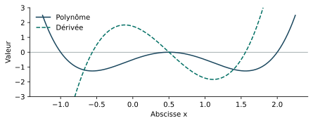
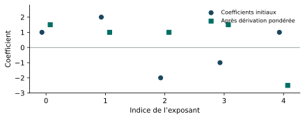

# École polytechnique — Deuxième composition de mathématiques P′ 1988 · Corrigé guidé

*Corrigé rédigé par IA, non officiel. Signalez toute erreur.*

**Rédaction** · GPT-6.2 Astra Ultra · vitesse non renseignée · 26 novembre 2026

**Révision** · GPT-6.2 Astra Ultra · vitesse non renseignée · 26 novembre 2026

Pour une fonction réelle de classe $C^\infty$ sur un intervalle ouvert $J$, on compte sur un intervalle non ponctuel $I\subset J$ les zéros avec leurs ordres. Une infinité de zéros distincts ou un zéro plat donne $Z=+\infty$. Les variations de signe $N(a)$ se comptent après suppression des coefficients nuls.

## I. Ordre d’un zéro et théorème de Rolle

### I.1.a. Factorisation locale et globale

> [!INDICATION]
> Développe $f$ en $x_0$ à l’ordre $n$ et regarde le quotient sur $J\setminus\{x_0\}$.

Par Taylor–Young, si $f^{(k)}(x_0)=0$ pour $0\le k<n$, le quotient $g_n(x)=f(x)/(x-x_0)^n$ se prolonge continûment en $g_n(x_0)=f^{(n)}(x_0)/n!$. Réciproquement une telle factorisation avec $g_n$ continue donne $f(x)=O((x-x_0)^n)$. Le premier terme non nul du développement d’ordre $n$ ne peut alors avoir de degré $<n$. L’ordre vaut exactement $n$ si et seulement si $g_n(x_0)\ne0$.

### I.1.b. Isolement et zéros plats

> [!INDICATION]
> Cherche un exemple à oscillations de plus en plus rapides, amorties par une fonction plate.

À un zéro d’ordre fini $n$, $g_n$ est non nulle sur un voisinage de $x_0$ par continuité. La factorisation y isole le zéro. Sur $\mathbb R$, prenons $f(x)=e^{-1/x^2}\sin(1/x)$ pour $x\ne0$ et $f(0)=0$. Chaque dérivée hors zéro est une somme de produits de $e^{-1/x^2}$, d’un polynôme en $1/x$ et d’une fonction trigonométrique bornée. Toutes s’étendent par zéro, de sorte que $0$ est un zéro plat. Les points $1/(k\pi)$ sont d’autres zéros qui l’approchent, et $f$ n’est pas identiquement nulle.

### I.1.c. Division dans la classe des fonctions lisses

> [!INDICATION]
> Écris l’accroissement de $f$ à l’aide de l’intégrale de sa dérivée sur le segment et itère la division.

Le théorème fondamental donne $g_1(x)=\int_0^1 f'(x+t(x_0-x))\,dt$, y compris en $x=x_0$. Ses dérivées d’ordre $k$ s’obtiennent en intégrant $(1-t)^k f^{(k+1)}(x+t(x_0-x))$, continûment sur tout compact de $J$. Donc $g_1$ est lisse. Plus généralement la formule de Taylor avec reste intégral donne
$$g_n(x)=\frac1{(n-1)!}\int_0^1 (1-s)^{n-1}f^{(n)}(x_0+s(x-x_0))\,ds.$$
On peut de même dériver à tout ordre, d’où $g_n\in C^\infty(J)$.

### I.2.a. Zéros de multiplicité finie sur un compact

> [!INDICATION]
> Que donne une infinité de zéros dans le compact $[a,b]$ ?

S’il y avait une infinité de zéros distincts, une sous-suite convergerait vers $c\in[a,b]$, lui-même zéro par continuité. I.1.b exclut une telle accumulation en un zéro d’ordre fini, y compris si $c=a$ ou $b$ puisque $J$ est ouvert. La somme finie des multiplicités finies est donc finie.

### I.2.b. Parité et signes aux extrémités

> [!INDICATION]
> Quel est le signe du facteur $(x-x_0)^m$ de part et d’autre d’une racine ?

Autour d’un zéro d’ordre $m$, le facteur non nul garde son signe tandis que $(x-x_0)^m$ change de signe exactement pour $m$ impair. Sur les intervalles sans zéro, le signe reste constant. Si $f(a)f(b)\ne0$, on obtient $\operatorname{sgn}(f(a)f(b))=(-1)^{Z(f)}$. Une valeur positive indique un nombre pair, et une valeur négative un nombre impair.

**Deux cas.** Un zéro d’ordre trois inverse le signe. Deux zéros d’ordre un et un zéro d’ordre deux donnent quatre zéros avec multiplicité et le même signe aux deux extrémités.

### I.2.c. Inégalité de Rolle avec multiplicité

> [!INDICATION]
> Compte les zéros conservés par la dérivée, puis ceux que Rolle donne entre racines distinctes.

Pour $s\ge1$ zéros distincts $x_1<\cdots<x_s$ d’ordres $m_i$, la dérivée possède $\sum_i(m_i-1)$ zéros avec multiplicité à ces points et au moins $s-1$ autres entre eux. Ainsi $Z(f')\ge Z(f)-1$. Pour $s=0$ l’inégalité est immédiate. L’égalité est réalisée par $f(x)=(x-x_1)^m$, avec $a<x_1<b$.

Si $f(a)f'(a)>0$, on peut multiplier $f$ par $-1$ pour prendre $f(a),f'(a)>0$. Si $s\ge1$, le premier zéro est strictement après $a$. La pente moyenne sur $[a,x_1]$ est négative, donc $f'$ y prend une valeur négative et s’annule entre $a$ et ce point, en plus du décompte précédent. Si $f(b)f'(b)<0$, appliquer le même argument à $x\mapsto f(a+b-x)$ fournit un zéro supplémentaire après le dernier zéro. Dans les deux cas, $Z(f')\ge Z(f)$, également vrai pour $s=0$.

### I.2.d. Une infinité de zéros

> [!INDICATION]
> Vérifie les deux façons pour $Z(f)$ de valoir l’infini et teste la réciproque sur une constante.

Un zéro plat de $f$ est plat pour $f'$. Une infinité de zéros distincts donne, pour tout entier $m$, au moins $m-1$ zéros distincts de $f'$ par Rolle entre $m$ zéros choisis. Donc $Z(f')=+\infty$. La réciproque échoue pour $f=1$ et $f'=0$.

### I.3. Série entière à coefficients finalement positifs ou nuls

> [!INDICATION]
> Dérive assez de fois pour supprimer les coefficients initiaux de signe quelconque. Examine aussi la série nulle.

Si $f$ est un polynôme non nul, il n’a qu’un nombre fini de zéros avec multiplicité. Sinon il y a un coefficient strictement positif de rang au moins $n_0$ et $f^{(n_0)}(x)>0$ pour $0<x<\rho$, par dérivation de la série à coefficients de queue positifs ou nuls. Des applications successives de Rolle sur les segments compacts inclus dans $]0,\rho[$ donnent au plus $n_0$ zéros sur cet intervalle, multiplicités comprises. L’origine, si elle est zéro, a un ordre fini égal au premier indice de coefficient non nul.

La conclusion imprimée demande de supposer $f\not\equiv0$. Si tous les coefficients sont nuls, les hypothèses sur leurs signes sont encore satisfaites et $Z(f)=+\infty$.

### I.4. Multiplication par une fonction sans zéro

> [!INDICATION]
> Que devient le facteur non nul dans la factorisation d’une racine ?

Si $Z(u)=0$ sur $I$, $uf$ et $f$ ont les mêmes zéros. À chaque point de $I$, $u$ est localement inversible dans la classe lisse. La multiplication conserve donc tous les ordres finis et la platitude. Ainsi $Z(uf)=Z(f)$, même pour la valeur $+\infty$.

### I.5. Changement de variable régulier

> [!INDICATION]
> Relie la dérivée non nulle de $\varphi$ à l’ordre du zéro de $\varphi(t)-\varphi(t_0)$.

La dérivée continue et non nulle garde un signe sur $J_1$. Ainsi $\varphi$ est strictement monotone et $I'=\varphi^{-1}(I)$ est un intervalle porté bijectivement sur $I$, puisque $\varphi(J_1)$ contient $J$. Si $\varphi(t_0)=x_0$, le facteur $\varphi(t)-x_0$ a un zéro simple en $t_0$. En composant la factorisation de I.1.a, chaque ordre fini de $f$ est conservé. La même argumentation à tout ordre, ou le changement inverse lisse, préserve la platitude. Par bijection des zéros, les deux nombres $Z$ sont égaux.

## II. Variations de signe et sommes d’exponentielles

### II.1.a. Unicité des coefficients non nuls

> [!INDICATION]
> Dans une relation linéaire entre exponentielles, isole le plus petit exposant à $+\infty$.

L’énoncé prend $f(x)=\sum_{i=0}^n a_i e^{-\lambda_i x}$ avec $\lambda_0<\cdots<\lambda_n$. Une combinaison nulle de fréquences distinctes donne, après multiplication par $e^{\lambda_0x}$ et passage à $+\infty$, le premier coefficient nul. On recommence pour toutes les fréquences. En réunissant les exposants de deux écritures puis en les soustrayant, on obtient donc les mêmes couples exposant-coefficient non nul. L’insertion ou le retrait de coefficients nuls laisse $N(a)$ inchangé.

### II.1.b. Réduire d’une unité la variation

> [!INDICATION]
> Développe $g=e^{-\mu x}(e^{\mu x}f)'$ : de quel côté du point $\mu$ le signe des coefficients change-t-il ?

La nouvelle suite est $b_j=(\mu-\lambda_j)a_j$. Pour $j<i$ le facteur est positif et pour $j\ge i$ il est négatif. La variation entre $a_{i-1}$ et $a_i$ disparaît, les autres demeurent. Ainsi $N(b)=N(a)-1$. Les facteurs exponentiels ne s’annulent pas. Le théorème de Rolle appliqué à $e^{\mu x}f$ sur un compact contenant les zéros que l’on veut compter donne $Z(g)\ge Z(f)-1$ si $Z(f)$ est fini, et $Z(g)=+\infty$ si $Z(f)=+\infty$. Cette formulation résulte aussi en choisissant un nombre arbitrairement grand de zéros lorsqu’ils sont infiniment nombreux.

### II.1.c. Majoration et parité

> [!INDICATION]
> Commence par des coefficients de même signe. Aux deux bouts de la droite, quel terme domine ?

Lorsque $N(a)=0$, tous les termes non nuls ont même signe et la somme ne s’annule pas. Par récurrence, II.1.b donne pour $N(a)\ge1$ un $g$ ayant au plus $N(a)-1$ zéros, donc $Z(f)\le N(a)<\infty$. On a supprimé les coefficients nuls grâce à II.1.a. Les signes de $f$ loin à gauche et à droite sont respectivement ceux de $a_n$ et de $a_0$ par domination des exponentielles extrêmes. Sur un grand compact contenant tous les zéros, I.2.b donne $(-1)^{Z(f)}=\operatorname{sgn}(a_na_0)=(-1)^{N(a)}$. La différence est donc un entier pair positif ou nul.

### II.2. Racines positives et négatives d’un polynôme

> [!INDICATION]
> Que deviennent les monômes par le changement $x=e^{-t}$ ? Pour les racines négatives, travaille avec $f(-x)$.

Les racines positives de $f$ correspondent, avec leurs ordres, aux zéros réels de $f(e^{-t})=\sum_{j=0}^n a_j\exp(-jt)$ sur la droite réelle. I.5 et II.1.c donnent $N(a)-Z_1(f)\in2\mathbb N$. Le polynôme $f(-x)$ a pour coefficients $a'_i=(-1)^ia_i$ et ses racines positives sont les opposées des racines négatives de $f$, avec leurs ordres. Donc $N(a')-Z_2(f)\in2\mathbb N$. Les zéros à l’origine sont exclus des deux décomptes.

**Vérification.** Pour $(x-1)^2(x+2)=x^3-3x+2$, les coefficients sont $(2,-3,0,1)$. Les deux changements comptent la racine positive double.

### II.3.a. Somme binomiale d’exponentielles

> [!INDICATION]
> Écris $k^x$ comme exponentielle et compte les alternances avant toute recherche de racines.

Pour $F(x)=\sum_{k=1}^n(-1)^{n-k}\binom nk k^x$, les exposants $\lambda_k=-\ln k$ sont distincts. Les ranger en sens croissant inverse l’ordre des coefficients, ce qui conserve leurs $n-1$ changements de signe. Ainsi $Z(F)\le n-1$.

### II.3.b. Localisation et ordre de tous les zéros

> [!INDICATION]
> L’opérateur $x\,d/dx$ multiplie le monôme de degré $k$ par quel nombre ?

Si $f_0(x)=(x-1)^n$ et $f_{j+1}=xf_j'$, alors pour tout entier $j\ge1$,
$$f_j(x)=\sum_{k=1}^n(-1)^{n-k}\binom nk k^j x^k,\qquad F(j)=f_j(1).$$
Pour $j=0$, le terme constant de $f_0$ manque dans $F(0)$, donc $F(0)=f_0(1)-(-1)^n=(-1)^{n+1}$. Près de $1$, dériver abaisse d’une unité l’ordre du zéro, et multiplier par $x$ le conserve. Ainsi $f_j(1)=0$ pour $1\le j<n$. Ces $n-1$ zéros distincts épuisent la borne de II.3.a. Ils sont tous simples. Pour $n=1$ il n’y a aucun zéro.

### II.4.a. Abscisse de convergence

> [!INDICATION]
> Après un rang assez grand, les termes sont de même signe et les exposants positifs.

Si la série $\sum a_ne^{-\lambda_n x_0}$ converge, sa queue est absolument convergente car les $a_n$ ont un signe fixe. Pour $x>x_0$ et $n$ grand, $e^{-\lambda_n x}\le e^{-\lambda_n x_0}$ puisque $\lambda_n\to+\infty$. Ainsi l’ensemble des abscisses de convergence est stable vers la droite. Son infimum $\alpha$ convient, avec les conventions $+\infty$ pour l’ensemble vide et $-\infty$ pour toute la droite. Aucune affirmation générale n’est requise au point $\alpha$.

### II.4.b. Trois abscisses possibles

> [!INDICATION]
> Fixe $\lambda_n=n$ et choisis des coefficients dont la croissance bat, ou ne bat pas, une exponentielle.

Avec $\lambda_n=n$ et $a_n=e^{-n^2}$, la série converge pour tout $x$ et $\alpha=-\infty$. Pour $a_n=e^{n^2}$, son terme ne tend vers zéro pour aucun $x$, d’où $\alpha=+\infty$. Pour $a_n=1$, la série géométrique converge exactement pour $x>0$, d’où $\alpha=0$.

### II.4.c. Dérivation et conservation de l’abscisse

> [!INDICATION]
> Pour absorber $\lambda_n^k$, utilise une marge strictement positive entre l’abscisse de contrôle et l’intervalle étudié.

Fixons $u>\alpha$ et $\alpha<v<u$. Pour tout $k\ge0$, la suite $\lambda_n^k e^{-\lambda_n(u-v)}$ est bornée à partir du rang où $\lambda_n>0$. Les séries de dérivées de chaque ordre convergent donc normalement sur chaque compact de $[u,\infty[$ par comparaison à $\sum |a_n|e^{-\lambda_nv}$. Ainsi $F$ est $C^\infty$ et $F'(x)=\sum_n (-\lambda_na_n)e^{-\lambda_n x}$.

La série dérivée converge pour $x>\alpha$. Si elle converge en un point $x<\alpha$, elle y converge absolument par son signe final, et comme $\lambda_n\ge1$ pour $n$ grand, la série initiale y converge également, contradiction. Les deux abscisses coïncident, y compris si $\alpha=-\infty$.

### II.4.d. Nombre total de zéros de la série

> [!INDICATION]
> Choisis $\mu$ entre deux exposants successifs dont les coefficients non nuls sont de signes contraires. Que devient l’abscisse quand on multiplie les coefficients par $\mu-\lambda_n$ ?

Après suppression des zéros, s’il n’y a aucune variation, tous les termes non nuls ont même signe et $F$ ne s’annule pas. Sinon, plaçons $\mu$ entre les exposants de deux termes non nuls successifs de signes contraires, en évitant tous les exposants. La fonction $G=e^{-\mu x}(e^{\mu x}F)'$ a pour coefficients $(\mu-\lambda_n)a_n$ et supporte une variation de moins. Ces coefficients ont encore signe final constant. L’argument de II.4.c (le facteur $|\mu-\lambda_n|$ croît comme $\lambda_n$) conserve l’abscisse de convergence. La récurrence donne donc $Z(G)\le N(a)-1$ sur $]\alpha,\infty[$. Rolle sur les compacts contenant tout ensemble fini de zéros, avec leurs multiplicités, donne $Z(F)\le N(a)$. Un zéro plat conduirait aussi à un zéro plat de $G$, impossible par récurrence.

### II.5.a. Application à une série entière

> [!INDICATION]
> Transporte l’intervalle $]0,\rho[$ sur une demi-droite.

Pour $x=e^{-t}$ la série devient $\sum a_ne^{-nt}$ d’abscisse $\alpha=-\ln\rho$ (avec $-\infty$ si $\rho=+\infty$). En effet elle converge pour $e^{-t}<\rho$ et diverge pour $e^{-t}>\rho$. Le changement de variable conserve les ordres, d’où $Z(f)\le N(a)$ par II.4.d.

### II.5.b. Perte de la parité

> [!INDICATION]
> Une série de rayon fini peut-elle rester strictement positive malgré une variation des coefficients ?

Prenons $f(x)=1-\tfrac12\sum_{n\ge1}x^n/[n(n+1)]$. Le rayon est $1$, et les coefficients ont une variation. Sur $]0,1[$, $\sum x^n/[n(n+1)]\le\sum 1/[n(n+1)]=1$ par télescopage. Ainsi $f(x)\ge1/2$, $Z(f)=0$ et la différence $N(a)-Z(f)=1$ est impaire.

## III. Wronskiens et variation des signes

### III.1. Zéro d’un déterminant

> [!INDICATION]
> Écris le système des annulations successives en $x_0$ comme un système homogène à $p$ inconnues.

Prenons la matrice $V=(h_{n_j}^{(k)}(x_0))_{0\le k<p,1\le j\le p}$, dont le déterminant est le wronskien $W$. La condition $Va=0$ signifie que les dérivées d’ordres $0$ à $p-1$ de $\sum a_jh_{n_j}$ s’annulent en $x_0$. L’existence d’un $a\ne0$ équivaut à $\det V=0$, ce qui démontre l’équivalence, même si la combinaison est identiquement nulle.

### III.2.a. Non-annulation des wronskiens extraits

> [!INDICATION]
> Combien de variations au plus peut avoir une suite ayant seulement $p$ coefficients non nuls ?

Sous $P_n$, si un wronskien extrait de taille $p$ s’annulait, III.1 donnerait une combinaison à zéro d’ordre au moins $p$. En la complétant par des coefficients nuls, elle présente au plus $p-1$ changements de signe. Cela contredit $P_n$. Chaque wronskien est donc continu et sans zéro sur l’intervalle $I$, de signe constant que l’on note $\varepsilon(n_1,\ldots,n_p)$.

### III.2.b. Coefficients d’un zéro normalisé

> [!INDICATION]
> Utilise Cramer pour le système dont le second membre est le dernier vecteur de base.

Soit $D=W(h_0,\ldots,h_n)(x_0)\ne0$ et $D_i$ le wronskien de taille $n$ obtenu en omettant $h_i$ et la ligne d’ordre $n$, calculé en $x_0$. Pour imposer les dérivées d’ordres $0,\ldots,n-1$ nulles et la dérivée d’ordre $n$ égale à un, le système complet a une unique solution, donnée par
$$a_i=(-1)^{n+i}D_i/D,\qquad 0\le i\le n.$$
Aucun $a_i$ n’est nul d’après III.2.a. La combinaison possède un zéro d’ordre $n$, donc $N(a)\ge n$ par $P_n$. Avec $n+1$ termes il s’ensuit que tous les signes alternent. En particulier $\operatorname{sgn}(a_0a_i)=(-1)^i$. La formule de Cramer donne alors $\operatorname{sgn}(D_i)=\operatorname{sgn}(D_0)$ pour tout $i$, y compris $i=n$. Tous les signes des wronskiens demandés sont égaux.

**Au rang deux.** Pour $(1,x,x^2)$ en zéro, les conditions donnent $(0,0,1/2)$, mais cette famille ne vérifie pas la propriété sur un intervalle contenant zéro. Sur $]0,+\infty[$, à $x_0=1$, le polynôme $(x-1)^2/2$ fournit les trois coefficients non nuls alternés.

### III.2.c. Signe commun à une taille donnée

> [!INDICATION]
> Compare deux sélections de $p$ colonnes qui ne diffèrent que d’un seul indice, dans leur union.

Toute sous-famille conserve $P$ à son propre rang, par insertion de coefficients nuls. Pour $1\le p\le n$, deux sous-ensembles de $p$ indices qui ne diffèrent que d’un élément sont contenus dans une même famille de $p+1$ indices. Appliquer III.2.b à cette famille montre l’égalité des signes entre les deux wronskiens de taille $p$. On relie deux sélections quelconques par échanges successifs. Pour $p=n+1$, il n’y a qu’un choix. Avec III.2.a, c’est exactement $Q_n$.

### III.2.d. Interprétation aux tailles un et deux

> [!INDICATION]
> Calcule la dérivée de $h_j/h_i$.

Pour $p=1$, chaque $h_i$ est partout non nulle et toutes ont le même signe. Pour $p=2$, $W(h_i,h_j)=h_i^2(h_j/h_i)'$ pour $i<j$. Tous ces rapports ont une dérivée partout non nulle et de même signe, indépendamment du couple. Ils sont donc tous strictement croissants ou tous strictement décroissants.

### III.3.a. Deux identités de wronskiens

> [!INDICATION]
> Regroupe les lignes selon l’ordre de dérivation dans la formule de Leibniz, puis fais apparaître une colonne constante.

La matrice des dérivées de $\psi f_j$ est le produit à gauche de la matrice des dérivées de $f_j$ par une matrice triangulaire inférieure, au sens suivant : $V(\psi f)=L V(f)$, où $L_{kr}=\binom{k}{r}\psi^{(k-r)}$ pour $r\le k$. Sa diagonale vaut $\psi$ et $W(\psi f_1,\ldots,\psi f_p)=\psi^p W(f_1,\ldots,f_p)$, même où $\psi$ s’annule.

Si $f_j$ est partout non nulle, appliquons cette formule avec $\psi=1/f_j$. La $j$-ième colonne devient $(1,0,\ldots,0)^t$. Le développement suivant cette colonne fournit
$$\frac{W(f_1,\ldots,f_p)}{f_j^p}
=(-1)^{j-1}W\big((f_1/f_j)',\ldots,(f_{j-1}/f_j)',(f_{j+1}/f_j)',\ldots,(f_p/f_j)'\big),$$
avec les termes de gauche ou de droite omis au bord. Pour $p=1$, le déterminant vide vaut un.

### III.3.b. Famille des quotients dérivés

> [!INDICATION]
> Compte à la fois la position du pivot $h_i$ et le nombre de signes moins introduits devant les quotients.

Choisissons $p$ des $H$, provenant d’indices $j_1<\cdots<j_p$ différents de $i$. Si $r$ de ces indices précèdent $i$, leur définition donne $r$ signes moins. Dans la famille des $p+1$ fonctions obtenue en insérant $h_i$ dans l’ordre, ce dernier est en position $r+1$. III.3.a donne un autre facteur $(-1)^r$, qui annule le premier. D’où
$$W(H_{j_1}^*,\ldots,H_{j_p}^*)=\frac{W(h_{j_1},\ldots,h_{j_r},h_i,h_{j_{r+1}},\ldots,h_{j_p})}{h_i^{p+1}},$$
où $H_j^*$ désigne le quotient dérivé signé provenant de $h_j$ dans la famille renumérotée de l’énoncé. Le numérateur a le signe commun de taille $p+1$ et le dénominateur ne s’annule pas, son signe étant fixé. Cela donne $Q_{n-1}$, y compris pour les pivots extrêmes.

### III.3.c. Réciproque de la propriété des wronskiens

> [!INDICATION]
> Choisis pour pivot le premier coefficient non nul d’un bloc qui suit un changement de signe.

Nous avons déjà démontré $P_n\Rightarrow Q_n$. Prouvons la réciproque par récurrence. Pour une famille réduite à une fonction, $Q_0$ signifie qu’elle est sans zéro, ce qui donne $P_0$. Sous $Q_n$, toutes les $h_j$ ont même signe, donc $N(a)=0$ entraîne $Z(h)=0$.

Si $N(a)>0$, choisissons $i$ avec $a_i$ de signe opposé au coefficient non nul qui le précède (après suppression des zéros). Pour $h=\sum a_jh_j$, la dérivée de $h/h_i$ s’écrit dans la famille de III.3.b avec les coefficients $-a_j$ pour $j<i$, $a_j$ pour $j>i$, sans coefficient pour $i$. Il en reste au moins un non nul. La variation devient $N(a)-1$ : après inversion des signes à gauche, le dernier coefficient de gauche a le signe de $a_i$, et supprimer $a_i$ ne crée alors aucune variation. L’hypothèse de récurrence majore $Z((h/h_i)')$ par $N(a)-1$. Rolle, avec les multiplicités, donne $Z(h/h_i)\le N(a)$ sur tout l’intervalle. Enfin $h_i$ n’a aucun zéro, donc $Z(h)=Z(h/h_i)$. C’est $P_n$.

### III.3.d. Exemple d’une famille complète

> [!INDICATION]
> Pour des exponentielles, sors le facteur exponentiel de chaque colonne du wronskien.

Sur $\mathbb R$, prenons $h_j(x)=e^{jx}$, $0\le j\le n$. Pour des indices croissants $j_1,\ldots,j_p$, leur wronskien vaut
$$e^{(j_1+\cdots+j_p)x}\prod_{1\le r<s\le p}(j_s-j_r)>0.$$
En effet, le déterminant restant est celui de Vandermonde. Ainsi $Q_n$ est satisfaite et III.3.c donne $P_n$.

## Documents de la session

La garde donne l’option P′, le rang de la composition et une durée de quatre heures. Le fac-similé porte les pages 122 à 124. [Fac-similé UPS](https://prepas.org/index.php?module=Sujets&voir=get&file=doc-44c3a4e126af6cfee26d) · [Notice officielle du concours](https://www.legifrance.gouv.fr/loda/id/JORFTEXT000000697782)
