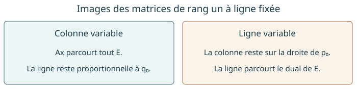

# École polytechnique — Première composition de mathématiques · Option P′ 1988 · Corrigé brut

*Corrigé rédigé par IA, non officiel. Signalez toute erreur.*

**Rédaction** · GPT-6.2 Astra Ultra · vitesse non renseignée

On travaille sur $E=\mathbb C^n$, avec $n\ge2$. On note $x^t$ la transposée de la colonne $x$, sans conjugaison complexe, et $E_{ij}=e_i e_j^t$ les matrices élémentaires. Le spectre tient compte des multiplicités algébriques.

Le corrigé brut suit la numérotation imprimée (recueil, pages 120 et 121). [Fac-similé UPS m88xp1ea](https://prepas.org/index.php?module=Sujets&voir=get&file=doc-d1e092eec687c96e214d) · [Notice annuelle de la session 1988](https://www.legifrance.gouv.fr/loda/id/JORFTEXT000000697782).

## I. Un endomorphisme construit à partir de la trace

### Question I.1

Écrivons $X=H+aI$ avec $a=\operatorname{tr}(X)/n$. Alors $\operatorname{tr} H=0$ et $\tau(X)=-H+(n-1)aI$. Les espaces propres sont donc l’hyperplan des matrices de trace nulle pour la valeur $-1$, et la droite $\mathbb CI$ pour la valeur $n-1$. Ces valeurs sont distinctes et les deux espaces sont supplémentaires. Leurs dimensions, respectivement $n^2-1$ et $1$, donnent aussi les multiplicités algébriques.

### Question I.2

La décomposition précédente fournit une base propre, donc $\tau$ est diagonalisable. Le polynôme $P(T)=(T+1)(T-(n-1))$ l’annule puisqu’il s’annule sur les deux valeurs propres. Pour $Y=H+aI$, l’antécédent est $-H+aI/(n-1)$. Ainsi

$$
\tau^{-1}(Y)=-Y+\frac{\operatorname{tr}Y}{n-1}I.
$$

### Question I.3

Pour $X=E_{12}$, on a $\tau(X)=-X$ et les deux rangs valent $1$. Pour $X=E_{11}$, la matrice $\tau(X)=I-E_{11}$ a rang $n-1>1$. Enfin, pour $X=\tau^{-1}(E_{11})$, les coefficients diagonaux sont $-(n-2)/(n-1)$ puis $1/(n-1)$, tous non nuls pour $n\ge3$. Le rang passe cette fois de $n$ à $1$.

### Question I.4

Posons $J=\left(\begin{smallmatrix}0&1\\-1&0\end{smallmatrix}\right)$. Si $X=\left(\begin{smallmatrix}a&b\\c&d\end{smallmatrix}\right)$, alors $\tau(X)=\left(\begin{smallmatrix}d&-b\\-c&a\end{smallmatrix}\right)=JX^tJ^{-1}$. Les deux matrices cherchées sont $J$ et $J^{-1}$, chacune de déterminant $1$. La transposition conserve le rang et le polynôme caractéristique, et la conjugaison les conserve également. Ainsi les rangs, les déterminants et les spectres de $X$ et $\tau(X)$ sont égaux.

## II. Classer les applications linéaires qui conservent le rang

### Question II.1.a

Si $X$ a rang $1$, ses colonnes sont des multiples $y_jx$ d’un même vecteur $x\ne0$, dont l’un au moins est non nul. Ainsi $X=xy^t$ avec $y=(y_j)\ne0$. Réciproquement, une telle matrice agit par $v\mapsto(y^tv)x$. Comme la forme $y^t$ est non nulle, l’image est exactement $\mathbb Cx$.

### Question II.1.b

Si $X$ a rang $2$, prenons une base $(x,z)$ de son image. Les coordonnées des colonnes dans cette base donnent deux lignes $y^t,w^t$ telles que $X=xy^t+zw^t$. L’application $v\mapsto(y^tv,w^tv)$ est surjective sur $\mathbb C^2$, puisque l’image de $X$ est de dimension deux. Les lignes sont donc indépendantes. Réciproquement, cette surjection suivie de l’injection $(a,b)\mapsto ax+bz$ donne une matrice de rang $2$ dès que les deux couples sont libres.

### Question II.2.a

Si $x,y$ sont non nuls, $\Phi(xy^t)$ a rang $1$ et s’écrit $pq^t$ avec $p,q$ non nuls. Toute autre écriture $p'q'^t$ a la même image, donc $p'=cp$ pour un $c\ne0$. En lisant une ligne où une coordonnée de $p$ est non nulle, on obtient $q'=q/c$. Tous les choix s’obtiennent ainsi.

### Question II.2.b

La somme $p_1q_1^t+p_2q_2^t=\Phi((x_1+x_2)y_0^t)$ est de rang au plus $1$. Comme $p_1,p_2$ sont indépendants, II.1.b impose que $q_1,q_2$ soient liés. Fixons $q_0=q_1$. Pour $x\ne0$, écrivons $\Phi(xy_0^t)=pq^t$. Le vecteur $p$ est indépendant d’au moins un des $p_i$. Appliquons le même argument à $x+x_i$ pour cet indice. Alors $q$ est proportionnel à $q_i$, donc à $q_0$. On absorbe le coefficient dans $p$. Pour $x=0$, il suffit de prendre $p=0$.

### Question II.2.c

L’application $u\mapsto uq_0^t$ est injective puisque $q_0\ne0$. La colonne $u$ de II.2.b est donc déterminée par $x$ et dépend linéairement de lui, par linéarité de $\Phi$. Notons $A$ la matrice de $x\mapsto u$. Si $Ax=0$, l’image de $xy_0^t$ a rang nul, donc $xy_0^t=0$ et $x=0$. En dimension finie, $A$ est inversible et $\Phi(xy_0^t)=Axq_0^t$.

### Question II.3

Choisissons $x_1\ne0$ et une colonne $p_0$ dans une factorisation de son image. L’hypothèse impose que toutes les autres colonnes de factorisation soient proportionnelles à $p_0$. Il existe donc pour tout $x$ une unique ligne $q(x)^t$ telle que $\Phi(xy_0^t)=p_0q(x)^t$. Cette ligne dépend linéairement de $x$. Elle est nulle seulement si $xy_0^t$ est de rang nul, donc si $x=0$. L’application $x\mapsto q(x)$ est un isomorphisme de matrice $B^t$ pour une certaine $B$ inversible. Ainsi $\Phi(xy_0^t)=p_0x^tB$.

### Question II.4.a

Les vecteurs $p_0,q_0$ sont non nuls puisque $\Phi$ conserve le rang. Si $y'_0=cy_0$ avec $c\ne0$, on aurait $cAxq_0^t=p_0 x^tB$ pour tout $x$. Pour $x\ne0$, cela obligerait $Ax$ à appartenir à la droite de $p_0$. Or $A$ est surjective et $n\ge2$. Les deux vecteurs $y_0,y'_0$ sont donc indépendants.

### Question II.4.b

Posons $x=A^{-1}p_0$ et choisissons $x'$ indépendant de $x$. Comme $y_0,y'_0$ sont indépendants, $xy_0^t+x'y_0'^t$ a rang $2$. Son image vaut $p_0(q_0^t+x'^t B)$ et a rang au plus $1$. La contradiction avec la conservation du rang exclut l’hypothèse où les deux comportements coexistent.

### Question II.5.a

Si $y=cy_0$, alors $xy^t=cxy_0^t$ et $\Phi(xy^t)=cAxq_0^t=Ax(cq_0)^t$. La formule vaut aussi pour $c=0$.

### Question II.5.b

Pour $y$ indépendant de $y_0$, II.2–4 imposent la forme $\Phi(xy^t)=A_yxq^t$ avec $A_y$ inversible. L’application $\Phi$ est injective, car $\Phi(X)=0$ implique $\operatorname{rg} X=0$. Or les deux espaces de départ $\{xy^t\}$ et $\{xy_0^t\}$ ont intersection nulle, en raison de l’indépendance des lignes. Si $q$ et $q_0$ étaient liés, leurs images coïncideraient par surjectivité de $A_y$ et de $A$, ce qui contredirait l’injectivité. Enfin on peut remplacer $(A_y,q)$ par $(cA_y,q/c)$ pour tout $c\ne0$. La droite de $q$ étant imposée par l’espace des lignes de sortie, c’est toute l’ambiguïté.

### Question II.5.c

L’image de $x(y+y_0)^t$ est $A_yxq^t+Axq_0^t$ et a rang au plus $1$. L’indépendance des lignes donne $A_yx\in\mathbb C Ax$ pour tout $x$. Ainsi $T=A^{-1}A_y$ laisse toute droite stable. En écrivant $Te_i=c_i e_i$ puis en appliquant $T$ à $e_i+e_j$, on trouve $c_i=c_j$. Donc $A_y=cA$ avec $c\ne0$. On absorbe $c$ dans $q$. Avec II.5.a, on obtient pour tout $y$ une unique ligne $q(y)^t$ telle que $\Phi(xy^t)=Axq(y)^t$ pour tout $x$. Fixer un $x\ne0$ prouve par linéarité que $y\mapsto q(y)$ est linéaire. La conservation du rang la rend injective, donc bijective. Pour une matrice inversible $B$, on a finalement $q(y)^t=y^tB$.

### Question II.5.d

La formule de II.5.c s’applique à $E_{ij}=e_i e_j^t$ et donne $\Phi(E_{ij})=AE_{ij}B$. Ces matrices forment une base. Par linéarité, pour tout $X$, on obtient $\Phi(X)=AXB$.

### Question II.6.a

La transposition est linéaire sur $\mathbb C$ et préserve le rang. Il en est donc de même pour $\Phi'(X)=\Phi(X)^t$. L’hypothèse de II.6 donne $\Phi'(xy_0^t)=B^t x p_0^t$. C’est précisément le premier comportement, avec facteur gauche $B^t$. Par II.5.c–d, il existe une matrice inversible $D$ telle que $\Phi'(xy^t)=B^txy^tD$ pour tout $x,y$, puis $\Phi'(X)=B^tXD$ pour toute matrice $X$.

### Question II.6.b

La transposition de $\Phi'(X)=B^tXD$ donne $\Phi(X)=D^tX^tB$. Avec $A=D^t$, c’est la forme $\Phi(X)=AX^tB$, avec $A,B$ inversibles. Les deux formes obtenues conservent bien le rang, par invariance sous les changements de base et sous la transposition.

## III. Préserver le déterminant ou le spectre

### Question III.1.a

Sur chaque coordonnée, les entrées de $J_r,K$ ont somme $1$. Au moins l’une des deux est non nulle. Comme les rangs ont pour somme $n$, exactement une entrée par coordonnée est non nulle et elle vaut $1$. Écrivons $X=UJ_rV$ et $Y=UKV$ avec les mêmes matrices inversibles $U,V$. Alors $\det(\rho X+Y)=\det(U)\det(V)\rho^r$. Son degré est exactement $r$, y compris lorsque $r=0$.

### Question III.1.b

Le coefficient de $\rho^k$ dans $\det(\rho\Psi(X)+\Psi(Y))$ est une somme de déterminants où $k$ colonnes viennent de $\Psi(X)$. Si $k>s=\operatorname{rg}\Psi(X)$, ces colonnes sont liées, donc le coefficient est nul. Par linéarité et conservation du déterminant, le polynôme coïncide avec celui de III.1.a, ce qui donne $r\le s$. Ainsi $\Psi(X)=0$ entraîne $r=0$ et $X=0$. L’endomorphisme $\Psi$ est inversible.

### Question III.1.c

Si $Z=\Psi(X)$, alors $\det\Psi^{-1}(Z)=\det X=\det Z$. L’inégalité de III.1.b appliquée à $\Psi^{-1}$ donne $s\le r$, donc les rangs sont égaux. La partie II fournit $\Psi(X)=AXB$ ou $\Psi(X)=AX^tB$. En $X=I$, on trouve $\det A\,\det B=1$. Réciproquement cette condition avec $A,B$ inversibles assure la conservation du déterminant dans les deux cas.

### Question III.2.a

La conservation du spectre donne celle du déterminant, donc $\det\Psi(I)=1$ et $G=\Psi(I)^{-1}$ a déterminant $1$. Par linéarité,

$$
\det(\rho I-G\Psi(X))=\det G\,\det\Psi(\rho I-X)=\det(\rho I-X).
$$

Ainsi $G\Psi(X)$ a le spectre de $X$, qui est aussi celui de $\Psi(X)$. Comme $\Psi$ est surjective par III.1.b, tout $Z$ est de la forme $\Psi(X)$ et $\operatorname{sp}(GZ)=\operatorname{sp}Z$.

### Question III.2.b

Pour tout $Z$, III.2.a donne $\operatorname{tr}((G-I)Z)=0$. Avec $Z=E_{ij}$, cette trace vaut $(G-I)_{ji}$. Tous les coefficients sont nuls, donc $G=I$ et $\Psi(I)=I$. Les deux formes de III.1.c donnent alors $AB=I$. Finalement $\Psi(X)=AXA^{-1}$ ou $\Psi(X)=AX^tA^{-1}$. Chacune convient car une matrice, sa transposée et ses conjuguées ont le même polynôme caractéristique.
