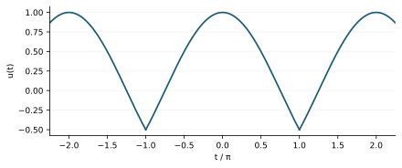
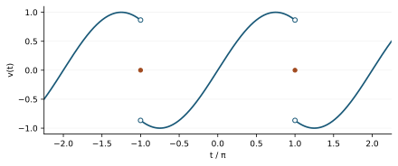

# Concours commun Mines-Ponts · École polytechnique, option T.A. — Deuxième épreuve de mathématiques 1988 · Corrigé brut

*Corrigé rédigé par IA, non officiel. Signalez toute erreur.*

**Rédaction** · GPT-6.2 Astra Ultra · vitesse non renseignée · 26 novembre 2026

On prolonge périodiquement $\cos(xt)$ et $\sin(xt)$ pour un réel positif non entier $x$. Les séries de Fourier obtenues servent ensuite à calculer quatre intégrales dépendant de $x\in]-1,1[$.

## Partie I — Prolongements périodiques et fractions simples

### I.1.a. Prolongements pair et impair

Pour $x>0$ non entier, on définit $u(t)=\cos(x(t-2k\pi))$ sur $[(2k-1)\pi,(2k+1)\pi]$. Les deux valeurs possibles aux raccords coïncident, car le cosinus est pair. Cette formule donne l’unique prolongement périodique de la donnée initiale et il est pair. À l’intérieur des mêmes intervalles, $v(t)=\sin(x(t-2k\pi))$. Périodicité et imparité imposent $v(\pi)=v(-\pi)=-v(\pi)$, donc $v((2k+1)\pi)=0$. Les choix indiqués rendent $v$ impaire et déterminent partout son unique prolongement.

### I.1.b. Graphes pour deux tiers

Sur $[-\pi,\pi]$, $u(t)=\cos(2t/3)$ atteint $1$ en zéro et $-1/2$ aux deux extrémités. Pour $v$, l’arc de $\sin(2t/3)$ prend les valeurs extrêmes $\pm1$ en $\pm3\pi/4$. À chaque raccord impair, sa limite gauche est $\sqrt3/2$, sa limite droite $-\sqrt3/2$ et sa valeur est zéro. La translation de $2\pi$ reproduit ces motifs.

### I.1.c. Coefficients trigonométriques

Avec la normalisation $2/\pi$ de l’intégrale sur $[0,\pi]$, on utilise $\sin((x\pm n)\pi)=(-1)^n\sin(\pi x)$. En ajoutant les deux fréquences pour le produit des cosinus et en les retranchant pour le produit des sinus, on trouve

$$
A_n=\frac{2(-1)^n x\sin(\pi x)}{\pi(x^2-n^2)},\qquad B_n=\frac{2(-1)^n n\sin(\pi x)}{\pi(x^2-n^2)} .
$$

Les expressions valent aussi pour $n=0$, donnant $A_0=2\sin(\pi x)/(\pi x)$ et $B_0=0$. Le dénominateur reste non nul par hypothèse.

### I.1.d. Développements de Fourier

Ces fonctions périodiques sont de classe $C^1$ par morceaux. Le théorème de Dirichlet donne à chaque point la demi-somme des limites latérales. Elle vaut la fonction elle-même partout, par continuité pour $u$, et par symétrie des limites aux sauts pour $v$. Les parités éliminent respectivement les sinus et les cosinus. Il vient pour tout $t$

$$
u(t)=\frac{\sin(\pi x)}{\pi x}+\frac{2\sin(\pi x)}{\pi}\sum_{n\ge1}\frac{(-1)^n x\cos(nt)}{x^2-n^2},\qquad
v(t)=\frac{2\sin(\pi x)}{\pi}\sum_{n\ge1}\frac{(-1)^n n\sin(nt)}{x^2-n^2}.
$$

### I.2.a. Deux identités de fractions simples

D’une part $u(0)=1$. D’autre part $u(\pi)=\cos(\pi x)$ et $\cos(n\pi)=(-1)^n$. En divisant les deux évaluations par $\sin(\pi x)\ne0$, on obtient

$$
\frac1{\sin(\pi x)}=\frac1{\pi x}+\frac2\pi\sum_{n\ge1}\frac{(-1)^n x}{x^2-n^2},\qquad
\cot(\pi x)=\frac1{\pi x}+\frac2\pi\sum_{n\ge1}\frac{x}{x^2-n^2}.
$$

### I.2.b. Dénominateurs pairs et impairs

Notons $O=\sum_{n\ge0} x/(x^2-(2n+1)^2)$ et $E=\sum_{n\ge1}x/(x^2-4n^2)$. Les séries convergent absolument et les sommes simple et alternée de I.2.a valent $E+O$ et $E-O$. Soustraction et addition, puis les identités d’angle moitié, donnent

$$
O=\frac\pi4\big(\cot(\pi x)-1/\sin(\pi x)\big)=-\frac\pi4\tan(\pi x/2),
\qquad E=\frac\pi4\cot(\pi x/2)-\frac1{2x}.
$$

### I.3. Somme alternée sur les impairs

En $t=\pi/2$, $v(t)=\sin(\pi x/2)$. Les termes pairs sont nuls et $\sin((2n+1)\pi/2)=(-1)^n$. En substituant dans I.1.d puis en utilisant la formule de l’angle double, il vient

$$
\sum_{n\ge0}\frac{(-1)^{n+1}(2n+1)}{x^2-(2n+1)^2}
=\frac{\pi\sin(\pi x/2)}{2\sin(\pi x)}=\frac\pi{4\cos(\pi x/2)} .
$$

On a simplement supprimé des termes nuls de la série convergente, sans permuter les termes non nuls.

## Partie II — Intégrales hyperboliques

### II.1.a. Convergence de la première intégrale

Pour $|x|<1$, $f(t)=\cosh(xt)/\cosh t$ est continue en zéro et vaut $1$ en ce point. Sur la demi-droite, $0<f(t)\le2e^{-(1-|x|)t}$, en majorant $\cosh(xt)$ par $e^{|x|t}$ et en minorant $\cosh t$ par $e^t/2$. Son intégrale $F(x)$ converge.

### II.1.b. Deux valeurs de référence

Dans $F(0)$, le premier changement de variable donne $dt/\cosh t=ds/(1+s^2)$. Ainsi $F(0)=\pi/2$. Dans $F(1/2)$, $\cosh(t/2)dt=2ds$ et $\cosh t=1+2s^2$, d’où $F(1/2)=2\int_0^\infty ds/(1+2s^2)=\pi/\sqrt2$.

### II.2.a. Intégrales des termes élémentaires

Écrivons $q=2n+1$. Comme $q\pm x>0$, la fonction $f_n=2(-1)^n\cosh(xt)e^{-qt}$ est absolument intégrable. Les intégrales exponentielles donnent $J_n(x)=(-1)^n((q-x)^{-1}+(q+x)^{-1})=2(-1)^nq/(q^2-x^2)$.

### II.2.b. Somme finie et reste exact

Pour $S_p=\sum_{n=0}^p f_n$, la somme géométrique donne $S_p=2\cosh(xt)e^{-t}(1-(-e^{-2t})^{p+1})/(1+e^{-2t})$. Comme $2e^{-t}/(1+e^{-2t})=1/\cosh t$, on a $S_p=f(1-(-e^{-2t})^{p+1})$ et $R_p=f-S_p=f(-e^{-2t})^{p+1}$. Ces formules s’étendent directement à $t=0$.

### II.2.c. Contrôle du reste intégré

Comme $|x|<1$ et $\cosh$ croît sur les réels positifs, $0<f(t)\le1$. Donc $|R_p(t)|\le e^{-2(p+1)t}$. En intégrant sur $[0,\infty[$, on trouve $|\int_0^\infty R_p|\le1/(2p+2)\to0$, même si la suite des restes ne tend pas vers zéro en $t=0$.

### II.3.a. Série pour la première intégrale

L’intégration de $f=S_p+R_p$ donne $F(x)=\sum_{n=0}^pJ_n(x)+\int_0^\infty R_p(t)dt$. Le dernier terme tend vers zéro par II.2.c. Ainsi $F(x)=\sum_{n=0}^\infty J_n(x)$ avec les termes dans l’ordre prescrit.

### II.3.b. Somme de la première intégrale

Le terme $2(-1)^nq/(q^2-x^2)$ est le double du terme de I.3. Pour $0<x<1$, il en résulte $F(x)=\pi/(2\cos(\pi x/2))$. L’intégrande et l’expression finale sont paires en $x$, donc la formule s’étend à $-1<x<0$, et II.1.b la confirme en zéro. En $1/2$, elle donne $\pi/\sqrt2$.

### II.4.a. Continuité et convergence pour la seconde intégrale

Le développement $\sinh(xt)=xt+O(t^3)$ et $\sinh t=t+O(t^3)$ donne $g(t)=\sinh(xt)/\sinh t\to x=g(0)$. Le prolongement est donc continu sur la demi-droite. Pour $t\ge1$, on a $|g(t)|\le C e^{-(1-|x|)t}$, puisque $\sinh t=e^t(1-e^{-2t})/2$. L’intégrale $G(x)$ converge absolument.

### II.4.b. Valeurs en zéro et en un demi

On a $G(0)=0$. Comme $\sinh t=2\sinh(t/2)\cosh(t/2)$, le changement $s=t/2$ donne $G(1/2)=\int_0^\infty ds/\cosh s=\pi/2$ par II.1.b.

### II.5. Somme de la seconde intégrale

Pour $t>0$,

$$
g(t)=\sum_{n=0}^p 2e^{-(2n+1)t}\sinh(xt)+g(t)e^{-2(p+1)t}.
$$

Comme $|g(t)|\le1$ par monotonie de $\sinh$ sur $[0,\infty[$, l’intégrale du reste est au plus $1/(2p+2)$ en valeur absolue. Avec $q=2n+1$, le terme intégré vaut $(q-x)^{-1}-(q+x)^{-1}=2x/(q^2-x^2)$. Ainsi, pour $0<x<1$, la somme vaut $-2O=\pi\tan(\pi x/2)/2$ par I.2.b. L’imparité en $x$ donne la même formule sur $]-1,1[$, zéro compris. Elle redonne $G(1/2)=\pi/2$.

## Partie III — Dérivation des intégrales

### III.1. Deux nouvelles intégrales

Les intégrandes $t\sinh(xt)/\cosh t$ et $t\cosh(xt)/\sinh t$ se comportent respectivement comme $xt^2+O(t^4)$ et $1+O(t^2)$ à l’origine. Sur $[1,\infty[$, elles sont dominées en module par $C t e^{-(1-|x|)t}$. Donc les deux intégrales $A(x)$ et $B(x)$ sont absolument convergentes pour $|x|<1$.

### III.2. Dérivation sous le signe intégral

Fixons $a<1$ avec $a>0$ et $|x|\le a$. Les dérivées en $x$ des intégrandes de $F,G$ sont celles de $A,B$. Sur $0<t\le1$, $|t\sinh(xt)/\cosh t|\le\sinh a$ et $|t\cosh(xt)/\sinh t|\le\cosh a$ car $\sinh t\ge t$. Sur $t\ge1$, on a le majorant intégrable commun $Ct e^{-(1-a)t}$. Les dérivées sont continues en $x$ et la domination vaut sur chaque compact. Le théorème de dérivation des intégrales donne $F,G\in C^1(]-1,1[)$ et $F'=A$, $G'=B$.

### III.3. Formules finales

Avec $z=\pi x/2$, les dérivées de $\pi/(2\cos z)$ et de $(\pi/2)\tan z$ donnent

$$
A(x)=\frac{\pi^2\sin z}{4\cos^2 z},\qquad B(x)=\frac{\pi^2}{4\cos^2 z},\qquad -1<x<1 .
$$

En particulier $A$ est impaire, $B$ paire et positive, en accord avec les intégrandes.

## Documents de la session

Les pages 134 et 135 du recueil portent la deuxième épreuve, réservée à l’option T.A. Les trois subdivisions de II.2 se lisent sur la deuxième vue après la définition des intégrales à la fin de la première. [Fac-similé UPS](https://prepas.org/index.php?module=Sujets&voir=get&file=doc-6fccddfad97b36d3d569) · [Notice officielle du concours](https://www.legifrance.gouv.fr/loda/id/JORFTEXT000000697782)
