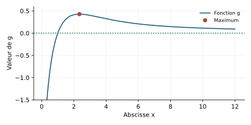
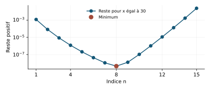

# Concours commun Mines-Ponts · École polytechnique, option T.A. — Épreuve pratique de mathématiques 1988 · Corrigé brut

*Corrigé rédigé par IA, non officiel. Signalez toute erreur.*

**Rédaction** · GPT-6.2 Astra Ultra · vitesse non renseignée · 26 novembre 2026

**Révision** · GPT-6.2 Astra Ultra · vitesse non renseignée · 26 novembre 2026

Pour $x>0$, on étudie $f_p(x)=\int_1^x e^t/t^p\,dt$ et $g(x)=e^{-x}f_1(x)$. Les encadrements numériques sont donnés avec arrondi vers l’extérieur.

## I. Étude des intégrales auxiliaires

### I.1. Variations de la première intégrale

Pour $x>0$ et $p\ge1$, $f_p(x)=\int_1^x e^t/t^p\,dt$. On a $f_1'(x)=e^x/x>0$. La fonction est strictement croissante, nulle en $1$, négative à gauche et positive à droite. Ses limites sont $-\infty$ en zéro et $+\infty$ à droite, la première étant précisée ci-dessous et la seconde résultant de $e^t/t\ge1$ pour $t\ge1$.

### I.2.a. Limite en zéro

Pour $0<x<1$, $f_1(x)=-\int_x^1e^t/t\,dt\le-\int_x^1dt/t=\ln x$. Donc $f_1(x)\to-\infty$ lorsque $x\to0^+$.

### I.2.b. Partie principale en zéro

La fonction $(e^t-1)/t$ se prolonge par $1$ en zéro. Son intégrale $C=\int_0^1(e^t-1)/t\,dt$ existe. Ainsi $f_1(x)=\ln x-C+\int_0^x(e^t-1)/t\,dt=\ln x-C+O(x)$. On en déduit $f_1(x)\sim\ln x$ en zéro.

### I.3.a. Première intégration par parties

Une intégration par parties sur les bornes orientées $1,x$ donne $f_1(x)=[e^t/t]_1^x+\int_1^xe^t/t^2\,dt=e^x/x-e+f_2(x)$, pour tout $x>0$.

### I.3.b. Majoration par découpage

Pour $x\ge2$ la partie intégrée de $1$ à $x/2$ est au plus $e^{x/2}\ln(x/2)$. De $x/2$ à $x$, elle est au plus $(2/x)(e^x-e^{x/2})$. En additionnant puis en simplifiant,

$$
f_1(x)\le e^{x/2}\ln x+2e^x/x.
$$

### I.3.c. Deux constantes pour encadrer la croissance

La quantité $x\ln(x)e^{-x/2}$ tend vers zéro, donc $f_1(x)\le3e^x/x$ pour $x$ assez grand. Par I.3.a, $f_1(x)\ge e^x/x-e\ge e^x/(2x)$ dès que $e^x/x\ge2e$. On peut donc prendre $A=1/2$ et $B=3$.

### I.4.a. Relation entre deux rangs

Pour $n\ge1$ et tout $x>0$,

$$
f_n(x)=[e^t/t^n]_1^x+n\int_1^x e^t/t^{n+1}\,dt=e^x/x^n-e+n f_{n+1}(x).
$$

### I.4.b. Majoration à un rang quelconque

Pour $n>1$ et $x\ge2$, le premier morceau est au plus $e^{x/2}\int_1^{x/2}t^{-n}dt\le e^{x/2}/(n-1)$. Le second est au plus $(2/x)^n\int_{x/2}^x e^t dt\le 2^ne^x/x^n$. On trouve $f_n(x)\le e^{x/2}/(n-1)+2^ne^x/x^n$. Pour $n=1$, la majoration logarithmique de I.3.b remplace celle du premier terme.

### I.4.c. Ordre de grandeur pour tout rang fixé

Par I.4.b, pour $n>1$ fixé et $x$ assez grand, $f_n(x)\le(1+2^n)e^x/x^n$. La relation de I.4.a et $f_{n+1}(x)\ge0$ donnent $f_n(x)\ge e^x/x^n-e\ge e^x/(2x^n)$ pour $x$ assez grand. Les constantes $A_n=1/2$, $B_n=1+2^n$ conviennent aussi pour $n=1$ grâce à I.3.c.

### I.5.a. Équivalent du premier rang

On a $f_2=O(e^x/x^2)$ à l’infini. Dans $f_1=e^x/x-e+f_2$, les deux derniers termes sont donc $o(e^x/x)$. Ainsi $f_1(x)\sim e^x/x$.

### I.5.b. Équivalent général

Pour $n$ fixé, $nf_{n+1}=O(e^x/x^{n+1})=o(e^x/x^n)$. La constante $-e$ est également négligeable. Par I.4.a, $f_n(x)\sim e^x/x^n$.

## II. Variations et calcul numérique de la fonction g

### II.1.a. Dérivée de la fonction pondérée

On a $g'=1/x-g$. Puisque $g=1/x+e^{-x}(f_2-e)$, il vient $g'(x)=e^{-x}(e-f_2(x))$. En particulier $f_2(1)=0$ donne $g'(1)=1$.

### II.1.b. Existence d’un point critique unique

La dérivée $f_2'(x)=e^x/x^2$ est strictement positive. La fonction part de $0$ en $1$ et tend vers $+\infty$ par I.5.b. Elle prend donc une seule fois la valeur $e$, en un point $\alpha>1$. Pour $x<1$, $f_2(x)<0$, ce qui exclut tout autre point critique.

### II.1.c. Tableau de variations et valeur maximale

Comme $e^{-x}>0$, $g'$ est positive avant $\alpha$, nulle en $\alpha$ et négative après. La fonction croît donc sur $]0,\alpha]$ et décroît sur $[\alpha,+\infty[$. L’égalité $g'=1/x-g$ donne $g(\alpha)=1/\alpha$. Elle s’annule en $1$ et possède un maximum strictement positif.

### II.1.d. Parties principales aux extrémités

À gauche, $e^{-x}\to1$ et $f_1\sim\ln x$, donc $g(x)\sim\ln x\to-\infty$. À droite, $f_1\sim e^x/x$, donc $g(x)\sim1/x\to0^+$.

### II.2.a. Reste de Taylor sur le premier intervalle

Pour $S_n(t)=\sum_{k=0}^n t^k/k!$, $R_n(t)=e^t-S_n(t)$ vaut $e^\xi t^{n+1}/(n+1)!$ avec $0<\xi<t$ si $t>0$. Sur $[0,1]$, on a donc $0\le R_n(t)\le e t^{n+1}/(n+1)!$, avec $R_n(0)=0$.

### II.2.b. Encadrement de la première intégrale

Posons $A_n(x)=\ln x+\sum_{k=1}^n(x^k-1)/(k\,k!)$. C’est l’intégrale de $S_n(t)/t$ de $1$ à $x$. Comme $f_1-A_n=-\int_x^1R_n(t)/t\,dt$, il vient pour $0<x\le1$

$$
A_n(x)-\frac{e(1-x^{n+1})}{(n+1)(n+1)!}\le f_1(x)\le A_n(x).
$$

### II.2.c. Valeurs en une demie

À $x=1/2$ et $n=6$, $A_6=-1{,}4408663645\ldots$ et la correction maximale est inférieure à $0{,}00007645$. Après multiplication par $e^{-1/2}$, $-0{,}873977<g(1/2)<-0{,}873929$. De $g'=2-g$ on déduit, à $10^{-3}$ près, $g(1/2)\simeq-0{,}874$ et $g'(1/2)\simeq2{,}874$.

### II.3.a. Reste de Taylor entre un et trois

Si $1\le t\le3$, la valeur intermédiaire $\xi$ appartient à $]0,t[$. On obtient $t^{n+1}/(n+1)!<R_n(t)\le e^3 t^{n+1}/(n+1)!$. La borne inférieure est stricte puisque $t>0$.

### II.3.b. Encadrement de la seconde intégrale

Pour $n\ge1$, posons

$$
B_n(x)=1-1/x+\ln x+\sum_{k=2}^n\frac{x^{k-1}-1}{(k-1)k!},\qquad D_n(x)=\frac{x^n-1}{n(n+1)!}.
$$

En intégrant le polynôme divisé par $t^2$ puis les deux bornes du reste, on trouve $B_n+D_n\le f_2\le B_n+e^3D_n$ sur $[1,3]$. À $1$ les trois valeurs sont nulles.

### II.3.c. Valeurs en deux et première localisation de la racine

Avec $n=17$, l’encadrement précédent donne $2{,}0828703186<f_2(2)<2{,}0828703187$. Puis $g'(2)=e^{-2}(e-f_2(2))$ et $g(2)=1/2-g'(2)$. On obtient $0{,}08599359<g'(2)<0{,}08599361$ et $0{,}41400639<g(2)<0{,}41400641$. À $10^{-3}$ près, les trois valeurs sont respectivement **2,083**, **0,414** et **0,086** pour $f_2(2), g(2),g'(2)$. Comme $f_2(2)<e$, on a $\alpha>2$.

### II.3.d. Encadrement plus fin et hauteur du maximum

Par II.3.b avec $n=17$, $2{,}45349984<f_2(2{,}2)<2{,}45349986$ et $2{,}83084412<f_2(2{,}4)<2{,}83084414$. La stricte croissance donne $2{,}2<\alpha<2{,}4$. On peut affiner par dichotomie avec le même encadrement. Aux abscisses $2{,}34090$ et $2{,}34091$, les valeurs sont respectivement dans $]2{,}71827397,2{,}71827398[$ et $]2{,}71829293,2{,}71829294[$, donc elles encadrent $e$. Il en résulte $1/2{,}34091<g(\alpha)<1/2{,}34090$, soit $g(\alpha)\simeq0{,}427185$ à $2\times10^{-6}$ près.

### II.4. Courbe représentative

La branche monte depuis l’asymptote $x=0$ avec $g\to-\infty$. Elle passe par $(1,0)$ avec tangente $y=x-1$, puis atteint vers $(2{,}34090,0{,}42719)$ son maximum à tangente horizontale. Elle reste ensuite positive et redescend vers l’axe horizontal, avec $g(x)\sim1/x$.

### II.5.a. Coefficients du développement avec reste exact

L’itération de $f_p=e^x/x^p-e+pf_{p+1}$, multipliée par $e^{-x}$, donne pour $n\ge1$

$$
g(x)=\sum_{p=1}^n\frac{(p-1)!}{x^p}-e^{1-x}\sum_{k=0}^{n-1}k!+n!e^{-x} f_{n+1}(x).
$$

On lit $a_p=(p-1)!$ et $b_n=-e\sum_{k=0}^{n-1}k!$. Au pas suivant, la substitution pour $f_{n+1}$ ajoute $n!/x^{n+1}$ et $-n!e^{1-x}$, ce qui établit aussi la récurrence.

### II.5.b. Divergence du reste à abscisse fixée

On a $r_n=n!e^{-x}\int_1^xe^t/t^{n+1}\,dt\ge n!e^{1-x}(x-1)/x^{n+1}>0$. À $x>1$ fixé, le rapport de deux termes successifs de ce minorant vaut $(n+1)/x$, donc le minorant tend vers $+\infty$. Ainsi $r_n\to+\infty$ et une troncature très tardive ne réduit pas l’erreur.

### II.5.c. Indice qui minimise le reste

Pour $r_0=e^{-x}f_1(x)>0$ et $n\ge1$, I.4.a donne

$$
r_n-r_{n-1}=(n-1)!e^{-x}(e-e^x/x^n).
$$

Le signe de $r_n/r_{n-1}-1$ est donc celui de $n\ln x-(x-1)$. Posons $q=(x-1)/\ln x>1$. Le reste diminue tant que $n<q$, puis augmente lorsque $n>q$. Un indice minimisant est $n_x=\lfloor q\rfloor$. Si $q$ est entier, $q-1$ et $q$ réalisent tous deux le minimum.

### II.5.d. Encadrement du reste pour trente

Pour $x=30$, $29/\ln30=8{,}526409\ldots$, d’où le minimum unique $r_8$. Posons $L(t)=e^t/t^9$. On a $L''=L[(1-9/t)^2+9/t^2]>0$. La corde entre $a$ et $b$ est la fonction affine $[(b-t)L(a)+(t-a)L(b)]/(b-a)$, majorante sur $[a,b]$. En l’intégrant sur $[1,9]$ puis $[9,30]$, on obtient

$$
0<r_8\le8!e^{-30}\left[4(L(1)+L(9))+\tfrac{21}{2}(L(9)+L(30))\right]<6{,}254\times10^{-8}.
$$

Cette dernière valeur est une approximation par excès certifiée du reste.

### II.5.e. Valeurs finales et précisions garanties

Écrivons $T=\sum_{p=1}^8(p-1)!/30^p-e^{-29}\sum_{k=0}^7k!=0{,}03452711728854\ldots$. On a $T<g(30)<T+6{,}254\times10^{-8}$. Le milieu arrondi donne

$$
g(30)\simeq0{,}034527149,\qquad g'(30)=1/30-g(30)\simeq-0{,}001193815.
$$

L’intervalle certifié pour $g(30)$ est inclus dans $]0{,}03452711728,0{,}03452717984[$. La soustraction à $1/30$ conserve sa largeur. Les deux valeurs affichées ont une erreur strictement inférieure à $3{,}2\times10^{-8}$, arrondis compris.

## Documents de la session

Le bandeau du concours commun indique les options M, P′ et T.A., une durée de deux heures et l’École polytechnique pour l’option T.A. [Fac-similé UPS](https://prepas.org/index.php?module=Sujets&voir=get&file=doc-317ce6bbf6a5b1419fe8) · [Notice officielle du concours](https://www.legifrance.gouv.fr/loda/id/JORFTEXT000000697782).
