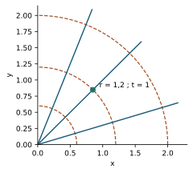
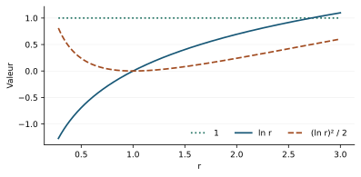

# Concours commun Mines-Ponts · École polytechnique, option T.A. — Première épreuve de mathématiques 1988 · Corrigé guidé

*Corrigé rédigé par IA, non officiel. Signalez toute erreur.*

**Rédaction** · GPT-6.2 Astra Ultra · vitesse non renseignée · 26 novembre 2026

Dans le quadrant $D=\{(x,y):x>0,\ y>0\}$, on étudie $Tf=x f_x+y f_y$ sur les fonctions lisses à valeurs complexes. On note $N_\alpha=\ker(T-\alpha I)$. Les coordonnées utilisées sont le rayon $r$ et la pente $t=y/x$.

## Partie I — L’opérateur radial et ses espaces propres

### I.1.a. Produit de deux fonctions

> [!INDICATION]
> Appliquer la règle du produit aux deux dérivées partielles.

On a $T(fg)=x(f_xg+fg_x)+y(f_yg+fg_y)=(Tf)g+f(Tg)$. Cette identité vaut aussi pour les fonctions à valeurs complexes, par linéarité des dérivées.

### I.1.b. Coordonnées adaptées

> [!INDICATION]
> Lorsque le point se déplace sur une demi-droite issue de l’origine, laquelle des deux coordonnées reste constante ?

Posons $r=\sqrt{x^2+y^2}$ et $t=y/x$. Le calcul des dérivées donne $r_x=x/r$, $r_y=y/r$, $t_x=-y/x^2$, $t_y=1/x$. Dans la règle de chaîne, le coefficient de $\widetilde f_r$ vaut $x r_x+y r_y=r$ et celui de $\widetilde f_t$ vaut $x t_x+y t_y=0$. Par conséquent $Tf=r\widetilde f_r(r,t)$. Les deux variables $r,t$ parcourent indépendamment $]0,\infty[$, puisque $x=r/\sqrt{1+t^2}$ et $y=tx$.

### I.1.c. Composition par une fonction d’une variable

> [!INDICATION]
> Les deux termes ont un facteur commun après la dérivation.

Si $f$ est réelle, $(\varphi\circ f)_x=\varphi'(f)f_x$ et $(\varphi\circ f)_y=\varphi'(f)f_y$. Ainsi $T(\varphi\circ f)=\varphi'(f)Tf$. On dérive ici par rapport à une variable réelle, même lorsque $\varphi$ est à valeurs complexes.

### I.2.a. Pente d’une demi-droite

> [!INDICATION]
> Appliquer la formule de I.1.b à la deuxième coordonnée.

On a $Tt=x(-y/x^2)+y/x=0$. La dilatation simultanée des deux coordonnées préserve le quotient $y/x$.

### I.2.b. Fonctions de la pente

> [!INDICATION]
> Utiliser la règle de composition dans l’intervalle des valeurs de $t$.

Pour toute $H\in C^\infty(]0,\infty[,\mathbb C)$, on a $T(H(t))=H'(t)Tt=0$ et $H(t)$ est bien définie et lisse sur le quadrant. Elle appartient donc à $N_0$.

### I.2.c. Description du noyau

> [!INDICATION]
> Fixer $t$ et résoudre l’équation obtenue pour la variable $r$.

Si $Tf=0$, I.1.b donne $\partial_r\widetilde f=0$ puisque $r>0$. Pour chaque $t$, la fonction de $r$ est constante sur l’intervalle connexe $]0,\infty[$. Sa valeur $H(t)=\widetilde f(1,t)$ dépend régulièrement de $t$. Ainsi $N_0$ est exactement formé des $H(y/x)$, la réciproque venant de I.2.b.

### I.3.a. Distance à l’origine

> [!INDICATION]
> Calculer $xr_x+yr_y$.

Comme $r>0$, $Tr=(x^2+y^2)/r=r$. Le rayon est donc une fonction propre de valeur propre $1$.

### I.3.b. Puissances entières

> [!INDICATION]
> Commencer par une fonction quelconque du rayon avant de spécialiser son expression.

Pour $\varphi$ lisse sur $]0,\infty[$, $T(\varphi(r))=r\varphi'(r)$. Avec $\varphi(s)=s^k$, on trouve $T(r^k)=kr^k$ pour tout entier relatif $k$, car $r$ ne s’annule pas dans le domaine.

### I.3.c. Valeur propre un

> [!INDICATION]
> Faire passer le terme $f$ du membre de droite dans un produit dérivé.

La règle du produit donne $T(r^{-1}f)=r^{-1}(Tf-f)$. Le facteur $r^{-1}$ étant non nul, $Tf=f$ équivaut à $r^{-1}f\in N_0$. D’où $f=rH(t)$, avec $H$ lisse arbitraire, et toute telle fonction convient.

### I.4.a. Valeurs propres entières

> [!INDICATION]
> Quel facteur permet d’annuler le terme $kf$ ?

Pour $k\in\mathbb Z$, on a $T(r^{-k}f)=r^{-k}(Tf-kf)$. Ainsi $f\in N_k$ si et seulement s’il existe une fonction lisse $H$ telle que $f=r^kH(t)$. Le calcul reste valable pour $k=0$.

### I.4.b. Valeur propre complexe

> [!INDICATION]
> La positivité de $r$ permet de dériver $e^{\alpha\ln r}$ sans choisir de logarithme complexe.

On a $T(\ln r)=1$ et $T(r^\alpha)=\alpha r^\alpha$. Comme $r^\alpha\ne0$, $T(r^{-\alpha}f)=r^{-\alpha}(Tf-\alpha f)$. Il en résulte $N_\alpha=\{r^\alpha H(t): H\in C^\infty(]0,\infty[,\mathbb C)\}$. Le facteur de pente est déterminé par la restriction de $f$ au quart de cercle $r=1$.

**Exemple.** Pour $\alpha=i$, la fonction $r^i$ a un module constant égal à $1$ et pourtant $T(r^i)=i r^i$.

## Partie II — Équations avec second membre

### II.1.a. Deux valeurs propres distinctes

> [!INDICATION]
> Appliquer $T-\alpha I$ à $g$, dont on connaît déjà l’image par $T$.

Si $Tg=\beta g$, alors $(T-\alpha I)g=(\beta-\alpha)g$. Lorsque $\beta\ne\alpha$, une solution particulière est $g/(\beta-\alpha)$. Toutes les solutions sont donc $f=g/(\beta-\alpha)+r^\alpha H(t)$, car la différence de deux solutions appartient à $N_\alpha$.

### II.1.b. Résonance

> [!INDICATION]
> Rechercher un facteur radial dont l’image par $T$ est la constante $1$.

Lorsque $\beta=\alpha$, $(T-\alpha I)(\varphi(r)g)=r\varphi'(r)g$. Le choix $\varphi(r)=\ln r$ convient. La solution générale est $f=g\ln r+r^\alpha H(t)$.

### II.2. Deux équations dans le quadrant

> [!INDICATION]
> Identifier séparément le degré d’homogénéité des deux seconds membres par une dilatation.

Notons $g_1=(x^2+y^2-xy)/(x^2+y^2+xy)$ et $g_2=(x^2+y^2)(x-y)/(x+y)$. Les dénominateurs sont positifs dans le quadrant. Sous $(x,y)\mapsto(sx,sy)$, $s>0$, $g_1$ est inchangée et $g_2$ est multipliée par $s^2$. En dérivant en $s=1$, on trouve $Tg_1=0$ et $Tg_2=2g_2$. La première équation $(T-I)f=g_1$ donne donc $f=-g_1+rH(t)$. La seconde $(T-2I)f=g_2$ donne $f=g_2\ln r+r^2K(t)$, où les fonctions $H,K$ sont lisses et libres.

### II.3.a. Variation d’un facteur radial

> [!INDICATION]
> Pour $f_0=\varphi(r)g$, résoudre une équation du premier ordre en $r$.

Par la règle du produit, $(T-\alpha I)f_0=(r\varphi'+(\beta-\alpha)\varphi)g$. Il suffit donc de prendre $(r^{\beta-\alpha}\varphi(r))'=r^{\beta-\alpha-1}\varphi_0(r)$. Un choix valable pour tout $r>0$ donne la solution générale

$$
f=r^{\alpha-\beta}g\int_1^r s^{\beta-\alpha-1}\varphi_0(s)\,ds+r^\alpha H(t).
$$

Les coefficients sont lisses puisque l’intégration ne rencontre pas zéro. L’addition du noyau donne toutes les solutions, y compris aux points où $g$ s’annule.

### II.3.b. Second membre logarithmique

> [!INDICATION]
> Calculer une primitive de $(\ln r)/r$.

Pour $\beta=\alpha$ et $\varphi_0(r)=\ln r$, l’intégrale de II.3.a vaut $(\ln r)^2/2$. Ainsi $f=g(\ln r)^2/2+r^\alpha H(t)$. En dérivant, le facteur $g$ fournit le terme $\alpha f$ et la dérivation de $(\ln r)^2/2$ fournit $\ln r$.

## Partie III — Puissances de l’opérateur

### III.1. Noyau du carré

> [!INDICATION]
> Avec $z=\ln r$, quel opérateur représente $T$ à pente fixée ?

En notant $U(z,t)=\widetilde f(e^z,t)$, on a $Tf=U_z$ dans ces coordonnées et $T^2f=U_{zz}$. Par conséquent $T^2 f=0$ équivaut à $f=A(t)+B(t)\ln r$. Les coefficients lisses sont les valeurs de $U$ et de $U_z$ en $z=0$. Réciproquement, deux dérivations annulent cette expression.

### III.2. Second membre invariant

> [!INDICATION]
> Intégrer deux fois en gardant $t$ comme paramètre.

Si $g\in N_0$, écrivons $g=G(t)$. L’équation est $U_{zz}=G(t)$, d’où $f=G(t)(\ln r)^2/2+B(t)\ln r+A(t)$ avec $A,B$ lisses arbitraires. Elle comprend toutes les solutions parce qu’à $t$ fixé l’intégration introduit exactement les deux valeurs initiales $U(0,t)$ et $U_z(0,t)$.

### III.3. Noyau d’ordre quelconque

> [!INDICATION]
> À partir du noyau de $T^n$, chercher $Tf$ dans ce noyau, puis intégrer une fois.

Pour $n\ge1$, le noyau de $T^n$ est formé des

$$
f(x,y)=\sum_{j=0}^{n-1}A_j(t)\frac{(\ln r)^j}{j!}.
$$

Le cas $n=1$ est I.2.c. Si la formule vaut au rang $n$, la condition $T^{n+1}f=0$ équivaut à $Tf\in\ker T^n$. Intégrer la formule de $Tf$ par rapport à $z=\ln r$ ajoute une constante $A_0(t)$ et élève tous les degrés d’une unité. Réciproquement, toute telle somme est tuée par $n+1$ dérivations au nouveau rang. Les coefficients sont indépendants et lisses, car $A_j(t)=\partial_z^j U(0,t)$.

## Partie IV — Polynômes de l’opérateur

### IV.1. Deux facteurs homogènes

> [!INDICATION]
> Résoudre, à $t$ fixé, l’équation caractéristique en la variable $z=\ln r$.

Le polynôme caractéristique est $P(s)=(s-\alpha)(s-\beta)$. Si ses racines sont distinctes, $f=r^\alpha A(t)+r^\beta B(t)$. Si $\alpha=\beta$, $f=r^\alpha(A(t)+B(t)\ln r)$. Dans les deux cas, les deux solutions en $z$ ont un wronskien non nul à $z=0$, donc leurs coefficients s’obtiennent linéairement à partir de $U(0,t),U_z(0,t)$ et sont lisses. Cela justifie aussi la réciproque pour toute paire de fonctions lisses.

### IV.2. Discussion des résonances

> [!INDICATION]
> Écrire $g=r^\gamma G(t)$. Appliquer le polynôme différentiel à $e^{\gamma z}$ multiplié par un polynôme de $z$.

À chaque solution particulière ci-dessous, on ajoute la solution homogène de IV.1, valable également si $\alpha=\beta=0$. Pour tout polynôme $Q$, on a $P(T)(gQ(z))=gP(\gamma+\partial_z)Q(z)$, par la règle du produit. Trois cas en résultent.

- Si $\gamma$ diffère des deux racines, une solution particulière est $g/P(\gamma)$.
- Si $\gamma$ est exactement l’une des deux racines distinctes, on prend $g\ln r/P'(\gamma)$, puisque $P(\gamma+\partial_z)z=P'(\gamma)$.
- Si $\gamma=\alpha=\beta$, on prend $g(\ln r)^2/2$, car la deuxième dérivée de $z^2/2$ vaut $1$.

Chaque formule reste valable pour $g=0$ et donne alors le seul terme homogène dans la solution générale.

**Contrôle.** À racine double, appliquer une fois $T-\gamma I$ à $g(\ln r)^2/2$ donne $g\ln r$, puis une seconde application donne $g$.

### IV.3. Équation du second ordre en coordonnées cartésiennes

> [!INDICATION]
> Développer $T^2f$ en prenant soin de dériver aussi les coefficients $x,y$.

Le calcul donne $T^2f=x^2f_{xx}+2xyf_{xy}+y^2f_{yy}+Tf$. L’équation imprimée devient donc $(T^2-T-kI)f=0$. Si $1+4k\ne0$, posons $\lambda_\pm=(1\pm\sqrt{1+4k})/2$. La solution générale est $r^{\lambda_+}A(t)+r^{\lambda_-}B(t)$, les deux choix du signe de la racine carrée échangeant seulement les deux coefficients. Pour $k=-1/4$, la racine double $1/2$ donne $r^{1/2}(A(t)+B(t)\ln r)$. Les fonctions $A,B$ parcourent les fonctions complexes lisses de $t>0$.

## Documents de la session

Les trois vues sont les pages 125 à 127 du recueil. La garde attribue la première épreuve aux options M, P′ et T.A. du concours commun, avec recrutement de l’École polytechnique en option T.A. La question II.2 comprend deux équations sous un même numéro. [Fac-similé UPS](https://prepas.org/index.php?module=Sujets&voir=get&file=doc-91f9804387ca4cabfa8f) · [Notice officielle du concours](https://www.legifrance.gouv.fr/loda/id/JORFTEXT000000697782)
