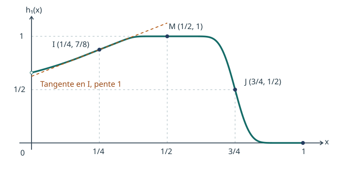

# École polytechnique — Deuxième composition de mathématiques · M′ 1989 · Corrigé brut

*Corrigé rédigé par IA, non officiel. Signalez toute erreur.*

**Rédaction** · GPT-6.2 Astra Ultra · vitesse non renseignée

On cherche des fonctions réelles dérivables vérifiant $f'(x)=f(\lambda x)$, avec $\lambda>0$. Le domaine est la droite réelle ou l’une des deux demi-droites ouvertes, chacune stable par multiplication par $\lambda$. Nous poserons $d_p=p(p-1)/2$ pour $p\ge0$.

La comparaison de I.3.a est démontrée pour toute puissance strictement positive, y compris la puissance deux de la transcription. [Fac-similé UPS](https://prepas.org/index.php?module=Sujets&voir=get&file=doc-a21a2440bb9facea32d8) · [Notice annuelle](https://www.legifrance.gouv.fr/jorf/id/JORFTEXT000000884199).

## Questions préliminaires

### Question Prélim.1.a

La dérivabilité de $f$ donne sa continuité. Si $f$ est de classe $C^k$, alors $x\mapsto f(\lambda x)$ l’est aussi. Puisque cette fonction est $f'$, on obtient $f\in C^{k+1}$. La récurrence à partir de $k=0$ prouve $f\in C^\infty$.

### Question Prélim.1.b

La formule est $f^{(p)}(x)=\lambda^{d_p}f(\lambda^p x)$. Elle vaut pour $p=1$. En dérivant au rang $p$, le coefficient est multiplié par $\lambda^p$ et l’équation remplace $f'(\lambda^p x)$ par $f(\lambda^{p+1}x)$. Or $d_{p+1}=d_p+p$, ce qui conclut la récurrence.

### Question Prélim.2

On a $(e^{-x}f(x))'=0$, donc $f(x)=Ce^x$ sur $\mathbb R$ pour une constante réelle $C$. Réciproquement, chacune de ces fonctions satisfait l’équation.

## I. Solutions sur la droite pour un facteur inférieur à un

### Question I.1.a

Fixons $x$ et notons $M$ le maximum de $|f|$ entre $0$ et $x$. Par le préliminaire, $|f^{(p)}(t)|\le \lambda^{d_p}M$ pour tout $t$ de ce segment. Le reste après le degré $p-1$ est au plus $M\lambda^{d_p}|x|^p/p!$ en valeur absolue et tend vers zéro. Comme $f^{(k)}(0)=\lambda^{d_k}f(0)$,
$$
 f(x)= f(0)\sum_{k=0}^\infty \lambda^{d_k}\frac{x^k}{k!}.
$$
Le rapport des valeurs absolues des termes consécutifs est $\lambda^k|x|/(k+1)$ pour $x\ne0$. Le rayon vaut $+\infty$.

### Question I.1.b

La formule précédente impose l’unicité pour chaque valeur de $f(0)$. Réciproquement, la série normalisée converge partout et sa dérivée terme à terme a pour coefficient de $x^k$ le nombre $\lambda^{d_{k+1}}/k!=\lambda^{d_k}\lambda^k/k!$. Cette dérivée est sa valeur en $\lambda x$. La série normalisée vaut un en zéro, donc engendre l’espace, de dimension un.

### Question I.2.a

Sur $|x|\le R$ et $c\le\lambda\le b<1$ avec $c>0$, la dérivée d’ordre $j$ en $\lambda$ du terme $k$ est nulle si $j>d_k$. Sinon sa valeur absolue est au plus $c^{-j}(1+d_k)^jR^k/k!$. Cette série majorante converge par le critère du rapport. On peut donc dériver terme à terme à tout ordre sur tout tel rectangle. La fonction $F$ est indéfiniment dérivable par rapport à $\lambda$.

### Question I.2.b

Chaque terme est continu en $(x,\lambda)$ et, sur $|x|\le R$, sa valeur absolue est au plus $R^k/k!$ pour $0<\lambda<1$. La série converge uniformément sur ce domaine. Sa somme est donc continue conjointement sur $\mathbb R\times]0,1[$.

### Question I.3.a

Pour un entier $k>\alpha$, $f(x)\ge\lambda^{d_k}x^k/k!$ si $x>0$. Donc $x^\alpha=o(f(x))$, en particulier pour la puissance $2$. Fixons $\beta>0$. Comme $\lambda^{d_k/k}=\lambda^{(k-1)/2}\to0$, on a $\lambda^{d_k}\le(\beta/2)^k$ aux grands indices. La série sur ces indices est dominée par $e^{\beta x/2}$ et les autres termes forment un polynôme. Ainsi $f(x)=o(e^{\beta x})$ en $+\infty$.

### Question I.3.b

Sur la demi-droite positive $f>0$, $f'(x)=f(\lambda x)>0$ et $f''(x)=\lambda f(\lambda^2x)>0$. La courbe monte, est strictement convexe, et sa pente tend vers $+\infty$. Comme $f(x)/x\to+\infty$, la branche infinie a pour direction l’axe des ordonnées. La croissance reste inférieure à toute exponentielle de taux strictement positif.

### Question I.4

S’il n’existait pas de zéros arbitrairement loin à gauche, $f$ y garderait un signe strict. Quitte à considérer $-f$, supposons-le positif. L’équation rend $f$ croissante suffisamment loin à gauche. Pour $x<0$ assez négatif et $x/\lambda\le t\le x$, $\lambda t\ge x$. Ainsi
$$
 f(x)-f(x/\lambda)=\int_{x/\lambda}^x f(\lambda t)\,dt\ge (x-x/\lambda)f(x).
$$
Le membre de gauche est strictement inférieur à $f(x)$, tandis que $x-x/\lambda\to+\infty$. Cette contradiction fournit des zéros tendant vers $-\infty$.

## II. Reconstruction sur la demi-droite positive pour un facteur inférieur à un

### Question II.1

Sur $]\lambda a,a[$ la fonction prescrite est $\varphi(x)=\varphi_1(x)\exp(1/((x-a)(x-\lambda a)))$, avec $\varphi_1$ lisse, positive ou nulle et non identiquement nulle. Près de chaque bord, si $u$ est la distance à ce bord, le facteur exponentiel est majoré par $e^{-c/u}$ pour un $c>0$. Après un nombre fini de dérivations, la règle du produit fait apparaître ce même facteur multiplié par des dérivées bornées de $\varphi_1$ et des fonctions rationnelles à pôles d’ordre fini. Toutes ces expressions doivent donc tendre vers zéro. Prolonger successivement les dérivées à l’aide du théorème des accroissements finis donne $\varphi^{(j)}(\lambda a+)=\varphi^{(j)}(a-)=0$ pour tout $j\ge0$.

### Question II.2.a

Notons $J_n=[\lambda^{n+1}a,\lambda^na]$ pour $n\in\mathbb Z$. Partons de $g=\varphi$ sur $J_0$. Connaissant $g$ sur $J_n$ avec $n\ge0$, définissons $g(y)=g'(y/\lambda)$ sur $J_{n+1}$. Par platitude, toutes les dérivées se raccordent avec valeur zéro aux extrémités intérieures de ces intervalles. Cela définit $g$ jusqu’à $0$ exclu.
Pour prolonger à droite depuis $b=a$, puis depuis $b=a/\lambda,a/\lambda^2,\ldots$, posons $g(x)=g(b)+\int_b^x g(\lambda t)\,dt$ pour $b\le x\le b/\lambda$. L’argument de l’intégrande se trouve sur l’intervalle déjà construit. Au premier raccord, $\varphi'(a)=\varphi(\lambda a)=0$ et les dérivées supérieures concordent par platitude. Aux suivants, l’équation des deux côtés et les raccords précédents assurent la continuité de toutes les dérivées par récurrence. Les formules imposent l’unicité de ce prolongement.

### Question II.2.b

La dimension est infinie. Plus précisément, multiplions le facteur plat de II.1 par les fonctions $x\mapsto e^{sx}$, $s\in\mathbb R$. Leurs prolongements sont linéairement indépendants. En effet, une relation finie se restreint à une relation entre exponentielles sur l’intervalle ouvert, puisque le facteur plat y est strictement positif. Dériver aux ordres $0,\ldots,k-1$ en un point donne une matrice de Vandermonde inversible pour $k$ paramètres distincts. Il y a donc au moins autant de dimensions que de réels, et au plus autant, puisqu’une fonction continue est déterminée par ses valeurs sur les rationnels du domaine.

### Question II.3.a

La formule de descente transporte le jet nul d’une extrémité à son image par $x\mapsto\lambda x$. Ainsi $g(\lambda^n a)=0$ pour tout $n\ge0$. Ces zéros distincts tendent vers zéro. L’hypothèse sur $\varphi_1$ assure que $g$ est non nulle quelque part sur $J_0$.

### Question II.3.b

Une limite infinie est exclue par les zéros. Si une limite finie existait, elle serait zéro. Prolongeons alors $g$ par $g(0)=0$. L’équation et la continuité donnent $g(x)=\int_0^x g(\lambda t)\,dt$. En notant $M=\max_{[0,a]}|g|$, une récurrence par intégration donne $|g(x)|\le Mx^p/p!$ pour $0\le x\le a$ et tout $p$, car $\lambda<1$. En laissant $p\to\infty$, on aurait $g=0$ sur $J_0$. Aucune limite n’existe.

### Question II.3.c

Si $|g|\le M$ sur $]0,a]$, alors $|g'(x)|=|g(\lambda x)|\le M$ sur cet intervalle. Le théorème des accroissements finis rend $g$ lipschitzienne et lui assure une limite finie en zéro par le critère de Cauchy. Ceci contredit II.3.b, donc $g$ est non bornée.

### Question II.3.d

Posons $A_n=\max_{J_n}|g|$. La valeur de $g$ à un bord est zéro et $\max_{J_n}|g'|=A_{n+1}$. Donc $A_n\le a(1-\lambda)\lambda^n A_{n+1}$. Comme $A_0>0$, la récurrence donne
$$
 A_n\ge A_0[a(1-\lambda)]^{-n}\lambda^{-n(n-1)/2}.
$$
La racine $n$-ième du membre de droite tend vers $+\infty$. Par suite $A_n^{1/n}$ et $A_n$ tendent vers $+\infty$ (la suite est strictement croissante à partir d’un certain rang).

### Question II.4.a

Puisque $\varphi\ge0$ est non nulle et $g(a)=0$, l’intégration de II.2.a donne $g\ge0$ et croissante sur $[a,\infty[$, avec $g(a/\lambda)=\lambda^{-1}\int_{\lambda a}^a\varphi>0$. Pour $x\ge a/\lambda^3$, $g''(x)=\lambda g(\lambda^2x)\ge\lambda g(a/\lambda)>0$ et $g'''(x)=\lambda^3g(\lambda^3x)\ge0$. Ainsi $g''$ est strictement positive et croissante au sens large. Elle croît strictement dès que $\lambda^3x\ge a/\lambda$.

### Question II.4.b

Sur la demi-droite précédente, $g''$ est minorée par une constante positive. Deux intégrations donnent $g'(x)\to+\infty$ et $g(x)\to+\infty$, avec une croissance au moins quadratique et une branche convexe de direction verticale. Plus généralement pour chaque $p$, $g^{(p)}(x)=\lambda^{d_p}g(\lambda^px)$ est minorée par une constante positive pour $x$ assez grand. En intégrant $p$ fois, la croissance dépasse toute puissance fixée (choisir un entier $p$ supérieur à son exposant).

## III. Équation à argument dilaté

### Question III.1

Si $h$ ne s’annulait plus à partir d’un certain point, on pourrait supposer $h>0$ sur cette demi-droite, quitte à changer son signe. Alors $h'=h(\lambda x)>0$. On aurait $h(\lambda x)-h(x)=\int_x^{\lambda x}h(\lambda t)\,dt\ge(\lambda-1)x h(\lambda x)$. Pour $x$ assez grand, ceci contredit $h(x)>0$. Ainsi il existe des zéros arbitrairement grands, y compris pour la solution identiquement nulle.

### Question III.2.a

Écrivons $K=1-1/\lambda$, $b_n=a/\lambda^n$ et $M=\max_{[a,\lambda a]}|h|$. Pour $b_{n+1}\le x\le b_n$, on a $h(x)=h(b_n)-\int_x^{b_n}h(\lambda t)\,dt$. Les arguments et $b_n$ appartiennent à l’intervalle précédent $[b_n,\lambda b_n]$. Sa borne $B$ est donc remplacée par $B(1+b_n-b_{n+1})=B(1+Ka\lambda^{-n})$. En commençant par $B=M$ et en itérant,
$$
 |h(x)|\le M\prod_{p=0}^n(1+Ka\lambda^{-p}).
$$

### Question III.2.b

Le produit précédent est au plus $\exp(Ka\sum_{p\ge0}\lambda^{-p})=e^a$, car $K=1-\lambda^{-1}$. On obtient $|h(x)|\le Me^a$ sur $]0,a]$.

### Question III.2.c

Comme $h'=h(\lambda x)$ est bornée près de zéro, $h$ vérifie un critère de Cauchy en $0^+$ par les accroissements finis. Notons $\ell$ sa limite réelle. Pour chaque $p\ge1$, $\lim_{x\downarrow0}h^{(p)}(x)=\lambda^{d_p}\ell$. Le prolongement par ces limites est lisse à droite, par applications successives du théorème des accroissements finis.

### Question III.3

Pour $a'<0$, posons $a=|a'|$, $u(x)=k(-x)$ et $M=\max_{[\lambda a',a']}|k|$. On a $u'(x)=-u(\lambda x)$, ce qui conserve l’estimation en valeur absolue. Sur $[a'/\lambda^n,a'/\lambda^{n+1}]$, la borne est donc $M\prod_{p=0}^n(1+K|a'|\lambda^{-p})$ et $|k|\le Me^{|a'|}$ sur $[a',0[$. La limite $\ell_-$ de $k$ en $0^-$ est finie et $\lim_{x\uparrow0}k^{(p)}(x)=\lambda^{d_p}\ell_-$ par l’équation originale.

### Question III.4.a

Avec le facteur plat sur $[a,\lambda a]$, $\varphi$ et toutes ses dérivées s’annulent aux deux bords, par le calcul de II.1. Posons $H=\int_a^{\lambda a}\varphi(t)\,dt>0$. La fonction $\psi(x)=\int_x^{\lambda a}\varphi(t)\,dt$ vérifie $\psi(a)=H$, $\psi(\lambda a)=0$. Pour tout $j\ge1$, $\psi^{(j)}=-\varphi^{(j-1)}$ a des valeurs unilatérales nulles aux deux bords.

### Question III.4.b

Partons de $h_1=\psi$ sur $[a,\lambda a]$. Vers zéro, à chaque bord inférieur $b$, utilisons $h_1(x)=h_1(b)-\int_x^b h_1(\lambda t)\,dt$ sur $[b/\lambda,b]$. Vers l’infini, au-dessus d’un intervalle déjà connu, utilisons $h_1(y)=h_1'(y/\lambda)$. Au premier raccord, les conditions de compatibilité sont $\psi^{(j+1)}(a)=\lambda^j\psi^{(j)}(\lambda a)$ pour $j\ge0$. Elles sont toutes vérifiées par III.4.a, y compris $\psi'(a)=\psi(\lambda a)$. Les deux règles transportent ensuite les égalités de jets d’un bord au suivant. On obtient une solution lisse sur toute la demi-droite.

### Question III.4.c

Sur $[a,\lambda a]$, $0\le h_1\le H$. Supposons cette borne établie jusqu’au bord $b_n=a/\lambda^n$ en descendant. Sur $[b_{n+1},b_n]$ la formule intégrale montre que $h_1(x)\le H$, et la diminution sur ce nouvel intervalle est au plus $HK a\lambda^{-n}$. En sommant depuis $a$, on obtient
$$
 h_1(x)-H\ge-HKa\sum_{p=0}^n\lambda^{-p}=-Ha(1-\lambda^{-(n+1)}).
$$
Comme $a<1$, la nouvelle borne inférieure est positive, ce qui ferme la récurrence. En passant à la limite de III.2.c, $\ell\ge H(1-a)>0$.

### Question III.5.a

Pour $\lambda=2$, $a=1/2$ et $\varphi_1$ constante, les deux facteurs du dénominateur de l’exponentielle s’échangent au signe près sous $x\mapsto3/2-x$. Donc $\varphi(3/2-x)=\varphi(x)$. Un changement de variable dans l’intégrale de masse un donne $\psi(3/2-x)=1-\psi(x)$. Son graphe admet le centre de symétrie $(3/4,1/2)$.

### Question III.5.b

Les intégrales de $\psi(x)$ et de $\psi(3/2-x)$ sur $[1/2,1]$ sont égales. Leur somme est l’intégrale de $1$, soit $1/2$. Ainsi $\int_{1/2}^1\psi(x)\,dx=1/4$.

### Question III.5.c

Sur $]0,1/2[$, $h_1'>0$ par III.4.c et la positivité de $\psi$ sur $[1/2,1[$. Sur $]1/2,1[$, $h_1'=-\varphi<0$. Le maximum est $(1/2,1)$, le minimum est $(1,0)$, et les tangentes à ces points sont horizontales. La formule intégrale et III.5.b donnent $h_1(1/4)=1-\frac12\int_{1/2}^1\psi=7/8$, avec $h_1'(1/4)=h_1(1/2)=1$.
Sur $]0,1/4[$, $h_1''(x)=2h_1(4x)>0$. Sur $]1/4,1/2[$, $h_1(4x)=h_1'(2x)=-\varphi(2x)<0$. Sur $]1/2,1[$, $h_1''=-\varphi'$ est négative avant $3/4$ et positive après, car $\varphi$ croît puis décroît autour de son milieu (son dénominateur en valeur absolue est maximal au centre). La courbe est donc convexe, puis concave, puis convexe, avec inflexions $(1/4,7/8)$ et $(3/4,1/2)$. Le point $1/2$ conserve la concavité de ses deux côtés.

### Question III.5.d

Écrivons $\ell=h_1(0)>0$. La tangente est $y=\ell(1+x)$ par III.2.c et coupe l’axe en $(-1,0)$. La croissance sur $[0,1/2]$ donne $\ell\le h_1(2x)\le1$ pour $0\le x\le1/4$. En intégrant, $\ell/4\le 7/8-\ell\le1/4$. On en déduit $5/8\le\ell\le7/10$, intervalle de largeur $3/40=0{,}075<0{,}1$.

### Question III.6.a

Prenons $a'<0$ et une fonction lisse non nulle à support dans $]\lambda a',a'[$, prolongée par zéro aux bords. Ses jets nuls donnent la compatibilité. En direction de $-\infty$, on étend par $k(y)=k'(y/\lambda)$. Vers zéro on intègre $k'=k(\lambda x)$ depuis le dernier bord construit. Comme en III.4.b ces règles conservent les jets et fournissent une solution non nulle sur $]-\infty,0[$.
Pour **toute** solution négative $k$, notons $L=k(0^-)$ et choisissons la solution positive $h_1$ de III.4.c pour un $a<1$, avec $H_0=h_1(0^+)>0$. Collons $k$ à $(L/H_0)h_1$ et fixons $f(0)=L$. Aux deux bords, les dérivées de chaque ordre $p$ tendent vers $\lambda^{d_p}L$. Le théorème des accroissements finis donne un raccord $C^\infty$ par récurrence. Au point zéro, $f'(0)=L=f(0)$, donc l’équation est satisfaite partout.

### Question III.6.b

Multiplions sur $]\lambda a',a'[$ une même bosse lisse non nulle à support compact par $e^{sx}$ pour chaque $s\in\mathbb R$. Leurs restrictions sont linéairement indépendantes par le même argument de Vandermonde qu’en II.2.b, appliqué sur un sous-intervalle où la bosse est strictement positive. Prolongeons-les comme en III.6.a. Toute relation entre les solutions sur $\mathbb R$ donnerait une relation entre ces restrictions. L’espace des solutions est de dimension infinie, et sa dimension algébrique exacte est le cardinal de $\mathbb R$ puisque ses éléments continus sont déterminés sur $\mathbb Q$.

### Question III.6.c

Si $f(0)\ne0$, le rapport entre les valeurs absolues de deux coefficients successifs vaut $\lambda^p/(p+1)\to+\infty$. La série de Taylor a rayon nul. Si $f(0)=0$, tous les coefficients sont nuls. L’analyticité donnerait $f=0$ sur $]-r,r[$ pour un $r>0$. Par $f(\lambda x)=f'(x)$, cette nullité se propage sur $]-\lambda r,\lambda r[$, puis sur toute la droite par itération. Ainsi aucune solution non identiquement nulle n’est développable en série entière près de zéro.
