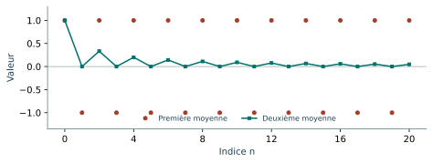
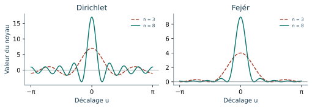
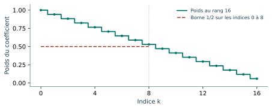

# École polytechnique — Deuxième composition de mathématiques P′ 1989 · Corrigé brut

*Corrigé rédigé par IA, non officiel. Signalez toute erreur.*

**Rédaction** · GPT-6.2 Astra Ultra · vitesse non renseignée · 26 novembre 2026

**Révision** · GPT-6.2 Astra Ultra · vitesse non renseignée · 26 novembre 2026

On note $T$ l’opérateur qui associe à une suite réelle ses moyennes depuis le rang zéro. La première partie compare la convergence de $\alpha$, $T\alpha$ et $T^2\alpha$. Les deux autres parties appliquent ces résultats aux sommes partielles d’une série puis aux séries de Fourier de fonctions continues $2\pi$-périodiques.

## I. Moyennes successives d’une suite

### I.1.a. Deux passages à la moyenne

Notons $(T\alpha)_n=(n+1)^{-1}\sum_{k=0}^n\alpha_k$. Si $\alpha_n\to\ell$, choisissons $N$ tel que $|\alpha_k-\ell|\le\varepsilon$ pour $k\ge N$. Pour $n\ge N$,
$$
|(T\alpha)_n-\ell|\le\frac{\sum_{k<N}|\alpha_k-\ell|}{n+1}+\varepsilon .
$$
Le premier terme tend vers zéro. Cela prouve $T\alpha\to\ell$. Appliquer le même résultat à $\beta=T\alpha$ montre que $T\alpha\to\ell$ entraîne $T^2\alpha\to\ell$.

### I.1.b. Une oscillation dont la moyenne converge

Prenons $\alpha_n=\ell+(-1)^n$. Ses sous-suites paires et impaires ont des limites distinctes. La somme $\sum_{k=0}^n(-1)^k$ vaut $1$ pour $n$ pair et $0$ pour $n$ impair, donc $(T\alpha)_n\to\ell$.

### I.1.c. Une oscillation qui subsiste après une moyenne

Posons $\alpha_n=\ell+(2n+1)(-1)^n$. Comme $(2k+1)(-1)^k=(k+1)(-1)^k-k(-1)^{k-1}$, la somme télescope et $(T\alpha)_n=\ell+(-1)^n$. La première moyenne diverge et la deuxième tend vers $\ell$ d’après I.1.b.

### I.1.d. Limite infinie

Si $\alpha_n\to+\infty$, fixons $A>0$ et prenons $N$ tel que $\alpha_k\ge 2A$ pour $k\ge N$. Pour $n\ge N$, la moyenne est au moins égale à $\big(\sum_{k<N}\alpha_k+2A(n-N+1)\big)/(n+1)$. Cette borne tend vers $2A$, donc $(T\alpha)_n\ge A$ pour $n$ assez grand. Ainsi $T\alpha\to+\infty$, puis $T^2\alpha\to+\infty$ par une deuxième application.

### I.2.a. Racines carrées

Si $\alpha_k\ge0$, Cauchy–Schwarz donne
$$
0\le\frac1{n+1}\sum_{k=0}^n\sqrt{\alpha_k}
\le\sqrt{\frac1{n+1}\sum_{k=0}^n\alpha_k}.
$$
Si $T\alpha\to0$, la borne supérieure tend vers zéro.

### I.2.b. Critère avec le poids racine

Posons $w_k=\sqrt{k}\,\alpha_k$, avec $\alpha$ positive et décroissante. Pour $n\ge1$ et $k\le n$, on a $\alpha_k\ge\alpha_n$ et $\sqrt{k}\ge k/\sqrt n$. Il en résulte
$$
(Tw)_n\ge\frac{\alpha_n}{(n+1)\sqrt n}\sum_{k=0}^n k
=\frac12\sqrt n\,\alpha_n.
$$
Si $Tw\to0$, alors $w\to0$. Le sens direct $w\to0\Rightarrow Tw\to0$ est I.1.a.

### I.2.c. Critère avec le poids entier

Cette fois, posons $w_k=k\alpha_k$. Pour $0\le j\le n$, la décroissance assure $(Tw)_j\ge\alpha_n\sum_{k=0}^j k/(j+1)=j\alpha_n/2$. Donc
$$
(T^2w)_n\ge\frac{\alpha_n}{2(n+1)}\sum_{j=0}^n j=\frac14n\alpha_n.
$$
La convergence de $T^2w$ vers zéro entraîne celle de $w$. La réciproque résulte de deux applications de I.1.a.

## II. Sommes partielles et coefficients de Fourier

### II.1.a. Une identité de sommes finies

Soient $s_n=\sum_{k=0}^nu_k$ et $v_n=nu_n$. Dans $\sum_{j=0}^n s_j$, le terme $u_k$ apparaît $n-k+1$ fois. La différence $(n+1)s_n-\sum_{j=0}^ns_j$ vaut donc $\sum_{k=0}^n k u_k$. Après division par $n+1$,
$$s-Ts=Tv.$$

### II.1.b. Série convergente

Si $s_n\to\ell$, I.1.a donne $(Ts)_n\to\ell$. Leur différence $(Tv)_n$ tend donc vers zéro.

### II.1.c. Revenir à la convergence ordinaire

On suppose $(Ts)_n\to\ell$. Si $Tv\to0$, l’identité $s=Ts+Tv$ donne $s_n\to\ell$. Réciproquement, si la série $\sum u_n$ converge, II.1.b entraîne $Tv\to0$. Sa somme est nécessairement $\ell$ par unicité de la limite de $Ts$.

### II.2.a. Une moyenne qui perd l’oscillation des sommes

Choisissons $u_0=1$ et $u_n=2(-1)^n$ pour $n\ge1$. Alors $s_n=(-1)^n$ et $(Ts)_n\to0$. En revanche, $(Tv)_n=(-1)^n-(Ts)_n$ garde les limites partielles $1$ et $-1$.

### II.2.b. Un exemple logarithmique

Pour $u_n=1/((n+1)\ln(n+2))$, on a $v_n=n/((n+1)\ln(n+2))\to0$, donc $Tv\to0$. En revanche, $u_n\ge 1/((n+2)\ln(n+2))$ et la série de droite diverge par comparaison avec l’intégrale de $1/(x\ln x)$, de primitive $\ln(\ln x)$ sur $x>1$. Ainsi $s_n\to+\infty$ et $(Ts)_n\to+\infty$ par I.1.d. Les sommes partielles n’ont aucune limite finie en moyenne.

### II.2.c. Moyenne itérée de la suite pondérée

Appliquons $T$ à II.1.a. On obtient $T^2v=Ts-T^2s$. Si $Ts\to\ell$, ses moyennes $T^2s$ ont la même limite. Donc $T^2v\to0$. La réciproque est fausse. L’exemple II.2.b donne $Tv\to0$, puis $T^2v\to0$, tandis que $Ts\to+\infty$.

### II.3.a. Décroissance des coefficients à l’infini

Pour $f$ continue, réelle et $2\pi$-périodique, posons $a_n=\pi^{-1}\int_{-\pi}^\pi f(t)\cos(nt)\,dt$ et $b_n=\pi^{-1}\int_{-\pi}^\pi f(t)\sin(nt)\,dt$. L’inégalité de Bessel pour la famille trigonométrique orthogonale s’écrit
$$
\frac{a_0^2}{2}+\sum_{k=1}^n(a_k^2+b_k^2)\le\frac1\pi\int_{-\pi}^\pi |f(t)|^2\,dt .
$$
Les séries positives $\sum a_k^2$ et $\sum b_k^2$ convergent. En particulier $a_n\to0$ et $b_n\to0$.

### II.3.b. Quatre limites en moyenne

Appliquons II.1.b à $u_k=a_k^2$, dont la série converge. La suite $na_n^2$ tend vers zéro en moyenne. I.2.a donne la même limite en moyenne pour sa racine $\sqrt n\,|a_n|$. Les deux raisonnements avec $b$ donnent les deux autres limites.

Si $|a_n|$ est décroissante, I.2.b donne en outre $\sqrt n\,|a_n|\to0$ au sens ordinaire. Son carré $na_n^2$ tend alors vers zéro lui aussi. Si ce sont les $|b_n|$ qui décroissent, on obtient $\sqrt n\,|b_n|\to0$ et $nb_n^2\to0$. Chaque conclusion requiert seulement la décroissance des modules de la famille concernée.

## III. Moyennes de Fourier et convergence uniforme

### III.1. Formules intégrales des deux noyaux

Avec $S_n(f)(x)=a_0/2+\sum_{k=1}^n(a_k\cos kx+b_k\sin kx)$ et $u=t-x$, les définitions donnent
$$
S_n(f)(x)=\frac1{2\pi}\int_{-\pi}^{\pi} f(t)D_n(t-x)\,dt,\qquad
D_n(u)=\sum_{k=-n}^n e^{iku}=\frac{\sin((2n+1)u/2)}{\sin(u/2)} .
$$
La somme géométrique justifie la dernière égalité. En moyennant les $D_j$ pour $0\le j\le n$, la fréquence $k$ apparaît $n+1-|k|$ fois. Ces mêmes multiplicités se trouvent dans le produit de $\sum_{j=0}^n e^{iju}$ par son conjugué. Le noyau moyen vaut donc
$$
F_n(u)=\frac1{n+1}\left|\sum_{j=0}^n e^{iju}\right|^2
=\frac{\sin^2((n+1)u/2)}{(n+1)\sin^2(u/2)} .
$$
Ainsi $\sigma_n(f)(x)=(2\pi)^{-1}\int_{-\pi}^{\pi} f(t)F_n(t-x)\,dt$. Ces expressions donnent exactement les facteurs $1/\pi$ et $1/(\pi(n+1))$ de l’énoncé lorsqu’on place le facteur $2$ sous chacune des fractions dans l’intégrale. Aux multiples de $2\pi$, les valeurs par continuité sont $D_n(0)=2n+1$ et $F_n(0)=n+1$.

### III.2.a. Masse du noyau

Si $f=1$, alors $a_0=2$ et tous les coefficients de rang positif sont nuls. Donc $\sigma_n(1)=1$. La seconde formule intégrale donne pour tout $x$
$$
\int_{-\pi}^{\pi}\frac{\sin^2((n+1)(t-x)/2)}{2\sin^2((t-x)/2)}\,dt=\pi(n+1).
$$

### III.2.b. Contrôle de la norme uniforme

Puisque $F_n\ge0$ et $(2\pi)^{-1}\int_{-\pi}^\pi F_n(t-x)\,dt=1$, la valeur absolue de l’intégrale pour $\sigma_n(f)(x)$ est au plus $\|f\|_\infty$. La prise du supremum en $x$ donne $\|\sigma_n(f)\|_\infty\le\|f\|_\infty$.

### III.3.a. Une fonction de classe un à support compact

Posons $\varphi(t)=\lambda(t^2-\pi^2)^2$ sur $|t|<\pi$ et $0$ ailleurs. Aux deux extrémités, le polynôme et sa dérivée $4\lambda t(t^2-\pi^2)$ s’annulent. Les raccords en $\pm\pi$ sont donc de classe $C^1$. La normalisation est
$$
1=2\lambda\left[\frac{t^5}{5}-\frac{2\pi^2t^3}{3}+\pi^4t\right]_{0}^{\pi}
=\lambda\frac{16\pi^5}{15},
\qquad \lambda=\frac{15}{16\pi^5}.
$$

### III.3.b. Conservation de la masse par changement d’échelle

Posons $h_p(t)=p\varphi(pt)$. Le changement $u=pt$ donne $\int_{-\pi}^{\pi}h_p(t)\,dt=\int_{-p\pi}^{p\pi}\varphi(u)\,du=1$ car le support de $\varphi$ est $[-\pi,\pi]$. Ceci vaut pour tout entier $p\ge1$, en particulier pour $p\ge2$.

### III.3.c. Régularité des convolutions

Par définition $f_p(x)=\int_{-\pi}^\pi f(x-t)h_p(t)\,dt$. La périodicité de $f$ donne celle de $f_p$. Prolongeons $h_p$ périodiquement à partir de $[-\pi,\pi]$, en une fonction $H_p$ de classe $C^1$ puisque les valeurs et les dérivées aux bornes sont nulles. Par changement de variable puis périodicité de l’intégrande,
$$f_p(x)=\int_{-\pi}^{\pi} f(u) H_p(x-u)\,du.$$
On peut dériver par rapport à $x$ sous l’intégrale puisque $f$ et $H_p'$ sont continues et bornées. La dérivée $\int f(u)H_p'(x-u)\,du$ est continue. Ainsi $f_p\in C^1(\mathbb R)$.

### III.3.d. Approximation uniforme de la fonction initiale

Une fonction continue périodique est uniformément continue. Notons $\omega_f(r)=\sup_{|s-t|\le r}|f(s)-f(t)|$, qui tend vers zéro avec $r$. Le noyau $h_p$ est positif, de masse un et s’annule hors de $[-\pi/p,\pi/p]$. Par conséquent
$$
|f_p(x)-f(x)|\le \int_{-\pi}^\pi |f(x-t)-f(x)|h_p(t)\,dt\le\omega_f(\pi/p).
$$
La majoration est indépendante de $x$ et tend vers zéro.

### III.4.a. Convergence uniforme des moyennes de Fourier

Fixons $p$ et posons $g=f_p$. Pour $0<\delta<\pi$, écrivons $\sigma_n(g)(x)-g(x)$ comme l’intégrale de $(g(x+u)-g(x))F_n(u)/(2\pi)$ sur $[-\pi,\pi]$. Si $|u|\le\delta$, l’écart est au plus $\|g'\|_\infty\delta$. Si $\delta\le |u|\le\pi$, alors $F_n(u)\le 1/((n+1)\sin^2(\delta/2))$. Cela donne
$$
\|\sigma_n(g)-g\|_\infty\le \|g'\|_\infty\delta+
\frac{2\|g\|_\infty}{(n+1)\sin^2(\delta/2)} .
$$
Choisissons $\delta$ petit, puis $n$ grand. Pour ce $p$ fixé, $\sigma_n(f_p)\to f_p$ uniformément.

Pour revenir à $f$, la linéarité et III.2.b donnent
$$
\|\sigma_n(f)-f\|_\infty
\le 2\|f-f_p\|_\infty+\|\sigma_n(f_p)-f_p\|_\infty .
$$
Avec III.3.d, fixons d’abord $p$ pour rendre le premier terme petit. Le second tend alors vers zéro quand $n\to\infty$. La convergence est uniforme sur $\mathbb R$.

### III.4.b. Moyenne itérée des coefficients du cosinus

En $x=0$, la somme partielle est $S_n(f)(0)=a_0/2+\sum_{k=1}^n a_k$. Ses moyennes $\sigma_n(f)(0)$ tendent vers $f(0)$ d’après III.4.a. Dans II.2.c, prenons $u_0=a_0/2$ et $u_k=a_k$ pour $k\ge1$. Il en résulte $T^2((ka_k)_{k\ge0})\to0$.

### III.5.a. Évaluation en un point mobile

Pour $f$ impaire, $f(0)=0$. Si $x_n=\pi/(2(n+1))$, alors $x_n\to0$ et
$$|\sigma_n(f)(x_n)|\le\|\sigma_n(f)-f\|_\infty+|f(x_n)|\longrightarrow0.$$
La convergence uniforme en III.4.a autorise ce changement de point avec $n$.

### III.5.b. Une minoration du sinus

Sur $[0,\pi/2]$, $\sin'' x=-\sin x\le0$. Le graphe de $\sin$ est donc au-dessus de la corde joignant $(0,0)$ à $(\pi/2,1)$, d’où $\sin x\ge 2x/\pi$.

### III.5.c. Une moyenne à poids triangulaires

L’imparité annule les $a_k$. En moyennant les sommes partielles, il vient $\sigma_n(f)(x)=\sum_{k=1}^{n}(1-k/(n+1))b_k\sin(kx)$. Pour $1\le k\le n$, on a $0\le kx_n<\pi/2$ et $\sin(kx_n)\ge k/(n+1)$. Les $b_k$ et les poids étant positifs ou nuls,
$$
0\le C_n:=\frac1{n+1}\sum_{k=0}^n\left(1-\frac{k}{n+1}\right)k b_k
\le \sigma_n(f)(x_n)\longrightarrow0.
$$

### III.5.d. Supprimer le poids triangulaire

Pour $0\le k\le n$, le poids $1-k/(2n+1)$ dans $C_{2n}$ est au moins $1/2$. Tous les termes sont positifs, donc
$$
C_{2n}\ge\frac1{2(2n+1)}\sum_{k=0}^n k b_k
=\frac{n+1}{2(2n+1)}\,T((kb_k))_n\ge\frac14 T((kb_k))_n.
$$
Comme $C_{2n}\to0$, on obtient $T((kb_k))_n\to0$.

### III.5.e. Convergence uniforme des sommes ordinaires

La formule des poids montre que $S_n(f)(x)-\sigma_n(f)(x)=(n+1)^{-1}\sum_{k=1}^n k b_k\sin(kx)$. Par positivité des $b_k$, sa valeur absolue est majorée uniformément par $T((kb_k))_n$, qui tend vers zéro. III.4.a donne donc
$$\|S_n(f)-f\|_\infty\le T((kb_k))_n+\|\sigma_n(f)-f\|_\infty\longrightarrow0.$$
La limite est $f$ sur toute la droite réelle.

## Documents de la session

La garde indique « École polytechnique », « concours d’admission 1989 », « option P′ » et « deuxième composition de mathématiques (4 heures) ». Les trois feuillets portent les pages imprimées 95 à 97. [Fac-similé UPS](https://prepas.org/index.php?module=Sujets&voir=get&file=doc-78644b9550d5f4c28f81) · [Notice officielle du 20 décembre 1988 relative au concours de 1989](https://www.legifrance.gouv.fr/jorf/id/JORFTEXT000000884199)
