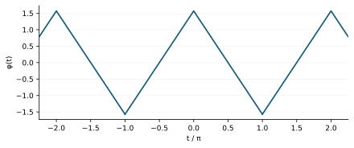
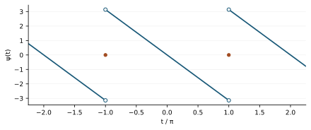

# Concours commun Mines-Ponts · École polytechnique, option T.A. — Deuxième épreuve de mathématiques 1989 · Corrigé brut

*Corrigé rédigé par IA, non officiel. Signalez toute erreur.*

**Rédaction** · GPT-6.2 Astra Ultra · vitesse non renseignée · 26 novembre 2026

On considère $C(t)=\sum_{n\ge1}a_n\cos(nt)/(n^2+\alpha^2)$ et $S(t)=\sum_{n\ge1}b_n\sin(nt)/(n^2+\alpha^2)$ pour $\alpha\ge0$. La dernière partie exprime ces séries à partir de deux problèmes aux limites.

## Partie I — Deux développements de Fourier

### I.1.a. Fonction triangulaire

Pour $-\pi\le t\le\pi$, la parité donne $\varphi(t)=\pi/2-|t|$. Par translation de $2\pi$, on obtient une ligne brisée continue sur la droite. Les sommets, de hauteur $\pi/2$ aux multiples pairs de $\pi$ et $-\pi/2$ aux multiples impairs, sont ses seuls points de non-dérivabilité. Entre deux sommets la pente est alternativement $-1$ et $1$.

### I.1.b. Coefficients du triangle

La moyenne est nulle et la parité annule tous les coefficients de sinus. Pour $n\ge1$, une intégration par parties donne

$$
a_n=\frac2\pi\int_0^\pi(\pi/2-t)\cos(nt)\,dt=\frac{2(1-(-1)^n)}{\pi n^2}.
$$

Les indices pairs donnent zéro et $a_{2p+1}=4/(\pi(2p+1)^2)$.

### I.1.c. Somme en chaque point

Le prolongement est continu et de classe $C^1$ par morceaux. Ainsi sa série de Fourier converge vers sa valeur en tout point, sommets compris. Pour $|t|\le\pi$,

$$
\frac4\pi\sum_{p\ge0}\frac{\cos((2p+1)t)}{(2p+1)^2}=\frac\pi2-|t|.
$$

La série converge même normalement grâce au majorant en $1/(2p+1)^2$.

### I.2.a. Fonction en dents de scie

Sur $]-\pi,\pi[$, l’imparité donne $\psi(t)=-t$. Pour $(2j-1)\pi<t<(2j+1)\pi$, on a $\psi(t)=2j\pi-t$. Aux extrémités des branches, $\psi((2j+1)\pi)=0$ car $\psi(\pi)=\psi(-\pi)=-\psi(\pi)$. La limite gauche est $-\pi$ et la droite $\pi$. La fonction est dérivable de dérivée $-1$ hors de ces points et discontinue à chacun d’eux.

### I.2.b. Coefficients des sinus

La moyenne et tous les coefficients de cosinus sont nuls par imparité. Les coefficients de sinus valent $b_n=(2/\pi)\int_0^\pi(-t)\sin(nt)dt=2(-1)^n/n$, car le terme intégré de cosinus s’annule et le terme de bord en $\pi$ vaut $\pi(-1)^n/n$.

### I.2.c. Somme aux points de saut

Par Dirichlet la somme de $2\sum_{n\ge1}(-1)^n\sin(nt)/n$ vaut $-t$ sur $]-\pi,\pi[$. En $t=\pm\pi$, la demi-somme des limites est zéro. C’est aussi la valeur de $\psi$ et celle de chaque terme de la série à ces deux points.

## Partie II — Équations vérifiées par les séries amorties

### II.1.a. Convergence ponctuelle et symétries

Pour $\alpha\ge0$, les dénominateurs $n^2+\alpha^2$ sont au moins $n^2$. Si $|a_n|,|b_n|\le M$, les termes des séries définissant $C$ et $S$ sont majorés en valeur absolue par $M/n^2$, donc les deux séries convergent absolument en tout point. Leurs termes sont $2\pi$-périodiques. Les cosinus donnent une somme paire $C$ et les sinus une somme impaire $S$.

### II.1.b. Continuité et moyennes

Le même majorant sommable donne la convergence normale sur $\mathbb R$, donc la continuité de $C,S$ et l’intégration terme à terme. La moyenne de $C$ sur $[0,\pi]$ est nulle. Celle de $S$ y vaut

$$
\frac1\pi\int_0^\pi S(t)\,dt=\frac1\pi\sum_{n\ge1}\frac{b_n(1-(-1)^n)}{n(n^2+\alpha^2)} .
$$

Le fac-similé demande une moyenne nulle sur $[0,\pi]$ pour les deux fonctions. Pour $b_1=1$, $b_n=0$ si $n>1$, on trouve $2/(\pi(1+\alpha^2))>0$. L’affirmation concernant $S$ est donc fausse sur ce demi-intervalle. Sur une période entière, les deux moyennes sont bien nulles.

### II.2.a. Dérivées premières

Sous les hypothèses $\sum |a_n|/n,\sum |b_n|/n<\infty$, les séries dérivées convergent normalement. Les séries initiales convergent en zéro, puisque $1/(n^2+\alpha^2)\le1/n$. Le théorème de dérivation terme à terme donne $C,S\in C^1(\mathbb R)$ et

$$
C'(t)=-\sum_{n\ge1}\frac{na_n\sin(nt)}{n^2+\alpha^2},\qquad S'(t)=\sum_{n\ge1}\frac{nb_n\cos(nt)}{n^2+\alpha^2}.
$$

### II.2.b. Dérivées secondes

Si $\sum|a_n|$ et $\sum|b_n|$ convergent, les hypothèses de II.2.a sont satisfaites. Les dérivées secondes ont pour coefficients $-n^2 a_n/(n^2+\alpha^2)$ et $-n^2 b_n/(n^2+\alpha^2)$ devant les cosinus et les sinus. Leurs modules sont majorés par $|a_n|$ et $|b_n|$. Par dérivation terme à terme, $C,S\in C^2(\mathbb R)$.

### II.3.a. Régularité pour des données continues par morceaux dérivables

Les données $\varphi,\psi$ sont continues, périodiques et $C^1$ par morceaux. Les termes aux raccords s’annulent par continuité lors d’une intégration par parties sur une période. Les coefficients sinus de $\varphi'$ valent $-na_n$ et les coefficients cosinus de $\psi'$ valent $nb_n$. Par Bessel, $\sum n^2|a_n|^2$ et $\sum n^2|b_n|^2$ sont finis, car les dérivées par morceaux sont de carré intégrable. L’inégalité de Cauchy-Schwarz avec $(1/n)$ donne $\sum|a_n|,\sum|b_n|<\infty$. La conclusion résulte alors de II.2.b.

### II.3.b. Équation pour les cosinus

Le facteur $n^2+\alpha^2$ s’annule avec le dénominateur du mode lors de l’application de l’opérateur. Par la dérivation justifiée en II.3.a, $-C''+\alpha^2 C=\sum a_n\cos(nt)=\varphi$ sur toute la droite, puisque la donnée continue est égale à sa série et de moyenne nulle. La formule de $C'$ donne $C'(0)=C'(\pi)=0$.

### II.3.c. Équation pour les sinus

Le même calcul donne $-S''+\alpha^2 S=\sum b_n\sin(nt)=\psi$ sur la droite, par la continuité et la régularité par morceaux de $\psi$. La série de $S$ donne $S(0)=S(\pi)=0$.

### II.4.a. Primitive de la donnée impaire

Dans cette question $\psi$ est continue sur $[0,\pi[$ et admet une limite finie à gauche de $\pi$. Par parité et translation elle est continue par morceaux et intégrable sur toute période. Posons $\chi(t)=\int_0^t\psi(s)ds$. Le changement $s\mapsto-s$ montre que $\chi$ est paire. L’intégrale sur une période vaut zéro par imparité, donc $\chi(t+2\pi)=\chi(t)$. La primitive est continue, dérivable de dérivée $\psi$ aux points de continuité, avec des dérivées latérales finies aux raccords. Elle est donc $C^1$ par morceaux.

### II.4.b. Coefficients de la primitive centrée

Si $a_0$ est la moyenne de $\chi$, la fonction $\varphi=\chi-a_0$ est paire de moyenne nulle. Pour $n\ge1$, son coefficient vaut $a_n=(2/\pi)\int_0^\pi\chi(t)\cos(nt)dt$. Le terme de bord avec $\sin(nt)$ est nul. Comme $\chi'=\psi$ à l’intérieur, on obtient $a_n=-b_n/n$.

### II.4.c. Développement et sommabilité

Le théorème de Dirichlet appliqué à $\varphi$ donne $\varphi(t)=-\sum_{n\ge1}b_n\cos(nt)/n$ pour tout $t$. La fonction $\psi$ est bornée et intégrable par morceaux, donc de carré intégrable sur une période. Bessel donne $\sum |b_n|^2<\infty$. Par Cauchy-Schwarz, $\sum |b_n|/n\le (\sum |b_n|^2)^{1/2}(\sum n^{-2})^{1/2}<\infty$. Le développement de $\varphi$ converge donc normalement.

### II.4.d. Une dérivée de plus sur le demi-intervalle

Les coefficients de la donnée paire $\varphi$ sont absolument sommables par II.4.c. La série prescrite est exactement $C=\sum a_n\cos(nt)/(n^2+\alpha^2)$. Elle est de classe $C^2$ sur $\mathbb R$, et $-C''+\alpha^2 C=\varphi$ par calcul terme à terme. Sur $[0,\pi[$, $\varphi'=\psi$ est continue, au sens unilatéral en zéro. Ainsi $C''=\alpha^2 C-\varphi$ est $C^1$ sur cet intervalle, et $C$ y est $C^3$.

### II.4.e. Retour à la série de sinus

Dériver les cosinus de $C$ donne $C'=S$, la dérivation étant justifiée par II.2.a. Donc $S$ est $C^1$ sur la droite et $C^2$ sur $[0,\pi[$. Sur cet intervalle $-S''+\alpha^2S=\varphi'=\psi$. Sa série donne $S(0)=S(\pi)=0$. La continuité assure aussi $\lim_{t\to\pi^-}S(t)=0$, même lorsque $\psi$ présente un saut.

## Partie III — Sommes explicites

### III.1.a. Problème de Neumann avec paramètre positif

Posons $h=\pi/2$, $s=t-h$. Pour $\alpha>0$, toute solution de $-y''+\alpha^2y=-s$ vaut $-s/\alpha^2+A\cosh(\alpha s)+B\sinh(\alpha s)$. Les conditions $y'(\pm h)=0$ dans la coordonnée $s$ donnent par différence $A=0$ puis $B=1/(\alpha^3\cosh(\alpha h))$. Ainsi

$$
f_\alpha(t)=-\frac{s}{\alpha^2}+\frac{\sinh(\alpha s)}{\alpha^3\cosh(\alpha h)} .
$$

Cette fonction est impaire en $s$, donc de moyenne nulle sur $[0,\pi]$. L’unicité avec ces conditions et les coefficients de I.1.b donnent, pour $0\le t\le\pi$, $\sum_{p\ge0}\cos((2p+1)t)/((2p+1)^2((2p+1)^2+\alpha^2))=(\pi/4)f_\alpha(t)$.

### III.1.b. Problème de Neumann sans paramètre

En coordonnées centrées $f_0''=s$. Une première intégration donne $f_0'=s^2/2-h^2/2$ pour annuler les pentes aux deux bornes. Une seconde donne $f_0=s^3/6-h^2s/2+C$. La partie dépendant de $s$ étant impaire, la moyenne impose $C=0$. Pour $0\le t\le\pi$ on en déduit

$$
\sum_{p\ge0}\frac{\cos((2p+1)t)}{(2p+1)^4}=\frac\pi4\left(\frac{s^3}{6}-\frac{h^2s}{2}\right).
$$

### III.1.c. Limite lorsque le paramètre s’annule

Les termes de la série de III.1.a sont dominés en module par $(2p+1)^{-4}$, indépendamment du paramètre. La limite peut donc être prise sous la somme. À droite,

$$
\frac{\sinh(\alpha s)}{\cosh(\alpha h)}
=\alpha s+\alpha^3(s^3/6-sh^2/2)+O(\alpha^5)
$$

pour $s$ fixé. Après division par $\alpha^3$, le terme $s/\alpha^2$ se simplifie avec l’autre terme de $f_\alpha$. On retrouve exactement III.1.b.

### III.2.a. Problème de Dirichlet avec paramètre positif

Sur $[0,\pi[$, toute solution vaut $-t/\alpha^2+A\cosh(\alpha t)+B\sinh(\alpha t)$. La condition en zéro impose $A=0$ et la limite en $\pi$ donne $B=\pi/(\alpha^2\sinh(\alpha\pi))$. Par unicité et II.4.e,

$$
\sum_{n\ge1}\frac{(-1)^n\sin(nt)}{n(n^2+\alpha^2)}
=\frac{g_\alpha(t)}2
=\frac1{2\alpha^2}\left(\frac{\pi\sinh(\alpha t)}{\sinh(\alpha\pi)}-t\right).
$$

L’égalité vaut aussi en $\pi$ par continuité. Le facteur $1/2$ vient des coefficients de I.2.b.

### III.2.b. Problème de Dirichlet sans paramètre

La condition en zéro élimine la constante de $g_0=t^3/6+At+B$. La condition en $\pi$ donne $A=-\pi^2/6$. La même identification par les coefficients conduit à $\sum_{n\ge1}(-1)^n\sin(nt)/n^3=(t^3-\pi^2t)/12$ pour $0\le t\le\pi$.

### III.3.a. Somme moins amortie sur les fréquences impaires

Après deux dérivations, le module de chaque terme est au plus $1/(2p+1)^2$. Les séries des fonctions et de leurs premières dérivées convergent également normalement. Multiplier la dérivée seconde de III.1.a par $-1$ donne sur tout $[0,\pi]$

$$
\sum_{p\ge0}\frac{\cos((2p+1)t)}{(2p+1)^2+\alpha^2}
=-\frac{\pi\sinh(\alpha(t-\pi/2))}{4\alpha\cosh(\alpha\pi/2)} .
$$

### III.3.b. Cosinus alternés et terme d’indice zéro

La série dérivée de III.2.a converge normalement par comparaison à $\sum1/n^2$. Sa somme est $g_\alpha'(t)/2$ et elle commence en $n=1$. L’énoncé commence en $n=0$, ce qui ajoute $1/\alpha^2$. Finalement, sur $[0,\pi]$,

$$
\sum_{n=0}^\infty\frac{(-1)^n\cos(nt)}{n^2+\alpha^2}
=\frac1{2\alpha^2}+\frac{\pi\cosh(\alpha t)}{2\alpha\sinh(\alpha\pi)} .
$$

## Documents de la session

Le sujet imprimé comporte six feuillets répartis sur les vues 111 à 113 du recueil et attribue la deuxième épreuve à l’option T.A. En II.1.b, la moyenne de S annoncée nulle sur un demi-intervalle est contredite par le premier sinus. Les deux éditions démontrent la formule exacte. La dernière somme débute bien en n égal à zéro. [Fac-similé UPS](https://prepas.org/index.php?module=Sujets&voir=get&file=doc-fbfdb235c2e55104db0d) · [Notice officielle du concours](https://www.legifrance.gouv.fr/jorf/id/JORFTEXT000000884199)
