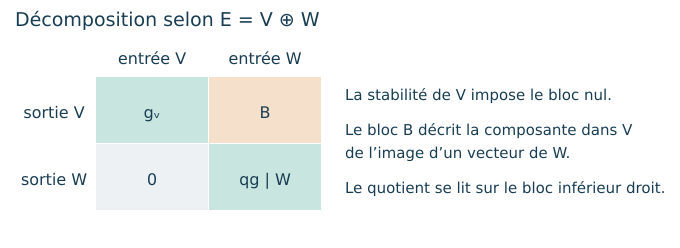

# École polytechnique — Deuxième composition de mathématiques · M′ et P′ 1990 · Corrigé brut

*Corrigé rédigé par IA, non officiel. Signalez toute erreur.*

**Rédaction** · GPT-6.2 Astra Ultra · vitesse non renseignée

Le cadre est un espace complexe $E$ de dimension $n\ge2$, avec $L=\operatorname{End}(E)$. Une sous-algèbre peut ne pas contenir l’identité. Une famille est irréductible si ses seuls sous-espaces stables sont $0$ et $E$. La garde prescrit le préliminaire et les parties I et II aux deux options. L’option M′ traite en plus la partie III.

## Question préliminaire commune

### Question préliminaire

L’opérateur nul laisse stable toute droite, propre puisque $n\ge2$. Pour $L$, si un sous-espace stable contient $v\ne0$, il contient tout $w\in E$ car on peut définir un endomorphisme par $v\mapsto w$ et le prolonger sur une base. Cela prouve l’irréductibilité de $L$.

## Partie I · Sous-algèbres irréductibles · M′ et P′

### Question 1.a

La sous-algèbre irréductible $A$ est non nulle par le préliminaire. Elle est stable sous les multiplications à gauche par ses propres éléments. Les dimensions des sous-espaces non nuls ayant cette stabilité forment donc un ensemble non vide d’entiers positifs. On choisit un $M$ réalisant le minimum.

### Question 1.b

Prenons $m_0\in M$ et $e\in E$ tels que $m_0(e)\ne0$. Si $v=m(e)$ et $a\in A$, alors $av=(am)(e)$ avec $am\in M$. L’image $\widehat e(M)$ est donc un sous-espace stable non nul, nécessairement $E$. La surjectivité impose $\dim M\ge n$.

### Question 1.c

Si $b(e)=0$, alors $(ab)(e)=a(0)=0$. Ainsi $M\cap\ker\widehat e$ est stable à gauche. Cette intersection est propre dans $M$ puisque $m_0(e)\ne0$. Par minimalité, sa dimension vaut zéro.

### Question 1.d

La restriction $\widehat e:M\to E$ est injective par 1.c et surjective par 1.b. C’est un isomorphisme, donc $\dim M=n$.

### Question 2.a

Posons $h=(\widehat x|_M)(\widehat e|_M)^{-1}$. Alors $m(x)=h(m(e))$ pour tout $m\in M$. Si l’évaluation en $x$ est nulle, $h=0$. Sinon son image est stable non nulle par le calcul de 1.b, donc égale à $E$. Le morphisme $h:E\to E$ est alors surjectif et bijectif.

### Question 2.b

Pour $a\in A$, $m\in M$, on a $ahm(e)=am(x)=h(am(e))$. Comme $m(e)$ parcourt $E$, il vient $ah=ha$.

### Question 2.c

L’endomorphisme $h$ a une valeur propre $\lambda$. Son sous-espace propre est stable par $A$ car $(h-\lambda I)a=a(h-\lambda I)$. Il est non nul, donc égal à $E$. Ainsi $h=\lambda(x)I$, même dans le cas $h=0$. La formule de 2.a montre que $h$ dépend linéairement de $x$, donc $\lambda(x)=\operatorname{tr}(h)/n$ aussi.

### Question 2.d

On a $\lambda(e)=1$ car $h=I$ pour $x=e$. Pour chaque $m$, $m(x-\lambda(x)e)=0$, soit $m(x)=\lambda(x)m(e)$. Tout $m\ne0$ a donc rang un et noyau $H=\ker\lambda$. Réciproquement, si $u$ a pour noyau $H$, alors $u(x)=\lambda(x)u(e)$ et il existe un unique $m\in M$ tel que $m(e)=u(e)$. D’où $u=m$. Le noyau commun caractérise $M$ indépendamment du représentant non nul.

### Question 3.a

Si $A=M_1$, tous ses éléments annuleraient $H_1$, hyperplan propre et non nul puisque $n\ge2$. Ce serait un sous-espace stable interdit. Ainsi $M_1\subsetneq A$.

### Question 3.b

Pour $a\in A$, il existe un unique $m_1\in M_1$ avec $m_1(e_1)=a(e_1)$. Alors $a-m_1\in\ker\widehat e_1$. L’intersection est nulle par injectivité, donc $A=M_1\oplus\ker\widehat e_1$.

### Question 3.c

Le noyau est non nul par 3.a et 3.b, et stable à gauche par 1.c. Ses sous-espaces stables non nuls admettent un membre de dimension minimale $M_2$. Tout sous-espace contenu dans $M_2$ est aussi contenu dans le noyau. En choisissant $e_2$ sur lequel un élément de $M_2$ ne s’annule pas, la preuve de 1.b–d s’applique sans changement. Ainsi $\widehat e_2|_{M_2}$ est un isomorphisme et $\dim M_2=n$.

### Question 3.d

Posons $K_0=A$. Tant que $K_{i-1}\ne0$, on choisit dans ce sous-espace stable un membre minimal $M_i$ et un $e_i$ comme en 3.c. L’évaluation décompose $K_{i-1}=M_i\oplus K_i$ avec $K_i=K_{i-1}\cap\ker\widehat e_i$, encore stable à gauche. Sa dimension baisse de $n$. On s’arrête donc à $K_r=0$, et $A=\bigoplus_{i=1}^r M_i$, avec toutes les propriétés demandées.

### Question 4.a

Si $v\in V=\bigcap H_i$, chaque $m_i\in M_i$ annule $v$. Tout $a\in A$ étant leur somme, $a(V)=0$. Ainsi $V$ est stable, et propre car contenu dans $H_1$. L’irréductibilité donne $V=0$.

### Question 4.b

L’application $T:E\to\mathbb C^r$, $v\mapsto(\ell_i(v))$, a noyau $V$. Toute forme nulle sur $V$ se factorise par $T(E)$ et se prolonge de $T(E)$ à $\mathbb C^r$ par choix d’une base. Ainsi $V^\perp=\operatorname{Vect}(\ell_1,\ldots,\ell_r)=E^*$.

### Question 4.c

Les $r$ formes engendrent le dual de dimension $n$, donc $r\ge n$. Par ailleurs $\dim A=rn\le\dim L=n^2$, donc $r\le n$. Finalement $r=n$.

### Question 5

La sous-algèbre $A\subset L$ a dimension $rn=n^2=\dim L$, donc $A=L$. Réciproquement $L$ est irréductible d’après le préliminaire. Ce résultat vaut sans hypothèse initiale d’unité dans $A$.

## Partie II · Groupes d’exposant fini · M′ et P′

### Question 6.a

La trace est bilinéaire en $a,b$ dans $t_a(b)=\operatorname{tr}(ab)$. Dans une base, $\operatorname{tr}(aE_{ji})=a_{ij}$. Si $t_a=0$, chaque coefficient de $a$ est donc nul. Les espaces $L$ et $L^*$ ayant même dimension $n^2$, l’application linéaire injective $a\mapsto t_a$ est bijective.

### Question 6.b

Les produits de combinaisons linéaires d’éléments de $G$ sont de telles combinaisons car $G$ est fermé par produit. Un sous-espace stable par $G$ est stable par ces combinaisons et réciproquement. Si $G$ est irréductible, $\langle G\rangle$ est donc une sous-algèbre irréductible. Par 5 elle vaut $L$. Par 6.a, les $t_g$, $g\in G$, engendrent $L^*$.

### Question 7.a

Ses valeurs propres appartiennent à l’ensemble fini $\mu_s$ des racines $s$-ièmes de l’unité puisque $(gg')^s=I$. La trace $t_g(g')$ est une somme de $n$ éléments de $\mu_s$ comptés avec multiplicité. Il y a au plus $s^n$ sommes ordonnées, donc un nombre fini de traces.

### Question 7.b

Par 6.b on extrait une base $t_{g_1},\ldots,t_{g_{n^2}}$ de $L^*$. L’application $g\mapsto(\operatorname{tr}(g_i g))_i$ est injective puisqu’une base du dual sépare les points. Chaque coordonnée appartient à l’ensemble fini de 7.a. Le produit cartésien de ces ensembles est fini, donc $G$ aussi.

### Question 8.a

La stabilité de $V$ donne $g=\left(\begin{smallmatrix}g_V&B_g\\0&g_W\end{smallmatrix}\right)$, où $g_W=qg|_W$ représente l’action sur $E/V$. Les blocs diagonaux se multiplient séparément. Appliqué à $g^{-1}$, ce calcul donne leurs inverses et l’identité a pour blocs $I_V,I_W$. Les deux ensembles de blocs diagonaux sont donc des sous-groupes.

### Question 8.b

Si $g_V=I_V$ et $g_W=I_W$, alors $g=I+N$ avec $N=pgq$ et $N^2=0$ puisque $qp=0$. Le binôme donne $g^s=I+sN$. L’hypothèse $g^s=I$ entraîne $N=0$ en caractéristique zéro. Le morphisme $g\mapsto(g_V,g_W)$ a donc un noyau trivial et est injectif.

### Question 8.c

Les règles de produit donnent $(g_V)^s=I_V$, $(g_W)^s=I_W$. En dimension un, les éléments sont dans $\mu_s$. En dimension $n$, le cas irréductible est acquis en 7.b. Dans le cas réductible, les deux dimensions sont comprises entre $1$ et $n-1$. Par récurrence les deux groupes images sont finis, et 8.b plonge $G$ dans leur produit. D’où la finitude.

## Partie III · Normes des orbites · Option M′

### Question 9

Pour $g v=\lambda v$ avec $v\ne0$, on a $g^j v=\lambda^j v$ pour tout $j\in\mathbb Z$. Si $|\lambda|<1$, les puissances positives envoient $v$ vers zéro. Si $|\lambda|>1$, ce sont les puissances négatives. Ces deux cas contredisent la minoration de l’orbite. Ainsi $|\lambda|=1$.

### Question 10.a

Dans la base de 7.b, $|\operatorname{tr}(g_i g)|\le n$, car $g_i g$ appartient au groupe et ses valeurs propres ont module un. En écrivant $g=\sum_i \operatorname{tr}(g_i g)u_i$ dans la base préduale, on obtient $\|g\|\le n\sum_i\|u_i\|$. La borne est indépendante de $g$.

### Question 10.b

Si $C=\sup_{h\in G}\|h\|$, on a $\|x\|\le\|g^{-1}\|\,\|gx\|\le C\|gx\|$. Pour $x\ne0$, l’infimum est au moins $\|x\|/C>0$.

### Question 11.a

Dans la décomposition de 8.a, $\det(TI-g)=\det(TI_V-g_V)\det(TI_W-g_W)$. Les racines du second facteur sont donc des valeurs propres de $g$, de même que celles du premier.

### Question 11.b

Raisonnons par récurrence sur la dimension. En dimension un le groupe agit par des scalaires de module un. Le cas irréductible relève de 10.b. Sinon les groupes des blocs diagonaux satisfont l’hypothèse spectrale par 11.a. Si $0\ne x\in V$, la récurrence sur le premier groupe minore $\|g_Vx\|=\|gx\|$. Si $qx\ne0$, elle donne $\inf_g\|g_W qx\|>0$. Or $qgx=g_W qx$, donc $\|gx\|\ge\|g_W qx\|/\|q\|$. Cela achève la preuve avec les normes restreintes à $V$ et $W$.

### Question 12.a

Les applications $g_j(\xi,\eta)=(\xi,j\xi+\eta)$, $j\in\mathbb Z$, vérifient $g_jg_k=g_{j+k}$, $g_0=I$, $g_j^{-1}=g_{-j}$. Elles forment donc un sous-groupe. Les deux entrées diagonales valent $1$, unique valeur propre, de multiplicité deux.

### Question 12.b

La droite $\xi=0$ est fixe point par point. Si $\xi\ne0$, alors $\|g_j(\xi,\eta)\|_1=|\xi|+|j\xi+\eta|\ge|\xi|$. Sinon la norme est $|\eta|$. Cela illustre 11.b. Pourtant $\|g_j\|_1=1+|j|$, par les sommes de colonnes ou par évaluation en $(1,0)$. Ainsi la minoration individuelle des orbites vaut dans ce groupe réductible non borné, et l’irréductibilité joue bien un rôle dans 10.a.
