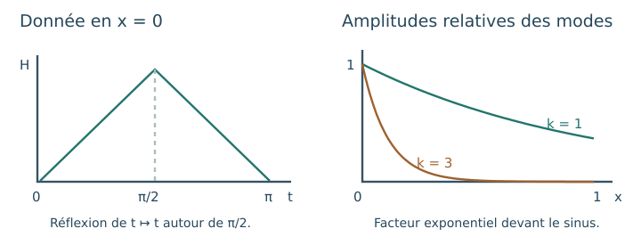

# École polytechnique — Première composition de mathématiques · M′ 1990 · Corrigé brut

*Corrigé rédigé par IA, non officiel. Signalez toute erreur.*

**Rédaction** · GPT-6.2 Astra Ultra · vitesse non renseignée

La suite $(\lambda_n)_{n\ge0}$ est strictement croissante, positive ou nulle et de limite infinie. La série complexe $\sum a_n$ converge, éventuellement sans convergence absolue. On note $D_n=\sum_{k=n}^\infty a_k$ et $u_n(z)=a_ne^{-\lambda_n z}$. Dans la seconde partie, $x$ est la variable d’évolution et $t$ celle de la dérivée d’ordre deux.

## Partie I · Séries de Dirichlet

### Question 1

Si $z=x+iy$ avec $x>0$, alors $e^{-\alpha z}-e^{-\beta z}=\int_\alpha^\beta z e^{-sz}\,ds$. La valeur absolue est au plus $|z|\int_\alpha^\beta e^{-sx}\,ds=(|z|/x)(e^{-\alpha x}-e^{-\beta x})$.

### Question 2.a

Posons $v_k=e^{-\lambda_k z}$. Pour $p\le q$, la sommation par parties donne
$$
\sum_{k=p}^q a_kv_k=D_pv_p+\sum_{k=p+1}^q D_k(v_k-v_{k-1})-D_{q+1}v_q.
$$
Si $z\ne0$ appartient au secteur $\Omega(\theta)$ avec $\theta<\pi/2$, alors $|z|/x\le1/\cos\theta$. Par 1 la somme des modules des différences de $v_k$ est majorée par $1/\cos\theta$, par télescopage. En zéro toutes ces différences valent zéro. Comme $|v_k|\le1$, tout reste fini est borné par $(2+1/\cos\theta)\sup_{k\ge p}|D_k|$, qui tend vers zéro. C’est le critère de Cauchy uniforme.

### Question 2.b

Chaque point de $\Re z>0$ a un voisinage inclus dans un secteur $\Omega(\theta)$, $\theta<\pi/2$. Les termes sont continus et la convergence est uniforme sur ce secteur, donc $f$ est définie et continue sur le demi-plan. La même convergence inclut le sommet du secteur, d’où $\lim_{z\to0,\ z\in\Omega(\theta)} f(z)=f(0)=\sum a_n$.

### Question 3.a

Avec $\rho>0$ et $x\ge x_0>0$, le poids $v(\lambda)=\lambda^\rho e^{-\lambda x}$ décroît dès $\lambda>\rho/x_0$ et tend vers zéro. Pour $p$ au-delà de ce seuil, ses différences en $\lambda_k$ ont une somme de modules au plus $v(\lambda_p)$. La formule de 2.a majore le reste par $3\sup_{k\ge p}|D_k|\,\lambda_p^\rho e^{-\lambda_p x_0}$. La convergence est donc uniforme sur $[x_0,+\infty[$.

### Question 3.b

La dérivée d’ordre $j$ d’un terme est $a_n(-\lambda_n)^j e^{-\lambda_n x}$. Pour tout entier $j\ge1$ la série correspondante converge uniformément sur $[x_0,+\infty[$ par 3.a. L’ordre zéro converge par 2.a. Les dérivations successives sont donc permises sur tout compact de $]0,+\infty[$. Ainsi $f$ est de classe $C^\infty$ et ses dérivées sont les sommes indiquées.

### Question 3.c

Si $\sum|a_n|<\infty$, alors $|a_n\lambda_n^\rho e^{-\lambda_n x}|\le |a_n|\sup_{\lambda\ge0}\lambda^\rho e^{-\lambda x_0}$. Ce supremum est fini pour tout $\rho>0$, de même que celui d’ordre zéro. La convergence normale donne immédiatement les convergences uniformes et les dérivations successives de 3.b.

### Question 4.a

Fixons $x>0$, $Y>0$, $\omega\in\mathbb R$. Le segment $x+i[-Y,Y]$ est contenu dans un secteur fermé d’angle strictement inférieur à $\pi/2$. L’intégration terme à terme est donc justifiée par 2.a. Pour la moyenne de $f(x+iy)e^{i\omega y}$ sur $[-Y,Y]$, on obtient
$$
g_Y(x,\omega)=\sum_{n\ge0} a_ne^{-\lambda_nx}\operatorname{sinc}((\lambda_n-\omega)Y),\qquad
\operatorname{sinc}(v)=\frac{\sin v}{v},\quad \operatorname{sinc}(0)=1 .
$$
Si $\omega=\lambda_j$, le terme $j$ vaut exactement $a_j e^{-\lambda_j x}$. Sinon tous les termes utilisent le quotient ordinaire.

### Question 4.b

Écrivons $\delta=\lambda-\omega\ge1$. La dérivée par rapport à $\lambda$ du sinus cardinal vaut $[\cos(\delta Y)-\operatorname{sinc}(\delta Y)]/\delta$, donc son module est au plus $2$. Pour $V=e^{-\lambda x}\operatorname{sinc}(\delta Y)$, cela donne $|V'(\lambda)|\le e^{-\lambda x}(x+2)$. On peut prendre $B(x)=x+2$.

### Question 4.c

Pour $\omega+1\le\lambda<\mu$, 4.b entraîne $|V(\mu)-V(\lambda)|\le [(x+2)/x](e^{-\lambda x}-e^{-\mu x})$. Ainsi $B_1(x)=1+2/x$ convient pour tout $\omega$ et tout $Y>0$.

### Question 4.d

Dès que $\lambda_p\ge\omega+1$, la variation des poids $V(\lambda_k)$ sur une queue est au plus $B_1(x)e^{-\lambda_p x}$ par télescopage de 4.c. Les deux termes de bord dans 2.a sont majorés à l’aide de $|V(\lambda_k)|\le e^{-\lambda_kx}$. Le reste est donc borné par $(2+B_1(x))e^{-\lambda_px}\sup_{k\ge p}|D_k|$, indépendamment de $Y$. On peut passer à la limite $Y\to+\infty$ terme à terme. Le résultat est $a_j e^{-\lambda_j x}$ si $\omega=\lambda_j$, et zéro si $\omega$ n’est aucune fréquence.

### Question 4.e

Pour tout $j$ et tout $x>0$, la formule précédente reconstruit $a_j=e^{\lambda_j x}\lim_{Y\to\infty} g_Y(x,\lambda_j)$ à partir de $f$. Ainsi, pour une suite de fréquences fixée, l’application $(a_n)\mapsto f$ est injective.

## Partie II · Équation de la chaleur et comportement à l’origine

### Question 5

Soit $b=\pi/2$. Le produit non nul $F(x,t)=\varphi(x)\psi(t)$ vérifie $F_x=F_{tt}$, $\psi(0)=0$, $\psi'(b)=0$. En fixant un $t$ où $\psi(t)\ne0$, on obtient $\varphi'=c\varphi$. Par continuité et non-nullité du produit en $(0,b)$, $\varphi$ ne s’annule pas et $\psi''=c\psi$. Pour $c=0$ ou $c>0$, les solutions linéaires ou hyperboliques satisfaisant les deux conditions sont nulles. Pour $c=-k^2<0$, $\psi$ est proportionnelle à $\sin kt$ et $\cos(kb)=0$. Ainsi $k=k_n=2n+1$, $n\ge0$. La normalisation $|F(0,b)|=1$ fixe le module de l’amplitude et la croissance en zéro fixe son signe positif. Les produits cherchés sont exactement $F_n(x,t)=e^{-k_n^2x}\sin(k_nt)$, qui vérifient toutes les conditions.

### Question 6.a

Posons $A(t)=th(t)$ sur $[0,b]$. Définissons $H=A$ sur cet intervalle, $H(t)=A(\pi-t)$ sur $[b,\pi]$, puis $H(-t)=-H(t)$ sur $[-\pi,0]$. On prolonge avec période $2\pi$. Puisque $A(0)=0$, les raccords sont continus et $H$ est $C^1$ par morceaux. L’imparité élimine les cosinus. La symétrie $H(\pi-t)=H(t)$ élimine les sinus d’indice pair, puisque $\sin(j(\pi-t))=(-1)^{j+1}\sin(jt)$. Inversement ces symétries sont imposées par une série de seuls sinus impairs et sa convergence vers la fonction continue. Elles déterminent tout le prolongement.

### Question 6.b

L’imparité puis la réflexion en $b$ donnent $b_n=(2/\pi)\int_0^\pi H(t)\sin(k_nt)\,dt=(4/\pi)\int_0^b th(t)\sin(k_nt)\,dt$.

### Question 6.c

Après une intégration par parties, $k_n b_n=(4/\pi)\int_0^b A'(t)\cos(k_nt)\,dt$. Les termes de bord s’annulent car $A(0)=0$ et $\cos(k_nb)=0$. Les cosinus sont orthogonaux sur $[0,b]$, tous de norme quadratique $\sqrt{\pi}/2$. Bessel donne $\sum k_n^2|b_n|^2<\infty$, puis Cauchy–Schwarz donne $\sum|b_n|<\infty$. Donc $\sum b_n e^{-k_n^2x}\sin(k_nt)$ converge normalement sur $Q=[0,\infty[^2$ et définit $F$. En $x=0$, le théorème de Dirichlet pour $H$ continue et $C^1$ par morceaux identifie la somme à $H(t)$, donc à $th(t)$ sur $[0,b]$.

### Question 6.d

La convergence normale précédente assure la continuité sur $Q$. Sur $x\ge\varepsilon>0$, les poids $k_n^j e^{-\varepsilon k_n^2}$ sont bornés pour tout $j$. On peut donc dériver une fois en $x$ et deux fois en $t$ terme à terme, avec le même facteur $-k_n^2$ dans $F_x$ et $F_{tt}$. Les sinus s’annulent en $t=0$, et les cosinus des termes de $F_t$ s’annulent en $t=b$. Cela donne l’équation et les deux conditions aux bords.

### Question 6.e

Pour $t>0$, posons $G=F/t$. Pour $x>0$ et $t=0$, posons $G(x,0)=F_t(x,0)$. En effet $F(x,t)/t=\int_0^1 F_t(x,ut)\,du$ pour $x>0$. La convergence uniforme des dérivées près de tout $x>0$ donne la continuité au bord. Pour $x=0,t>0$, la définition par quotient est déjà continue. Cela construit $G$ sur $Q$ privé de l’origine.

### Question 7.a

Pour $h=1$, l’intégration donne $\int_0^b t\sin(k_nt)\,dt=\sin(k_nb)/k_n^2=(-1)^n/k_n^2$. Donc
$$
F(x,t)=\frac4\pi\sum_{n\ge0}\frac{(-1)^n}{k_n^2}e^{-k_n^2x}\sin(k_nt).
$$

### Question 7.b

Pour le créneau pair $\sigma$ égal à $1$ avant $b$ et à $-1$ après $b$ sur $[0,\pi]$, la moyenne est nulle. Le coefficient de $\cos(jt)$ est $4\sin(jb)/(\pi j)$ pour $j\ge1$. Ainsi sa série est $(4/\pi)\sum_{n\ge0}(-1)^n\cos(k_nt)/k_n$. Aux sauts elle prend la demi-somme, zéro. En $t=0$, point de continuité, elle vaut $1$. Il en résulte $\sum_{n\ge0}(-1)^n/(2n+1)=\pi/4$.

### Question 7.c

Sur $s\ge1$, posons $U(s)=[e^{-xs^2}\operatorname{sinc}(ts)-1]/s$, avec la convention $\operatorname{sinc}(0)=1$. Pour $t>0$, la dérivée de $\sin(ts)/(ts^2)$ vaut $[\cos(ts)-2\operatorname{sinc}(ts)]/s^2$. La formule se prolonge en $t=0$. Le facteur exponentiel introduit en plus un terme de module au plus $2x e^{-xs^2}$. Ainsi $|U'|\le2xe^{-xs^2}+4/s^2$. Pour $x=0$ le premier terme est nul, et pour $x>0$ il est intégrable. Les intervalles $[4n+1,4n+3]$ étant disjoints, la somme des différences absolues est finie.

### Question 7.d

À partir de $p$, la somme est au plus $\int_{4p+1}^\infty (2x e^{-xs^2}+4/s^2)\,ds$. Le second terme vaut $4/(4p+1)$. Pour $x>0$, le changement $v=\sqrt x\,s$ majore le premier par $2\sqrt x\int_0^\infty e^{-v^2}dv=\sqrt{\pi x}$. Pour $x=0$ il est nul. Ainsi $K=\sqrt\pi$ convient indépendamment de $t,x,p$.

### Question 7.e

Par 7.a–b et 6.e, $G-1=(4/\pi)\sum_{n\ge0}[U(4n+1)-U(4n+3)]$ sur $Q^*$, avec la même convention en $t=0$ (où $x>0$ autorise la dérivation terme à terme). Pour chaque $s$ fixé, $U(s)\to0$ lorsque $(x,t)\to(0,0)$. La partie finie tend donc vers zéro. Après passage à la limite supérieure, la queue est majorée par $(4/\pi)4/(4p+1)$ par 7.d. En faisant tendre $p$ vers l’infini, on trouve $G\to1$. Ainsi $G(0,0)=1$ assure la continuité sur $Q$.

### Question 8.a

Supposons $h\in C^2$. À partir de 6.c, une seconde intégration par parties donne $k_n^2 b_n=(-1)^n c+\beta_n$, où
$$
c=\frac4\pi A'(b)=\frac4\pi[h(b)+b h'(b)],\qquad
\beta_n=-\frac4\pi\int_0^b A''(t)\sin(k_nt)\,dt .
$$
Les sinus de fréquences impaires sont orthogonaux sur $[0,b]$, de norme quadratique $\sqrt\pi/2$. Par Bessel, $\sum\beta_n^2<\infty$. Alors $\sum|\beta_n|/k_n$ converge par Cauchy–Schwarz.

### Question 8.b

Écrivons $G=(\pi c/4)G_1+R$, où $G_1$ correspond à $h=1$. Le reste est la somme des termes $\beta_n e^{-k_n^2x}\operatorname{sinc}(k_nt)/k_n$, qui ont chacun un prolongement continu à tout $Q$. La majorante sommable de 8.a donne la convergence uniforme jusque dans le coin. Par 7.e, $G$ admet donc un prolongement continu. Le long de $x=0$, $0<t\le b$, le quotient vaut $h(t)$. Sa valeur nécessaire et suffisante au coin est donc $G(0,0)=h(0)$.

### Question 8.c

On a $G(0,t)=h(t)$ pour $0<t\le b$ et $G(0,t)=(\pi-t)h(\pi-t)/t$ pour $b\le t\le\pi$. La dérivée gauche en $b$ vaut $h'(b)$. La dérivée droite, celle de $A(\pi-t)/t$, vaut $-A'(b)/b-A(b)/b^2$. La différence droite moins gauche est donc $-2A'(b)/b=-2h'(b)-4h(b)/\pi$.

### Question 8.d

La somme demandée est $(\pi c/4)G_1(0,t)=A'(b)G_1(0,t)$. Elle vaut $A'(b)$ pour $0<t\le b$ et $A'(b)(\pi-t)/t$ pour $b\le t\le\pi$. Son saut de dérivée est $-2A'(b)/b$, exactement celui de 8.c. En effet, près de $b>0$, la série restante $\sum\beta_n\sin(k_nt)/(k_n^2t)$ est dérivable terme à terme. Ses dérivées sont majorées par $C(|\beta_n|/k_n+|\beta_n|/k_n^2)$, de somme finie. Sa dérivée est continue et ne contribue donc pas au saut.
