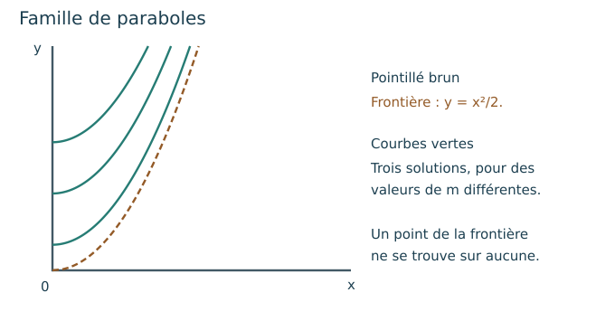
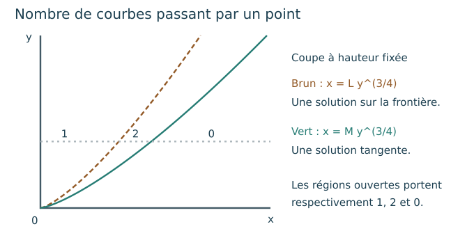

# École polytechnique — Première composition de mathématiques · P′ 1990 · Corrigé brut

*Corrigé rédigé par IA, non officiel. Signalez toute erreur.*

**Rédaction** · GPT-6.2 Astra Ultra · vitesse non renseignée

Dans le demi-plan $y>0$, on cherche les solutions maximales de $f''=f^k$ telles que $f(0)=m>0$, $f'(0)=0$. Les courbes sont indexées par le paramètre libre $m$. Compter les courbes passant par un point revient à retrouver toutes les valeurs admissibles de $m$.

## Partie I · Trois exposants particuliers

### Question 1.a

Pour $k=0$, on trouve $f_m(x)=m+x^2/2$ sur $\mathbb R$, car cette formule est partout positive. Les graphes sont des paraboles d’axe vertical dont les sommets $(0,m)$ se trouvent au-dessus de l’origine.

### Question 1.b

Un point $(x_1,y_1)$ impose $m=y_1-x_1^2/2$. Il appartient à une seule courbe si $y_1>x_1^2/2$, et à aucune si $0<y_1\le x_1^2/2$. L’égalité correspondrait à $m=0$, exclu.

### Question 2

Pour $k=1$, les conditions initiales donnent $f_m(x)=m\cosh x$. Ces solutions positives sont définies sur $\mathbb R$. Les graphes se déduisent de celui de $\cosh$ en multipliant toutes les ordonnées par $m$. Chaque point du demi-plan appartient à un unique graphe, avec $m=y_1/\cosh x_1$.

### Question 3.a

Pour $k=-1$, le champ $(y,v)\mapsto(v,1/y)$ est lisse pour $y>0$. L’existence et l’unicité maximales donnent la solution $f_0$ de données $(1,0)$ ici désignée comme dans l’énoncé. La fonction $m f_0(x/m)$ vérifie les données $(m,0)$ et l’équation. Le changement d’échelle étant inversible, elle est maximale. Les graphes sont les images de celui de $f_0$ par les homothéties de centre l’origine et de rapport $m$.

### Question 3.b

Comme $f''=1/f>0$, $f$ est strictement convexe. La réflexion $x\mapsto -x$ conserve l’équation et les données initiales. Par unicité maximale, $f$ est paire. Sa dérivée strictement croissante s’annule en zéro. Ainsi $f$ décroît pour $x<0$ et croît pour $x>0$.

### Question 4.a

On obtient $(f')^2=2\ln(y/m)$. Sur la demi-branche positive, $f'=\sqrt{2\ln Y}$, $Y=y/m$. La primitive séparée est $x=m\int_1^Y(2\ln t)^{-1/2}\,dt$. L’intégrande est équivalente en $1$ à $1/\sqrt{2(t-1)}$ et son intégrale diverge à l’infini, par exemple par comparaison à $1/t$ au-delà d’un seuil. Cette primitive croît de zéro à l’infini. Par inversion et par parité, l’intervalle maximal est $\mathbb R$ et l’ensemble des valeurs est $[m,+\infty[$.

### Question 4.b

Avec $J(Y)=\int_1^Y(2\ln t)^{-1/2}\,dt$ et $y=mY$, on a $x/y=F(Y)=J(Y)/Y$, même en $Y=1$ où les deux membres sont nuls.

### Question 4.c

Pour $1<A<Y$, on a $0\le F(Y)\le J(A)/Y+1/\sqrt{2\ln A}$. On laisse tendre $Y$ puis $A$ vers l’infini. Ainsi $x/y\to0$ bien que $|x|\to\infty$. Les deux branches sont paraboliques de direction verticale, symétriques par rapport à l’axe des ordonnées.

### Question 4.d

Posons $w(Y)=(2\ln Y)^{-1/2}$. On a $Y^2F'=Yw-J$, dont la dérivée est $Yw'<0$. La fonction $F$, continue, positive à l’intérieur, nulle en $1$ et de limite nulle à l’infini, atteint un maximum intérieur. Ce point critique est donc unique. En $Y_0$, $F(Y_0)=w(Y_0)$ et $f'(x)=1/w(Y_0)=y/x$.

### Question 4.e

Soit $M=F(Y_0)$. Si $x_1=0$, un seul graphe passe par le point, avec $m=y_1$. Pour $x_1>0$, il y a deux graphes si $x_1/y_1<M$, un si $x_1/y_1=M$, aucun si $x_1/y_1>M$. En effet chaque racine $Y$ donne $m=y_1/Y$ et $F$ croît puis décroît strictement. La droite $D$ a pente $1/M=\sqrt{2\ln Y_0}$. Pour chaque $m$, au point d’ordonnée $mY_0$, sa pente coïncide avec $f'$ d’après 4.d.

### Question 5.a

Pour $\varphi(Y)=Y/\sqrt{2\ln Y}$, la dérivée est $(2\ln Y-1)/(2\ln Y)^{3/2}$. Son unique minimum se situe en $Y_1=\sqrt e$ et vaut $\sqrt e$.

### Question 5.b

Avec $t=e^{u^2/2}$, $J(Y_1)=\int_0^1 e^{u^2/2}\,du<\sqrt e=\varphi(Y_1)$. Ainsi $Yw-J>0$ en $Y_1$ et s’annule une seule fois, en $Y_0>Y_1$. La pente $\sqrt{2\ln Y_0}$ est strictement supérieure à $1$.

## Partie II · Solutions maximales pour k supérieur à −1

### Question 6.a

Pour tout $k>-1$, le champ $(y,v)\mapsto(v,y^k)$ est lisse sur $]0,+\infty[\times\mathbb R$. Par le théorème de Cauchy–Lipschitz, à chaque couple initial $(m,0)$ avec $m>0$ correspond exactement une solution maximale.

### Question 6.b

Sur $-I$, $g(x)=f(-x)$ a même équation et mêmes données que $f$. Toute extension de $g$ se réfléchirait en une extension de $f$, ainsi $g$ est également maximale. L’unicité de la solution maximale donne $I=-I$ et $g=f$.

### Question 6.c

La courbe est strictement convexe, avec minimum $m$ en zéro. La dérivée strictement croissante est négative à gauche de zéro et positive à droite. Ainsi $f$ décroît puis croît strictement.

### Question 7.a

Écrivons $\alpha=(k+1)/2>0$. L’identité $2f'f''=2f'f^{2\alpha-1}$ donne, pour $x\ge0$,
$$
f'(x)=\frac{\sqrt{y^{2\alpha}-m^{2\alpha}}}{\sqrt\alpha},\qquad
x=\sqrt\alpha\,m^{1-\alpha}J_\alpha(y/m),\qquad
J_\alpha(Y)=\int_1^Y\frac{dt}{\sqrt{t^{2\alpha}-1}}.
$$
L’intégrande est équivalente à $[2\alpha(t-1)]^{-1/2}$ en $1$ et à $t^{-\alpha}$ à l’infini. La primitive donne par inversion toute la branche croissante, tant que $y$ est fini. Si $\alpha>1$, l’intervalle maximal est $]-T,T[$ où $T=\sqrt\alpha\,m^{1-\alpha}J_\alpha(+\infty)$, et $y\to+\infty$ aux deux bornes. Si $0<\alpha\le1$, il est égal à $\mathbb R$.

### Question 7.b

Pour $0<\alpha\le1$, $y\to+\infty$ à droite et l’intégrale première donne $f'(x)\to+\infty$. Par convexité, $f(x)\ge f(x/2)+(x/2)f'(x/2)$, d’où $f(x)/x\to+\infty$ aussi. Les deux branches infinies sont paraboliques de direction verticale.

## Partie III · Nombre de courbes passant par un point

### Question 8

La formule de 7.a donne $xy^{\alpha-1}=\sqrt\alpha\,Y^{\alpha-1}J_\alpha(Y)=F(Y)$, valable dès $x=0$. À ordonnée $y>0$ fixée, la transformation $Y\mapsto m=y/Y$ établit une bijection entre les solutions en $Y\ge1$ de cette équation et les graphes passant par $(x,y)$.

### Question 9.a

Pour $k\ge0$, si $f_1(0)<f_2(0)$ et $\xi$ est le premier contact à droite sur leur domaine commun, $f_1\le f_2$ sur $[0,\xi]$. Donc $f_1''\le f_2''$. En intégrant deux fois et en utilisant les vitesses initiales nulles, on trouve $f_2(\xi)-f_1(\xi)\ge m_2-m_1>0$, contradiction. La continuité garantit le contact en $\xi$ si une inversion de l’ordre existe.

### Question 9.b

Pour $y>0$ fixé, une égalité $F(Y_1)=F(Y_2)$ avec $Y_1\ne Y_2$ donnerait deux solutions de minima distincts passant par le même point, en contradiction avec 9.a. Or $F$ est continue, $F(1)=0$ et $F(Y)>0$ pour $Y>1$. Une fonction continue injective sur un intervalle étant strictement monotone, elle est ici strictement croissante.

### Question 9.c

Si $\alpha>1$, $J_\alpha$ tend vers une constante strictement positive et $Y^{\alpha-1}\to+\infty$. Si $\alpha=1$, c’est $J_1(Y)=\operatorname{argch}Y$ qui diverge. L’image de $F$ vaut $[0,+\infty[$ dans les deux cas. Chaque point du quart de plan se trouve sur une et une seule courbe.

### Question 10.a

On a $1/\sqrt{s-1}-1/\sqrt{s}=\frac12\int_{s-1}^s u^{-3/2}\,du\le1/[2(s-1)^{3/2}]$, puisque l’intégrande est décroissante.

### Question 10.b

Avec $w(t)=(t^{2\alpha}-1)^{-1/2}$, 10.a donne pour $t\ge2$ que $0\le w(t)-t^{-\alpha}\le C_\alpha t^{-3\alpha}$. Après intégration, l’erreur est bornée si $3\alpha>1$, vaut $O(\ln Y)$ si $3\alpha=1$, et $O(Y^{1-3\alpha})$ sinon. Le segment $[1,2]$ donne une constante finie. Toutes ces erreurs sont $o(Y^{1-\alpha})$ pour $0<\alpha<1$. D’où $F(Y)\to L=\sqrt\alpha/(1-\alpha)$.

### Question 10.c

Pour $1/2\le\alpha<1$, $F$ croît strictement de zéro vers $L$ sans atteindre $L$. Il y a un graphe si $0\le x<Ly^{1-\alpha}$, et aucun si $x\ge Ly^{1-\alpha}$. La frontière $x=Ly^{1-\alpha}$ est une courbe limite, exclue du domaine balayé. La figure prend $\alpha=1/2$, où la frontière s’écrit $y=x^2/2$.

### Question 11.a

Pour $0<\alpha<1/2$, posons $D(Y)=Yw(Y)-(1-\alpha)J_\alpha(Y)$. Alors $F'(Y)=\sqrt\alpha\,Y^{\alpha-2}D(Y)$. Un calcul donne $D'=\alpha w+Yw'=-\alpha(Y^{2\alpha}-1)^{-3/2}<0$. Ainsi $F'$ s’annule au plus une fois.

### Question 11.b

L’intégrale de 10.a est au moins $1/(2s^{3/2})$. Combinée à 10.a, cette minoration donne $d(t)=w(t)-t^{-\alpha}\sim\frac12t^{-3\alpha}$. Or $D(Y)=Yd(Y)-(1-\alpha)\int_1^Y d(t)\,dt+1$. Si $3\alpha<1$, les deux termes de puissance donnent $D(Y)\sim-\alpha Y^{1-3\alpha}/(1-3\alpha)$. Si $3\alpha=1$, $Yd(Y)\to1/2$ tandis que l’intégrale est équivalente à $\tfrac12\ln Y$. Dans les deux cas $Y^{2-\alpha}F'(Y)=\sqrt\alpha\,D(Y)\to-\infty$.

### Question 11.c

Lorsque $Y\downarrow1$, $Yw(Y)\to+\infty$ tandis que $J_\alpha(Y)\to0$. Pour $0<\alpha\le1/3$, $D$ décroît donc de $+\infty$ à $-\infty$. Il s’annule en un unique $Y_0>1$. Le maximum strict vaut
$$
M=F(Y_0)=\frac{\sqrt\alpha}{1-\alpha}
\frac{Y_0^\alpha}{\sqrt{Y_0^{2\alpha}-1}}>L .
$$

### Question 11.d

Écrivons $u=xy^{\alpha-1}$. Sur $[1,Y_0]$, $F$ monte de $0$ à $M$. Puis elle décroît de $M$ vers $L$ sans atteindre $L$. Il y a une courbe pour $0\le u\le L$, deux pour $L<u<M$, une pour $u=M$, aucune pour $u>M$. Les frontières sont $x=Ly^{1-\alpha}$ et $x=My^{1-\alpha}$. Cette dernière est une enveloppe. Pour tout $y>0$, choisir $m=y/Y_0$. La pente de la solution vaut $y^\alpha\sqrt{1-Y_0^{-2\alpha}}/\sqrt\alpha$, celle de l’enveloppe vaut $y^\alpha/[(1-\alpha)M]$. Elles coïncident par 11.c.

### Question 12.a

Pour $1/3<\alpha\le1/2$, $w(t)-t^{-\alpha}=O(t^{-3\alpha})$ à l’infini par 10.a. La singularité en $1$ est intégrable. Pour $t>1$, la fonction $s\mapsto(s-1)^{-1/2}-s^{-1/2}$ est strictement décroissante. Ainsi $w(t)-t^{-\alpha}$ diminue quand $\alpha$ augmente, et $1/(\alpha-1)$ décroît strictement aussi. Leur somme intégrée $\psi(\alpha)$ est strictement décroissante. Pour $\alpha=1/2$, la primitive entre $1$ et $R$ est $2\sqrt{R-1}-2\sqrt R+2$, de limite $2$. Donc $\psi(1/2)=2-2=0$, et $\psi(\alpha)>0$ pour $1/3<\alpha<1/2$.

La marge du fac-similé suggère de soustraire $t^{-2\alpha}$. Avec cette lecture, la différence est équivalente à $t^{-\alpha}$ à l’infini et l’intégrale diverge. L’expression imprimée $t^{-\alpha}$ est également celle de la définition de $\psi$ et permet la suite du raisonnement.

### Question 12.b

L’identité
$$
D(Y)=Y[w(Y)-Y^{-\alpha}]-(1-\alpha)
\left(\int_1^Y [w(t)-t^{-\alpha}]\,dt+\frac1{\alpha-1}\right)
$$
s’obtient par intégration de $t^{-\alpha}$. Le premier terme est $O(Y^{1-3\alpha})\to0$. La limite de $D$ est donc $-(1-\alpha)\psi(\alpha)<0$. Comme $D$ est strictement décroissante et tend vers $+\infty$ en $1$, $F'$ s’annule exactement une fois.

### Question 12.c

Pour $1/3<\alpha<1/2$, 12.b donne le même unique maximum intérieur, donc la même valeur $M$ de 11.c. La limite finale est toujours $L$ par 10.b. On retrouve une solution pour $0\le u\le L$, deux pour $L<u<M$, une pour $u=M$ et aucune au-delà. Le calcul de pente en 11.d reste valable. Ainsi la courbe $x=My^{1-\alpha}$ est encore l’enveloppe tangente.
