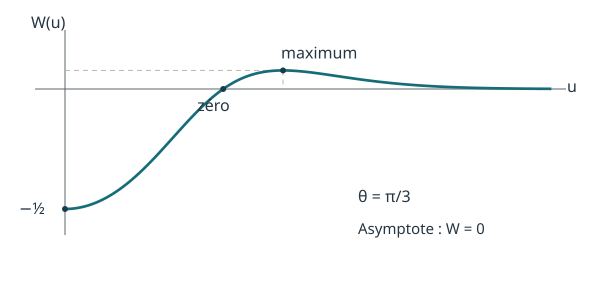

# École polytechnique — Deuxième composition de mathématiques · Option M′ 1991 · Corrigé brut

*Corrigé rédigé par IA, non officiel. Signalez toute erreur.*

**Rédaction** · GPT-6.2 Astra Ultra · vitesse non renseignée

La série étudiée est $f(x)=\sum_{n\ge1}x^n/\sqrt n$. Les numéros suivent les quatre parties du fac-similé original, pages imprimées 126 à 128. On utilisera d’abord des sommes de rectangles pour étudier $x\uparrow1$, puis une intégrale gaussienne pour étudier le bord complexe du disque.

## Partie I — Sommes de rectangles pour une fonction décroissante

### Question 1.a

Soit $\phi$ continue, strictement positive, décroissante sur $]0,\infty[$ et intégrable sur cet intervalle. Fixons $h>0$. Pour $n\ge1$, la décroissance donne $0\le h\phi(nh)\le\int_{(n-1)h}^{nh}\phi(t)\,dt$. Pour $n=1$, l’intégrale est impropre et existe par hypothèse. Toute somme partielle est donc majorée par $\int_0^\infty\phi$. Ces sommes croissent et sont bornées, ce qui prouve la convergence.

### Question 1.b

Sur $[nh,(n+1)h]$, on a cette fois $\int_{nh}^{(n+1)h}\phi(t)\,dt\le h\phi(nh)$. Avec la majoration précédente et en passant à la limite dans les sommes partielles,

$$
\int_h^\infty\phi(t)\,dt\ \le\ h\sum_{n\ge1}\phi(nh)\ \le\ \int_0^\infty\phi(t)\,dt.
$$

La différence des deux bornes vaut $\int_0^h\phi(t)\,dt\to0$ quand $h\downarrow0$. La somme a donc pour limite l’intégrale sur $]0,\infty[$.

### Question 2.a

On suppose seulement $\int_0^1\phi<\infty$. L’erreur $c_k=\int_{k-1}^k\phi(t)\,dt-\phi(k)$ est positive ou nulle et $c_1$ est finie. Pour $k\ge2$, on a $c_k\le\phi(k-1)-\phi(k)$. Ainsi $\sum_{k=2}^N c_k\le\phi(1)-\phi(N)\le\phi(1)$. La série à termes positifs $C=\sum_{k=1}^\infty c_k$ converge, même lorsque l’intégrale à l’infini diverge.

### Question 2.b

Posons $s(x)=\sum_{1\le k\le x}\phi(k)$, la somme vide valant zéro, et $\psi(x)=s(x)-\int_0^x\phi+C$. Pour $N=\lfloor x\rfloor$, la somme des $c_k$ jusqu’à $N$ vaut $\int_0^N\phi-s(x)$. On peut donc écrire, pour tout $x>0$,

$$
\psi(x)=\int_x^{N+1}\phi(t)\,dt-\phi(N+1)+\sum_{k=N+2}^\infty c_k.
$$

La dernière somme est comprise entre $0$ et $\phi(N+1)$ par télescopage. L’intégrale positive est au plus $(N+1-x)\phi(x)\le\phi(x)$, et $\phi(N+1)\le\phi(x)$. D’où $-\phi(x)\le\psi(x)\le\phi(x)$. Ainsi $|\psi(x)/\phi(x)|\le1$ sur tout $]0,\infty[$. Le calcul comprend $N=0$ et les points entiers.

## Partie II — Développement au voisinage de 1

### Question 3

La racine $n$-ième du coefficient $1/\sqrt n$ tend vers $1$, d’où le rayon $R=1$. Pour $0<x<1$, $\sum_{n=1}^N x^n/\sqrt n\le f(x)$. À $N$ fixé, la somme de gauche tend vers $A_N=\sum_{n=1}^N1/\sqrt n$. Or $A_N\ge\sqrt N$, car chacun des $N$ termes est au moins $1/\sqrt N$. En choisissant $N$ arbitrairement grand, on obtient $\lim_{x\uparrow1}f(x)=+\infty$.

### Question 4

Écrivons $x=e^{-h}$ pour $h>0$. On a $\sqrt h\,f(e^{-h})=h\sum_{n\ge1}\phi(nh)$ avec $\phi(t)=e^{-t}/\sqrt t$. Cette fonction est positive, décroissante et intégrable, puisque sa singularité en zéro est d’ordre $t^{-1/2}$ et sa décroissance à l’infini exponentielle. Par 1.b, la limite vaut $\int_0^\infty e^{-t}dt/\sqrt t$. Le changement $t=u^2$ et l’intégrale gaussienne fournie donnent $\sqrt\pi$. Puisque $h=-\log x\sim1-x$, il vient

$$
f(x)\underset{x\uparrow1}{\sim}\frac{\sqrt\pi}{\sqrt{1-x}}.
$$

### Question 5

Sur $[0,\infty[$, $s(y)=\sum_{n\ge1}n^{-1/2}\mathbf 1_{[n,\infty[}(y)$, donc $s(y)=A_{\lfloor y\rfloor}$ en posant $A_0=0$. Pour $h=-\log x>0$, chaque terme est positif et le théorème de convergence monotone autorise l’interversion. On trouve

$$
h\int_0^\infty s(y)e^{-hy}\,dy
=\sum_{n\ge1}\frac{1}{\sqrt n}\int_n^\infty he^{-hy}\,dy
=\sum_{n\ge1}\frac{e^{-nh}}{\sqrt n}=f(x).
$$

### Question 6.a

Pour $\phi(y)=y^{-1/2}$, 2.b donne $s(y)=2\sqrt y-C+\psi(y)$ avec $|\psi(y)|\le1/\sqrt y$ et $C=\sum_{k\ge1}(2\sqrt k-2\sqrt{k-1}-1/\sqrt k)$. Dans 5, la constante contribue $-C$. Par intégration par parties et changement $u=hy$, le terme $2\sqrt y$ contribue $\int_0^\infty y^{-1/2}e^{-hy}\,dy=\sqrt{\pi/h}$. La valeur absolue du reste est au plus $h\int_0^\infty y^{-1/2}e^{-hy}\,dy=\sqrt{\pi h}$. Ainsi $f(e^{-h})=\sqrt{\pi/h}-C+O(\sqrt h)$.

Enfin $(1-e^{-h})/h=1-h/2+O(h^2)$, d’où $(1-e^{-h})^{-1/2}-h^{-1/2}=O(\sqrt h)$. On en déduit la limite additive demandée

$$
L=\lim_{x\uparrow1}\left(f(x)-\frac{\sqrt\pi}{\sqrt{1-x}}\right)=-C.
$$

### Question 6.b

Pour $0<x<1$, la convergence absolue donne $f(-x)=\sqrt2\,f(x^2)-f(x)$. En utilisant 6.a, les contributions constantes donnent $(\sqrt2-1)L$. La différence des termes singuliers vaut

$$
\frac{\sqrt\pi}{\sqrt{1-x}}\left(\sqrt{\frac{2}{1+x}}-1\right)=O(\sqrt{1-x}).
$$

La série $f(-x)=\sum (-1)^n x^n/\sqrt n$ converge uniformément pour $x\in[0,1]$ par la majoration du reste alterné par $1/\sqrt{N+1}$. On peut donc faire tendre $x$ vers $1$, et $f(-1)=(\sqrt2-1)L$. Finalement $L=(\sqrt2+1)f(-1)$.

## Partie III — Représentation intégrale et axe réel négatif

### Question 7

On étudie $\int_0^\infty du/(e^{u^2}-x)$. Pour $x\notin[1,\infty[$, le dénominateur ne s’annule pas. L’intégrande est continue sur tout segment et, pour $u$ assez grand, son module est au plus $2e^{-u^2}$. Il y a convergence absolue.

Pour $x=1$, l’intégrande est équivalente à $1/u^2$ en zéro. Pour $x>1$, elle a un pôle simple en $a=\sqrt{\log x}>0$, de terme principal $1/[2ax(u-a)]$. Les intégrales impropres unilatérales y divergent. Le domaine exact est donc $\mathbb C\setminus[1,\infty[$, où l’énoncé définit $g(x)=\frac{2x}{\sqrt\pi}\int_0^\infty du/(e^{u^2}-x)$.

### Question 8

Si $|x|<1$, on a $x/(e^{u^2}-x)=\sum_{n\ge1}x^n e^{-nu^2}$. Comme $\int_0^\infty e^{-nu^2}\,du=\sqrt\pi/(2\sqrt n)$, la somme des intégrales des modules est $\frac{\sqrt\pi}{2}\sum_{n\ge1}|x|^n/\sqrt n<\infty$. On peut intégrer terme à terme, y compris pour $x=0$. Il en résulte $g(x)=\sum_{n\ge1}x^n/\sqrt n=f(x)$.

### Question 9

Avec $t=\sqrt{\log |x|}>0$ et $x=-e^{t^2}$, posons $q_t(u)=(1+e^{u^2-t^2})^{-1}$. Alors $g(x)=-2\int_0^\infty q_t(u)\,du/\sqrt\pi$. Sur $0\le u\le t$, $1-q_t(u)\le e^{-(t-u)(t+u)}\le e^{-t(t-u)}$. Sur $u\ge t$, $q_t(u)\le e^{-(u-t)(u+t)}\le e^{-2t(u-t)}$. Par intégration,

$$
0\le\int_0^t(1-q_t)\,du\le\frac1t,\qquad
0\le\int_t^\infty q_t\,du\le\frac1{2t}.
$$

Ainsi $\int_0^\infty q_t\,du=t+O(1/t)$. En revenant à $x$, on obtient $g(x)+\frac2{\sqrt\pi}\sqrt{\log|x|}\longrightarrow0$ lorsque $x\to-\infty$.

## Partie IV — Comportement sur le cercle unité

### Question 10

Pour $\theta\in]0,2\pi[$, posons $z=e^{i\theta}\ne1$. Les sommes $Z_N=\sum_{n=1}^Nz^n=z(1-z^N)/(1-z)$ ont un module au plus $2/|1-z|$. Comme $n^{-1/2}$ décroît vers zéro, le critère de Dirichlet, obtenu en sommant par parties, donne la convergence de $\sum_{n\ge1}z^n/\sqrt n$. La partie réelle et la partie imaginaire de ses sommes partielles tendent donc vers celles de $f(z)$. Cela justifie $C(\theta)=\sum\cos(n\theta)/\sqrt n$ et $S(\theta)=\sum\sin(n\theta)/\sqrt n$ sur l’intervalle indiqué. Aux deux extrémités, la série des sinus vaut zéro terme à terme.

### Question 11.a

Pour $n+1\le k\le2n$, on a $\pi/4\le k\pi/(4n)\le\pi/2$. Le sinus vaut au moins $1/\sqrt2$ et $1/\sqrt k\ge1/\sqrt{2n}$. Chacun des $n$ termes est donc au moins $1/(2\sqrt n)$. Par sommation,

$$
\sum_{k=n+1}^{2n}\frac{\sin(k\pi/(4n))}{\sqrt k}\ \ge\ \frac12\sqrt n.
$$

La constante $K=1/2$ convient pour tout $n\ge1$.

### Question 11.b

Si la série des sinus convergeait uniformément sur $[0,2\pi]$, le supremum du module de la somme des termes $n+1$ à $2n$ tendrait vers zéro. Or à $\theta_n=\pi/(4n)$ cette somme est au moins $\sqrt n/2$ par 11.a. La condition de Cauchy uniforme échoue. La série converge donc ponctuellement sur tout l’intervalle, mais sa convergence n’y est pas uniforme.

### Question 12

Fixons $z=e^{i\theta}\ne1$. On a $\delta=\min_{0\le r\le1}|1-rz|>0$ par compacité, car $rz=1$ y est impossible. Pour $q=ze^{-u^2}$, la différence entre $q/(1-q)$ et $\sum_{n=1}^Nq^n$ est $q^{N+1}/(1-q)$. Son intégrale en module est donc majorée par $\delta^{-1}\sqrt\pi/(2\sqrt{N+1})$. L’intégration de la somme finie et le passage à la limite donnent $g(z)=\sum_{n\ge1}z^n/\sqrt n=f(z)$.

En multipliant $z/(e^{u^2}-z)$ par le conjugué du dénominateur, sa partie réelle s’écrit $(e^{u^2}\cos\theta-1)/(e^{2u^2}-2e^{u^2}\cos\theta+1)$. L’intégrale converge absolument par 7. Ainsi

$$
C(\theta)=\frac2{\sqrt\pi}\int_0^\infty W_\theta(u)\,du,\qquad
W_\theta(u)=\frac{e^{u^2}\cos\theta-1}{e^{2u^2}-2e^{u^2}\cos\theta+1}.
$$

### Question 13

Fixons $0<\theta<\pi/2$, et notons $c=\cos\theta$, $s=\sin\theta$, $r=e^{u^2}$. Le dénominateur $D=r^2-2cr+1=(r-c)^2+s^2$ est positif. Le seul zéro de $W_\theta$ sur $[0,\infty[$ est donc $u_0=\sqrt{\log(1/c)}$. En dérivant le quotient, on trouve

$$
W_\theta'(u)=2ur\,\frac{-cr^2+2r-c}{D^2}.
$$

Le trinôme a deux racines $r_-=(1-s)/c=c/(1+s)<1$ et $r_+=(1+s)/c>1$. Les zéros de la dérivée sur la demi-droite sont $0$ et $u_*=\sqrt{\log((1+s)/c)}$. Le noyau croît strictement de $W_\theta(0)=-1/2$ à $W_\theta(u_*)=(1-s)/(2s)$, puis décroît strictement vers $0$ par valeurs positives. On a $0<u_0<u_*$. Si on prolonge la formule à toute la droite, sa parité donne les points symétriques.

### Question 14

Lorsque $\theta\downarrow0$, $u_0=\sqrt{\log(1/\cos\theta)}\to0$. D’après 13, $W_\theta\ge-1/2$ avant $u_0$ et $W_\theta\ge0$ ensuite. Fixons $0<\varepsilon<1$. Sur $[\varepsilon,1]$, $W_\theta(u)$ tend uniformément vers $1/(e^{u^2}-1)$, puisque le dénominateur limite y est strictement positif. Pour $\theta$ tel que $u_0<\varepsilon$, on en déduit

$$
\int_0^\infty W_\theta(u)\,du\ \ge\ -u_0/2+\int_\varepsilon^1 W_\theta(u)\,du.
$$

La limite inférieure du membre de gauche est donc au moins $\int_\varepsilon^1du/(e^{u^2}-1)$. Cette borne tend vers $+\infty$ lorsque $\varepsilon\downarrow0$, car l’intégrande est équivalente à $1/u^2$. Avec 12, il vient $\lim_{\theta\downarrow0}C(\theta)=+\infty$.
