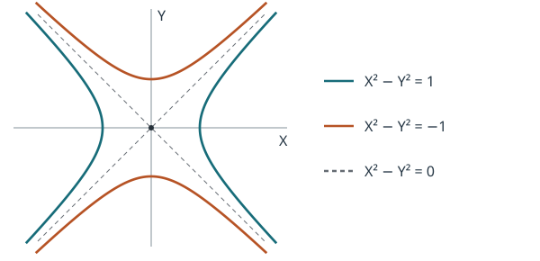

# École polytechnique — Première composition de mathématiques · Option M′ 1991 · Corrigé guidé

*Corrigé rédigé par IA, non officiel. Signalez toute erreur.*

**Rédaction** · GPT-6.2 Astra Ultra · vitesse non renseignée

On travaille sur l’espace complexe $E$ de base $(\phi_n)_{n\in\mathbb Z}$. On fixe $\nu\in\mathbb C$ et on pose $A\phi_n=2in\phi_n$, $B_\nu\phi_n=b_n\phi_{n+1}$, $C_\nu\phi_n=c_n\phi_{n-1}$, où $b_n=\nu+1+2n$, $c_n=\nu+1-2n$ et $D_\nu=B_\nu+C_\nu$. Chaque vecteur de $E$ a un nombre fini de coordonnées non nulles.

## Partie I — Sous-espaces invariants et commutant

### Question I.1

> [!INDICATION]
> Comparer les valeurs propres de $A$ aux deux extrémités d’un déplacement d’indice.

#### Solution

Sur $\phi_n$, les produits $AB_\nu$ et $B_\nu A$ ont respectivement pour coefficients $2i(n+1)b_n$ et $2inb_n$ devant $\phi_{n+1}$. Leur différence vaut $2ib_n\phi_{n+1}$. Pour $C_\nu$, le déplacement de $n$ à $n-1$ donne de même $-2ic_n\phi_{n-1}$. Par linéarité du commutateur, on obtient

$$
[A,B_\nu]=2iB_\nu,\qquad [A,C_\nu]=-2iC_\nu,\qquad [A,D_\nu]=2i(B_\nu-C_\nu).
$$

### Question I.2.a

> [!INDICATION]
> Écrire le sous-espace comme somme de droites propres de $A$, puis suivre les images d’une seule de ces droites.

#### Solution

D’après le résultat admis, tout sous-espace stable par $A$ s’écrit $E_J=\bigoplus_{n\in J}\mathbb C\phi_n$. La stabilité par $B_\nu$ impose $n+1\in J$ dès que $n\in J$ et $b_n\ne0$. Celle par $C_\nu$ impose $n-1\in J$ si $c_n\ne0$. Ces deux règles sont aussi suffisantes. Si $\nu$ n’est pas un entier impair, aucun coefficient ne s’annule. À partir d’un indice quelconque de $J$ on atteint tous les entiers dans les deux sens. Les seuls sous-espaces stables sont donc $\{0\}$ et $E$.

### Question I.2.b

> [!INDICATION]
> Déterminer les indices où le mouvement vers la droite ou vers la gauche s’arrête.

#### Solution

Pour $\nu=-2m-1$, on a $b_n=2(n-m)$ et $c_n=-2(n+m)$. La seule montée interdite part de $m$, la seule descente interdite de $-m$. Le segment entier $[-m,m]$ définit donc un espace stable $E^0$. Depuis tout indice de ce segment, les mouvements autorisés engendrent le segment entier. Un indice $n>m$ peut descendre jusqu’à $m$, et un indice $n<-m$ peut monter jusqu’à $-m$. Ainsi tout espace stable non nul contient $E^0$, qui est l’unique espace stable minimal. Pour $m=0$, c’est la droite $\mathbb C\phi_0$.

### Question I.2.c

> [!INDICATION]
> Localiser les deux nouvelles coupures. À partir d’un indice de la région centrale, déterminer si une extrémité peut être atteinte.

#### Solution

Pour $\nu=2m+1$, $b_n=2(n+m+1)$ s’annule en $-m-1$ et $c_n=2(m+1-n)$ en $m+1$. Chacune des deux demi-droites $J_-=\{n\le -m-1\}$ et $J_+=\{n\ge m+1\}$ est stable. Dans chacune, tout indice se déduit de tout autre par des déplacements autorisés, d’où la minimalité de $E_{J_-}$ et de $E_{J_+}$. Si un ensemble stable contient un indice de $[-m,m]$, les montées successives atteignent $m+1$ et les descentes $-m-1$. Il contient alors les deux demi-droites et ne peut être minimal. La liste est complète.

### Question I.3

> [!INDICATION]
> Pour relier deux coefficients diagonaux voisins, il suffit que l’un des deux déplacements entre ces indices soit autorisé.

#### Solution

Si $L$ commute avec $A$, alors $A(L\phi_n)=2inL\phi_n$. La valeur propre est simple, donc $L\phi_n=\lambda_n\phi_n$. Les relations de commutation avec $B_\nu,C_\nu$ donnent respectivement $b_n(\lambda_{n+1}-\lambda_n)=0$ et $c_{n+1}(\lambda_{n+1}-\lambda_n)=0$. Les coefficients $b_n$ et $c_{n+1}$ ne peuvent s’annuler ensemble, car leur différence est $4n+2\ne0$. Tous les $\lambda_n$ sont donc égaux, même aux valeurs exceptionnelles de $\nu$. Réciproquement, tout multiple scalaire de l’identité commute avec les trois opérateurs.

## Partie II — Une forme hermitienne et ses orbites réelles

### Question II.1

> [!INDICATION]
> Identifier l’unique indice qui subsiste lorsque $m=0$.

#### Solution

Pour $\nu=-1$, on a $E^0=\mathbb C\phi_0$. On lit $A\phi_0=0$, $b_0=c_0=0$. Les quatre restrictions $A^0$, $B_\nu^0$, $C_\nu^0$ et $D_\nu^0$ sont donc nulles. Dans la suite de cette partie, $m\ge1$ et $\nu=-2m-1$.

### Question II.2.a

> [!INDICATION]
> Utiliser la base orthonormale donnée pour prendre l’adjoint de $A^0$, puis réutiliser la simplicité de son spectre.

#### Solution

Les entrées diagonales de $A^0$ sont les nombres imaginaires purs $2in$, donc $(A^0)^*=-A^0$. L’égalité $TA^0+(A^0)^*T=0$ équivaut à $TA^0=A^0T$. Les droites propres étant distinctes et de dimension un, ceci équivaut à ce que $T$ soit diagonal dans la base $(\phi_{-m},\ldots,\phi_m)$. Ses entrées $t_n=(T\phi_n\mid\phi_n)$ sont alors réelles et non nulles par les hypothèses d’hermiticité et d’inversibilité.

### Question II.2.b

> [!INDICATION]
> Regarder l’entrée de ligne $n+1$, colonne $n$, puis écrire le produit des rapports consécutifs.

#### Solution

Supposons $T$ diagonal. L’entrée de $TD_\nu^0+(D_\nu^0)^*T$ en position $(n+1,n)$ vaut $t_{n+1} b_n+c_{n+1}t_n$. La matrice est hermitienne et ses seules entrées potentiellement non nulles sont sur les deux diagonales voisines. Elle s’annule donc exactement lorsque

$$
t_{n+1}=-\frac{m+n+1}{m-n}\,t_n,\qquad -m\le n<m.
$$

En partant de $t_{-m}$ et en multipliant ces rapports, on obtient, avec $k=(-1)^m t_{-m}\in\mathbb R^*$,

$$
t_n=k(-1)^n\frac{(m+n)!(m-n)!}{(2m)!}.
$$

Le quotient $(2m)!/(m-n)!$ est le produit descendant $2m(2m-1)\cdots(m+1-n)$, vide pour $n=-m$. On retrouve exactement le coefficient de l’énoncé. Ces valeurs satisfont la récurrence et rendent $T$ inversible, ce qui donne la réciproque.

### Question II.2.c

> [!INDICATION]
> Vérifier d’abord comment se comporte le commutateur de deux opérateurs antihermitiens relativement à $T$.

#### Solution

Si $TX=-X^*T$ et $TY=-Y^*T$, alors $TXY=X^*Y^*T$ et $TYX=Y^*X^*T$. Par différence, $T[X,Y]=-[X,Y]^*T$. Appliquons ce résultat à $X=A^0$ et $Y=D_\nu^0$. D’après I.1, $[A^0,D_\nu^0]=2i(B_\nu^0-C_\nu^0)$. La multiplication par le scalaire réel $1/2$ conserve la relation, d’où l’antihermiticité demandée.

### Question II.3

> [!INDICATION]
> Calculer les trois coordonnées de $x$ dans la base des $\phi_n$ avant d’appliquer les poids de $T$.

#### Solution

Ici $m=1$. L’énoncé prend $t_{-1}=t_1=1$, $t_0=-1/2$, puis $\psi_1=(\phi_1+\phi_{-1})/\sqrt2$, $\psi_2=\sqrt2\,\phi_0$, $\psi_3=i(\phi_1-\phi_{-1})/\sqrt2$. Pour $x=\sum_{j=1}^3 x_j\psi_j$ à coordonnées réelles, les coefficients sur $\phi_1,\phi_{-1},\phi_0$ sont $(x_1+ix_3)/\sqrt2$, $(x_1-ix_3)/\sqrt2$ et $\sqrt2 x_2$. La somme pondérée des carrés de leurs modules donne

$$
(Tx\mid x)=x_1^2-x_2^2+x_3^2.
$$

### Question II.4

> [!INDICATION]
> Dériver les deux facteurs et déplacer l’opérateur du second terme à l’aide de son adjoint.

#### Solution

Posons $y(t)=e^{tA^0}x$. La série exponentielle en dimension finie se dérive terme à terme, ainsi $y'=A^0y$. Comme $t$ est réel, la dérivée de la forme vaut

$$
f'(t)=(TA^0y\mid y)+(Ty\mid A^0y)=((TA^0+(A^0)^*T)y\mid y)=0.
$$

Par conséquent $f(t)=f(0)=x_1^2-x_2^2+x_3^2$ pour tout $t\in\mathbb R$.

### Question II.5

> [!INDICATION]
> Écrire l’action de $A^0$ dans le plan engendré par $\psi_1$ et $\psi_3$, puis identifier l’exponentielle d’une rotation.

#### Solution

On a $A^0\psi_1=2\psi_3$, $A^0\psi_3=-2\psi_1$ et $A^0\psi_2=0$. Donc $e^{tA^0}x$ a pour coordonnées

$$
(x_1\cos 2t-x_3\sin 2t,\ x_2,\ x_1\sin 2t+x_3\cos 2t).
$$

Quand $t$ décrit $\mathbb R$, l’angle $2t$ prend toutes les valeurs. L’orbite est le cercle entier de centre $(0,x_2,0)$ et de rayon $\sqrt{x_1^2+x_3^2}$ dans le plan de deuxième coordonnée $x_2$. Si le rayon est nul, l’orbite se réduit au point $x$.

### Question II.6

> [!INDICATION]
> Passer aux coordonnées $x_1+x_2$ et $x_1-x_2$. Leur signe se conserve sous l’exponentielle.

#### Solution

Écrivons $D=D_{-3}^0$. Les définitions donnent $D\psi_1=-4\psi_2$, $D\psi_2=-4\psi_1$, $D\psi_3=0$. Si $(X,Y,Z)$ désigne $e^{tD}x$, on trouve

$$
X+Y=e^{-4t}(x_1+x_2),\qquad X-Y=e^{4t}(x_1-x_2),\qquad Z=x_3.
$$

Ainsi $X^2-Y^2=c$ avec $c=x_1^2-x_2^2$. Pour $c\ne0$, les facteurs $X+Y$ et $X-Y$ parcourent toutes les paires de produit $c$ ayant leurs signes initiaux. L’orbite est donc la branche entière de l’hyperbole contenant $x$. Elle est caractérisée par le signe de $X$ si $c>0$, par celui de $Y$ si $c<0$.

Pour $c=0$ et $(x_1,x_2)\ne(0,0)$, un seul facteur est nul et l’autre parcourt tous les multiples strictement positifs de sa valeur initiale. L’orbite est une demi-droite ouverte de la droite $X=Y$ ou $X=-Y$, à hauteur $Z=x_3$. Si les deux facteurs sont nuls, $x$ est fixe.

## Partie III — Action sur les fonctions périodiques

### Question III.1

> [!INDICATION]
> Pour raccorder les formules aux pôles de la tangente, utiliser l’angle mesuré depuis le pôle.

#### Solution

Sur $(-\pi/2+k\pi,\pi/2+k\pi)$, $u_a(\theta)=k\pi+\arctan(a\tan\theta)$, pour $a>0$. Au voisinage d’un pôle $\theta_0=\pi/2+k\pi$, la même fonction s’écrit $u_a(\theta_0+h)=\theta_0+\arctan(a^{-1}\tan h)$. Cette formule se déduit de la relation sur les tangentes et du choix d’intervalle. Elle prouve la régularité $C^\infty$ au raccord.

La dérivation hors des pôles, puis la continuité, donnent partout

$$
u_a'(\theta)=\frac{a}{\cos^2\theta+a^2\sin^2\theta}=\frac{a}{a^2+(1-a^2)\cos^2\theta}>0.
$$

Les relations sur les tangentes et les intervalles montrent que $u_{1/a}$ est l’inverse de $u_a$. On a donc un difféomorphisme global, avec $u_a(\theta+\pi)=u_a(\theta)+\pi$.

### Question III.2

> [!INDICATION]
> Changer de variable par $y=u_a(\theta)$. Pour la nécessité, tester le poids obtenu avec une fonction lisse localisée.

#### Solution

Pour $a=e^t$, posons $J=u_a'>0$. Le sujet définit $U_t f=J^{(\nu+1)/2}(f\circ u_a)$, la puissance utilisant le logarithme réel de $J$. Puisque $u_a(0)=0$, $u_a(\pi)=\pi$, le changement $y=u_a(\theta)$ donne

$$
\int_0^\pi |U_tf|^2\,d\theta=\int_0^\pi J(u_a^{-1}(y))^{\operatorname{Re}\nu}|f(y)|^2\,dy.
$$

Si $\operatorname{Re}\nu=0$, le poids vaut un. Réciproquement, choisissons $t\ne0$. Au point $y=0$, on a $J(0)=a\ne1$. Si $\operatorname{Re}\nu\ne0$, le poids continu est strictement d’un côté de $1$ sur un petit intervalle intérieur voisin de $0$. Une fonction lisse non nulle à support dans cet intervalle, prolongée $\pi$-périodiquement, contredit l’égalité. Elle appartient à chaque $F^r$. Les $U_t$ sont donc tous unitaires au sens demandé exactement pour $\operatorname{Re}\nu=0$.

### Question III.3

> [!INDICATION]
> Dériver séparément l’argument $u_{e^t}$ et le logarithme de son jacobien en $t=0$.

#### Solution

À $t=0$, $u_1(\theta)=\theta$ et $J=1$. En dérivant la relation sur les tangentes ou sa carte au pôle, on obtient $\partial_t u_{e^t}|_0=\sin\theta\cos\theta$. D’autre part $\log J=t-\log(\cos^2\theta+e^{2t}\sin^2\theta)$, donc $\partial_t\log J|_0=1-2\sin^2\theta=\cos 2\theta$. Pour $f\in F^r$, $r>0$, la règle du produit donne

$$
(U^0 f)(\theta)=\tfrac12\sin(2\theta) f'(\theta)+\tfrac{\nu+1}{2}\cos(2\theta)f(\theta).
$$

### Question III.4

> [!INDICATION]
> Dans la somme des deux intégrales, reconnaître la dérivée du produit $f\overline g$ et intégrer par parties.

#### Solution

Posons $p=\sin(2\theta)/2$ et $q=(\nu+1)\cos(2\theta)/2$. La somme demandée est l’intégrale de $p(f\overline g)' +(q+\overline q)f\overline g$. Le terme de bord est nul puisque $p(0)=p(\pi)=0$. Comme $p'=\cos(2\theta)$, il reste

$$
\operatorname{Re}\nu\int_0^\pi \cos(2\theta)f(\theta)\overline{g(\theta)}\,d\theta.
$$

Cette quantité s’annule pour tous $f,g$ si $\operatorname{Re}\nu=0$. Le choix $f=1$ et $g=\cos(2\theta)$ donne sinon $\operatorname{Re}\nu\,\pi/2\ne0$. C’est donc exactement la même condition qu’en III.2.

### Question III.5

> [!INDICATION]
> Développer le sinus et le cosinus en exponentielles. Identifier séparément les fréquences voisines.

#### Solution

Pour $\phi_n(\theta)=e^{2in\theta}$, on a $\phi_n'=2in\phi_n$. Dans III.3, le terme dérivé vaut $\frac n2(\phi_{n+1}-\phi_{n-1})$ et l’autre terme vaut $\frac{\nu+1}4(\phi_{n+1}+\phi_{n-1})$. Par suite

$$
4U^0\phi_n=(\nu+1+2n)\phi_{n+1}+(\nu+1-2n)\phi_{n-1}=D_\nu\phi_n.
$$

Les exponentielles sont linéairement indépendantes par orthogonalité sur $[0,\pi]$. En identifiant $E$ à leur espace de combinaisons linéaires finies, la restriction de $U^0$ à cet espace est exactement $D_\nu/4$.
