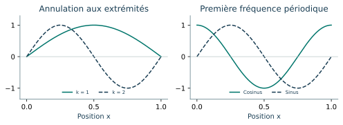
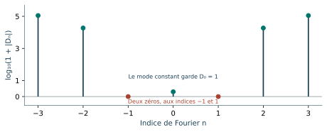

# École polytechnique — Deuxième composition de mathématiques P′ 1991 · Corrigé brut

*Corrigé rédigé par IA, non officiel. Signalez toute erreur.*

**Rédaction** · GPT-6.2 Astra Ultra · vitesse non renseignée · 26 novembre 2026

**Révision** · GPT-6.2 Astra Ultra · vitesse non renseignée · 26 novembre 2026

Sur $[0,1]$, l’opérateur est $L_\lambda\phi=\phi^{(4)}+2\lambda\phi^{(2)}+\phi$. Les trois premières parties emploient des fonctions réelles. La dernière autorise les coefficients et les fonctions complexes et impose des conditions périodiques sur les dérivées jusqu’à l’ordre trois.

## I. Tester les dérivées secondes

### I.1. Une fonction affine vérifie la condition

On travaille sur $I=[0,1]$ et $(f\mid g)=\int_0^1 f(x)g(x)\,dx$ pour les fonctions réelles des trois premières parties. Écrivons $C^2_0$ pour les fonctions $u$ de classe $C^2$ qui s’annulent aux deux extrémités, et $C^2_{0,0}$ pour celles dont la dérivée première s’y annule aussi. Pour $f(x)=a x+b$ et $u\in C^2_{0,0}$, deux intégrations par parties donnent
$$
 (f\mid u'')=[fu'-au]_0^1=0 .
$$

### I.2. Construire la partie affine

Posons $A=\int_0^1f(x)\,dx$, $B=\int_0^1x f(x)\,dx$, $r(x)=f(x)-\lambda x-\mu$. Pour $u(x)=\int_0^x(x-y)r(y)\,dy$, on a $u''=r$, $u(0)=u'(0)=0$. Les conditions en $1$ sont $\int_0^1r=0$ et $\int_0^1(1-x)r(x)\,dx=0$, donc l’annulation des deux moments d’ordres zéro et un. Cela s’écrit
$$
 \lambda/2+\mu=A,\qquad \lambda/3+\mu/2=B .
$$
Il existe une unique solution, $\lambda=12B-6A$ et $\mu=4A-6B$. Le $u$ ainsi construit appartient bien à $C^2_{0,0}$.

### I.3. Caractérisation réciproque

Supposons $(f\mid v'')=0$ pour tout $v\in C^2_{0,0}$ et utilisons $u$ de I.2. L’affine $\lambda x+\mu$ satisfait elle aussi la condition d’après I.1. En soustrayant pour $v=u$, on a $\int_0^1r(x)^2\,dx=0$. Comme $r$ est continue et réelle, $r$ est nulle sur tout $I$. Ainsi $f$ est affine, ce qui achève l’équivalence.

## II. Une identité avec termes de bord

### II.1. Détermination de la constante

Pour $f,g,h$ continues avec $(f\mid u'')+(g\mid u')+(h\mid u)=0$ pour tout $u\in C^2_0$, posons $G=\mathcal I g$ et $H=\mathcal I^2h$, où $(\mathcal I v)(x)=\int_0^xv(t)\,dt$. Pour $u\in C^2_0$,
$$
 \int_0^1Gu''=G(1)u'(1)-\int_0^1gu',\qquad
 \int_0^1Hu''=H(1)u'(1)+\int_0^1hu .
$$
En effet les primitives s’annulent en zéro et $u$ s’annule aux deux bords. En additionnant avec les signes de $F=f-G+H$, on obtient
$$
 (F\mid u'')=k u'(1),\qquad k=H(1)-G(1).
$$

### II.2. L’affine et les deux valeurs de f

Pour $u\in C^2_{0,0}$ le membre droit est nul, donc I.3 donne que $F$ est affine. Pour toute fonction $u\in C^2_0$, il vient alors $(F\mid u'')=F(1)u'(1)-F(0)u'(0)$. On peut imposer séparément les deux dérivées de bord. En effet $x(1-x)^2$ donne le couple $(1,0)$ et $x^2(x-1)$ le couple $(0,1)$. L’identité de II.1 impose donc $F(0)=0$, $F(1)=k$. Les primitives s’annulant en zéro, $f(0)=0$. En $1$, $F(1)=f(1)-G(1)+H(1)=f(1)+k$, d’où $f(1)=0$.

## III. Conditions d’annulation et problème variationnel

### III.1. Passage à la formulation intégrale

Supposons $\phi\in C^4(I)$, $\phi^{(4)}+2\lambda\phi''+\phi=\psi$, avec $\phi(0)=\phi(1)=\phi''(0)=\phi''(1)=0$. Multiplions par $u\in C^2_0$ et intégrons. Pour l’ordre quatre, les termes de bord sont $[\phi'''u-\phi''u']_0^1=0$. Pour l’ordre deux, $[\phi'u]_0^1=0$. Il reste exactement
$$
 (\phi''\mid u'')-2\lambda(\phi'\mid u')+(\phi-\psi\mid u)=0 .
$$
Nous noterons cette identité (II), comme dans le sujet.

### III.2. Retour à l’équation et régularité

Supposons $\phi\in C^2_0$ satisfaisant (II). Appliquons la partie II avec $f=\phi''$, $g=-2\lambda\phi'$, $h=\phi-\psi$. Elle donne $\phi''(0)=\phi''(1)=0$ et
$$
 \phi''+2\lambda(\phi-\phi(0))+\mathcal I^2(\phi-\psi)\quad\text{affine}.
$$
La fonction $\mathcal I^2(\phi-\psi)$ est de classe $C^2$, et $\phi$ aussi par hypothèse. Il en résulte que $\phi''\in C^2$, donc $\phi\in C^4$. On peut maintenant dériver l’identité affine deux fois. Elle donne $\phi^{(4)}+2\lambda\phi''+\phi-\psi=0$. Toutes les conditions de (I) sont ainsi retrouvées.

### III.3. Deux inégalités de norme

Pour $\phi\in C^2_0$, l’intégration par parties donne $\|\phi'\|^2=-(\phi''\mid\phi)$. L’identité
$$
 \tfrac12(\|\phi''\|^2+\|\phi\|^2)-\|\phi'\|^2=\tfrac12\|\phi''+\phi\|^2
$$
donne l’inégalité demandée. Elle est une égalité si et seulement si $\phi''+\phi=0$. Une telle $\phi$ vaut $a\cos x+b\sin x$, et $\phi(0)=\phi(1)=0$ force $a=b=0$, car $\sin 1\ne0$. L’égalité ne se produit donc dans cet espace que pour $\phi=0$.

D’autre part $\phi(x)=\int_0^x\phi'(t)\,dt$ entraîne $|\phi(x)|^2\le x\int_0^x|\phi'|^2\le x\|\phi'\|^2$. En intégrant sur $[0,1]$ on obtient même $\|\phi\|^2\le\tfrac12\|\phi'\|^2$, ce qui implique l’inégalité demandée.

### III.4. Une borne inférieure pour l’énergie

Pour $\lambda<1$, posons $c=1-\max(\lambda,0)>0$ et
$$
 B(v,u)=(v''\mid u'')-2\lambda(v'\mid u')+(v\mid u).
$$
Si $0\le\lambda<1$, III.3 donne $B(u,u)\ge(1-\lambda)(\|u''\|^2+\|u\|^2)$. Si $\lambda<0$, le terme en $\|u'\|^2$ est positif et on peut prendre le coefficient un. Dans les deux cas $B(u,u)\ge c(\|u''\|^2+\|u\|^2)$. L’énergie $U(u)=\tfrac12 B(u,u)-(\psi\mid u)$ vérifie donc
$$
 U(u)\ge\tfrac c2\|u\|^2-\|\psi\|\,\|u\|\ge-\frac{\|\psi\|^2}{2c}.
$$

### III.5. Dérivées sur une droite

Par bilinéarité symétrique, pour $\phi,u\in C^2_0$,
$$
 h_{\phi,u}(t)=U(\phi)+t[B(\phi,u)-(\psi\mid u)]+\tfrac12 t^2 B(u,u).
$$
Donc $h'_{\phi,u}(t)=B(\phi,u)-(\psi\mid u)+tB(u,u)$ et $h''_{\phi,u}(t)=B(u,u)$, indépendamment de $t$. Pour $u\ne0$ la dernière quantité est strictement positive lorsque $\lambda<1$.

### III.6. Stationnarité et minimum strict

L’identité (II) pour $\phi_0$ est exactement l’égalité $h'_{\phi_0,u}(0)=0$ pour tout $u$. Si cette égalité vaut, alors pour $\phi\ne\phi_0$, en choisissant $u=\phi-\phi_0$, III.5 donne $U(\phi)-U(\phi_0)=B(u,u)/2>0$. Réciproquement, si $\phi_0$ est un minimum strict, la fonction différentiable $t\mapsto U(\phi_0+tu)$ a un minimum en zéro pour tout $u$, donc sa dérivée y est nulle. Les conditions a, b et c sont équivalentes. Deux minima stricts sont impossibles, d’où l’unicité d’une éventuelle solution sous cette hypothèse sur $\lambda$.

### III.7. Nécessité de dépasser un

Supposons $\psi=0$ et $\phi\ne0$ solution de (I). Le test $u=\phi$ dans (II) donne $2\lambda\|\phi'\|^2=\|\phi''\|^2+\|\phi\|^2$. On a $\|\phi'\|>0$, faute de quoi $\phi$ serait constante et nulle au bord. L’inégalité stricte de III.3 pour une fonction non nulle donne alors $\lambda>1$.

### III.8. Factorisation et modes propres

Pour $\lambda>1$, choisissons $\alpha=\lambda+\sqrt{\lambda^2-1}$ et $\beta=\lambda-\sqrt{\lambda^2-1}$. On a $\alpha+\beta=2\lambda$, $\alpha\beta=1$ et $0<\beta<1<\alpha$. En posant $\omega=\phi''+\alpha\phi$, on obtient identiquement
$$
 \omega''+\beta\omega=\phi^{(4)}+2\lambda\phi''+\phi .
$$
Les conditions aux bords entraînent $\omega(0)=\omega(1)=0$. La solution de $\omega''+\beta\omega=0$ vaut $a\cos(\sqrt\beta x)+b\sin(\sqrt\beta x)$ ; elle s’annule aux deux bords seulement si $a=b=0$, car $0<\sqrt\beta<1<\pi$. Ainsi $\omega=0$ et $\phi$ vérifie $\phi''+\alpha\phi=0$ avec les deux conditions de Dirichlet. Une solution non nulle existe exactement quand $\sqrt\alpha=k\pi$, $k\ge1$ entier. Les $\lambda$ cherchés et toutes les solutions correspondantes sont
$$
 \lambda_k=\tfrac12\bigl((k\pi)^2+(k\pi)^{-2}\bigr),\qquad
 \phi(x)=C\sin(k\pi x),\quad C\in\mathbb R.
$$
La relation $\phi''=-\alpha\phi$ assure aussitôt les deux conditions sur $\phi''$. Les valeurs $\lambda_k$ sont distinctes car $s+s^{-1}$ est strictement croissante pour $s>1$.

## IV. Conditions périodiques complexes

### IV.1. Symbole de l’opérateur

Pour cette partie, $\lambda$ et les fonctions peuvent être complexes. La classe $C^4_{\rm per}$ impose la coïncidence en $0$ et $1$ des dérivées d’ordres $0,1,2,3$. Posons $\omega_n=2\pi n$ et $\gamma_n(v)=\int_0^1e^{-i\omega_n x}v(x)\,dx$. Des intégrations par parties successives donnent $\gamma_n(\phi^{(j)})=(i\omega_n)^j\gamma_n(\phi)$ pour $j\le4$, puisque tous les termes de bord nécessaires coïncident. Par conséquent
$$
 \gamma_n(\psi)=D_n\gamma_n(\phi),\qquad D_n=\omega_n^4-2\lambda\omega_n^2+1.
$$
En particulier $D_0=1$, donc la moyenne de $\phi$ est celle de $\psi$.

### IV.2. Le noyau périodique

Pour $\psi=0$, le coefficient $\gamma_n(\phi)$ ne peut être libre que si $D_n=0$. Cela n’arrive jamais à l’indice zéro et exige pour $n\ne0$
$$
 \lambda=\Lambda_{|n|}=\tfrac12\bigl((2\pi n)^2+(2\pi n)^{-2}\bigr).
$$
Ces valeurs sont distinctes pour les indices positifs. Si aucune n’est égale à $\lambda$, tous les coefficients s’annulent, donc $\phi=0$ par unicité de Fourier pour les fonctions continues périodiques. Si $\lambda=\Lambda_k$, seuls les coefficients d’indices $\pm k$ sont libres, et toutes les solutions sont $c_+e^{2\pi ikx}+c_-e^{-2\pi ikx}$ avec $c_+,c_-\in\mathbb C$. Elles vérifient directement l’équation et les conditions périodiques.

### IV.3. Second membre et résonance

Soit $\psi\in C^1_{\rm per}$. Pour chaque indice où $D_n\ne0$, posons $a_n=\gamma_n(\psi)/D_n$. Si $\lambda=\Lambda_k$, l’existence exige $\gamma_k(\psi)=\gamma_{-k}(\psi)=0$. Sous cette condition, choisissons arbitrairement les deux coefficients $a_{\pm k}$. Si elle échoue, il n’y a aucune solution. Dans le cas non résonant, tous les coefficients sont déterminés.

Dans chaque cas compatible, la formule cherchée est
$$
 \phi(x)=\sum_{n\in\mathbb Z}a_n e^{2\pi inx}.
$$
Justifions quatre dérivations. L’intégration par parties, permise par $\psi(1)=\psi(0)$, donne $i\omega_n\gamma_n(\psi)=\gamma_n(\psi')$. L’inégalité de Bessel appliquée à $\psi'$ donne $\sum_n|\gamma_n(\psi')|^2<\infty$. Par Cauchy-Schwarz et $\sum_{n\ne0}n^{-2}<\infty$, on a $\sum_n|\gamma_n(\psi)|<\infty$. Comme $D_n/\omega_n^4\to1$, il en résulte $\sum_n(1+|\omega_n|^4)|a_n|<\infty$ ; les deux modes éventuellement libres sont en nombre fini. Les séries des dérivées jusqu’à l’ordre quatre convergent donc normalement, et leur somme est périodique. Le membre gauche de l’équation a les mêmes coefficients que $\psi$, donc lui est égal par unicité. Le résultat donne une solution unique hors résonance, et une famille affine de dimension deux sur $\mathbb C$ en cas de résonance compatible.

## Documents de la session

La garde et les subdivisions sont celles de l’option P′. Les deux exemplaires reproduisent les mêmes feuillets. [Fac-similé UPS](https://prepas.org/index.php?module=Sujets&voir=get&file=doc-ccfef9f790dfb8a358e4) · [Second exemplaire](https://www.sujetsetcorriges.fr/dl/X/Maths/PC/sec-x-1991-maths2-PC.pdf) · [Instruction officielle du concours de 1991](https://www.legifrance.gouv.fr/jorf/id/JORFTEXT000000353010)
