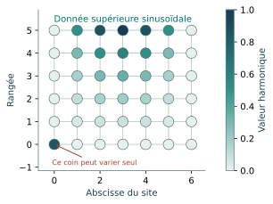
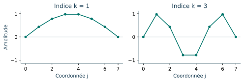

# École polytechnique — Première composition de mathématiques P′ 1991 · Corrigé guidé

*Corrigé rédigé par IA, non officiel. Signalez toute erreur.*

**Rédaction** · GPT-6.2 Astra Ultra · vitesse non renseignée · 26 novembre 2026

**Révision** · GPT-6.2 Astra Ultra · vitesse non renseignée · 26 novembre 2026

La partie I étudie les matrices tridiagonales $A_n=\alpha I_n+\beta J_n$ et leurs polynômes caractéristiques. Le choix $\alpha=4$, $\beta=-1$ dans les parties II et III conduit au problème de Dirichlet discret. La partie IV retrouve le spectre pour tous les paramètres de la partie I.

## I. Polynômes caractéristiques et orthogonalité

### I.1. Réalité des zéros

> [!INDICATION]
> Une valeur propre peut a priori être complexe. Regarde ce que devient le produit hermitien de $A_nz$ avec $z$ lorsque les paramètres sont réels.

La matrice $J_n$ possède des coefficients égaux à un sur les deux diagonales voisines de la diagonale principale, et nuls ailleurs. Avec $\alpha,\beta$ réels et $\beta\ne0$, la matrice $A_n=\alpha I_n+\beta J_n$ est symétrique réelle. Le théorème spectral la diagonalise dans une base orthonormée réelle, avec des valeurs propres réelles. Les racines de $P_n(X)=\det(XI_n-A_n)$ sont ces valeurs propres, avec leurs multiplicités. Cela vaut aussi pour $P_1=X-\alpha$.

### I.2. Formes coordonnées

> [!INDICATION]
> Pour un polynôme de degré $d$, soustrais son coefficient dominant multiplié par $P_d$. La répétition termine en un nombre fini d’étapes et explique la triangularité.

Chaque $P_n$ est unitaire de degré $n$ et $P_0=1$. Pour chaque $d$, les coordonnées de $P_0,\ldots,P_d$ dans la base des monômes forment une matrice triangulaire de diagonale unité. Ils constituent donc une base des polynômes de degré au plus $d$. Les développements obtenus dans deux espaces de degrés différents coïncident en ajoutant des coefficients nuls par unicité. Les formes $\lambda_n$ qui donnent la coordonnée de $P_n$ sont ainsi linéaires et uniques sur $\mathbb C[X]$. Pour chaque $Q$, seuls les indices $n\le\deg Q$ peuvent intervenir.

### I.3. Récurrence du déterminant

> [!INDICATION]
> Dans le cofacteur du coefficient hors diagonale de la dernière ligne, repère la seule entrée non nulle de la dernière colonne du mineur. Compte séparément les deux facteurs $-\beta$ et le signe de cofacteur.

Dans $XI_n-A_n$, les termes diagonaux valent $X-\alpha$ et les deux diagonales voisines valent $-\beta$. Développons suivant la dernière ligne. Le terme diagonal donne $(X-\alpha)P_{n-1}$. Pour le terme de colonne $n-1$, le signe du cofacteur est négatif. Dans le mineur correspondant, la dernière colonne porte seulement $-\beta$ sur sa dernière ligne. Sa contribution totale est $-\beta^2 P_{n-2}$. Ainsi, pour $n\ge2$,
$$
 P_n=(X-\alpha)P_{n-1}-\beta^2P_{n-2}.
$$

### I.4. Multiplication par la variable

> [!INDICATION]
> Isole $XP_n$ dans la récurrence d’indice $n+1$. Traite $n=0$ directement au moyen des deux premiers termes.

La récurrence donne $XP_n=P_{n+1}+\alpha P_n+\beta^2P_{n-1}$ pour $n\ge1$. Pour $n=0$, elle se réduit à $XP_0=P_1+\alpha P_0$. Les trois coordonnées non éventuellement nulles sont donc respectivement $1,\alpha,\beta^2$ aux indices $n+1,n,n-1$, le dernier étant omis pour $n=0$.

### I.5.a. Le coefficient constant dans la base des P

> [!INDICATION]
> Dessine les trois mouvements d’un indice quand on multiplie par $X$. Pour atteindre zéro en exactement $n$ étapes depuis $n$, un mouvement stationnaire serait déjà de trop.

À chaque multiplication par $X$, un terme d’indice $j$ peut monter à $j+1$, rester à $j$ ou descendre à $j-1$ si $j\ge1$. Pour atteindre l’indice $0$ à partir de $n$, il faut donc au moins $n$ multiplications. Si $m<n$, on a $\lambda_0(X^mP_n)=0$. Si $m=n$, l’unique suite possible descend à chaque étape et gagne un facteur $\beta^2$ à chacune. On obtient $\lambda_0(X^nP_n)=\beta^{2n}$, y compris $n=0$ avec la convention du produit vide.

### I.5.b. Orthogonalité des polynômes

> [!INDICATION]
> Développe seulement le facteur de degré le plus petit en monômes. Que change l’égalité $m=n$ pour le seul monôme dominant ?

Si $m<n$, tout monôme de $P_m$ a degré strictement inférieur à $n$. La linéarité de $\lambda_0$ et I.5.a donnent $\lambda_0(P_mP_n)=0$. La commutativité de la multiplication couvre $n<m$. Pour la suite, notons aussi que $\lambda_0(P_n^2)=\beta^{2n}$, puisque $P_n$ est unitaire et que tous ses termes de degré inférieur donnent zéro lorsqu’on les multiplie par $P_n$ et applique $\lambda_0$.

### I.5.c. Positivité définie

> [!INDICATION]
> Les coefficients de $P_j$ étant réels, conjuguer $Q$ conjuguera ses coordonnées dans cette base. Exploite ensuite le calcul diagonal de la question précédente.

Écrivons $Q=\sum c_jP_j$. Puisque les $P_j$ ont des coefficients réels, $\overline Q=\sum \overline{c_j}P_j$, où la conjugaison porte sur les coefficients. Les termes croisés disparaissent par I.5.b et
$$
 \lambda_0(Q\overline Q)=\sum_j|c_j|^2\beta^{2j}.
$$
Tous les poids sont strictement positifs car $\beta$ est réel non nul. Cette somme finie est réelle et positive ou nulle, et elle s’annule exactement si tous les $c_j$ sont nuls, donc si $Q=0$.

**Vérification au degré un.** Pour $Q=P_0+iP_1$, les deux termes croisés s’annulent et la formule donne $1+\beta^2$. Le calcul porte bien sur les coefficients conjugués.

### I.6. Simplicité des zéros

> [!INDICATION]
> Pour une valeur propre fixée, commence la récurrence des coordonnées avec la valeur fictive $u_0=0$. Combien de coordonnées d’un vecteur propre sont encore libres ?

Pour une valeur propre $\eta$ de $A_n$, posons $u_0=u_{n+1}=0$ autour des coordonnées $u_1,\ldots,u_n$ d’un vecteur propre. Les équations ligne par ligne sont
$$
 \beta u_{j+1}=(\eta-\alpha)u_j-\beta u_{j-1}.
$$
La donnée de $u_1$ détermine donc tout le vecteur. L’application « première coordonnée » est injective sur l’espace propre, lequel est de dimension un. La matrice est diagonalisable par I.1, donc la multiplicité algébrique de chaque valeur propre est également un. Cela prouve la simplicité des racines sans supposer connues les formules de la partie IV.

## II. Une récurrence à deux conditions de bord

### II.1. Norme stricte de la matrice de voisinage

> [!INDICATION]
> La somme de deux décalages a une norme au plus deux. Pour rendre la borne stricte, cherche ce qu’une égalité au point de plus grand module imposerait au voisin de plus en plus proche du bord.

Notons $S$ le décalage $e_j\mapsto e_{j+1}$, complété par $Se_n=0$. On a $J_n=S+S^*$ et $\|S\|,\|S^*\|\le1$, d’où $\|J_n\|\le2$. Pour exclure l’égalité, le théorème spectral appliqué à $J_n$ montre qu’il faudrait un vecteur propre non nul de valeur $\eta=2$ ou $\eta=-2$. Prolongeons ses coordonnées par $u_0=u_{n+1}=0$. Au site $j$ où $|u_j|$ est maximal, $2|u_j|=|u_{j-1}+u_{j+1}|\le |u_{j-1}|+|u_{j+1}|\le2|u_j|$. Les deux voisins ont alors le même module maximal. L’argument se propage jusqu’au bord nul, contradiction. Ainsi $\|J_n\|<2$, y compris pour $n=1$ où $J_1=0$.

### II.2. Valeurs propres au-dessus de deux

> [!INDICATION]
> Prends un vecteur propre de $J_n$. Calcule l’action de $4I_n-J_n$ sur ce même vecteur et conserve la stricte inégalité obtenue en II.1.

Désormais $\alpha=4$ et $\beta=-1$. Les valeurs propres de $A_n=4I_n-J_n$ sont $4-\eta$, où $\eta$ parcourt le spectre réel de $J_n$. Comme $|\eta|\le\|J_n\|<2$, elles sont toutes strictement supérieures à $2$.

### II.3. Construction d’un facteur inversible

> [!INDICATION]
> Sur une droite propre de $A_n$, il suffit de résoudre l’équation réelle $r+r^{-1}=a$. Choisis la racine supérieure à un pour que toutes ses puissances non nulles évitent un.

Diagonalisons $A_n$ dans une base orthonormée. À chaque valeur propre $a>2$ associons $\rho(a)=(a+\sqrt{a^2-4})/2>1$. Elle vérifie $\rho+\rho^{-1}=a$. La matrice $T_n$ diagonale dans cette même base, de valeurs propres $\rho(a)$, est inversible et $A_n=T_n+T_n^{-1}$. Pour tout entier $k\ne0$, $\rho(a)^k\ne1$. Ainsi chaque $T_n^k-I_n$ est inversible, pour les $k$ positifs comme négatifs.

### II.4. Relier les deux valeurs imposées

> [!INDICATION]
> Les deux suites $T^k$ et $T^{-k}$ satisfont la récurrence. Leur différence impose automatiquement la valeur zéro au départ. Reste à imposer la valeur au dernier indice sans perdre l’unicité.

Posons $T=T_n$ et $D_k=T^k-T^{-k}$ pour tout $k\ge0$. On a $D_0=0$, $D_k=A_nD_{k-1}-D_{k-2}$ pour $k\ge2$, et $D_q=T^{-q}(T^{2q}-I_n)$ est inversible. La suite
$$
 V_k=D_kD_q^{-1}W,\qquad 0\le k\le q,
$$
vérifie la récurrence et les conditions $V_0=0,V_q=W$.

Pour l’unicité, $D_1$ est également inversible. Toute suite de la récurrence avec $V_0=0$ est déterminée par $V_1$ et s’écrit $D_kD_1^{-1}V_1$, les deux termes initiaux coïncidant. La valeur prescrite en $q$ détermine donc $V_1=D_1D_q^{-1}W$.

## III. Le problème de Dirichlet sur le rectangle

### III.1. Données sur le côté supérieur

> [!INDICATION]
> Prends la rangée horizontale d’altitude $j$. Compte d’abord les deux voisins dans cette même rangée. Les deux autres sont dans les rangées d’indices $j-1$ et $j+1$.

Sur le rectangle de sites $0\le x\le p+1$, $0\le y\le q+1$, fixons la donnée de bord $\phi$, nulle hors du côté supérieur $F_2$ (coins exclus). Sa ligne supérieure intérieure est $W=(\phi(i,q+1))_{1\le i\le p}$. Pour $V_j=(h(i,j))_{1\le i\le p}$, la somme des voisins horizontaux est $J_pV_j$ puisque les valeurs sur les côtés verticaux sont nulles. La moyenne des quatre voisins équivaut donc, à chaque rangée intérieure $1\le j\le q$, à
$$
 V_{j+1}=(4I_p-J_p)V_j-V_{j-1}=A_pV_j-V_{j-1}.
$$
Le bas et le haut imposent $V_0=0$ et $V_{q+1}=W$. En appliquant II.4 avec dimension $p$ et indice terminal $q+1$, on construit toutes les lignes, de façon unique. Complétées par $\phi$ sur le bord, elles vérifient toutes les équations.

**Un contrôle sur une petite grille.** Pour $p=q=2$, avec les deux valeurs supérieures égales à un et le reste du bord nul, la symétrie impose deux valeurs intérieures $a$ en bas, $b$ en haut. Alors $3a=b$, $3b=a+1$, d’où $a=1/8$ et $b=3/8$.

### III.2. Données aux coins et bord général

> [!INDICATION]
> Teste directement ce que devient l’équation intérieure quand seul un sommet porte une valeur. Puis découpe le bord en cinq morceaux disjoints avant de superposer les solutions.

Les quatre sommets $S$ ne sont voisins horizontaux ou verticaux d’aucun site intérieur. Si $\phi$ est portée par $S$, sa prolongation par zéro partout ailleurs est donc harmonique à l’intérieur. Elle est unique, car la différence de deux prolongements aurait bord nul et serait nulle par III.1 avec $W=0$.

Pour une donnée quelconque, décomposons-la en ses cinq restrictions aux quatre côtés ouverts $F_1,\ldots,F_4$ et aux coins $S$, chacune prolongée par zéro sur les autres sites du bord. La réflexion $y\mapsto q+1-y$ traite le côté inférieur à partir du supérieur. L’échange des coordonnées, avec échange de $p,q$, puis si besoin une réflexion, traite chacun des côtés verticaux. Additionnons ces quatre solutions et la solution des coins. L’équation des moyennes est linéaire, donc cette somme a exactement le bord demandé. L’unicité vient de nouveau du problème à bord nul.

## IV. Calcul explicite des modes

### IV.1. Récurrence trigonométrique

> [!INDICATION]
> Additionne $\sin((n+1)t)$ et $\sin((n-1)t)$. Distingue l’identité sur les cosinus d’angles intérieurs et sa conséquence entre polynômes.

Pour $0<t<\pi$, l’identité $\sin((n+1)t)+\sin((n-1)t)=2\cos t\sin(nt)$ donne, après division par $\sin t$, $Q_n(\cos t)=2\cos t\,Q_{n-1}(\cos t)-Q_{n-2}(\cos t)$. L’intervalle $]-1,1[$ contient une infinité de points, donc l’identité polynomiale $Q_n=2XQ_{n-1}-Q_{n-2}$ vaut pour $n\ge2$. Les termes initiaux sont $Q_0=1$, $Q_1=2X$.

### IV.2. Identification avec les polynômes caractéristiques

> [!INDICATION]
> Pour passer de la récurrence de $Q_n$ à celle de $P_n$, il faut à la fois décaler la variable de $\alpha$ et corriger le coefficient de $P_{n-2}$. Compare toujours les deux premiers termes.

Notons provisoirement $P_n^{\alpha,\beta}$ pour afficher la dépendance. Les deux récurrences et leurs premiers termes donnent
$$
 P_n^{\alpha,\beta}(X)=\beta^nQ_n\!\left(\frac{X-\alpha}{2\beta}\right).
$$
En particulier, pour le couple $(\alpha,\beta)=(0,1/2)$, on a $Q_n(X)=2^nP_n^{0,1/2}(X)$. La formule générale reste valable lorsque $\beta<0$.

### IV.3. Valeurs propres pour tous les paramètres

> [!INDICATION]
> Choisis les multiples de $\pi/(n+1)$ strictement entre zéro et $\pi$. Le dénominateur trigonométrique y est non nul et le numérateur s’annule exactement aux angles utiles.

La formule trigonométrique donne comme zéros de $Q_n$ les $\cos(k\pi/(n+1))$, $1\le k\le n$. Ils sont distincts puisque le cosinus est strictement décroissant sur $[0,\pi]$. Leur nombre est le degré. D’après IV.2, le spectre de $A_n$ est ainsi constitué des $n$ réels distincts
$$
 \lambda_k=\alpha+2\beta\cos\!\left(\frac{k\pi}{n+1}\right),\qquad 1\le k\le n.
$$

### IV.4. Coordonnées d’un vecteur propre

> [!INDICATION]
> Écris les équations de trois coordonnées successives. Quelle puissance de $\beta$ permet de faire apparaître les coefficients $1$ et $\beta^2$ de la récurrence des polynômes ?

Choisissons $\nu_i=\beta^{-i}$ pour $0\le i\le n-1$ et posons $u_j=\beta^{-(j-1)}P_{j-1}(\lambda)$ pour $1\le j\le n$. On a $u_1=1$, et les valeurs complétant le vecteur sont $u_0=0$, $u_{n+1}=\beta^{-n}P_n(\lambda)=0$. La récurrence I.3 donne $\beta u_{j+1}+\alpha u_j+\beta u_{j-1}=\lambda u_j$ à chaque coordonnée, avec la première ligne fournie par $P_1(\lambda)=\lambda-\alpha$. Le vecteur est donc propre, y compris lorsque certaines valeurs $P_i(\lambda)$ sont nulles. Si $\lambda=\lambda_k$, ses coordonnées sont aussi $\sin(jk\pi/(n+1))/\sin(k\pi/(n+1))$.

**Le cas $n=2$.** On obtient les valeurs $\alpha\pm\beta$ et les vecteurs $(1,1)$ et $(1,-1)$. Cette vérification distingue $\beta^{-i}$ de $\beta^i$.

## Documents de la session

La garde et les subdivisions sont celles de l’option P′. Les deux exemplaires reproduisent les mêmes feuillets. [Fac-similé UPS](https://prepas.org/index.php?module=Sujets&voir=get&file=doc-3b2fc71dcee6aaf1566a) · [Second exemplaire](https://www.sujetsetcorriges.fr/dl/X/Maths/PC/sec-x-1991-maths1-PC.pdf) · [Instruction officielle du concours de 1991](https://www.legifrance.gouv.fr/jorf/id/JORFTEXT000000353010)
