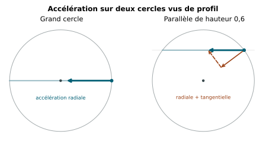
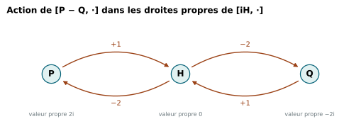

# École polytechnique — Deuxième composition de mathématiques · Option M′ 1992 · Corrigé guidé

*Corrigé rédigé par IA, non officiel. Signalez toute erreur.*

**Rédaction** · GPT-6.2 Astra Ultra · vitesse non renseignée

On travaille dans l’espace vectoriel réel $F$ sous-jacent à $M_n(\mathbb C)$. On écrit $a^*$ pour la matrice adjointe, $[a,b]=ab-ba$ et $(a\mid b)=\operatorname{Re}\operatorname{tr}(a^*b)$. Les groupes appelés $U(n)$ et $SU(n)$ sont ceux que le sujet désigne par $\mathcal U$ et $\mathcal U^0$.

Concours d’admission 1992, option M′, quatre heures. [Fac-similé de l’UPS](https://prepas.org/index.php?module=Sujets&voir=get&file=doc-0c16aa1b41e326fbd6c7) · [Second exemplaire](https://www.sujetsetcorriges.fr/dl/X/Maths/MP/sec-x-1992-maths2-MP.pdf)

## Repères de lecture

- Le produit scalaire est réel sur les matrices complexes. En IV, les sous-espaces et les endomorphismes demandés sont complexes.
- Pour les courbes, transportez un vecteur tangent à l’identité en multipliant à gauche par l’inverse du point courant.
- Pour la sphère, traduisez la projection tangentielle en une équation d’accélération, puis vérifiez la constance de la vitesse.

## I. Structure euclidienne et exponentielle

### Question 1.a

> [!INDICATION]
> Développer la trace sur la diagonale avant de prendre la partie réelle.

#### Solution

On a $(a\mid b)=\operatorname{Re}\sum_{j,k}\overline{a_{jk}}b_{jk}$. Sur l’espace réel sous-jacent $F$, cette expression est bilinéaire. Échanger $a$ et $b$ conjugue la somme, donc préserve sa partie réelle. Enfin $(a\mid a)=\sum_{j,k}|a_{jk}|^2$ est positif et ne s’annule que si $a=0$. C’est un produit scalaire réel.

### Question 1.b

> [!INDICATION]
> Décomposer une matrice en ses parties symétrique et antisymétrique pour l’adjonction.

#### Solution

Écrivons $a=h+v$, où $h=(a+a^*)/2$ est hermitienne et $v=(a-a^*)/2$ antihermitienne. Une matrice des deux types vérifie $a=-a$, donc la somme est directe. Pour $h^*=h$, $v^*=-v$, on a $\overline{\operatorname{tr}(hv)}=\operatorname{tr}((hv)^*)=-\operatorname{tr}(vh)=-\operatorname{tr}(hv)$. Ainsi $(h\mid v)=0$. Chaque matrice hermitienne dépend de $n$ réels sur la diagonale et de $n(n-1)/2$ complexes au-dessus, donc $\dim_{\mathbb R}\mathcal H=n^2$. La multiplication par $i$ est un isomorphisme réel de $\mathcal H$ sur l’espace antihermitien $\mathcal G$, également de dimension $n^2$.

### Question 1.c

> [!INDICATION]
> Faire apparaître le produit de g avec son adjointe.

#### Solution

Si $g$ est unitaire, $g^*g=I$. Donc $(ga\mid gb)=\operatorname{Re}\operatorname{tr}(a^*g^*gb)=(a\mid b)$. La multiplication à gauche par $g$ est une isométrie de $F$.

### Question 2

> [!INDICATION]
> Calculer l’adjointe du produit dans l’ordre inverse.

#### Solution

La décomposition orthogonale de 1.b donne $\Pi_I(z)=(z-z^*)/2$. Si $a,b\in\mathcal G$, alors $(ab)^*=b^*a^*=ba$. D’où $\Pi_I(ab)=(ab-ba)/2=[a,b]/2$.

### Question 3

> [!INDICATION]
> Pour l’inclusion réciproque, choisir un argument de chaque valeur propre du groupe unitaire.

#### Solution

Si $a^*=-a$, l’adjonction terme à terme donne $(e^a)^*=e^{-a}$. Les matrices $a$ et $-a$ commutent, donc $e^a e^{-a}=I$ et $e^a$ est unitaire. Réciproquement, soit $g=q\operatorname{diag}(e^{i\theta_1},\ldots,e^{i\theta_n})q^*$ sa diagonalisation unitaire avec $\theta_j$ réels. Alors $a=q\operatorname{diag}(i\theta_j)q^*$ est antihermitienne, et la série exponentielle donne $e^a=g$. Ainsi $\exp(\mathcal G)=U(n)$.

### Question 4

> [!INDICATION]
> Isoler le terme de premier degré de la série exponentielle.

#### Solution

Pour toute norme matricielle sous-multiplicative, la norme de $e^{ta}-I-ta$ est majorée par $\sum_{k\ge2}|t|^k\|a\|^k/k!=O(t^2)$ quand $t\to0$. Ainsi $\left.\frac{d}{dt}e^{ta}\right|_{t=0}=a$. L’identité $e^{(t+h)a}=e^{ta}e^{ha}$ donne également la dérivée $e^{ta}a=ae^{ta}$ en tout $t$.

## II. Tangentes et courbes du groupe unitaire

### Question 5.a

> [!INDICATION]
> Différencier l’équation d’unitarité au point identité et construire une courbe pour la réciproque.

#### Solution

Pour une courbe $\gamma$ de $U(n)$ avec $\gamma(0)=I$, l’égalité $\gamma^*\gamma=I$ donne après dérivation $\gamma'(0)^*+\gamma'(0)=0$. Ainsi $T_I\subset\mathcal G$. Pour tout $a\in\mathcal G$, la courbe lisse $t\mapsto e^{ta}$ appartient à $U(n)$, part de $I$ et a pour vitesse initiale $a$. Donc $T_I=\mathcal G$.

### Question 5.b

> [!INDICATION]
> Ramener la base de la courbe à l’identité par une multiplication constante.

#### Solution

Si $\gamma(0)=g$, alors $g^{-1}\gamma$ part de $I$, et $g^{-1}\gamma'(0)\in\mathcal G$ d’après 5.a. Réciproquement, $t\mapsto ge^{ta}$ part de $g$ et a pour vitesse $ga$ pour tout $a\in\mathcal G$. Donc $T_g=g\mathcal G$, image d’un sous-espace réel par une application réelle linéaire inversible.

### Question 6

> [!INDICATION]
> Transporter la décomposition orthogonale de la question 1 par une isométrie.

#### Solution

Pour $z\in F$, écrivons $g^{-1}z=v+h$ avec $v=\Pi_I(g^{-1}z)\in\mathcal G$ et $h\perp\mathcal G$. Alors $z=gv+gh$ avec $gv\in T_g$ et $gh\perp T_g$ par 1.c. L’unicité de la décomposition orthogonale donne $\Pi_g(z)=g\Pi_I(g^{-1}z)$.

### Question 7

> [!INDICATION]
> Exprimer la dérivée du champ en coordonnées ramenées à l’identité.

#### Solution

Écrivons $\alpha=\gamma^{-1}\gamma'$ et $A=\gamma^{-1}X$. La vitesse $\gamma'(t)$ est tangente, en translatant le paramètre de la courbe au point $t$. Donc $\alpha,A$ sont antihermitiennes, et $A'$ l’est également par dérivation. Comme $X'=\gamma(\alpha A+A')$, les questions 2 et 6 donnent
$$
(D_\gamma X)(t)=\Pi_{\gamma(t)}X'(t)
=\gamma(t)\left(\tfrac12[\alpha(t),A(t)]+A'(t)\right).
$$

### Question 8

> [!INDICATION]
> Appliquer le calcul précédent au champ des vitesses et respecter l’ordre des facteurs.

#### Solution

Pour $X=\gamma'$ on a $A=\alpha$ et $[\alpha,\alpha]=0$. Ainsi $D_\gamma\gamma'=0$ équivaut à $\alpha'=0$, donc $\alpha=c\in\mathcal G$ est constante sur l’intervalle $J$. L’équation $\gamma'=\gamma c$ entraîne $(\gamma(t)e^{-tc})'=0$. Il existe donc $g_0\in U(n)$ tel que $\gamma(t)=g_0e^{tc}$. Ce raisonnement vaut aussi quand $0\notin J$, en évaluant la constante à un point quelconque de $J$. En posant $a=g_0 c g_0^{-1}\in\mathcal G$, on obtient la forme imprimée $\gamma(t)=e^{ta}g_0$. Réciproquement, une telle courbe est unitaire et $\alpha=g_0^{-1}a g_0$ est constante, ce qui donne $D_\gamma\gamma'=0$.

### Question 9

> [!INDICATION]
> Écrire la vitesse tangentielle sur le cercle sous la forme iωγ.

#### Solution

Pour $n=1$, le groupe est le cercle unité, $\mathcal G=i\mathbb R$. Les courbes trouvées sont $\gamma(t)=e^{i(\theta_0+\omega t)}$, donc des mouvements à vitesse angulaire constante, y compris le repos si $\omega=0$. Directement, $|\gamma|=1$ donne $\overline\gamma\gamma'=i\omega(t)$ avec $\omega$ réelle. Ainsi $\gamma''=i\omega'\gamma-\omega^2\gamma$. Sa projection sur la droite tangente $i\gamma\mathbb R$ est $i\omega'\gamma$. Son annulation impose $\omega'=0$, et l’intégration de $\gamma'=i\omega\gamma$ conclut dans les deux sens.

## III. Déterminant un et sphère de dimension trois

### Question 10

> [!INDICATION]
> Vérifier que le commutateur est déjà de trace nulle.

#### Solution

Dans $\mathcal G$, l’orthogonal de $\mathcal G^0=\{v\in\mathcal G:\operatorname{tr}v=0\}$ est la droite réelle $i\mathbb RI$. En effet la trace de $v\in\mathcal G$ est imaginaire pure et $v-(\operatorname{tr}v/n)I$ est de trace nulle, orthogonale à $iI$. Or $\Pi_I(ab)=[a,b]/2$ pour $a,b\in\mathcal G$, et la cyclicité de la trace donne $\operatorname{tr}[a,b]=0$. La partie restante de $ab$ est hermitienne, donc orthogonale à $\mathcal G^0$. Par conséquent $\Pi_I^0(ab)=[a,b]/2$.

### Question 11

> [!INDICATION]
> Refaire la formule du champ tangent en tenant compte de la trace.

#### Solution

D’après les identités admises, $T_g^0=g\mathcal G^0$, et la projection se transporte par multiplication à gauche. Pour $X=\gamma A$ tangent à $SU(n)$, $A,A',\alpha=\gamma^{-1}\gamma'$ sont dans $\mathcal G^0$, et 10 donne $D^0_\gamma X=\gamma(A'+[\alpha,A]/2)$. En particulier $D^0_\gamma\gamma'=0$ si et seulement si $\alpha$ est constante. L’intégration de 8 donne exactement $\gamma(t)=e^{ta}g_0$, avec $a\in\mathcal G^0$ et $g_0\in SU(n)$. En effet pour une antihermitienne sans trace, la diagonalisation fournit $\det e^{ta}=e^{t\operatorname{tr}a}=1$. Ainsi la constante $\gamma(t)e^{-t\alpha}$ est spéciale unitaire et la conjugaison conserve la trace. Réciproquement les paramètres indiqués donnent une courbe de $SU(n)$ dont la vitesse ramenée à l’identité est constante.

### Question 12.a

> [!INDICATION]
> Compter deux fois les deux produits scalaires complexes usuels.

#### Solution

Avec $z=x_1+ix_2$, $w=x_3+ix_4$, les lignes de $\phi(x)$ sont $(z,w)$ et $(-\overline w,\overline z)$. Pour $y$ définissons $z',w'$ de même. La formule de 1.a donne
$$
(\phi(x)\mid\phi(y))=2\operatorname{Re}(\overline z z'+\overline w w')=2\sum_{j=1}^{4}x_jy_j .
$$
L’application multiplie les longueurs par $\sqrt2$ et préserve l’orthogonalité.

### Question 12.b

> [!INDICATION]
> Exponentier la matrice diagonale puis lire sa première ligne.

#### Solution

Pour $a=\operatorname{diag}(i,-i)$, on a $e^{ta}=\operatorname{diag}(e^{it},e^{-it})$. Sa première ligne est $(\cos t+i\sin t,0)$, donc $\phi^{-1}(e^{ta})=(\cos t,\sin t,0,0)$.

### Question 13

> [!INDICATION]
> Décrire le plan du grand cercle. Pour la preuve directe, dériver deux fois la norme sur la sphère.

#### Solution

Soit $a\in\mathcal G^0$ de taille deux. Le théorème spectral l’écrit $q\operatorname{diag}(ir,-ir)q^{-1}$ avec $r$ réel et $q$ unitaire. Multiplier la première colonne de $q$ par $\overline{\det q}$ conserve les vecteurs propres et ramène le déterminant à un. On obtient la conjugaison demandée dans $SU(2)$. Si $a\ne0$, alors $r\ne0$ et $a^2=-r^2 I$, de sorte que
$$
e^{ta}g_0=(\cos rt)g_0+(\sin rt)(a/r)g_0 .
$$
Les deux matrices de droite sont images de points unitaires de $\mathbb R^4$ car $g_0$ et $(a/r)g_0$ sont spéciales unitaires (les valeurs propres de $a/r$ sont $i,-i$). Elles sont orthogonales car $\operatorname{Re}\operatorname{tr}(g_0^*ag_0)=0$. Leurs antécédents engendrent donc un plan réel passant par l’origine. Son intersection avec $S^3$ est un grand cercle, parcouru à vitesse constante $|r|$. Pour $a=0$, la courbe est constante.

Directement, si $x(t)\in S^3$, son espace tangent est $x(t)^\perp$ dans $\mathbb R^4$. L’inclusion résulte de $\|x\|^2=1$ et la courbe normalisée $(x+sv)/\|x+sv\|$ réalise tout vecteur $v\perp x$. Comme $\phi$ est linéaire et multiplie le produit scalaire par deux, la projection tangentielle de l’accélération s’annule exactement quand $x''$ est parallèle à $x$. En dérivant $x\cdot x'=0$, il vient $x''=-\|x'\|^2x$, puis $(\|x'\|^2)'=2x'\cdot x''=0$. Si la vitesse $v>0$, la solution est $x(t_0)\cos(v(t-t_0))+(x'(t_0)/v)\sin(v(t-t_0))$, dans le plan des données initiales. Si $v=0$, elle est constante. Réciproquement ces courbes vérifient l’équation, ce qui caractérise aussi tous les grands cercles ainsi paramétrés.

## IV. Commutateurs sur les matrices complexes de trace nulle

### Question 14

> [!INDICATION]
> Développer les deux traces et ramener le facteur initial en dernière position.

#### Solution

L’espace $V$ est stable par $\alpha(u)a=[u,a]$ car la trace d’un commutateur est nulle. Comme $u^*=-u$, $([u,a])^*=ua^*-a^*u$. Par suite
$$
(\alpha(u)a\mid b)+(a\mid\alpha(u)b)
=\operatorname{Re}\operatorname{tr}(ua^*b-a^*ub+a^*ub-a^*bu)=0
$$
par cyclicité. Chaque $\alpha(u)$ est antisymétrique pour le produit scalaire réel considéré.

### Question 15

> [!INDICATION]
> Calculer les trois crochets de base, puis remplir une colonne par vecteur image.

#### Solution

Dans l’ordre imprimé, posons $H=E_1=\operatorname{diag}(1,-1)$, $P=E_2=e_{12}$, $Q=E_3=e_{21}$. La multiplication matricielle donne $[H,P]=2P$, $[H,Q]=-2Q$, $[P,Q]=H$. Les trois matrices $u$ du sujet valent respectivement $iH$, $P-Q$, $i(P+Q)$. En rangeant les coordonnées des images de $H,P,Q$ en colonnes, on obtient
$$
[\alpha(iH)]=\begin{pmatrix}0&0&0\\0&2i&0\\0&0&-2i\end{pmatrix},
\qquad
[\alpha(P-Q)]=\begin{pmatrix}0&1&1\\-2&0&0\\-2&0&0\end{pmatrix},
$$
$$
[\alpha(i(P+Q))]=\begin{pmatrix}0&-i&i\\-2i&0&0\\2i&0&0\end{pmatrix}.
$$
Par exemple $[P-Q,H]=-2P-2Q$ et $[i(P+Q),P]=-iH$. Ces deux colonnes fixent les signes des crochets non diagonaux.

### Question 16

> [!INDICATION]
> Commencer par le générateur diagonal, puis exploiter les deux coefficients de la première colonne du deuxième.

#### Solution

Si un endomorphisme complexe $T$ commute à $\alpha(iH)$, il préserve chacune des trois droites propres associées aux valeurs distinctes $0,2i,-2i$. Il est donc diagonal de coefficients $a,b,c$ en base $(H,P,Q)$. La commutation à $\alpha(P-Q)$, appliquée à $H$, impose $-2bP-2cQ=-2aP-2aQ$, donc $a=b=c$. Inversement toute homothétie complexe commute à tout endomorphisme complexe, notamment chacun des $\alpha(u)$. Le commutant cherché est $\mathbb C I_V$.

### Question 17

> [!INDICATION]
> Transporter la stabilité au complément orthogonal pour faire intervenir le commutant.

#### Solution

Soit $W$ un sous-espace complexe stable sous tous les $\alpha(u)$. Pour $b\in W^\perp$ et $a\in W$, la question 14 donne $(a\mid\alpha(u)b)=-(\alpha(u)a\mid b)=0$, donc $W^\perp$ est également stable. Ce complément réel orthogonal est aussi complexe. En effet $(a\mid ib)=(-ia\mid b)=0$ puisque $-ia\in W$. La projection sur $W$ parallèlement à $W^\perp$ est donc complexe linéaire. Elle commute à chaque $\alpha(u)$ car les deux sous-espaces sont stables. Par 16, c’est $\lambda I_V$, et son idempotence impose $\lambda\in\{0,1\}$. Ainsi $W=\{0\}$ ou $W=V$, deux solutions effectivement stables.
