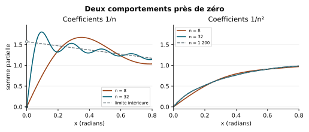
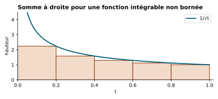

# École polytechnique — Première composition de mathématiques · Option M′ 1992 · Corrigé brut

*Corrigé rédigé par IA, non officiel. Signalez toute erreur.*

**Rédaction** · GPT-6.2 Astra Ultra · vitesse non renseignée

Soit $(b_n)_{n\ge1}$ une suite réelle positive décroissante de limite nulle. On étudie sur $[0,\pi]$ les sommes $E_n(x)=\sum_{k=1}^n\sin(kx)$, $A_n(x)=\sum_{k=1}^n(b_k-b_{k+1})E_k(x)$ et $f_n(x)=\sum_{k=1}^n b_k\sin(kx)$. La convergence de ces dernières définira $f$.

Concours d’admission 1992, option M′, quatre heures. [Fac-similé de l’UPS](https://prepas.org/index.php?module=Sujets&voir=get&file=doc-6ce99dbf4cf4d8c184da) · [Second exemplaire](https://www.sujetsetcorriges.fr/dl/X/Maths/MP/sec-x-1992-maths1-MP.pdf)

## I. Sommes partielles et coefficients de Fourier

### Question 1.a

Pour $1\le k\le n$, l’identité produit-somme donne
$$
2\sin(x/2)\sin(kx)=\cos((k-1/2)x)-\cos((k+1/2)x).
$$
Les termes intermédiaires se compensent. Il reste $2\sin(x/2)E_n(x)=\cos(x/2)-\cos((n+1/2)x)$. L’égalité vaut aussi en zéro puisque les deux membres y sont nuls.

### Question 1.b

Avec $E_0=0$, on écrit $f_n=\sum_{k=1}^n b_k(E_k-E_{k-1})$. En décalant le deuxième indice, il vient $f_n=b_nE_n+\sum_{k=1}^{n-1}(b_k-b_{k+1})E_k=A_n+b_{n+1}E_n$.

### Question 1.c

Posons $s=\sin(x/2)\ge0$. Le numérateur de 1.a a pour module au plus deux, donc $s|E_k|\le1$. Comme $b_k-b_{k+1}\ge0$, la somme des différences sur $[1,n]$ donne $s|A_n|\le b_1-b_{n+1}$. Sur $[n+1,p]$, on obtient $s|A_p-A_n|\le b_{n+1}-b_{p+1}$. Enfin 1.b donne
$$
s|f_p-f_n|\le b_{n+1}-b_{p+1}+b_{p+1}+b_{n+1}=2b_{n+1}.
$$

### Question 2

En zéro et en $\pi$, chaque somme est nulle. Fixons $0<\alpha<\pi$. Sur $[\alpha,\pi]$, l’écart entre deux sommes d’indices $p>n$ est majoré par $2b_{n+1}/\sin(\alpha/2)$, qui tend vers zéro. Le critère de Cauchy uniforme fournit la convergence uniforme sur ce segment, donc la convergence simple sur $]0,\pi]$. La limite $f$ est continue sur $]0,\pi]$ et $f(0)=f(\pi)=0$. La continuité en zéro n’est pas assurée. Ainsi les coefficients $1/n$ donnent $(\pi-x)/2$ sur $]0,\pi[$, comme le calcul de Fourier de 11.b le vérifiera.

### Question 3.a

La dérivée seconde du sinus est $-\sin t\le0$ sur $[0,\pi/2]$. Le graphe y est au-dessus de la corde de $(0,0)$ à $(\pi/2,1)$, d’où $\sin t\ge2t/\pi$.

### Question 3.b

Pour $x>0$, on a $|\sin(mx)|\le mx$ et $\sin(x/2)\ge x/\pi$. En laissant $p$ tendre vers l’infini dans 1.c, on obtient
$$
|\sin(mx)(f-f_n)(x)|\le2m\pi b_{n+1}.
$$
L’inégalité est également vraie en zéro. Les fonctions continues $x\mapsto\sin(mx)f_n(x)$ convergent donc uniformément vers $x\mapsto\sin(mx)f(x)$ sur le segment fermé. La limite est continue et son intégrale est la limite des intégrales. Or le produit-somme donne $\int_0^\pi\sin(mx)\sin(kx)\,dx=0$ si $k\ne m$, et $\pi/2$ si $k=m$. Dès $n\ge m$, l’intégrale est $\pi b_m/2$, sa valeur à la limite.

## II. Convergence uniforme jusqu’à l’origine

### Question 4.a

Supposons $kb_k\to0$ et posons $\varepsilon_n=\sup_{k\ge n}kb_k$, $p=\lfloor\pi/x\rfloor$ pour $0<x\le\pi$. Sur les $p$ premiers indices, $|b_k\sin(kx)|\le kb_k x\le\varepsilon_n x$. La valeur absolue de leur somme est donc majorée par $px\varepsilon_n\le\pi\varepsilon_n$. Pour la suite, 1.c puis 3.a donnent
$$
\left|\sum_{k=n+p}^{\infty}b_k\sin(kx)\right|
\le\frac{2 b_{n+p}}{\sin(x/2)}
\le\frac{2\pi\varepsilon_n}{(n+p)x}\le2\varepsilon_n ,
$$
car $n+p\ge1+p>\pi/x$.

### Question 4.b

En réunissant les deux morceaux, $|f(x)-f_{n-1}(x)|\le(\pi+2)\varepsilon_n$ pour $x>0$. Le reste est nul en zéro et $\varepsilon_n\to0$ puisque $kb_k\to0$. La convergence est uniforme sur $[0,\pi]$.

### Question 5

Prenons $x_n=\pi/(4n)$. Pour $n<k\le2n$, la phase $kx_n$ appartient à $[\pi/4,\pi/2]$. Les $n$ termes sont positifs et chacun est au moins $b_{2n}/\sqrt2$. Ainsi
$$
\|f_{2n}-f_n\|_{\infty}\ge f_{2n}(x_n)-f_n(x_n)\ge nb_{2n}/\sqrt2.
$$
Si la suite converge uniformément, le membre de gauche tend vers zéro. Donc $(2n)b_{2n}\to0$. Pour les indices impairs, $0\le(2n+1)b_{2n+1}\le(2n+1)b_{2n}\to0$. Avec 4.b, cela donne l’équivalence voulue.

## III. Intégrale impropre et convergence absolue

### Question 6.a

Écrivons $s_n=\sum_{k=1}^n b_k$, $I_n=[\pi/(n+1),\pi/n]$. On a $|f_n|\le s_n$. De plus, 1.c et 3.a donnent $|f-f_n|\le2\pi b_{n+1}/x$. En intégrant,
$$
\int_{I_n}|f|\le\pi\left(\frac1n-\frac1{n+1}\right)s_n
+2\pi b_{n+1}\log(1+1/n)
\le\pi\left(\frac1n-\frac1{n+1}\right)s_n+\frac{2\pi}{n}b_{n+1}.
$$

### Question 6.b

La condition (iii) est $\sum b_k/k<\infty$. L’interversion des sommes positives donne
$$
\sum_{n\ge1}s_n\left(\frac1n-\frac1{n+1}\right)
=\sum_{k\ge1}b_k\sum_{n\ge k}\left(\frac1n-\frac1{n+1}\right)=\sum_{k\ge1}\frac{b_k}{k}.
$$
De plus $b_{n+1}/n\le b_n/n$. La somme des majorants de 6.a converge donc. Les $I_n$ recouvrent $]0,\pi]$ et ont leurs intérieurs disjoints. On obtient $\int_0^\pi |f|<\infty$, soit (ii).

### Question 7

Pour $\varepsilon>0$, choisissons $N$ tel que $0<b_k\le\varepsilon$ pour $k>N$. Si $n>N$, alors $0\le s_n/n\le s_N/n+\varepsilon$. Le passage à la limite supérieure puis $\varepsilon\downarrow0$ donne $s_n/n\to0$.

### Question 8.a

Fixons $x>0$. La convergence uniforme sur $[x,\pi]$ permet d’intégrer terme à terme. Comme $\int_x^\pi\sin(kt)dt=(\cos(kx)-(-1)^k)/k$,
$$
F(x)=\int_x^\pi f(t)dt=\sum_{k\ge1}(b_k/k)\cos(kx)-\lambda,
\qquad \lambda=\sum_{k\ge1}(-1)^k b_k/k .
$$
La série alternée définissant $\lambda$ converge, les $b_k/k$ décroissant vers zéro. Par différence, la série cosinus converge aussi. En isolant les $n$ premiers termes et en utilisant $(1-\cos(kx))/k=\int_0^x\sin(kt)dt$, on trouve
$$
\sigma_n=\lambda+F(x)+\sum_{k=1}^n b_k\int_0^x\sin(kt)dt
-\sum_{k>n}(b_k/k)\cos(kx),\qquad \sigma_n=\sum_{k=1}^n b_k/k .
$$

### Question 8.b

Comme $|\sin(kt)|\le1$, la valeur absolue de la troisième expression du membre de droite pour $x=1/n$ est au plus $\sum_{k=1}^n b_k/n=s_n/n$. La question 7 donne la limite zéro.

### Question 8.c

Pour tout bloc $q\le k\le m$, la formule géométrique donne $|\sum_{k=q}^m e^{ikx}|\le2/|1-e^{ix}|=1/\sin(x/2)$ si $0<x\le\pi$. La même borne vaut pour sa partie réelle. Posons $c_k=b_k/k$. Par sommation par parties, $\sum_{k=q}^m c_k\cos(kx)$ est combinaison des sommes de blocs de premier indice $q$, de poids positifs $c_k-c_{k+1}$ et $c_m$ dont la somme vaut $c_q$. À la limite, la queue a module au plus $c_q/\sin(x/2)$. Pour $q=n+1$ et $x=1/n$, elle est ainsi majorée par $\pi n b_{n+1}/(n+1)\to0$.

### Question 8.d

Supposons (i), la convergence de $\int_0^\pi f(t)dt$. Par définition $F(1/n)\to\int_0^\pi f$. En évaluant 8.a en $1/n$ et en utilisant 8.b–c, on obtient la limite finie $\sigma_n\to\lambda+\int_0^\pi f$. C’est (iii). Or 6.b donne (iii) ⇒ (ii) et la convergence absolue entraîne la convergence impropre (ii) ⇒ (i). Les trois conditions imprimées sont donc équivalentes.

## IV. Sommes de Riemann et singularité logarithmique

### Question 9

Pour $0<x<a$ et $N=\lfloor a/x\rfloor$, la décroissance de $\psi$ donne $x\psi(nx)\le\int_{(n-1)x}^{nx}\psi(t)dt$. Dans l’autre sens, $x\psi(nx)\ge\int_{nx}^{(n+1)x}\psi(t)dt$ pour $1\le n<N$. Ainsi
$$
\int_x^{Nx}\psi(t)dt\le x\sum_{n=1}^N\psi(nx)\le\int_0^a\psi(t)dt.
$$
Comme $Nx\to a$, la continuité près de $a$ et la convergence impropre en zéro font tendre la première intégrale vers la dernière.

### Question 10.a

Pour $0<x\le\pi$, toute somme consécutive de $\sin(nx)$ a module au plus $1/\sin(x/2)$ par la formule géométrique de 8.c. Si $q x\ge b$, la suite $\varphi(nx)$ est positive, décroît et tend vers zéro. La sommation par parties de 8.c, appliquée aux sinus, assure la convergence (les queues sont de Cauchy) et donne
$$
\left|x\sum_{n=q}^{\infty}\varphi(nx)\sin(nx)\right|
\le \frac{x}{\sin(x/2)}\varphi(qx)\le\pi\varphi(qx).
$$
Choisissons $A\ge b$ tel que $\pi\varphi(A)\le\varepsilon$ et $q=\lceil A/x\rceil$. La décroissance fournit la majoration demandée pour chaque $x$.

### Question 10.b

Posons $h(t)=\varphi(t)\sin t$. En zéro l’intégrale converge par (i). Pour $B>A\ge b$, le second théorème de la moyenne appliqué à la fonction positive décroissante $\varphi$ donne un $\xi\in[A,B]$ tel que $\int_A^B h=\varphi(A)\int_A^\xi\sin t\,dt$. Le module est au plus $2\varphi(A)\to0$, donc l’intégrale impropre converge aussi à l’infini.

Sur $]0,a]$, la question 9 donne la limite des sommes des rectangles de $h$. Sur $]a,A[$, la continuité assure la convergence des sommes de Riemann à pas $x$ vers $\int_a^A h$. Les éventuelles mailles aux extrémités ont une contribution $O(x)$, car $h$ est bornée près de ces deux points. Enfin, grâce à 10.a et à la borne intégrale précédente, l’écart des queues est au plus $(\pi+2)\varphi(A)$. On laisse d’abord $x\downarrow0$ à $A$ fixé, puis $A\to\infty$. Ainsi
$$
\lim_{x\downarrow0}x\sum_{n\ge1}\varphi(nx)\sin(nx)=\int_0^\infty\varphi(t)\sin(t)\,dt .
$$

### Question 11.a

Le fac-similé demande si $\int_0^\pi |f(x)|dx$ converge. Pour $b_n=(\log n)/n$, la décroissance commence à $n=3$, puisque la dérivée de $(\log t)/t$ vaut $(1-\log t)/t^2$. Remplaçons les deux premières valeurs par $b_3$ pour utiliser III. La différence ne comporte que deux sinus, donc est continue et intégrable. Or $\sum_{n\ge3}(\log n)/n^2$ converge par comparaison intégrale. La condition (iii), puis 6.b, donnent la convergence de l’intégrale demandée.

### Question 11.b

La fonction impaire $2\pi$-périodique égale à $(\pi-x)/2$ sur $]0,\pi[$ a pour coefficient de sinus
$$
\frac1\pi\int_0^\pi(\pi-t)\sin(nt)dt=\frac1n
$$
par intégration par parties. Les coefficients de cosinus sont nuls. La fonction est $C^1$ par morceaux, donc le théorème de Dirichlet donne $\sum_{n\ge1}\sin(nx)/n=(\pi-x)/2$ pour $0<x<\pi$.

Posons $\varphi(t)=\log(t)/t$. Elle décroît positivement vers zéro pour $t\ge e$. Sur $0<t<1$, le produit $-\varphi(t)\sin t=(-\log t)(\sin t/t)$ est positif et décroissant. En effet $\sin t/t=\int_0^1\cos(st)ds$ décroît sur cet intervalle. Le produit est majoré par $-\log t$, intégrable en zéro. On applique donc la question 9 à $-\varphi(t)\sin t$ près de zéro et on change le signe du résultat. Sur les deux autres intervalles la preuve de 10.b s’applique directement. Ainsi $x\sum_{n\ge1}\varphi(nx)\sin(nx)\to L$, où $L=\int_0^\infty ( \log t/t)\sin t\,dt$ est fini.

L’égalité $\log(n)/n=x\varphi(nx)-\log(x)/n$ donne
$$
f(x)=x\sum_{n\ge1}\varphi(nx)\sin(nx)-\frac{\pi-x}{2}\log x.
$$
Puisque $x\log x\to0$, on a $f(x)=-\tfrac\pi2\log x+L+o(1)$. Ainsi $f(x)\to+\infty$ à droite et la constante demandée est $c=-\pi/2$.

### Question 11.c

L’équivalent de 11.b donne $|f(x)|^2=O(1+|\log x|^2)$ près de zéro. L’intégrale de $|\log x|^2$ sur $]0,1]$ vaut $\int_0^\infty u^2e^{-u}du=2$ par la substitution $x=e^{-u}$. Sur tout $[\delta,\pi]$, la fonction est continue par 2, après le même ajustement fini qu’en 11.a. Donc $\int_0^\pi |f(x)|^2 dx$ converge.
