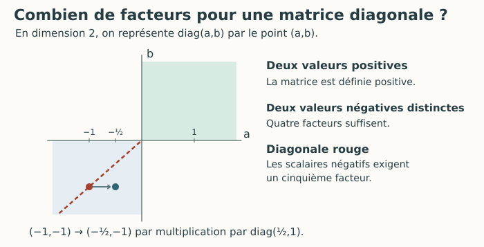

# École polytechnique — Deuxième composition de mathématiques P′ 1992 · Corrigé brut

*Corrigé rédigé par IA, non officiel. Signalez toute erreur.*

**Rédaction** · GPT-6.2 Astra Ultra · vitesse non renseignée

[Fac-similé UPS](https://prepas.org/index.php?module=Sujets&voir=get&file=doc-d6ea43e1dae0c1fe2668) · [Second exemplaire](https://www.sujetsetcorriges.fr/dl/X/Maths/PC/sec-x-1992-maths2-PC.pdf) · [Instruction du concours de 1992](https://www.legifrance.gouv.fr/jorf/id/JORFTEXT000000357550)

On note $\mathcal G=\{A\in M_n(\mathbb R):\det A>0\}$, $\mathcal S$ l’espace des matrices symétriques réelles et $\mathcal D$ l’ensemble des matrices symétriques définies positives. Pour $m\ge1$, $\mathcal D_m$ est formé des produits d’au plus $m$ facteurs de $\mathcal D$. Ajouter des facteurs identité permet de supposer qu’il y en a exactement $m$. Enfin $A\in\mathcal C$ signifie $A\in\mathcal G$ et $X^TAX>0$ pour au moins un vecteur réel $X$.

## I. Exponentielle et spectre

### Question 1.a

Pour chaque $k\ge0$, $(P^{-1}AP)^k=P^{-1}A^kP$. En sommant puis en passant à la limite par continuité de la multiplication matricielle, on obtient $\exp(P^{-1}AP)=P^{-1}\exp(A)P$.

### Question 1.b

Soit $T$ une matrice triangulaire supérieure semblable à $A$, de diagonale $\lambda_1,\ldots,\lambda_n$. Les puissances $T^k$ restent triangulaires avec diagonale $\lambda_i^k$. L’exponentielle est donc triangulaire avec diagonale $e^{\lambda_i}$. Par la question 1.a, les valeurs propres de $\exp A$ sont ces nombres, avec leurs multiplicités algébriques additionnées quand plusieurs exponentielles coïncident.

### Question 1.c

Pour $A$ réelle, la série a des termes réels, donc une somme réelle. Son déterminant vaut $\prod_i e^{\lambda_i}=e^{\operatorname{tr} A}>0$. Ainsi $\exp A\in\mathcal G$.

### Question 2

Si $e^\lambda=-r$, $r>0$, alors $\lambda=\log r+(2j+1)i\pi$ avec $j\in\mathbb Z$. Aucun de ces nombres n’est réel. Comme $A$ est réelle, $\lambda$ et $\bar\lambda$ figurent avec la même multiplicité algébrique et ont la même exponentielle $-r$. Les contributions s’ajoutent deux à deux. Chaque valeur propre strictement négative de $\exp A$ a donc une multiplicité paire.

### Question 3

Pour $n\ge2$, le bloc $J=\left(\begin{smallmatrix}0&-1\\1&0\end{smallmatrix}\right)$ vérifie $J^2=-I_2$. En séparant termes pairs et impairs, $e^{tJ}=\cos t\,I_2+\sin t\,J$, donc $e^{2\pi J}=I_2=e^0$. En complétant le générateur par un bloc nul si nécessaire, on obtient la non-injectivité. D’autre part $\operatorname{diag}(-1,-2,1,\ldots,1)$ a un déterminant positif et deux valeurs propres négatives simples. La question 2 exclut qu’elle soit une exponentielle réelle. L’application n’est donc pas surjective. Pour $n=1$, c’est l’exponentielle réelle usuelle, bijective de $\mathbb R$ sur $]0,+\infty[$.

### Question 4

Si $A=\sum_i\lambda_iP_i$ et $P_iP_j=0$ pour $i\ne j$, $P_i^2=P_i$, alors $A^k=\sum_i\lambda_i^kP_i$ pour $k\ge1$. Le terme d’ordre zéro vaut $I$. Ainsi
$$e^A=I+\sum_i(e^{\lambda_i}-1)P_i.$$

### Question 5

Pour $S\in\mathcal S$, le théorème spectral donne $S=\sum_i\lambda_iP_i$ avec projecteurs orthogonaux de somme $I$ et $\lambda_i\in\mathbb R$. Alors $e^S=\sum_i e^{\lambda_i}P_i\in\mathcal D$. Réciproquement, si $T=\sum_j t_jQ_j\in\mathcal D$ est sa décomposition pour les valeurs propres distinctes $t_j>0$, $S=\sum_j(\log t_j)Q_j$ est une solution symétrique. L’exponentielle réelle scalaire étant injective, les sous-espaces propres d’une solution symétrique sont ceux de son exponentielle, avec la correspondance $\lambda\leftrightarrow e^\lambda$. L’expression trouvée est donc unique.

## II. Produits et transformations des formes quadratiques

### Question 6

Pour tout $P\in GL_n(\mathbb R)$, $(P^TAP)^T=P^TA^TP$ et $\det(P^TAP)=(\det P)^2\det A$. Cela préserve respectivement la symétrie et le signe du déterminant. De plus $X^T(P^TAP)X=(PX)^TA(PX)$. La bijection $X\mapsto PX$ préserve aussi bien l’existence d’une direction positive que la positivité sur tous les vecteurs non nuls. Ainsi $\mathcal S,\mathcal G,\mathcal C,\mathcal D$ sont stables par congruence.

### Question 7.a

Écrivons $P^{-T}=(P^{-1})^T$. Pour $A_j\in\mathcal D$,
$$P^{-1}(A_1\cdots A_{2m})P=
\prod_{i=1}^m (P^{-1}A_{2i-1}P^{-T})(P^TA_{2i}P).$$
Les facteurs intermédiaires se simplifient et chaque facteur écrit est défini positif par congruence. Donc $\mathcal D_{2m}$ est stable par similitude.

### Question 7.b

On a $P^T(A_1\cdots A_{2m+1})P=(P^TA_1P)(P^{-1}A_2\cdots A_{2m+1}P)$. Les deux parenthèses appartiennent à $\mathcal D$ et $\mathcal D_{2m}$ respectivement, donc leur produit à $\mathcal D_{2m+1}$. Le cas d’un seul facteur est la question 6.

### Question 8

Pour $A=U\operatorname{diag}(a_i)U^T$, où $U$ est orthogonale et chaque $a_i>0$, posons $B=U\operatorname{diag}(\sqrt{a_i})U^T$. Cette matrice appartient à $\mathcal D$ et $B^2=A$.

### Question 9.a

Écrivons $A_1\cdots A_{2m}=S^2B$ avec $S\in\mathcal D$ et $B=A_2\cdots A_{2m}\in\mathcal D_{2m-1}$. Alors $S^{-1}(S^2B)S=SBS=S^TBS$. Par la stabilité par congruence des produits impairs, $SBS\in\mathcal D_{2m-1}$.

### Question 9.b

Si $A=S^2B$ avec $B\in\mathcal D_{2m}$, alors $S^{-1}AS^{-1}=SBS^{-1}$. Le premier membre est congruent à $A$ et le second est semblable à $B$, donc appartient à $\mathcal D_{2m}$ par la question 7.a.

### Question 10.a

Écrivons $A=S^2$ avec $S\in\mathcal D$. Alors $S^{-1}(AB)S=SBS$ est réelle symétrique parce que $B$ l’est. Cette matrice est diagonalisable sur $\mathbb R$, donc $AB$ aussi.

### Question 10.b

Le spectre de $AB$ est celui de $SBS$. Pour une matrice symétrique, la stricte positivité de toutes les valeurs propres équivaut à la stricte positivité de la forme quadratique hors de zéro. Par congruence inversible, cette condition pour $SBS$ équivaut à $B\in\mathcal D$.

### Question 11

D’après la question 10, tout élément de $\mathcal D_2$ est diagonalisable à spectre réel strictement positif. Réciproquement, une matrice réelle de ce type est semblable sur $\mathbb R$ à une matrice diagonale positive, donc à un élément de $\mathcal D\subset\mathcal D_2$. La question 7.a donne son appartenance à $\mathcal D_2$. Les deux ensembles sont égaux.

## III. Trois facteurs et une direction positive

### Question 12

Si $A\in\mathcal D_2$, elle a une valeur propre $\lambda>0$ et un vecteur propre réel $X\ne0$. Alors $X^TAX=\lambda\|X\|^2>0$ et $A\in\mathcal G$. Ainsi $\mathcal D_2\subset\mathcal C$. Chaque élément de $\mathcal D_3$ est congruent à un élément de $\mathcal D_2$ par la question 9.b. Comme $\mathcal C$ est stable par congruence, $\mathcal D_3\subset\mathcal C$.

### Question 13

Si $A\in\mathcal D_3\cap\mathcal S$, la question 9.b la rend congruente à une matrice $B\in\mathcal D_2$ qui reste symétrique. Son spectre strictement positif donne $B\in\mathcal D$, et la congruence implique $A\in\mathcal D$. L’inclusion opposée s’obtient en ajoutant des facteurs identité. Ainsi $\mathcal D_3\cap\mathcal S=\mathcal D$.

### Question 14.a

Supposons $n=2$. Dans une base orthonormée qui diagonalise $(A+A^T)/2$, cette partie a diagonale $x,z$. La partie antisymétrique y est encore antisymétrique, donc de la forme $\left(\begin{smallmatrix}0&y\\-y&0\end{smallmatrix}\right)$. On obtient par congruence $C=\left(\begin{smallmatrix}x&y\\-y&z\end{smallmatrix}\right)$. La forme quadratique est $xX_1^2+zX_2^2$ et prend au moins une valeur positive puisque $A\in\mathcal C$. Ainsi $x>0$ ou $z>0$. Leur échange permet de choisir $x>0$.

### Question 14.b

Pour $P=\left(\begin{smallmatrix}u&t\\0&1\end{smallmatrix}\right)$, le produit demandé est
$$P^TCP=\begin{pmatrix}u^2x&u(xt+y)\\u(xt-y)&xt^2+z\end{pmatrix}.$$
Choisissons $t=-y/x$. La matrice devient triangulaire inférieure avec $c=z+y^2/x=(\det C)/x>0$, $a=u^2x$ et $b=-2uy$. Le choix $u=\sqrt{2c/x}$ donne $a=2c\ne c$ et $P$ inversible.

### Question 14.c

Pour $n=2$, la question 14.b rend chaque $A\in\mathcal C$ congruente à une matrice diagonalisable à deux valeurs propres positives, donc dans $\mathcal D_2\subset\mathcal D_3$. La stabilité de $\mathcal D_3$ par congruence donne $A\in\mathcal D_3$. Avec la question 12, on trouve $\mathcal D_3=\mathcal C$ en dimension deux. Dans la suite, pour $n$ quelconque, on emploie le résultat admis par l’énoncé pour les éléments **non symétriques** de $\mathcal C$.

## IV. Quatre puis cinq facteurs

### Question 15

Si $A,B\in\mathcal D_2$ et $AB=-I$, alors $B=-A^{-1}$. Toutes les valeurs propres de $A$ sont strictement positives, donc celles de $-A^{-1}$ sont strictement négatives, en contradiction avec $B\in\mathcal D_2$. Ainsi $-I\notin\mathcal D_4$.

### Question 16.a

Si tout vecteur non nul était propre, prenons deux vecteurs indépendants $v,w$. L’application de $A$ à $v+w$ montre que les valeurs propres associées à $v,w$ et $v+w$ sont égales. Cela force $A$ à être scalaire. Pour $A$ non scalaire, il existe donc $v$ tel que $(v,Av)$ soit libre. En complétant ce couple en une base, la première colonne de $A$ est $(0,1,0,\ldots,0)^T$.

### Question 16.b

Le résultat est
$$\begin{pmatrix}1&-t\\0&1\end{pmatrix}
\begin{pmatrix}0&a\\1&b\end{pmatrix}
\begin{pmatrix}1&t\\0&1\end{pmatrix}
=\begin{pmatrix}-t&a-bt-t^2\\1&b+t\end{pmatrix}.$$

### Question 16.c

Dans la base de la question 16.a, le coin supérieur gauche a la forme de la question 16.b. La conjugaison par $\operatorname{diag}(P_t,I_{n-2})$, avec $P_t=\left(\begin{smallmatrix}1&t\\0&1\end{smallmatrix}\right)$, agit sur ce coin par le calcul précédent. Pour $t<0$ de module assez grand, $-t>0$ et $a-bt-t^2\ne1$. Les deux entrées hors diagonale du coin diffèrent. La transformée est donc non symétrique et possède le coefficient diagonal positif voulu.

### Question 16.d

Une matrice non scalaire de $\mathcal G$ est semblable à une matrice non symétrique $B$ dont un coefficient diagonal est positif. Le vecteur de base correspondant donne une direction positive, donc $B\in\mathcal C$. Par le résultat admis, $B\in\mathcal D_3\subset\mathcal D_4$. La stabilité par similitude de $\mathcal D_4$ ramène à la matrice initiale. Les scalaires positifs appartiennent à $\mathcal D$. Pour $r>0$, si $-rI$ appartenait à $\mathcal D_4$, diviser l’un des facteurs par $r$ donnerait $-I\in\mathcal D_4$, contredisant la question 15. Ainsi
$$\mathcal D_4=\mathcal G\setminus\{-rI:r>0\}.$$
En dimension impaire, les scalaires négatifs ont déjà un déterminant négatif.

### Question 17

Il suffit de traiter les éléments de $\mathcal G$ encore exclus par la question 16.d. Pour $n$ pair, $n\ge2$, soit $-rI$ avec $r>0$. Prenons $S=\operatorname{diag}(2,1,\ldots,1)\in\mathcal D$. Alors $-rS^{-1}$ est dans $\mathcal G$ et n’est pas scalaire, donc appartient à $\mathcal D_4$. Le produit $S(-rS^{-1})=-rI$ appartient à $\mathcal D_5$. Pour $n$ impair, $\mathcal D_4=\mathcal G$ suffit déjà, et dans tous les cas $\mathcal D_5=\mathcal G$.

