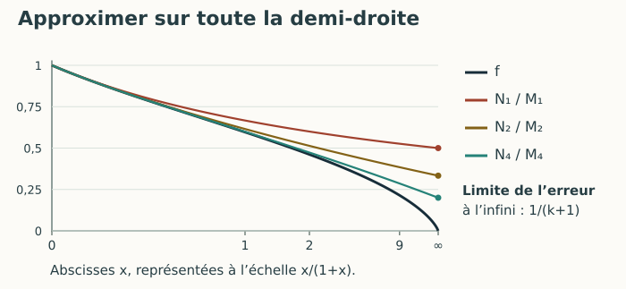

# École polytechnique — Première composition de mathématiques P′ 1992 · Corrigé brut

*Corrigé rédigé par IA, non officiel. Signalez toute erreur.*

**Rédaction** · GPT-6.2 Astra Ultra · vitesse non renseignée

[Fac-similé UPS](https://prepas.org/index.php?module=Sujets&voir=get&file=doc-c9bfac77ed70e30cb3ff) · [Second exemplaire](https://www.sujetsetcorriges.fr/dl/X/Maths/PC/sec-x-1992-maths1-PC.pdf) · [Instruction du concours de 1992](https://www.legifrance.gouv.fr/jorf/id/JORFTEXT000000357550)

On étudie l’équation $x^2g'(x)+g(x)=x$ pour $x>0$, avec la condition $g(0+)=0$. La fonction auxiliaire est $f(x)=\int_0^\infty e^{-t}/(1+xt)\,dt$, définie jusqu’en $x=0$. Les dérivées en zéro sont des dérivées à droite.

## I. La solution sélectionnée au voisinage de zéro

### Question 1.a

Pour $\varphi(x,t)=e^{-t}/(1+xt)$, une récurrence donne
$$\partial_x^n\varphi(x,t)=(-1)^n n!\frac{t^ne^{-t}}{(1+xt)^{n+1}}.$$
Pour $x,t\ge0$, son module est au plus $n!t^ne^{-t}$. Cette fonction est intégrable, avec $\int_0^\infty t^ne^{-t}\,dt=n!$ par intégrations par parties. Toutes les intégrales demandées convergent absolument. La dérivation sous le signe intégral est d’ailleurs justifiée par cette même domination.

### Question 1.b

On a $f'(x)=-\int_0^\infty te^{-t}/(1+xt)^2\,dt<0$. Ainsi $f$ décroît strictement, avec $f(0)=1$ et $f'(0)=-1$. Lorsque $x\to+\infty$, l’intégrande tend vers zéro pour tout $t>0$ et est dominé par $e^{-t}$. Par convergence dominée, $f(x)\to0$.

### Question 2.a

Le facteur intégrant est $e^{-1/x}$. Toutes les solutions sur $]0,+\infty[$ sont
$$y(x)=e^{1/x}\left(C+\int_0^x\frac{e^{-1/s}}s\,ds\right),\qquad C\in\mathbb R,$$
l’intégrale étant convergente par le changement $v=1/s$. Dans la solution avec $C=0$, posons $t=1/s-1/x$. Elle devient $\int_0^\infty e^{-t}/(t+1/x)\,dt=xf(x)$. Comme $0<f(x)\le1$, cette solution tend vers zéro en zéro. Toute autre solution en diffère de $Ce^{1/x}$ et ne vérifie pas la condition. On a donc $g=xf$, prolongée par $g(0)=0$.

### Question 2.b

Sur cet intervalle $e^{-t}\ge e^{-1}$. Ainsi $g(x)\ge e^{-1}\int_0^1 x/(1+xt)\,dt=e^{-1}\log(1+x)$, d’où $g(x)\to+\infty$.

## II. Obstruction à la rationalité

### Question 3

Si $g$ était un polynôme de degré $d\ge1$, $X^2g'+g$ aurait degré $d+1\ge2$ alors que le second membre est $X$. Un polynôme constant ne convient pas non plus.

### Question 4.a

Si $g=P/Q$ avec $Q$ non constant et $P,Q$ premiers entre eux, l’équation donne l’identité polynomiale
$$(X^2P'+P-XQ)Q=X^2Q'P.$$
Le lemme de Gauss implique $Q\mid X^2Q'$. En posant $A=X^2Q'/Q$, on obtient $X^2Q'=AQ$ et, en simplifiant par $Q$, $X^2P'+P-XQ=AP$.

### Question 4.b

Si $d=\deg Q\ge1$, la comparaison des termes dominants de $X^2Q'=AQ$ donne $\deg A=1$ et son coefficient dominant vaut $d$. De plus $Q(0)\ne0$, car sinon $P(0)\ne0$ et le quotient divergerait en zéro. En évaluant l’identité en zéro, on obtient $A(0)=0$, donc $A=dX$.

### Question 4.c

Si $Q=\sum_jq_jX^j$, alors $(j-d)q_j=0$ pour chaque $j$. Ainsi $Q=q_dX^d$, ce qui contredit $Q(0)\ne0$ puisque $d\ge1$. Le cas d’un dénominateur constant a été exclu à la question 3. La fonction $g$ est donc non rationnelle.

## III. Deux suites de polynômes

### Question 5

L’équation différentielle donne $M_0=N_0=1$. Pour $k\ge1$, la dérivation et le regroupement du terme en $g$ et du terme indépendant conduisent à
$$M_k=(1+2kX)M_{k-1}-X^2M'_{k-1},\qquad
N_k=M_{k-1}+(2k-1)XN_{k-1}-X^2N'_{k-1}.$$
Ces formules construisent deux polynômes tels que
$$g^{(k+1)}(x)=(-1)^{k+1}\left(\frac{M_k(x)g(x)}{x^{2k+2}}-\frac{N_k(x)}{x^{2k+1}}\right).$$
La différence de deux représentations donnerait $(M_k-\widetilde M_k)g=x(N_k-\widetilde N_k)$. Si le coefficient de $g$ était non nul, $g$ serait rationnelle. Ce coefficient est donc nul, puis $N_k=\widetilde N_k$.

### Question 6

Notons $a_{k,j}=[X^j]M_k$, nul hors de $0\le j\le k$. La question 5 impose $a_{k,0}=1$ et
$$a_{k,j}=a_{k-1,j}+(2k-j+1)a_{k-1,j-1}.$$
La formule candidate est $a_{k,j}=k!(k+1)!/((k+1-j)!(k-j)!j!)$. Pour $1\le j\le k$, les deux termes du membre droit divisés par ce candidat valent respectivement $(k+1-j)(k-j)/(k(k+1))$ et $j(2k-j+1)/(k(k+1))$. Leur somme vaut $1$, y compris pour $j=k$ où le premier terme s’annule. Le rang zéro et le coefficient constant assurent l’initialisation. Enfin $(j+1)a_{k,j+1}=k(k+1)a_{k-1,j}$, ce qui donne $M'_k=k(k+1)M_{k-1}$.

### Question 7

Partons de $N_0=1$. Si $N_{k-1}$ a terme dominant $bX^{k-1}$, les deux termes en $N_{k-1}$ dans la récurrence fournissent ensemble $[(2k-1)-(k-1)]bX^k=kbX^k$. Le terme en $M_{k-1}$ ne l’annule pas. Par récurrence, $N_k$ a degré $k$ et terme dominant $k!X^k$.

## IV. Approximation uniforme sur la demi-droite

### Question 8.a

Pour $k\ge0$ et $x\ge0$, l’intégrande de $G_k(x)=\int_0^\infty t^ke^{-t}/(1+xt)^{k+2}\,dt$ est positif et majoré par $t^ke^{-t}$. Son intégrale converge et $G_k(x)\le k!$.

### Question 8.b

Avec $ds=dt/(1+t)^2$, on obtient $\int_0^\infty t^k/(1+t)^{k+2}\,dt=\int_0^1s^k\,ds=1/(k+1)$.

### Question 8.c

Pour $x>0$, posons $s=xt$. Alors
$$0\le x^{k+1}G_k(x)=\int_0^\infty\frac{s^ke^{-s/x}}{(1+s)^{k+2}}\,ds\le\frac1{k+1}.$$
La borne vaut aussi pour $x=0$ puisque le membre de gauche y est nul. Elle est indépendante de $x$, donc la convergence vers zéro est uniforme sur toute la demi-droite.

### Question 9

Pour $k\ge1$, la dérivée d’ordre $k$ du noyau vaut $(-1)^{k-1}k!t^{k-1}/(1+xt)^{k+1}$. Après multiplication par $e^{-t}$, le moment intégrable domine uniformément cette dérivée. D’où $g^{(k)}=(-1)^{k-1}k!G_{k-1}$, y compris en zéro par prolongement à droite. Appliquons cette formule à $k+1$ et comparons-la à la question 5, avec $g=xf$. Il vient
$$N_k(x)-M_k(x)f(x)=(k+1)!x^{2k+1}G_k(x).$$
En zéro, cette égalité se prolonge par continuité. La même comparaison vaut aussi au rang $k=0$.

### Question 10

Les coefficients de $M_k$ sont positifs et son terme de degré $k$ est $(k+1)!x^k$. Ainsi, pour $x>0$,
$$0\le \frac{N_k(x)}{M_k(x)}-f(x)\le x^{k+1}G_k(x)\le\frac1{k+1}.$$
En zéro l’erreur est nulle car $N_k(0)=M_k(0)=f(0)=1$. C’est la convergence uniforme cherchée. La borne est exacte pour le supremum, puisque le quotient tend vers $k!/(k+1)!=1/(k+1)$ à l’infini, où $f$ tend vers zéro.

## V. Une identité entre deux rangs successifs

### Question 11

Pour $k\ge1$, la formule de Leibniz appliquée à $x^2g'$ donne
$$x^2g^{(k+2)}+[1+2(k+1)x]g^{(k+1)}+k(k+1)g^{(k)}=0.$$
Ainsi $\alpha_k=k(k+1)$ et $\beta_k=2(k+1)$.

### Question 12

Pour $k\ge1$, écrivons $H=(N_{k-1}M_k-M_{k-1}N_k)/x^{2k-1}$. La question 5 se réarrange en $N_k=M_kf+(-1)^kx^{2k+1}g^{(k+1)}$. Par substitution,
$$H=(-1)^{k-1}\bigl(M_kg^{(k)}+x^2M_{k-1}g^{(k+1)}\bigr).$$
En dérivant, le coefficient de $g^{(k)}$ est, au signe commun près, $M'_k=k(k+1)M_{k-1}$. Celui de $g^{(k+1)}$ est $M_k+2xM_{k-1}+x^2M'_{k-1}=(1+2(k+1)x)M_{k-1}$. Le dernier coefficient est $x^2M_{k-1}$. La question 11 donne alors $H'=0$. En $0+$, $M_k(0)=1$ et les dérivées de $g$ ont des limites finies. Ainsi
$$H(x)=(-1)^{k-1}g^{(k)}(0)=k!G_{k-1}(0)=k!(k-1)!.$$

### Question 13

Soit $D$ un diviseur commun de $M_k,N_k$. Pour $k\ge1$, il divise $N_{k-1}M_k-M_{k-1}N_k=k!(k-1)!X^{2k-1}$. Or $M_k(0)=1$, donc $X$ ne divise pas $M_k$. Le seul pgcd unitaire est $1$. Au rang zéro, les deux polynômes valent déjà $1$.
