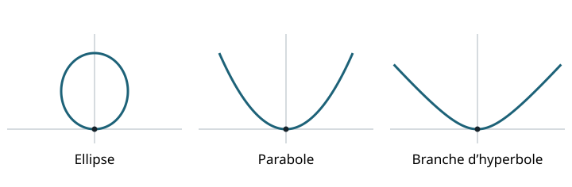

# École polytechnique — Deuxième composition de mathématiques · Option M′ 1993 · Corrigé brut

*Corrigé rédigé par IA, non officiel. Signalez toute erreur.*

**Rédaction** · GPT-6.2 Astra Ultra · vitesse non renseignée

Le plan $\mathbb R^2$ est orienté. Nous écrivons $u\wedge v=u_1v_2-u_2v_1$. La rotation $R$ d’angle $\pi/2$ est la multiplication par $i$ dans le plan complexe. Les deux parties étudient successivement le paramètre de longueur euclidien et un paramètre associé au déterminant.

## I. Retrouver une courbe à partir de sa courbure euclidienne

### Question 1

Posons $\theta(t)=\int_{t^0}^t\gamma(u)\,du$. Cette fonction est de classe $C^1$ et $\theta(t^0)=0$. Si $\tau'=\gamma R(\tau)$, alors $(e^{-i\theta}\tau)'=e^{-i\theta}(\tau'-i\gamma\tau)=0$. La condition initiale impose $\tau(t)=e^{i\theta(t)}\tau^0$. Inversement, cette formule définit une solution de classe $C^1$ sur tout $I$ par dérivation. Elle assure donc à la fois l’existence et l’unicité.

### Question 2

Puisque $(\|\tau\|^2)'=2\gamma(\tau\mid R(\tau))=0$, la norme est constante. Elle vaut $1$ en $t^0$ et donc sur tout $I$. On retrouve aussi ce résultat en prenant le module de la formule de 1.

### Question 3

La courbe $x(t)=x^0+\int_{t^0}^t\tau(u)\,du$ est de classe $C^2$. Elle vérifie $x'=\tau$ et $x''=\gamma R(\tau)$. Comme $\|\tau\|=1$, le paramètre est une abscisse curviligne. Sa courbure algébrique vaut

$$
C(t)=\frac{x'(t)\wedge x''(t)}{\|x'(t)\|^3}
=\gamma(t)\bigl(\tau(t)\wedge R(\tau(t))\bigr)=\gamma(t).
$$

La courbure non signée a la même valeur puisque $\gamma$ est positive.

### Question 4

Pour $t>0$, les données $t^0=1$, $\tau^0=1$ et $x^0=0$ donnent $\theta=\log t$, puis

$$
\tau(t)=e^{i\log t},\qquad x(t)=\frac{t\,e^{i\log t}-1}{1+i}.
$$

La dérivée de la seconde formule est $\tau$ et $x(1)=0$. Autour du pôle $P=-1/(1+i)=(-1+i)/2$, le module de $x-P$ est $r=t/\sqrt2$ et un argument continu vaut $\psi=\log t-\pi/4$. On a donc $r=e^{\psi+\pi/4}/\sqrt2$ pour $\psi\in\mathbb R$. C’est une spirale logarithmique, qui s’enroule indéfiniment près de $P$ quand $t\to0^+$.

## II. Paramètre et courbure équiaffines

### Question 5

Si $u=\varphi(t)$ et $X(u)=x(t)$, alors

$$
X_u=\frac{x'}{\varphi'},\qquad
X_{uu}=\frac{x''}{(\varphi')^2}-\frac{\varphi'' x'}{(\varphi')^3},\qquad
X_u\wedge X_{uu}=\frac{x'\wedge x''}{(\varphi')^3}.
$$

Les fonctions du membre de droite sont évaluées en $t$. Lorsque les deux déterminants valent $1$, il vient $(\varphi')^3=1$, donc $\varphi'=1$. Sur l’intervalle $I$, $\varphi(t)=t+C$ ; réciproquement, toute translation du paramètre préserve la normalisation.

### Question 6

Écrivons $D(t)=x'(t)\wedge x''(t)>0$. Pour un point de base $t_*$ et une constante $C$, posons

$$
\varphi(t)=C+\int_{t_*}^t D(v)^{1/3}\,dv .
$$

Comme $D$ est de classe $C^1$, $\varphi$ est de classe $C^2$ et sa dérivée est strictement positive. C’est un difféomorphisme de classe $C^2$ sur son image, suffisant pour définir les deux dérivées de $X=x\circ\varphi^{-1}$ dans la relation demandée. Par 5, $X_u\wedge X_{uu}=D/D=1$. La formule montre aussi l’unicité à une constante près. Si $x$ est lisse, $\varphi$ l’est aussi.

### Question 7

Dériver $x'\wedge x''=1$ donne $x'\wedge x'''=0$. Il existe donc un scalaire $\lambda$ tel que $x'''=\lambda x'$, car $x'\ne0$. D’après la définition de $\chi$, on a $\chi=x''\wedge x'''=\lambda(x''\wedge x')=-\lambda$. Ainsi $x'''=-\chi x'$.

### Question 8

Résolvons $y''+\rho(t)y=0$, $y(t^0)=b$, $y'(t^0)=c$. Le système du premier ordre pour $(y,y')$ a des coefficients continus, donc une unique solution sur $I$ et $y$ est de classe $C^2$. Posons $x(t)=a+\int_{t^0}^t y(v)\,dv$. La fonction $y\wedge y'$ a pour dérivée $y\wedge(-\rho y)=0$ et vaut $b\wedge c=1$ à l’origine choisie. Ainsi $x'\wedge x''=1$ et $x''\wedge x'''=y'\wedge(-\rho y)=\rho$. Les trois valeurs initiales sont réalisées et $x$ est de classe $C^3$. Inversement, par 7 toute solution doit vérifier $x'''+\rho x'=0$ avec ces mêmes données. L’unicité du problème pour $y$, puis la valeur de $x(t^0)$, donnent l’unicité de $x$.

### Question 9

Ici $\rho=-6/t^2$ ; une solution scalaire $t^m$ pour chaque composante de $y$ vérifie $m(m-1)=6$. Les exposants $3$ et $-2$ sont distincts. On écrit $y(t)=A t^3+B t^{-2}$ avec deux vecteurs constants. Les conditions $A+B=b=(1/5,-1)$ et $3A-2B=c=(3/5,2)$ donnent $A=(1/5,0)$ et $B=(0,-1)$. En intégrant et en imposant $x(1)=(1/20,1)$, on trouve

$$
x(t)=\left(\frac{t^4}{20},\frac1t\right).
$$

En effet, $x'\wedge x''=(t^3/5)(2/t^3)-(-1/t^2)(3t^2/5)=1$, et la relation $x'''=6x'/t^2$ redonne $\chi=-6/t^2$.

### Question 10

En choisissant $t^0=0$, notons $a=x(0)$, $b=x'(0)$, $c=x''(0)$. On a $b\wedge c=1$. Pour $\chi=\omega^2>0$, l’intégration donne $x=a+b\sin(\omega t)/\omega+c(1-\cos(\omega t))/\omega^2$. C’est l’image d’un cercle entier par une application affine inversible, donc une ellipse entière de centre $a+c/\omega^2$.

Pour $\chi=0$, on obtient $x=a+bt+ct^2/2$. Les coordonnées dans le repère $(a;b,c)$ sont $(t,t^2/2)$, ce qui donne une parabole entière.

Pour $\chi=-\omega^2<0$ avec $\omega>0$, la solution est $x=a+b\sinh(\omega t)/\omega+c(\cosh(\omega t)-1)/\omega^2$. Dans la base $(b/\omega,c/\omega^2)$ de centre $a-c/\omega^2$, les coordonnées $(U,V)=(\sinh(\omega t),\cosh(\omega t))$ satisfont $V^2-U^2=1$ et $V\ge1$. Lorsque $t$ parcourt $\mathbb R$, une branche entière de l’hyperbole est parcourue.

### Question 11

Écrivons $F=(U,V)$ si $F(p)=Up+V$. Pour $F_1=(U_1,V_1)$ et $F_2=(U_2,V_2)$, on a

$$
F_1\circ F_2=(U_1U_2,U_1V_2+V_1),\qquad
F^{-1}=(U^{-1},-U^{-1}V).
$$

Les deux nouvelles parties linéaires ont déterminant $1$, car $\det(U_1U_2)=\det U_1\det U_2$ et $\det U^{-1}=1/\det U$. L’identité est $(\mathrm{Id},0)$ et l’associativité est celle de la composition. Cela établit que $G$ est un groupe.

### Question 12

Pour $X=Ux+V$, les dérivées d’ordres $1$, $2$ et $3$ s’obtiennent en appliquant $U$ aux dérivées correspondantes de $x$. Comme $\det U=1$, on a $X'\wedge X''=x'\wedge x''=1$ et $X''\wedge X'''=x''\wedge x'''=\chi(t)$. Le même paramètre convient pour $X$ et la fonction de courbure équiaffine est conservée point par point.

### Question 13

Fixons $t^0\in I$. Il existe une unique application linéaire $U$ envoyant $(x'(t^0),x''(t^0))$ sur $(X'(t^0),X''(t^0))$. Ces deux bases ont pour déterminant $1$, donc $\det U=1$. Posons $V=X(t^0)-Ux(t^0)$. La courbe $Ux+V$ a par 12 la même fonction $\chi$ que $X$ et, par construction, les mêmes position, vitesse et accélération en $t^0$. La question 8 appliquée à $\rho=\chi$ donne $X(t)=Ux(t)+V$ sur $I$. Les trois données au point de base imposent aussi l’unicité de cette transformation.

### Question 14

Posons $b=x'(t^0)$, $c=x''(t^0)$, $\chi_0=\chi(t^0)$ et $h=t-t^0$. La régularité $C^4$ permet de dériver 7, ce qui donne $x^{(4)}=-\chi'x'-\chi x''$. Dans la base $(b,c)$, notons $U=\bar x_1(t)-\bar x_1(t^0)$ et $V=\bar x_2(t)-\bar x_2(t^0)$. La formule de Taylor fournit

$$
U=h-\frac{\chi_0}{6}h^3-\frac{\chi'(t^0)}{24}h^4+o(h^4),\qquad
V=\frac12h^2-\frac{\chi_0}{24}h^4+o(h^4).
$$

Comme $U'(t^0)=1$, la courbe est localement un graphe et $h=U+\chi_0 U^3/6+O(U^4)$. En élevant au carré puis en reportant dans $V$, on trouve

$$
\bar x_2(t)=\bar x_2(t^0)+\frac12U^2+\frac{\chi_0}{8}U^4+o(U^4).
$$

Le coefficient quartique résulte de $\chi_0/6-\chi_0/24$. La dérivée de $\chi$ figurant dans le premier développement n’influence pas ce coefficient.
