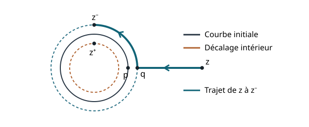

# École polytechnique — Première composition de mathématiques · Option M′ 1993 · Corrigé brut

*Corrigé rédigé par IA, non officiel. Signalez toute erreur.*

**Rédaction** · GPT-6.2 Astra Ultra · vitesse non renseignée

On travaille avec une courbe régulière fermée $\Gamma=f(\mathbb R)$ dans le plan complexe. La fonction $f$ est de classe $C^1$, de plus petite période positive $T$, sa dérivée ne s’annule pas et deux paramètres de même image sont congrus modulo $T$. Le produit scalaire de deux complexes $u,v$ est $\operatorname{Re}(u\overline v)$.

## I. Une horloge adaptée à la longueur

### Question 1.a

Posons $A(u)=\int_0^u|f'(v)|\,dv$ et $L=A(T)>0$. La périodicité donne $A(u+T)=A(u)+L$. Comme $A'>0$, $A$ est strictement croissante et de classe $C^1$. Ses valeurs en $nT$ sont $nL$, donc son image est $\mathbb R$. Sa réciproque $\varphi$ est de classe $C^1$ et vérifie $\varphi(s+L)=\varphi(s)+T$. Alors $g=f\circ\varphi$ est $L$-périodique, avec

$$
g'(s)=\frac{f'(\varphi(s))}{|f'(\varphi(s))|}.
$$

Si $g(s)=g(t)$, on a $\varphi(s)=\varphi(t)+nT$, d’où $s=t+nL$ en appliquant $A$. En particulier, chaque période positive de $g$ est un multiple de $L$. Toutes les propriétés demandées sont vérifiées.

### Question 1.b

Le paramètre initial parcourt une fois $\Gamma$ sur $[0,T]$, sans répétition avant le retour au point de départ. La formule de longueur donne $\int_0^T|f'(u)|\,du=L$. Dans le nouveau paramétrage, la même longueur vaut $\int_0^L1\,ds$.

### Question 1.c

L’identité $|f'(\varphi(s))|\,|\varphi'(s)|=1$ impose $\varphi'\ne0$. Son signe $\sigma\in\{-1,1\}$ est constant, par continuité sur $\mathbb R$. Ainsi $(A\circ\varphi)'=\sigma$, soit $\varphi(s)=A^{-1}(\sigma s+c)$ pour une constante $c$. Réciproquement, chacune de ces fonctions convient par 1.a. Deux choix s’obtiennent donc l’un de l’autre par composition à droite avec $s\mapsto\pm s+d$. Ils choisissent une origine et un sens de parcours.

## II. Relier un point du complémentaire à une courbe décalée

### Question 2

La fonction $D(t)=|g(t)-z|^2$ est périodique et de classe $C^1$. Elle atteint son minimum et son maximum sur $[0,L]$, et les points correspondants sont des extrema sur $\mathbb R$. Or $D'(t)=2\operatorname{Re}((g(t)-z)\overline{g'(t)})$. Si $D$ n’est pas constante, les deux valeurs extrêmes sont différentes et leurs points images aussi. Si $D$ est constante, la dérivée s’annule partout et $g(0),g(L/2)$ sont distincts par 1.a. En chaque point retenu, la droite joignant $z$ à $g(t)$ est définie puisque $z\notin\Gamma$, et elle est orthogonale à $g'(t)$.

### Question 3.a

La dérivée continue $g'$ est $L$-périodique. Elle est uniformément continue sur $[-L,2L]$. Pour $0<K<1$, fixons $0<\alpha<L/2$ assez petit pour que deux arguments de ce compact distants de moins de $\alpha$ donnent des valeurs distantes de moins de $K$. Pour $s,t$ arbitraires vérifiant $|s-t|<\alpha$, la même translation de pas $nL$ ramène $t$ dans $[0,L]$ et $s$ dans $[-L,2L]$. L’estimation vaut donc sur toute la droite.

### Question 3.b

Si $0<|s-t|<\alpha$, le théorème fondamental donne

$$
g(s)-g(t)-(s-t)g'(t)=\int_t^s (g'(v)-g'(t))\,dv .
$$

Sur le segment ayant pour extrémités $s,t$, le maximum du module de l’intégrande est strictement inférieur à $K$ par 3.a et compacité. Le module du reste est donc strictement inférieur à $K|s-t|$, quel que soit l’ordre des bornes.

### Question 4

Représentons chaque différence modulo $L$ par un nombre $u$ de $[0,L)$. L’hypothèse $|s-t+nL|\ge\alpha$ pour tout entier $n$ revient à $\alpha\le u\le L-\alpha$. Après réduction de $t$ modulo $L$, l’infimum cherché est donc le minimum de $|g(t+u)-g(t)|$ sur $[0,L]\times[\alpha,L-\alpha]$. Cette fonction continue y est partout positive car $u$ ne peut être un multiple de $L$. Son minimum $\beta$ est strictement positif.

### Question 5

Si $g(s)=g(t)\pm i\varepsilon g'(t)$ avec $0<\varepsilon<\beta$, la corde a pour longueur $\varepsilon$. Par 4, après translation de $s$ d’un multiple de $L$, on a $|u|<\alpha$ pour $u=s-t$. Le cas $u=0$ est impossible. D’après 3.b, $g(s)-g(t)=ug'(t)+r$ avec $|r|<K|u|$. Sa projection algébrique sur $g'(t)$ diffère de $u$ de moins que $|u|$, donc elle est non nulle. Or la corde supposée normale a une projection nulle. Ainsi chacune des images $\Gamma_\varepsilon^+$ et $\Gamma_\varepsilon^-$ est disjointe de $\Gamma$.

### Question 6

Pour $z\notin\Gamma$, choisissons $p=g(t_0)$ minimisant la distance à $z$ et écrivons $r=|z-p|>0$. Par 2, $z=p+\sigma ri g'(t_0)$ pour un signe $\sigma$. Sur cette normale, relions $z$ à $p+\sigma\varepsilon i g'(t_0)$. Si $r\ge\varepsilon$, tout point du segment autre que $z$ est à distance de $z$ strictement inférieure à $r$ et ne peut appartenir à $\Gamma$. Si $r<\varepsilon$, tous ses points ont pour coordonnées normales des longueurs $d\in[r,\varepsilon]\subset(0,\beta)$ ; la question 5 appliquée à chacune de ces longueurs les exclut de $\Gamma$. On prolonge par l’arc continu $t\mapsto g(t)+\sigma i\varepsilon g'(t)$ de $t_0$ à $0$. Son extrémité est $z^\sigma=g(0)+\sigma i\varepsilon g'(0)$ et tout le parcours est dans le complémentaire.

## III. Séparer les deux côtés par la variation de l’argument

### Question 7

L’égalité $|h|=1$ donne $2\operatorname{Re}(h'/h)=0$. On peut donc poser

$$
k(t)=a+\frac1i\int_0^t\frac{h'(u)}{h(u)}\,du .
$$

Cette fonction est réelle, de classe $C^1$ et de valeur initiale $a$. La dérivée de $he^{-ik}$ est nulle et sa valeur initiale est $1$. On obtient $h=e^{ik}$. Deux relèvements de même valeur initiale ont une différence continue à valeurs dans $2\pi\mathbb Z$. Sur l’intervalle connexe, cette différence est constante et elle est nulle à l’origine.

### Question 8

Notons $w_s(u)=g(u)-\gamma(s)$ et $h_s=w_s/|w_s|$. À $s$ fixé, $w_s$ est de classe $C^1$ et ne s’annule pas. On a $h_s'/h_s=w_s'/w_s-(\log |w_s|)'$. Le deuxième terme a une intégrale nulle entre $0$ et $L$ par périodicité. La question 7 fournit

$$
n_s=\frac1i\int_0^L\frac{g'(u)}{g(u)-\gamma(s)}\,du .
$$

En orientant l’arc supposé de $z^+$ vers $z^-$ et en posant $v=g'(0)$, il vient

$$
n_0=\frac1i\int_0^L\frac{g'(u)}{g(u)-g(0)-i\varepsilon v}\,du,\qquad
n_1=\frac1i\int_0^L\frac{g'(u)}{g(u)-g(0)+i\varepsilon v}\,du .
$$

Ces expressions ne dépendent pas des choix initiaux d’argument. Le nombre $n_s$ est un angle en radians. Puisque $h_s(L)=h_s(0)$, il appartient à $2\pi\mathbb Z$.

### Question 9.a

Sur $[\alpha,L-\alpha]$, la distance $|g(u)-g(0)|$ est au moins $\beta$. La différence des fractions a un numérateur de module $2\varepsilon$ après réduction au même dénominateur, et chacun des deux facteurs du dénominateur a pour module au moins $\beta-\varepsilon$. L’intégrale sur cet intervalle tend donc vers zéro.

Sur $[-\alpha,\alpha]$, posons $q(u)=(g(u)-g(0))/v$. Alors $q'(0)=1$, $|q'(u)|=1$ et $|q(u)-u|\le K|u|$ par 3.b et continuité aux extrémités. Par l’inégalité triangulaire,

$$
|q(u)\pm i\varepsilon|\ge\sqrt{u^2+\varepsilon^2}-K|u|
\ge(1-K)\sqrt{u^2+\varepsilon^2}.
$$

Le changement $u=\varepsilon t$ transforme la différence des fractions multipliée par $du$ en

$$
F_\varepsilon(t)\,dt=
\frac{2i\,q'(\varepsilon t)}
{(q(\varepsilon t)/\varepsilon-i)(q(\varepsilon t)/\varepsilon+i)}\,dt
$$

sur $|t|\le\alpha/\varepsilon$. Prolongeons $F_\varepsilon$ par zéro au-delà. Son module est majoré par $2/((1-K)^2(1+t^2))$. Sur tout compact, $q(\varepsilon t)/\varepsilon\to t$ et $q'(\varepsilon t)\to1$ uniformément, donc $F_\varepsilon(t)\to 2i/(1+t^2)$ uniformément. En intégrant d’abord sur $[-M,M]$ puis en utilisant la majorante intégrable sur les deux queues, on obtient pour la deuxième limite $\int_{\mathbb R}2i/(1+t^2)\,dt=2i\pi$.

### Question 9.b

Pour chaque $0<\varepsilon<\beta$, les deux intégrales de 8 définissent des variations d’argument appartenant à $2\pi\mathbb Z$, même sans supposer l’existence d’un arc entre leurs pôles. Elles dépendent continûment de $\varepsilon$ sur cet intervalle, puisque les dénominateurs restent non nuls par 5 et sont uniformément minorés au voisinage de toute valeur fixée. Leur différence est donc constante. Par périodicité, l’intégrale sur $[0,L]$ se décompose en celles sur $[-\alpha,\alpha]$ et $[\alpha,L-\alpha]$. Compte tenu du facteur $1/i$, la limite de 9.a montre que $n_0-n_1=2\pi$ pour toute valeur de $\varepsilon$ considérée.

### Question 10

Les deux compacts $\gamma([0,1])$ et $\Gamma$ sont disjoints, donc à distance strictement positive. L’intégrande de 8 est continue sur le rectangle $[0,L]\times[0,1]$ et son intégrale dépend continûment de $s$. À valeurs dans $2\pi\mathbb Z$, la fonction $s\mapsto n_s$ est constante. Cela imposerait $n_0=n_1$, en contradiction avec 9.b. Aucun arc du complémentaire ne joint donc $z^+$ à $z^-$.

### Question 11.a

Tout point du complémentaire appartient, d’après 6, à la composante par arcs de $z^+$ ou à celle de $z^-$. Ces composantes sont distinctes d’après 10. Comme les composantes forment une partition, il y en a exactement deux.

### Question 11.b

Par compacité de $\Gamma$, choisissons $R$ tel que $\Gamma\subset\{|z|<R\}$. L’ensemble $\{|z|>R\}$ est connexe par arcs. Deux de ses points se relient en allant radialement jusqu’à un même grand cercle, puis en suivant ce cercle. Cet extérieur appartient à une seule composante du complémentaire, qui est non bornée. Toute autre composante est incluse dans $\{|z|\le R\}$. Sur les deux composantes trouvées, exactement une est bornée.
