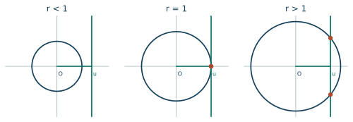
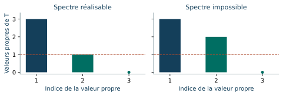

# École polytechnique — Deuxième composition de mathématiques P′ 1993 · Corrigé brut

*Corrigé rédigé par IA, non officiel. Signalez toute erreur.*

**Rédaction** · GPT-6.2 Astra Ultra · vitesse non renseignée · 26 novembre 2026

**Révision** · GPT-6.2 Astra Ultra · vitesse non renseignée · 26 novembre 2026

La donnée est une famille ordonnée $V=(v_1,\ldots,v_n)$ de vecteurs de $\mathbb R^n$, dont au moins un est non nul. On cherche toutes les bases orthonormées ordonnées $F=(f_i)_i$ et tous les projecteurs $P$ tels que $P(f_i)=v_i$. Un projecteur désigne ici un endomorphisme vérifiant $P^2=P$ et peut être oblique.

## I. Configurations de rang un ou de rang maximal

### 1. Une famille de rang maximal

Écrivons $X=\operatorname{Vect}(v_1,\ldots,v_n)$ et $d=\dim X$. Si $(F,P)$ est solution, les $P(f_i)=v_i$ engendrent $\operatorname{Im}P$. Lorsque $d=n$, $P$ est surjectif. Un idempotent fixe tout vecteur de son image, puisque $P(Py)=Py$. On a alors $P=I$ et $f_i=v_i$ pour tout $i$. Il existe donc une solution exactement quand la famille ordonnée $V$ est orthonormée, et cette solution $(V,I)$ est unique.

### 2. Le plan et une image de dimension un

Fixons un vecteur unitaire $u$ de la droite $X$ et écrivons $v_i=c_i u$. Un projecteur d’image $X$ a la forme $P(x)=\langle x,w\rangle u$ où $\langle u,w\rangle=1$. En effet toute forme linéaire a un représentant $w$ et l’idempotence revient à $P(u)=u$. Ainsi $w=u+t u_\perp$ pour un choix unitaire $u_\perp\perp u$ et un réel $t$.

Soit $c=(c_1,c_2)$, $r=\|c\|>0$. L’isométrie $Q$ qui envoie la base canonique sur $F$ vérifie $P(f_i)=v_i$ exactement quand $Q^*w=c$, soit $Qc=w$. C’est possible si et seulement si $\|w\|=r$, donc si $t^2=r^2-1$. Or $r^2=\|v_1\|^2+\|v_2\|^2$. Pour chaque $w$ admissible, l’image par $Q$ de la direction unitaire $c/r$ est fixée et il reste deux choix sur sa droite orthogonale. On compte donc **zéro** solution si $r^2<1$, **deux** si $r^2=1$, **quatre** si $r^2>1$. Chaque couple compte une base ordonnée. Un $v_i$ nul ne change pas le calcul.

### 3. Une droite image en dimension supérieure

Avec les mêmes notations, $c=(c_1,\ldots,c_n)$ et $r^2=\sum_i\|v_i\|^2$. Tout représentant d’un projecteur admissible s’écrit $w=u+z$, $z\in u^\perp$. Sa norme impose $\|z\|^2=r^2-1$. Réciproquement, pour tout $z$ satisfaisant cette équation, l’isométrie de la droite $\mathbb Rc$ sur $\mathbb R w$ envoyant $c$ sur $w$ se prolonge en un isomorphisme orthogonal $Q$. La base $F=(Qe_i)_i$ et $P(x)=\langle x,w\rangle u$ forment la solution recherchée.

La condition est donc $r\ge1$. Si $r=1$, $z=0$ et les solutions sont paramétrées, après choix de bases orthonormées dans $c^\perp$ et $u^\perp$, par $O(n-1)$. Si $r>1$, le vecteur $z/\sqrt{r^2-1}$ parcourt la sphère $S^{n-2}$ de $u^\perp$. Pour chaque point, les prolongements de $Q$ sont exactement les isométries de $c^\perp$ sur $w^\perp$, soit une copie de $O(n-1)$. Cette description ne compte deux fois aucun couple, car $P$ détermine $w$ et $F$ détermine $Q$.

## II. Matrices de Gram et isométries

### 4.a. Noyau et image

On note $A^*$ l’adjoint euclidien, noté $^{t}\!A$ sur l’énoncé. L’identité $\langle A^*Ax,x\rangle=\|Ax\|^2$ donne $\ker(A^*A)=\ker A$. Par application à $A^*$ on a $\ker(AA^*)=\ker A^*$. Or $\operatorname{Im}B=(\ker B^*)^\perp$ en dimension finie. Comme $AA^*$ est autoadjoint, il suit que $\operatorname{Im}(AA^*)=(\ker A^*)^\perp=\operatorname{Im}A$.

### 4.b. Spectres avec multiplicités

Les deux opérateurs $A^*A$ et $AA^*$ sont autoadjoints positifs, donc diagonalisables sur $\mathbb R$. Pour $\lambda>0$, $A$ envoie l’espace propre de $A^*A$ de valeur $\lambda$ dans celui de $AA^*$, car $AA^*(Ax)=A(A^*Ax)$. L’opération inverse sur ces espaces est $\lambda^{-1}A^*$. Les dimensions sont donc égales. Enfin les noyaux ont même dimension $n-\operatorname{rg}A$ d’après 4.a et l’égalité des rangs de $A,A^*$. Les spectres coïncident avec multiplicités, zéro compris lorsqu’il est présent.

### 5.a. Factorisation orthogonale à droite

Supposons $AA^*=BB^*$. Pour tout $y$, $\|A^*y\|^2=\langle AA^*y,y\rangle=\|B^*y\|^2$. Par suite la formule
$$
 R(B^*y)=A^*y
$$
définit une application linéaire sur $\operatorname{Im}B^*$. En effet $B^*y=B^*z$ impose $A^*(y-z)=0$. Elle conserve les normes et a pour image $\operatorname{Im}A^*$. Prolongeons cette isométrie des images à tout l’espace en choisissant des bases orthonormées de leurs orthogonaux, de même dimension. Notons le prolongement $U^*$. Alors $U$ est orthogonal et $U^* B^*=A^*$. Par passage à l’adjoint, $A=BU$.

### 5.b. Tous les facteurs et unicité

Pour tout tel $U$, l’action de $U^*$ sur $\operatorname{Im}B^*$ est imposée par $R$. Sur $(\operatorname{Im}B^*)^\perp=\ker B$, elle peut être n’importe quelle isométrie sur $(\operatorname{Im}A^*)^\perp=\ker A$. Chacun de ces choix convient par le calcul précédent. Si $r=\operatorname{rg}A=\operatorname{rg}B$, l’ensemble est donc paramétré par $O(n-r)$ après choix de repères. Il y a unicité exactement si $r=n$. Dès que les noyaux ont dimension positive, la composition d’une isométrie donnée avec une réflexion du noyau en fournit une deuxième.

## III. Critère spectral et ensemble des solutions

### 6. L’opérateur attaché à la famille

Soit $E=(e_i)$ une base orthonormée et $A=A_{V,E}$ l’application $e_i\mapsto v_i$. Puisque $\langle A^*x,e_i\rangle=\langle x,v_i\rangle$, on a
$$
 T_Vx=AA^*x=\sum_{i=1}^n\langle x,v_i\rangle v_i .
$$
Le membre droit est indépendant de $E$. De plus, $T_V$ est autoadjoint positif, son image est $X$ par 4.a, et son noyau est $X^\perp$. Sa restriction $T_X$ à $X$ est donc définie positive.

### 7. Réduction à un projecteur

Si $(F,P)$ est solution, alors $A_{V,F}=P$ et 6 donne $T_V=PP^*$. Réciproquement, supposons qu’un idempotent $P$ vérifie cette égalité. Avec une base orthonormée de référence $E$, on a $A_{V,E}A_{V,E}^*=PP^*$. La question 5.a fournit un orthogonal $U$ tel que $A_{V,E}=PU$. Alors $f_i=Ue_i$ constituent une base orthonormée avec $P(f_i)=A_{V,E}e_i=v_i$. L’équivalence est établie dans les deux sens.

### 8. Le critère de rang un retrouvé

Si $v_i=c_i u$ comme en 3, $T_Vx=r^2\langle x,u\rangle u$ avec $r^2=\sum_i c_i^2$. Un idempotent $P$ tel que $PP^*=T_V$ a nécessairement pour image $\operatorname{Im}(PP^*)=X$. Écrivons $Px=\langle x,w\rangle u$ avec $\langle u,w\rangle=1$. On calcule $PP^*x=\|w\|^2\langle x,u\rangle u$. L’équation demande $\|w\|=r$ et $\langle w,u\rangle=1$, donc $r\ge1$. Pour $n>1$, si $r\ge1$, tout $w=u+z$ avec $z\perp u$ et $\|z\|=\sqrt{r^2-1}$ convient. On retrouve exactement le premier résultat de 3.

### 9.a. Condition nécessaire et suffisante

Posons $Y=X^\perp$, $d=\dim X$ et $m=n-d$. Par 4.a, $\operatorname{Im}P=X$ pour tout candidat. Comme $P$ fixe son image, dans la décomposition orthogonale $X\oplus Y$, il s’écrit
$$
 P=\begin{pmatrix}I_X&C\\0&0\end{pmatrix},\qquad
 PP^*=\begin{pmatrix}I_X+CC^*&0\\0&0\end{pmatrix},
$$
avec $C:Y\to X$ arbitraire. Toute matrice de la première forme est bien idempotente. Il faut et il suffit donc de réaliser $H=T_X-I_X$ comme $CC^*$. Nécessairement $H$ est positif et de rang au plus $m$.

Réciproquement, supposons ces deux conditions. Posons $L=\operatorname{Im}H$ et choisissons une isométrie $J:L\to Y$, possible car $\dim L\le m$. La racine positive $H^{1/2}$ a pour image $L$. En posant $C^*=JH^{1/2}$, on obtient
$$
 \langle CC^*x,x'\rangle=\langle H^{1/2}x,H^{1/2}x'\rangle=\langle Hx,x'\rangle
$$
pour tous $x,x'\in X$. Ainsi $CC^*=H$ et 7 conclut. En termes de spectre, **toute valeur propre non nulle de $T_V$ doit être au moins $1$, et la somme des multiplicités de celles strictement supérieures à $1$ doit être au plus $n-d$**. Le nombre $n-d$ est aussi la multiplicité de zéro. Ces deux conditions sont suffisantes.

### 9.b. Paramétrisation de tous les couples

Pour chaque injection isométrique $J:L\to Y$, prenons $C^*=JH^{1/2}$ et le projecteur $P$ de 9.a. Cette liste épuise les projecteurs. En effet, si $CC^*=H$, alors $C^*$ s’annule sur $\ker H$. Pour $z=H^{1/2}x\in L$ la règle $Jz=C^*x$ est donc bien définie et $\|Jz\|^2=\langle Hx,x\rangle=\|z\|^2$. Ce $J$ est unique et redonne $C$.

Pour chaque $P$ de la liste, fixons la même base $E$ et $A=A_{V,E}$. Construisons $U^*$ sur $\operatorname{Im}P^*$ par $U^*(P^*y)=A^*y$, puis prolongeons-le par une isométrie arbitraire de $\ker P$ sur $\ker A$. Les bases $F=(Ue_i)_i$ sont, d’après 5.b et 7, exactement celles qui conviennent à ce $P$. Les deux degrés de liberté sont ainsi séparés. Si $H=0$, son image est nulle et $P$ est la projection orthogonale sur $X$, mais les bases possibles gardent en général une liberté $O(n-d)$. Si $d=n$, on retrouve l’unicité de 1 lorsque le critère est rempli.

## Documents de la session

La garde et les subdivisions sont celles de l’option P′. Les deux exemplaires reproduisent les mêmes feuillets. [Fac-similé UPS](https://prepas.org/index.php?module=Sujets&voir=get&file=doc-616087cdef9af4971a77) · [Second exemplaire](https://www.sujetsetcorriges.fr/dl/X/Maths/PC/sec-x-1993-maths2-PC.pdf) · [Instruction du 25 janvier 1993](https://www.legifrance.gouv.fr/jorf/id/JORFTEXT000000345466)
