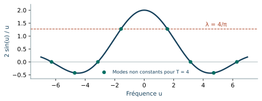
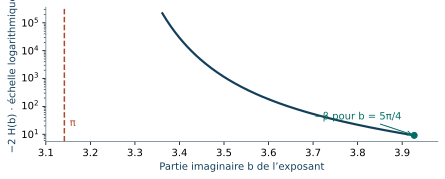

# École polytechnique — Première composition de mathématiques P′ 1993 · Corrigé guidé

*Corrigé rédigé par IA, non officiel. Signalez toute erreur.*

**Rédaction** · GPT-6.2 Astra Ultra · vitesse non renseignée · 26 novembre 2026

**Révision** · GPT-6.2 Astra Ultra · vitesse non renseignée · 26 novembre 2026

L’équation étudiée est $f(x+1)-f(x-1)=\lambda f'(x)$ pour un paramètre complexe non nul et une fonction $f\in C^1(\mathbb R,\mathbb C)$. On note $E_\lambda$ l’espace de ses solutions. La moyenne $J$ permet de distinguer les cas où les dérivées sont bornées. Les exponentielles relient les parties I et IV.

## I. Translations, polynômes et périodicité

### 1.a. Régularité

> [!INDICATION]
> Si $f$ possède déjà $j$ dérivées continues, de quelle classe est $x\mapsto f(x+1)-f(x-1)$ ? Utilise ensuite l’équation pour gagner une dérivée, en gardant en vue l’hypothèse $\lambda\ne0$.

Fixons $\lambda\in\mathbb C\setminus\{0\}$ et $\Delta f(x)=f(x+1)-f(x-1)$. Si $f\in E_\lambda$, alors $f'=\lambda^{-1}\Delta f$. Lorsque $f$ est de classe $C^j$, le second membre est de classe $C^j$ car il est combinaison de translatées de $f$. La fonction $f$ est donc de classe $C^{j+1}$. En partant de $j=1$, la récurrence donne $f\in C^\infty(\mathbb R)$.

### 1.b. Dérivées successives

> [!INDICATION]
> Écris d’abord $\Delta^2f$ sans développer de dérivée. Les extrémités sont décalées de deux, tandis que le centre intervient deux fois. C’est le binôme de deux opérateurs qui commute terme à terme avec la dérivation.

La dérivation commute aux translations, donc à $\Delta$. Il vient $f^{(n)}=\lambda^{-n}\Delta^nf$ pour tout $n\ge0$. Les deux opérateurs $f(x)\mapsto f(x+1)$ et $f(x)\mapsto f(x-1)$ commutent. Leur binôme donne explicitement
$$
 f^{(n)}(x)=\frac1{\lambda^n}\sum_{j=0}^n(-1)^j\binom nj f(x+n-2j).
$$
Pour $n=1$ on retrouve les deux décalages de l’énoncé. Pour $n=2$ les déplacements sont $2,0,-2$ et les coefficients $1,-2,1$.

### 1.c. Développement en série entière

> [!INDICATION]
> La formule de 1.b donne un majorant uniforme en $x$. Compare ensuite le reste de Taylor à une puissance divisée par une factorielle. Un rayon de convergence infini ne suffirait pas, à lui seul, à garantir l’égalité avec $f$.

Notons $M=\sup_{\mathbb R}|f|<\infty$. La somme des valeurs absolues des coefficients binomiaux vaut $2^n$. Ainsi $\|f^{(n)}\|_\infty\le M(2/|\lambda|)^n$. Pour tous $a,x\in\mathbb R$, le reste intégral de Taylor après l’ordre $n$ a pour module au plus
$$
 M\frac{(2|x-a|/|\lambda|)^{n+1}}{(n+1)!}.
$$
Ce majorant tend vers zéro. La série de Taylor en $a$ représente $f$ sur tout $\mathbb R$ et ses coefficients définissent même une série entière de rayon infini.

### 2. Solutions polynomiales

> [!INDICATION]
> Compare successivement le terme de plus haut degré puis, pour $\lambda=2$, celui de plus haut degré qui reste. Les dérivées d’ordres pairs disparaissent lorsque tu soustrais les deux translations.

Pour un polynôme $P$, le développement de Taylor est fini et donne
$$
 \Delta P=2P'+\frac{2}{3!}P^{(3)}+\frac{2}{5!}P^{(5)}+\cdots .
$$
Si $P$ est non constant, $P'$ porte seul le terme de degré $\deg P-1$ à droite. L’égalité $\Delta P=\lambda P'$ impose $\lambda=2$. Pour cette valeur, si $\deg P\ge3$, $P^{(3)}$ porte seul le premier terme restant et ne peut s’annuler dans la somme. Les solutions polynomiales sont donc les constantes pour $\lambda\ne2$, et tous les polynômes de degré au plus deux pour $\lambda=2$. La substitution vérifie les deux réciproques.

### 3. Solutions périodiques

> [!INDICATION]
> Teste d’abord $e^{ij\omega x}$. Pour montrer que tu as toutes les solutions, refais le calcul sur les coefficients d’une fonction périodique arbitraire. Traite le coefficient d’indice zéro avant toute division.

Posons $\omega=2\pi/T$. Sur le coefficient de Fourier $c_j$ d’une solution $T$-périodique, les translations agissent par $e^{\pm ij\omega}$, et la dérivation par $ij\omega$ (intégration par parties). Le mode constant est libre. Pour $j\ne0$ on a
$$
 \bigl(2\sin(j\omega)-\lambda j\omega\bigr)c_j=0.
$$
Un mode non constant exige $\lambda=2\sin(j\omega)/(j\omega)$, donc $|j|\le2/(|\lambda|\omega)$. Il y a un nombre fini de tels indices. En leur retranchant le polynôme trigonométrique portant ces coefficients, on obtient une fonction continue dont tous les coefficients sont nuls, donc nulle par unicité des coefficients de Fourier. Réciproquement chacun des modes permis est solution.

La dimension complexe est $1+2\#\{j\ge1:2\sin(j\omega)=\lambda j\omega\}$. Elle vaut un si $\lambda$ n’est pas réel ou si $|\lambda|\ge2$, puisque $|\sin u|<|u|$ pour tout réel $u\ne0$.

**Contrôle.** Lorsque $T=4$ et $\lambda=4/\pi$, les deux indices non nuls admissibles sont $j=\pm1$. En effet $\omega=\pi/2$ et la borne sur $|j|$ vaut exactement un. Les deux exponentielles et la constante fournissent donc trois directions indépendantes.

## II. Une moyenne glissante

### 4.a. Gain de régularité

> [!INDICATION]
> La borne mobile de l’intégrale procure une dérivée. Pour prouver que le gain est optimal, place une singularité de la dérivée d’ordre $k+1$ près d’une seule des deux bornes. Une fonction périodique pourrait au contraire faire disparaître la singularité par compensation.

Pour $f\in C^k(\mathbb R)$, écrivons $Jf(x)=\tfrac12\int_{x-1}^{x+1}f(u)\,du$. Une primitive de $f$ est de classe $C^{k+1}$. Donc $Jf\in C^{k+1}$ et l’inclusion demandée vaut pour tout entier $0\le k'\le k+1$.

Ce gain est optimal. Prenons une fonction lisse $\chi$ égale à un près de $1$ et nulle hors de $(1/2,3/2)$. La fonction $f(t)=\chi(t)(t-1)_+^{\,k+1}$ est $C^k$, avec $u_+=\max(u,0)$. Pour $x$ proche de zéro, $(Jf)'(x)=x_+^{\,k+1}/2$, qui n’est pas $C^{k+1}$ en zéro, puisque sa dérivée d’ordre $k+1$ a deux limites différentes. L’inclusion échoue pour $k'\ge k+2$.

### 4.b. Dérivée et moyenne

> [!INDICATION]
> Compare l’intégrale de $f'$ entre $x-1$ et $x+1$ à la dérivée de l’intégrale de $f$ entre les mêmes bornes. Veille au facteur deux dans la définition de la moyenne.

Par le théorème fondamental de l’analyse, pour $f\in C^1$,
$$
 2Jf'(x)=\int_{x-1}^{x+1}f'(t)\,dt=\Delta f(x)=2(Jf)'(x).
$$
Ainsi $f\in E_{2\mu}$ équivaut à $Jf'=\mu f'$.

### 5.a. Valeurs propres sur les fonctions bornées

> [!INDICATION]
> Une moyenne de valeurs dont les modules sont tous au plus $M$ reste dans le disque de rayon $M$. Cet argument porte sur le supremum, même quand il n’est atteint nulle part.

Pour toute fonction continue bornée, l’inégalité triangulaire appliquée à la moyenne donne $\|Jf\|_\infty\le\|f\|_\infty$. Si $Jf=\mu f$ et $|\mu|>1$, il vient $|\mu|\|f\|_\infty\le\|f\|_\infty$, d’où $\|f\|_\infty=0$. La fonction nulle convient.

### 5.b. Dérivée bornée

> [!INDICATION]
> L’hypothèse de bornitude porte sur $f'$. Repère donc d’abord quelle fonction est vecteur propre de $J$, puis réintègre le résultat de 5.a.

Pour $f\in E_{2\mu}$, la dérivée $f'$ vérifie $Jf'=\mu f'$ d’après 4.b. Si $|\mu|>1$ et $f'$ est bornée, 5.a impose $f'=0$. Les constantes, qui ont toutes une dérivée bornée, sont exactement les solutions cherchées.

### 5.c. Exponentielles réelles

> [!INDICATION]
> Avec un exposant réel non nul, l’équation se simplifie après division par $e^{Kx}$. Étudie le quotient sur la demi-droite positive et utilise ensuite sa symétrie pour obtenir la deuxième exponentielle.

La substitution $f(x)=e^{Kx}$ donne $\sinh K=\mu K$. Sur $K>0$, la fonction $K\mapsto\sinh K/K$ croît strictement de $1$ à $+\infty$. En effet, le numérateur $K\cosh K-\sinh K$ de sa dérivée s’annule en zéro et a pour dérivée $K\sinh K>0$. À chaque réel $\mu>1$ correspond donc un unique $K_0>0$, puis, par parité du quotient, les deux solutions $e^{K_0x}$ et $e^{-K_0x}$. Aucune des deux n’a de dérivée bornée sur $\mathbb R$.

## III. Fonctions bornées invariantes par moyenne

### 6.a. Moyenne d’un carré

> [!INDICATION]
> Écris chaque valeur de $h$ comme une moyenne, soustrais et applique Cauchy-Schwarz à la différence et à la fonction égale à un. La mesure $dt/2$ simplifie le coefficient.

Soit $h$ continue bornée avec $Jh=h$. Pour $u,v\in\mathbb R$, posons $D(t)=h(u+t)-h(v+t)$ et $dm(t)=dt/2$ sur $[-1,1]$. Comme $m$ a masse un, l’invariance et Cauchy-Schwarz donnent
$$
 |h(u)-h(v)|^2=\left|\int D\,dm\right|^2\le\int |D|^2\,dm .
$$
L’argument reste valable pour $h$ complexe.

### 6.b. Première comparaison

> [!INDICATION]
> Dans le résultat précédent, fixe $v=x$ et déplace $u$ de $s$. Après la seconde moyenne, permute les deux variables pour reconnaître $Ju_0(x)$.

Avec $u=x+s$ et $v=x$, intégrons 6.a en $s$ contre $dm(s)$. Le membre gauche vaut $u_0(x)$. Dans le membre droit, les intégrales portent sur un carré compact et l’intégrande est continue. Après permutation, l’intégrale en $s$ vaut $u_0(x+t)$. L’intégrale extérieure donne $Ju_0(x)=u_1(x)$. Ainsi $u_0\le u_1$.

### 6.c. Croissance

> [!INDICATION]
> Soustrais deux termes consécutifs et observe que la différence suivante est la moyenne glissante de la précédente. Une moyenne positive conserve le signe.

La moyenne $J$ préserve l’ordre des fonctions réelles. Chaque $u_n$ est réelle et positive ou nulle. En appliquant $J$ à $u_0\le u_1$, puis en itérant, on obtient pour tout $n\ge0$ et tout $x$, $0\le u_n(x)\le u_{n+1}(x)$.

### 6.d. Identité de variance

> [!INDICATION]
> Développe $|a-b|^2=|a|^2-2\operatorname{Re}(a\overline b)+|b|^2$. Le terme $b=h(x)$ est fixe dans l’intégrale et la moyenne de $a$ vaut également $h(x)$.

À $x$ fixé, développons le carré dans $u_0(x)$. Le terme croisé moyenné est $-2\operatorname{Re}(\overline{h(x)}\,Jh(x))=-2|h(x)|^2$. Il en résulte exactement
$$
 u_0(x)=J(|h|^2)(x)-|h(x)|^2.
$$

### 6.e. Somme télescopique

> [!INDICATION]
> Écris les trois premiers termes avec $g=|h|^2$. Les termes intérieurs s’annulent dans la somme. Vérifie ensuite que le dernier terme restant est uniformément majoré.

Appliquons $J^n$ à l’identité précédente. Avec $g=|h|^2$,
$$
 u_n=J^{n+1}g-J^ng,\qquad
 \sum_{n=0}^N u_n(x)=J^{N+1}g(x)-g(x).
$$
Les moyennes itérées de $g$ sont comprises entre zéro et $\|h\|_\infty^2$. La somme partielle, croissante puisque ses termes sont positifs ou nuls, est majorée par $\|h\|_\infty^2-g(x)$. Elle converge pour chaque $x$.

### 6.f. Conclusion

> [!INDICATION]
> Un terme général convergeant vers zéro peut-il rester positif à un rang si toute la suite est croissante ? Convertis la nullité de l’intégrale en nullité de l’intégrande à l’aide de sa continuité.

Le terme général de cette série convergente tend vers zéro. Or la suite $u_n(x)$ est croissante et positive ou nulle. Donc $u_0(x)=0$ pour tout $x$. L’intégrande continue et positive ou nulle de $u_0(x)$ est alors nulle sur l’intervalle entier. Il vient $h(x+t)=h(x)$ pour $|t|\le1$. En joignant deux réels quelconques par un nombre fini de pas de taille au plus un, on voit que $h$ est constante. Toute constante est bien fixée par la moyenne.

**Pour vérifier le raisonnement.** Une suite positive dont la série converge peut être non nulle. Ce qui l’interdit ici est la croissance des termes eux-mêmes. Si $u_0(x)>0$, les sommes partielles dépassent $(N+1)u_0(x)$.

### 7. Une dérivée bornée d’ordre quelconque

> [!INDICATION]
> Commence par $p=0$ et distingue une fonction fixe de $J$ de sa primitive. Pour un $p$ quelconque, c’est $f^{(p+1)}$ qui est toujours fixe. Déduis sa bornitude de celle de $f^{(p)}$ en utilisant la relation aux translations.

Soit $f\in E_2$. D’après 4.b, $Jf'=f'$. La moyenne commute avec la dérivation des fonctions lisses, donc $Jf^{(p+1)}=f^{(p+1)}$ pour tout $p\ge0$. Si $f^{(p)}$ est bornée, alors $f^{(p+1)}=\Delta f^{(p)}/2$ est bornée. La question 6 impose que $f^{(p+1)}$ soit constante. Ainsi $f^{(p)}$ est affine et bornée sur la droite, donc constante. Par intégrations successives, $f$ est un polynôme de degré au plus $p$.

D’après la question 2, on obtient exactement les polynômes de degré au plus $\min(p,2)$. Pour $p=0$, ce sont les constantes. Pour $p=1$, toutes les fonctions affines. Pour $p\ge2$, tous les polynômes de degré au plus deux. Dans chaque cas la dérivée demandée est bien bornée.

## IV. Exposants complexes

### 8.a. Parties réelle et imaginaire

> [!INDICATION]
> Multiplie par le conjugué de $z$ seulement après avoir séparé les parties de $\sinh(a+ib)$. Réserve $z=0$ pour la fin.

Pour $z=a+ib\ne0$, $\sinh z=\sinh a\cos b+i\cosh a\sin b$. La multiplication du quotient par $(a-ib)/(a-ib)$ donne
$$
 \operatorname{Re}g(z)=\frac{a\sinh a\cos b+b\cosh a\sin b}{a^2+b^2},
 \qquad
 \operatorname{Im}g(z)=\frac{a\cosh a\sin b-b\sinh a\cos b}{a^2+b^2}.
$$
À l’origine les valeurs sont respectivement $1$ et $0$.

### 8.b. Monotonie de la fonction auxiliaire

> [!INDICATION]
> Dérive $\tanh(a)/a$ et multiplie par un facteur strictement positif pour ne conserver que le signe. La quantité $\sinh(a)\cosh(a)-a$ se traite par une seconde dérivation.

Pour $a>0$, le signe de $\varphi'(a)$ est celui de $a-\sinh a\cosh a$, après multiplication par $a^2\cosh^2a>0$. Or $\sinh a\cosh a-a$ s’annule en zéro et a pour dérivée $2\sinh^2a>0$ sur $]0,\infty[$. Donc $\varphi$ est strictement décroissante. Elle tend vers $1$ en zéro et vers zéro à l’infini. Son prolongement $\varphi(0)=1$ en fait une bijection de $[0,\infty[$ sur $]0,1]$.

### 8.c. Précision sur la réciproque

> [!INDICATION]
> Remplace $x$ par $\varphi(a)$ avant de soustraire. L’écriture de $\coth a$ avec des exponentielles permet de déterminer la limite d’une différence de deux termes qui divergent.

Quand $x\to0^+$, $a=\psi(x)\to+\infty$. Puisque $1/x=a/\tanh a$, on a
$$
 \psi(x)-\frac1x=a(1-\coth a)=-\frac{2a}{e^{2a}-1}\longrightarrow0 .
$$
Ce calcul contrôle une différence, exigence plus forte que le seul équivalent $\psi(x)\sim1/x$.

### 8.d. Une branche au voisinage de pi

> [!INDICATION]
> Écris $b=\pi+t$ avec $t>0$. Estime séparément $\tan b/b$, l’argument de $\cosh$, et le signe de $\sin b/b$. Une borne exponentielle donne le sens de la divergence.

Pour $\pi<b\le5\pi/4$, on a $0<\tan b/b<1$. La fonction demandée
$$
 H(b)=\cosh\!\left(\psi\!\left(\frac{\tan b}{b}\right)\right)\frac{\sin b}{b}
$$
est donc définie et continue sur cet intervalle. Écrivons $b=\pi+t$, $t\downarrow0$. On a $q=\tan b/b\sim t/\pi$, puis $\psi(q)=1/q+o(1)\sim\pi/t$. En particulier $\psi(q)\ge\pi/(2t)$ pour $t$ assez petit. Or $\sin b/b\sim-t/\pi$ et $t\exp(\pi/(2t))\to+\infty$. On conclut que $H(b)\to-\infty$.

### 8.e. Réaliser une demi-droite de paramètres

> [!INDICATION]
> Annule d’abord la partie imaginaire de $g(a+ib)$. Une fois $g$ réel, compare les parties imaginaires de $\sinh(a+ib)=g(a+ib)(a+ib)$ pour retrouver exactement la fonction de 8.d.

Posons $a=\psi(\tan b/b)>0$ sur l’intervalle de 8.d. La relation $\tanh a/a=\tan b/b$ équivaut ici à $a\cosh a\sin b=b\sinh a\cos b$. Par 8.a, $g(a+ib)$ est donc réel. En comparant les parties imaginaires de $\sinh(a+ib)=g(a+ib)(a+ib)$, on obtient $g(a+ib)=\cosh a\sin b/b=H(b)$.

Fixons $\beta=2H(5\pi/4)<0$. La continuité et la limite précédente permettent, pour tout $\lambda\le\beta$, de trouver $b\in]\pi,5\pi/4]$ tel que $2H(b)=\lambda$. L’exposant $K=a+ib$ est non nul. Puisque $2\sinh K=\lambda K$, la fonction $x\mapsto e^{Kx}$ appartient à $E_\lambda$. Cet argument requiert seulement le théorème des valeurs intermédiaires, même si plusieurs exposants conviennent.

**Vérification sur un paramètre.** En prenant $b=5\pi/4$, on obtient $\tan b/b=4/(5\pi)$, qui est dans $]0,1[$. La partie réelle $a$ est strictement positive et $\sin b<0$, ce qui vérifie le signe de $\beta$.

## Documents de la session

La garde et les subdivisions sont celles de l’option P′. Les deux exemplaires reproduisent les mêmes feuillets. [Fac-similé UPS](https://prepas.org/index.php?module=Sujets&voir=get&file=doc-0f1cf13ecf7ab7862891) · [Second exemplaire](https://www.sujetsetcorriges.fr/dl/X/Maths/PC/sec-x-1993-maths1-PC.pdf) · [Instruction du 25 janvier 1993](https://www.legifrance.gouv.fr/jorf/id/JORFTEXT000000345466)
