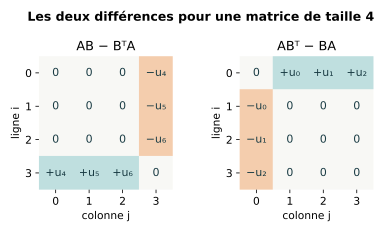
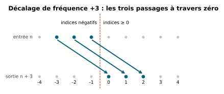

# École polytechnique — Deuxième composition de mathématiques · Option M′ 1994 · Corrigé brut

*Corrigé rédigé par IA, non officiel. Signalez toute erreur.*

**Rédaction** · GPT-6.2 Astra Ultra · vitesse non renseignée

Le sujet utilise d’abord une matrice carrée, puis les suites de carré sommable indexées par $\mathbb N$ et enfin par $\mathbb Z$. Dans les dernières parties, $E'$ est le sous-espace des suites à support fini. Le produit scalaire est antilinéaire dans la première variable. Les coefficients de Fourier sont des intégrales sans facteur $1/(2\pi)$.

Concours d’admission 1994, option M′, quatre heures. [Fac-similé de l’UPS](https://prepas.org/index.php?module=Sujets&voir=get&file=doc-9be802a81b9f7dfb8e20) · [Second exemplaire](https://www.sujetsetcorriges.fr/dl/X/Maths/MP/sec-x-1994-maths2-MP.pdf)

## I. Matrices de Hankel en dimension finie

### Question 1

En numérotant ici lignes et colonnes de $0$ à $k-1$, on obtient $(A_u)_{ij}=u_{i+j}$. La première ligne est $(u_0,\ldots,u_{k-1})$, la dernière $(u_{k-1},\ldots,u_{2k-2})$. La matrice est symétrique pour la transposition ordinaire, même lorsque ses coefficients sont complexes.

### Question 2.a

Si $k=1$, le rang vaut un exactement lorsque $u_0\ne0$. Supposons $k\ge2$. Si $u_0=c\ne0$ et le rang vaut un, l’annulation des mineurs contenant ce pivot impose
$$u_{i+j}=u_i u_j/c\qquad(0\le i,j<k).$$
Avec $q=u_1/c$, cela donne d’abord $u_i=cq^i$ pour $0\le i<k$ en prenant $j=1$, puis pour toutes les sommes $i+j$ jusqu’à $2k-2$. Réciproquement $A_u=c v v^{\mathsf T}$, $v=(1,q,\ldots,q^{k-1})^{\mathsf T}$, est de rang un.

Si $u_0=0$ mais $u$ est non nulle, soit $r$ l’indice du premier terme non nul. Pour $1\le r\le2k-3$, on peut écrire $r-1=i+j$ avec $0\le i,j\le k-2$. Le mineur des lignes $i,i+1$ et des colonnes $j,j+1$ vaut $u_{r-1}u_{r+1}-u_r^2=-u_r^2\ne0$. Il reste donc seulement $r=2k-2$. Ce cas donne effectivement une matrice ayant un seul coefficient non nul, dans son coin inférieur droit.

### Question 2.b

Dans le cas géométrique, en notant $x_j$ la coordonnée de rang $j$ pour $0\le j<k$, le noyau est l’hyperplan $\sum_{j=0}^{k-1}q^j x_j=0$. La somme demandée vaut
$$\sum_{n=0}^{2k-2}u_n z^n=
\begin{cases}c(1-(qz)^{2k-1})/(1-qz),&qz\ne1,\\ c(2k-1),&qz=1.\end{cases}$$
Dans le cas du seul terme final non nul, le noyau est $x_{k-1}=0$ et la somme vaut $u_{2k-2}z^{2k-2}$. Pour $k=1$, le noyau est nul et la somme vaut $u_0$.

### Question 3.a

Toujours en indices $0,\ldots,k-1$, $(A_u B)_{ij}=u_{i+j+1}$ si $j<k-1$ et vaut zéro sinon. En revanche $(B^{\mathsf T}A_u)_{ij}=u_{i+j+1}$ si $i<k-1$ et vaut zéro sinon. Dans $A_u B-B^{\mathsf T}A_u$, les seules positions potentiellement non nulles sont
$$(k-1,j):u_{k+j}\quad(0\le j<k-1),\qquad
(i,k-1):-u_{k+i}\quad(0\le i<k-1).$$
De même $(A_uB^{\mathsf T})_{ij}$ vaut $u_{i+j-1}$ pour $j>0$, et $(BA_u)_{ij}$ vaut $u_{i+j-1}$ pour $i>0$, chaque coefficient étant nul hors de son domaine. Dans $A_uB^{\mathsf T}-BA_u$ il reste donc
$$(0,j):u_{j-1}\quad(1\le j<k),\qquad (i,0):-u_{i-1}\quad(1\le i<k).$$
Les autres coefficients, y compris le coin commun de chaque paire de bords, sont nuls.

### Question 3.b

Si $u_k,\ldots,u_{2k-2}$ sont nuls, $B^{\mathsf T}A_u=A_uB$, d’où $S^*(H_u x)=H_u(Sx)\in\operatorname{Im}H_u$. Si $u_0,\ldots,u_{k-2}$ sont nuls, l’autre identité donne $H_u(S^*x)=S(H_u x)=0$ pour $x\in\ker H_u$. C’est la stabilité annoncée dans chacun des deux cas.

## II. Suites unilatérales et rang fini

### Question 4

Ici $E=\ell^2(\mathbb N)$ et $E'$ désigne les suites à support fini. La colonne $H_u e_j=(u_{j+p})_{p\ge0}$ appartient à $E$ par sommabilité de $u$. Pour $x,y\in E'$,
$$\Phi_u(x,y)=\sum_{p,j\ge0} u_{p+j}x_p y_j,\qquad Q_u(x)=\Phi_u(x,x).$$
La somme est finie et symétrique. On a $A_1\le A_2\le A_3$ par inclusion du cas diagonal puis par Cauchy–Schwarz. Pour $A_1<\infty$, l’identité $4\Phi_u(x,y)=Q_u(x+y)-Q_u(x-y)$ et celle du parallélogramme donnent
$$4|\Phi_u(x,y)|\le A_1(\|x+y\|^2+\|x-y\|^2)\le4A_1$$
sur les deux boules unités. Ainsi $A_2\le A_1$ également, l’inégalité étant immédiate pour $A_1=+\infty$. Enfin, pour $y$ fixé dans $B'$, prenons pour $x$ le conjugué de la troncature aux $N$ premiers termes de $H_uy$, divisé par sa norme lorsque celle-ci est non nulle. La valeur de $|\Phi_u(x,y)|$ est cette norme tronquée. Elle tend vers $\|H_u y\|$. Donc $A_3\le A_2$. Les trois valeurs sont égales, y compris lorsqu’elles sont infinies.

### Question 5

Pour $u_n=\widehat f(n)=\int_0^{2\pi} f(\theta)e^{-in\theta}\,d\theta$, l’inégalité de Bessel pour $e^{in\theta}/\sqrt{2\pi}$ donne $\sum_{n\ge0}|u_n|^2\le2\pi\int|f|^2$. Ainsi $u\in E$ et les colonnes définissent bien $H_u$. Pour $x,y\in E'$ posons $X(\theta)=\sum x_p e^{-ip\theta}$ et de même $Y$. Alors
$$\Phi_u(x,y)=\int_0^{2\pi} f(\theta)X(\theta)Y(\theta)\,d\theta.$$
Par orthogonalité $\int|X|^2=2\pi\|x\|^2$, et de même pour $Y$. Cauchy–Schwarz sous l’intégrale donne $A_3=A_2\le 2\pi\|f\|_\infty$. La constante est atteinte pour $f=1$, en prenant $x=y=e_0$.

### Question 6

Si $1<r<R$ où $R$ est le rayon de convergence, $(|u_n|r^n)$ est bornée. Donc $C^2=\sum_{n\ge0}(n+1)|u_n|^2<\infty$. Par Cauchy–Schwarz dans chaque ligne,
$$\|H_u x\|^2\le\|x\|^2\sum_{p,j\ge0}|u_{p+j}|^2=C^2\|x\|^2.$$
Chaque $u_n$ intervient sur les $n+1$ couples $p+j=n$. L’application est bien bornée sur $B'$.

### Question 7.a

Le rang un impose $u\ne0$, et la première colonne est $u$. La suivante est alors $qu$ pour un complexe $q$, donc $u_{n+1}=q u_n$ pour tout $n\ge0$. Comme $u\in\ell^2$ est non nulle, nécessairement $u_n=cq^n$ avec $c\ne0$ et $|q|<1$. Réciproquement, pour une telle suite la colonne $j$ vaut $q^ju$, et la première est non nulle. Le rang vaut bien un.

### Question 7.b

Écrivons $v=(q^p)_{p\ge0}$ avec $q^0=1$. On a $H_ux=c v\sum_jq^jx_j$. Ainsi $\|H_u x\|\le |c|\|v\|^2\|x\|=|c|\|x\|/(1-|q|^2)$. Les troncatures de $\bar v$ normalisées montrent même que la borne est exacte. La série vaut $c/(1-qz)$ pour $|qz|<1$, de rayon $1/|q|$ si $q\ne0$. Pour $q=0$, c’est le polynôme constant $c$, de rayon infini.

### Question 8

Écrivons $Q(z)=q_0+\cdots+q_dz^d$, avec $q_0\ne0$. L’identification dans $Q\sum_{n\ge0}u_nz^n=P$ donne
$$q_0u_n+q_1u_{n-1}+\cdots+q_du_{n-d}=0$$
pour $n\ge N=\max(d,1+\deg P)$, avec $N=d$ si $P=0$. Pour $j\ge N$ et tout $p\ge0$ on peut choisir $n=p+j$. La colonne $C_j$ satisfait donc $q_0C_j=-\sum_{t=1}^dq_t C_{j-t}$. Toutes les colonnes appartiennent par récurrence à l’espace engendré par $C_0,\ldots,C_{N-1}$. Le rang est fini. Cela inclut le cas où la série est un polynôme ou est nulle.

### Question 9

Le décalage $S^*$ supprime la première coordonnée d’une suite. Ainsi $S^*H_u e_j=(u_{j+1+p})_{p\ge0}=H_uSe_j$ et l’égalité vaut sur $E'$ par linéarité. Inversement, si $S^*T=TS$ sur $E'$, posons $u=Te_0\in E$. De $e_j=S^je_0$ on déduit $Te_j=(S^*)^ju=(u_{p+j})_{p\ge0}$. Ces colonnes déterminent $T$ sur toutes les suites à support fini.

### Question 10

L’espace $V=\operatorname{Im}H_u$ est stable par $S^*$ d’après 9. Si $r=\dim V>0$, le polynôme caractéristique $R(t)=\sum_{j=0}^ra_jt^j$ de $S^*|_V$, avec $a_r=1$, vérifie $R(S^*)H_u=0$ par Cayley–Hamilton. Appliqué à $e_0$, cela donne $\sum_{j=0}^r a_j u_{n+j}=0$ pour tout $n\ge0$. Posons $Q(z)=z^rR(1/z)$, qui est un polynôme de terme constant $1$. Dans $Q(z)\sum_{n\ge0}u_n z^n$, les coefficients de degrés $n+r$ sont nuls. Le produit est donc un polynôme $P$ de degré inférieur à $r$. La série converge au moins pour $|z|<1$ par Cauchy–Schwarz, d’où l’égalité avec $P/Q$ près de zéro. Si $r=0$, $u=0$ et l’on prend $R=Q=1$, $P=0$. C’est la réciproque de 8.

## III. Multiplication d’un polynôme trigonométrique

### Question 11

Désormais les indices parcourent $\mathbb Z$ et $u_n=\widehat f(n)$. Pour la suite finie $x$ et $g(\theta)=\sum_j x_j e^{ij\theta}$,
$$(T_f x)_p=\sum_j x_j u_{p-j}=\int_0^{2\pi} f(\theta)g(\theta)e^{-ip\theta}\,d\theta=\widehat{fg}(p).$$
Par Bessel, $\|T_fx\|^2\le2\pi\int|fg|^2\le2\pi\|f\|_\infty^2\int|g|^2=(2\pi)^2\|f\|_\infty^2\|x\|^2$. Cela prouve à la fois que la valeur appartient à $E$ et que $T_f$ est bornée sur la boule unité de $E'$.

### Question 12

Pour $f=0$, $T_f$ est de rang zéro. Sinon, par continuité $f$ ne s’annule pas sur un certain intervalle ouvert. Une relation finie $\sum_{j=0}^N c_jT_fe_j=0$ dit, par 11, que tous les coefficients de Fourier de la fonction continue $f(\theta)p(e^{i\theta})$ sont nuls, où $p(z)=\sum c_jz^j$. L’unicité de Fourier donne $fp=0$ partout. On peut la voir en approchant uniformément la conjuguée de cette fonction par des polynômes trigonométriques puis en intégrant leur produit avec elle. Ainsi $p$ s’annule sur un arc du cercle, donc est le polynôme nul. Les images des $e_j$, $j\ge0$, sont indépendantes et le rang est infini. Seule la fonction nulle donne un rang fini.

## IV. Commutateur et passage entre fréquences positives et négatives

### Question 13

Posons $d_j=1$ si $j\ge0$ et $d_j=-1$ sinon. Pour $D=2P-I$, on a $De_j=d_je_j$ et
$$\Delta_f e_n=\sum_{p\in\mathbb Z}(d_p-d_n)u_{p-n}e_p
=\begin{cases}-2\sum_{p<0}u_{p-n}e_p,&n\ge0,\\2\sum_{p\ge0}u_{p-n}e_p,&n<0.\end{cases}$$
Les coefficients restent nuls lorsque la sortie et l’entrée portent le même signe au sens de cette décomposition.

### Question 14

Pour $g_j(\theta)=e^{ij\theta}$, $u_k=2\pi$ si $k=j$ et zéro sinon. Ainsi $T_{g_j}e_n=2\pi e_{n+j}$. Si $j>0$, seuls $n=-j,\ldots,-1$ donnent une image non nulle, égale à $4\pi e_{n+j}$. L’image est engendrée par $e_0,\ldots,e_{j-1}$. Si $j<0$, seuls $n=0,\ldots,-j-1$ contribuent, avec l’image $-4\pi e_{n+j}$ et les indices de sortie $j,\ldots,-1$. Si $j=0$ le commutateur est nul. Son rang est donc $|j|$ dans tous les cas.

### Question 15

Dans 13, mettons $p=i\ge0$ et $n=-1-j$ pour le bloc montant, puis $p=-1-i$ et $n=j\ge0$ pour le bloc descendant. Les matrices obtenues, avec $i,j\ge0$, sont
$$2(u_{1+i+j})_{ij}\qquad\text{et}\qquad-2(u_{-1-i-j})_{ij}.$$
Les deux suites appartiennent à $\ell^2$ par Bessel. Les deux blocs prennent leurs entrées sur des demi-droites indépendantes et leurs sorties sur des demi-droites disjointes. Le rang de $\Delta_f$ est la somme de leurs rangs. Il vaut un exactement lorsque l’un est nul et l’autre de rang un.

D’après 7.a cela équivaut à l’existence d’un signe $s\in\{-1,1\}$, d’un complexe $c\ne0$ et d’un $q$ tel que $|q|<1$ vérifiant, pour tout $j\ge0$,
$$u_{s(1+j)}=cq^j,\qquad u_{-s(1+j)}=0.$$
Le coefficient $u_0$ est libre. La série géométrique est uniformément convergente et la normalisation de 5 impose la forme exacte
$$f(\theta)=C+\frac{c}{2\pi}\frac{e^{is\theta}}{1-qe^{is\theta}},\qquad C=u_0/(2\pi).$$
Les coefficients de cette fonction sont ceux qui précèdent, et l’unicité de Fourier établie en 12 donne la nécessité autant que la suffisance. Pour $s=1$, l’image est la droite de vecteur directeur $\sum_{i\ge0}q^i e_i$. Pour $s=-1$, elle est la droite de vecteur directeur $\sum_{i\ge0}q^ie_{-1-i}$. Dans les deux cas ces vecteurs sont de carré sommable. En particulier $q=0$ redonne les deux décalages de fréquence unitaire.
