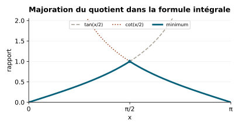
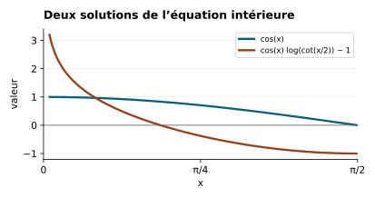

# École polytechnique — Première composition de mathématiques · Option M′ 1994 · Corrigé brut

*Corrigé rédigé par IA, non officiel. Signalez toute erreur.*

**Rédaction** · GPT-6.2 Astra Ultra · vitesse non renseignée

Soit $E_k^p$ (respectivement $E_k^i$) l’espace des fonctions réelles $C^k$, $2\pi$-périodiques et paires (respectivement impaires). Sur $\Omega=\mathbb R\setminus\pi\mathbb Z$, l’opérateur étudié s’écrit $Af=f''+f'\cot x$. La question 1 donne sa définition aux points manquants.

Concours d’admission 1994, option M′, quatre heures. [Fac-similé de l’UPS](https://prepas.org/index.php?module=Sujets&voir=get&file=doc-753d92208a5232268a19) · [Second exemplaire](https://www.sujetsetcorriges.fr/dl/X/Maths/MP/sec-x-1994-maths1-MP.pdf)

## I. Parité et primitives périodiques

### Question 1

Pour $x_0=m\pi$, la périodicité et l’imparité donnent $f(x_0+t)=-f(x_0-t)$, donc $f(x_0)=0$. Comme $t\cot(x_0+t)=t\cot t\to1$, on a
$$f(x_0+t)\cot(x_0+t)=\frac{f(x_0+t)-f(x_0)}{t}\,t\cot t\longrightarrow f'(x_0).$$
Cette valeur à chaque point manquant impose un prolongement continu unique. Le produit est pair et $2\pi$-périodique sur l’ensemble dense $\Omega$. Son prolongement conserve ces deux propriétés.

### Question 2.a

Si $f(-x)=\varepsilon f(x)$ avec $\varepsilon=\pm1$, alors $f'(-x)=-\varepsilon f'(x)$. La dérivée reste $2\pi$-périodique et est de classe $C^{k-1}$. Enfin $\int_0^{2\pi}f'(x)\,dx=f(2\pi)-f(0)=0$.

### Question 2.b

Posons $G(x)=\int_0^x g(t)\,dt$. La différence $G(x+2\pi)-G(x)$ est l’intégrale de $g$ sur une période, donc est nulle. Si $g$ est impaire, le changement $t=-s$ montre que $G$ est paire. Toutes les primitives paires de classe $C^k$ cherchées sont $G+C$ avec $C\in\mathbb R$. Si $g$ est paire, $G$ est impaire et c’est la seule primitive impaire, car une fonction impaire doit s’annuler en zéro. Pour $g=0$, on retrouve respectivement les constantes et la seule fonction nulle.

## II. L’opérateur et son inverse sur les fonctions normalisées

### Question 3.a

Pour $f\in E_2^p$, sa dérivée est dans $E_1^i$. Le prolongement de $f'\cot$ en $m\pi$ vaut $f''(m\pi)$. Ainsi $Af(m\pi)=2f''(m\pi)$.

### Question 3.b

Sur $\Omega$, la règle du produit donne
$$\sin x\,Af(x)=\sin x\, f''(x)+\cos x\,f'(x)=(\sin x\, f'(x))'.$$
Les deux extrémités de cette égalité sont continues sur $\mathbb R$, où l’identité est donc valable partout.

### Question 3.c

L’identité précédente impose $f'(x)\sin x=C$. En zéro, le produit est nul, donc $C=0$. La dérivée s’annule sur $\Omega$, puis partout par continuité. Toute constante est effectivement annulée. Le noyau est la droite des constantes.

### Question 3.d

On obtient $\int_0^\pi Af(x)\sin x\,dx=[f'(x)\sin x]_0^\pi=0$. Cette condition portera sur le second membre de l’équation $Af=h$.

### Question 4

Posons $H(x)=\int_0^x h(u)\sin u\,du$. Son intégrande est impaire et périodique. Ainsi $H$ est paire et $2\pi$-périodique. L’hypothèse $H(\pi)=0$ donne, avec $H(0)=0$, l’annulation de $H$ en tout $x_0=m\pi$. Pour $t\to0$,
$$H(x_0+t)=(-1)^m\tfrac12 h(x_0)t^2+o(t^2),\qquad \sin(x_0+t)=(-1)^m(t+o(t)).$$
Le quotient $g=H/\sin$ se prolonge par zéro en $x_0$, y est dérivable avec $g'(x_0)=h(x_0)/2$ et reste impair et périodique. Sur $\Omega$, $g'=h-g\cot$. Comme $g(x_0+t)\cot(x_0+t)\to h(x_0)/2$, cette dérivée se raccorde continûment. Nous avons donc $g\in E_1^i$.

Par 2.b, $f(x)=\int_0^x g(y)\,dy$ est dans $E_2^p$ et $f(0)=0$. C’est exactement la double intégrale proposée, le quotient dans l’intégrale étant pris avec son prolongement. L’égalité $(f'\sin)'=H'=h\sin$ donne $Af=h$ sur $\Omega$ puis partout. Deux solutions normalisées diffèrent d’une constante nulle. Notons $K h=f$ dans la suite.

### Question 5

Écrivons $h_n=Af_n$. La limite uniforme $h$ est dans $E_0^p$ et vérifie la condition de 3.d, par passage sous l’intégrale. Si $v$ satisfait à cette condition, alors pour $0<x<\pi$,
$$|(Kv)'(x)|\le \|v\|_\infty\frac{\min(1-\cos x,1+\cos x)}{\sin x}\le \|v\|_\infty.$$
En effet le numérateur de 4 s’écrit aussi $-\int_x^\pi v(u)\sin u\,du$, et le quotient majorant vaut $\min(\tan(x/2),\cot(x/2))$. Par intégration et symétrie, $\|Kv\|_\infty\le\pi\|v\|_\infty$. Or $f_n=f_n(0)+Kh_n$. Ces fonctions convergent uniformément vers $f(0)+Kh$, car $f_n(0)\to f(0)$. L’unicité de la limite simple identifie $f=f(0)+Kh$. La construction de 4 donne $f\in E_2^p$ et $Af=h$.

### Question 6

Par parité et périodicité, les extrema considérés sont aussi des extrema sur $\mathbb R$. Au maximum $f'(\xi)=0$ et $f''(\xi)\le0$. Si $\xi$ est intérieur, $Af(\xi)=f''(\xi)$, et si $\xi$ est une extrémité, $Af(\xi)=2f''(\xi)$. Donc $Af(\xi)\le0$. Le même argument appliqué à $-f$ donne $Af(\eta)\ge0$.

## III. Résolution de l’équation linéaire pour un paramètre positif

### Question 7

Au maximum, $h(\xi)\le-\mu f(\xi)$, d’où $f(\xi)\le\|h\|_\infty/\mu$. Au minimum $h(\eta)\ge-\mu f(\eta)$, donc $f(\eta)\ge-\|h\|_\infty/\mu$. Cela donne
$$\|f\|_\infty\le \mu^{-1}\|(A-\mu I)f\|_\infty.$$
Une fonction constante non nulle réalise l’égalité. On retient également que $(A-\mu I)w\le0$ entraîne $w\ge0$ en examinant son minimum.

### Question 8.a

L’identité $\cos((k+1)x)=2\cos x\cos(kx)-\cos((k-1)x)$ montre que $P_n$ est formé des $p(\cos x)$, $\deg p\le n$, les polynômes successifs ayant des degrés distincts. Pour $t=\cos x$,
$$A(p(\cos x))=(1-t^2)p''(t)-2t p'(t).$$
Ainsi $A-\mu I$ envoie $P_n$ dans $P_n$. Par 7 sa restriction est injective, donc surjective en dimension finie. Son image est $P_n$.

### Question 8.b

La fonction $t\mapsto h(\arccos t)$ est continue sur $[-1,1]$. Par le théorème de Weierstrass elle est limite uniforme de polynômes. Il existe donc des polynômes trigonométriques pairs $h_n$ tendant uniformément vers $h$ sur $\mathbb R$. Par 8.a, choisissons $f_n$ dans l’espace polynomial correspondant avec $(A-\mu I)f_n=h_n$. L’estimation 7 appliquée aux différences montre que $(f_n)$ converge uniformément vers une fonction $f$. On a $Af_n=h_n+\mu f_n\to h+\mu f$ uniformément. Par 5, $f\in E_2^p$ et $(A-\mu I)f=h$. L’unicité résulte de 7. L’argument vaut en particulier pour tout $h\in E_1^p$ demandé.

## IV. Le noyau pour la valeur résonante

### Question 9

Ici $Af=-2f$ et $f(0)=0$. Fixons $0<b<\pi/2$ et $L_b=\max_{[0,b]}|f|$. La formule de 4 donne pour $0\le x\le b$
$$|f(x)|\le 2 L_b\int_0^x\frac{1-\cos y}{\sin y}\,dy
\le 2b\tan(b/2)L_b.$$
Pour $b$ assez petit, $2b\tan(b/2)<1$. En prenant le maximum, on obtient $L_b=0$. La parité fournit l’annulation sur $[-b,b]$.

### Question 10

La fonction $f_0(x)=\cos x$ est paire, périodique, vaut $1$ en zéro et vérifie $A f_0=-2f_0$, y compris aux points singuliers par continuité.

### Question 11

Pour $f$ du noyau, $w=f-f(0)\cos$ vérifie les hypothèses de 9. En un point intérieur du voisinage d’annulation dans $(0,\pi)$, $w=w'=0$. Les coefficients de l’équation sont continus sur cet intervalle. L’unicité de Cauchy y prolonge la solution nulle jusqu’à tout point de $(0,\pi)$. Continuité, parité et périodicité donnent $w=0$ partout. Finalement $\ker(A+2I)=\mathbb R\cos$ dans $E_2^p$.

### Question 12

Sur $(0,\pi)$ l’équation est régulière, donc son espace réel de solutions est de dimension deux. Pour $-1<t<1$, posons $L(t)=\frac12\log((1+t)/(1-t))$. Outre $t$, la fonction $v(t)=tL(t)-1$ vérifie $(1-t^2)v''-2tv'+2v=0$. En effet $v'=L+t/(1-t^2)$ et $v''=2/(1-t^2)^2$. Comme $v(0)=-1$ et que la première solution s’y annule, elles sont indépendantes. Toutes les solutions sont donc
$$f(x)=c\cos x+d\bigl[\cos x\log\cot(x/2)-1\bigr],\qquad c,d\in\mathbb R.$$
Quand $x\to0^+$, $\log\cot(x/2)=\log(2/x)+o(1)$. Si $d=0$, la limite vaut $c$. Pour $d>0$ elle vaut $+\infty$, et pour $d<0$ elle vaut $-\infty$. La condition globale de régularité éliminait bien un degré de liberté.

## V. L’équation non linéaire

### Question 13.a

Écrivons $L=A-\mu I$. L’itération $L\phi_{k+1}=h e^{\phi_k}-a-\mu\phi_k$ est bien définie par 8.b car le second membre est pair, périodique et $C^1$. Comme $Lm=-\mu m$, $L(\phi_1-m)=h e^m-a\le0$. Le principe de 7 donne $\phi_1\ge m$.

### Question 13.b

On peut prendre $\mu_0=e^M\|h\|_\infty$. Pour $\mu\ge\mu_0$, $F_x(s)=h(x)e^s-a-\mu s$ est décroissante sur $[m,M]$. Comme $F_x(M)\ge-\mu M=LM$, toute itérée issue d’une fonction comprise entre $m$ et $M$ vérifie $L(\phi_{k+1}-M)\ge0$, d’où $\phi_{k+1}\le M$. Si $m\le\phi_{k-1}\le\phi_k\le M$, alors $L(\phi_{k+1}-\phi_k)=F_x(\phi_k)-F_x(\phi_{k-1})\le0$, donc $\phi_{k+1}\ge\phi_k$. Avec 13.a et la borne supérieure appliquée dès $k=0$, la récurrence établit la conclusion.

### Question 14.a

Prenons $\mu\ge\mu_0$. La limite ponctuelle $\phi$ existe entre $m$ et $M$. On a
$$A\phi_{k+1}=h e^{\phi_k}-a+\mu(\phi_{k+1}-\phi_k),$$
donc $\|A\phi_{k+1}\|_\infty\le\|h\|_\infty e^M+a+\mu(M-m)$. L’estimation de 5 pour $v=A\phi_{k+1}$ borne uniformément les dérivées, puisque $Kv=\phi_{k+1}-\phi_{k+1}(0)$. La limite ponctuelle hérite de cette même constante de Lipschitz. Sur le compact $[0,\pi]$, le théorème de Dini appliqué à la suite croissante de fonctions continues et à sa limite continue donne la convergence uniforme. Les symétries l’étendent à $\mathbb R$.

### Question 14.b

L’exponentielle est lipschitzienne sur $[m,M]$ et $\phi_{k+1}-\phi_k\to0$ uniformément. Ainsi $A\phi_{k+1}\to h e^\phi-a$ uniformément. Par 5 la limite est dans $E_2^p$ et résout (2). Les barrières demandées existent pour tout $h>0$ continu périodique, par exemple $m=\log(a/\max h)$ et $M=\log(a/\min h)$.

Soient $f,g$ deux solutions. Si $w=f-g$ avait un maximum strictement positif en $\xi$, alors $Aw(\xi)=h(\xi)(e^{f(\xi)}-e^{g(\xi)})>0$, contrairement à 6. Ainsi $f\le g$. L’échange des deux solutions donne $g\le f$ et l’unicité.
