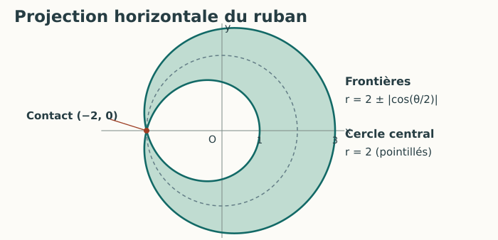
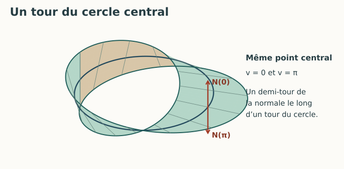

# École polytechnique — Deuxième composition de mathématiques P′ 1994 · Corrigé brut

*Corrigé rédigé par IA, non officiel. Signalez toute erreur.*

**Rédaction** · GPT-6.2 Astra Ultra · vitesse non renseignée

[Fac-similé UPS](https://prepas.org/index.php?module=Sujets&voir=get&file=doc-c07bd83ef9730e83db92) · [Second exemplaire](https://www.sujetsetcorriges.fr/dl/X/Maths/PC/sec-x-1994-maths2-PC.pdf) · [Instruction du concours de 1994](https://www.legifrance.gouv.fr/jorf/id/JORFTEXT000000180352)

Écrivons $s=\sin u$, $c=\cos u$, $E=(\cos 2v,\sin 2v,0)$, $H=(-\sin 2v,\cos 2v,0)$ et $K=e_3$. La base $(E,H,K)$ est orthonormée directe. Pour $|u|\le\pi/2$ et $|v|\le\pi$, la paramétrisation s’écrit $F(u,v)=rE+s\sin v\,K$, avec $r=2+s\cos v\ge1$.

## I. Une surface réglée

### Question 1

Comme $E'=2H$, on trouve
$$F_u=c(\cos v\,E+\sin v\,K),\qquad
F_v=-s\sin v\,E+2rH+s\cos v\,K.$$
Les coordonnées cartésiennes s’obtiennent en utilisant les expressions de $E,H,K$ données ci-dessus. L’orthonormalité donne
$$\|F_u\|^2=c^2,\qquad \|F_v\|^2=s^2+4(2+s\cos v)^2,\qquad (F_u\mid F_v)=0,$$
les produits radial et vertical du dernier calcul se compensant.

### Question 2

Si $F(u',v')=F(u,v)$, on a $v'=v+k\pi$ avec $k\in\mathbb Z$. Les coordonnées radiale et verticale donnent ensemble
$$\sin u'(\cos v',\sin v')=\sin u(\cos v,\sin v).$$
Ainsi $\sin u'=(-1)^k\sin u$ et, par injectivité du sinus sur $[-\pi/2,\pi/2]$, $u'=(-1)^ku$. Réciproquement ces formules donnent le même point. On conserve tous les $k$ tels que $-\pi\le v+k\pi\le\pi$. Cette dernière condition inclut les bords, par exemple les trois paramètres de seconde coordonnée $-\pi,0,\pi$ lorsque $v=0$.

### Question 3

Avec $\theta=2v$ modulo $2\pi$, $\sin u$ remplit $[-1,1]$ et le choix de l’autre représentant de $v$ change seulement le signe de $\cos v$. La projection est donc la région fermée
$$2-|\cos(\theta/2)|\le r\le2+|\cos(\theta/2)|.$$
Sur l’axe positif, le rayon couvre $[1,3]$. Sur l’axe négatif, les deux frontières se rejoignent en $(-2,0)$. Le dessin représente toute la région, pas seulement le bord.

### Question 4

$F_3=\sin u\sin v$ est compris entre $-1$ et $1$. Son maximum $1$ est atteint en $(\pi/2,\pi/2)$ et $(-\pi/2,-\pi/2)$. Son minimum $-1$ est atteint en $(\pi/2,-\pi/2)$ et $(-\pi/2,\pi/2)$. Dans chaque paire les paramètres décrivent le même point de la surface, de coordonnées $(-2,0,\pm1)$.
Si l’on inclut les extrema locaux au sens relatif du rectangle, sur $v=\pi$ les points $u>0$ sont des minima locaux de valeur zéro et les points $u<0$ des maxima locaux. Sur $v=-\pi$ les rôles s’inversent. Ces extrema de bord disparaissent sur la surface après identification. Ailleurs, le signe des dérivées, ou la variation de $\sin u\sin v$ près de $(0,0)$ et de $(0,\pm\pi)$, exclut tout autre extremum local.

### Question 5.a

En écrivant $E_b=(\cos2b,\sin2b,0)$, on a $F(u,b)=2E_b+\sin u\,(\cos b\,E_b+\sin b\,K)$. C’est le segment de centre $2E_b$ et d’extrémités $2E_b\pm(\cos b\,E_b+\sin b\,K)$. Sa projection est radiale, de rayons $2-|\cos b|$ à $2+|\cos b|$ dans la direction $E_b$. Elle se réduit au point $2E_b$ quand $b=\pm\pi/2$.

### Question 5.b

Le vecteur directeur $\cos b\,E_b+\sin b\,K$ est unitaire. La distance entre les extrémités est donc $2$. On retrouve $\int_{-\pi/2}^{\pi/2}\|F_u\|\,du=\int_{-\pi/2}^{\pi/2}\cos u\,du=2$.

### Question 6

Pour $|u|<\pi/2$, $\|F_u\|>0$ et $\|F_v\|\ge 2r>0$, donc les deux vecteurs indépendants engendrent le plan tangent passant par $F(u,v)$. Les autres paramétrages d’un même point proviennent de la relation de la question 2 et fournissent le même plan. Les formules se prolongent de part et d’autre des bornes en $v$.
En $u=0$, $F_v=4H$ et $F_u=\cos v\,E+\sin v\,K$. Une normale unitaire est
$$N(v)=-\sin v\,E+\cos v\,K=(-\sin v\cos2v,-\sin v\sin2v,\cos v).$$

## II. Courbes fermées et composantes

### Question 7

Pour un point de coordonnées $(x,y,z)$, posons $r=\sqrt{x^2+y^2}$. La quantité $(r-2)^2+z^2=\sin^2u$ est indépendante du choix de ses paramètres. Si $D_a=D_{a'}$, il faut donc $|a|=|a'|$. Réciproquement $F(-a,v+\pi)=F(a,v)$, avec $v$ pris modulo $2\pi$. Ainsi l’égalité a lieu exactement pour $a'=a$ ou $a'=-a$.

### Question 8.a

On a $F(0,v)=2E(v)$. L’image $D_0$ est le cercle de centre $O$, de rayon $2$, dans le plan horizontal. Le paramètre fait deux tours de ce cercle.

### Question 8.b

Une éventuelle normale unitaire continue vérifie $V(F(0,v))=\varepsilon(v)N(v)$, avec $\varepsilon(v)\in\{-1,1\}$. Son produit scalaire avec $N(v)$ montre que $\varepsilon$ est continue, donc constante sur $[0,\pi]$. Or $F(0,\pi)=F(0,0)$, tandis que $N(\pi)=-N(0)$. La contradiction exclut un tel champ. La demi-torsion des segments apparaît en suivant leurs directions autour du cercle.

### Question 9

Le milieu de $F(a,v)$ et de $F(a,v+\pi)$ est $2E(v)$. Tout plan contenant $D_a$ contient donc tout $D_0$. Comme ce cercle comporte trois points non alignés, le seul plan possible est $z=0$. Pour $v=\pi/2$, on obtient $z=\sin a$. Ainsi $a=0$ est nécessaire et la question 8.a prouve qu’il suffit.

### Question 10.a

D’après la question 2 on peut remplacer $u<0$ par $-u>0$, en ajustant $v$ de $\pi$ modulo $2\pi$. Ainsi $\mathcal M\setminus D_0$ est l’image du rectangle $(0,\pi/2]\times[-\pi,\pi]$ par $F$. Le segment joignant deux représentants reste dans ce rectangle. Son image fournit le chemin demandé.

### Question 10.b

Sur $\mathcal M$, la fonction
$$d(x,y,z)=\arcsin\sqrt{(\sqrt{x^2+y^2}-2)^2+z^2}$$
est continue et égale à $|u|$. Le complément de $D_a$, pour $0<a<\pi/2$, est la réunion disjointe des ensembles $d<a$ et $d>a$, tous deux non vides. Le premier est l’image du rectangle $[0,a)\times[-\pi,\pi]$, le second de $(a,\pi/2]\times[-\pi,\pi]$. Ils sont connexes par chemins. Aucun chemin ne les relie sans prendre la valeur intermédiaire $d=a$. Ce sont exactement les deux composantes.

### Question 11

Pour $a\ne0$, la question 2 donne une paramétrisation injective hors de la coïncidence des extrémités. La longueur de l’image vaut
$$L(a)=\int_{-\pi}^{\pi}\sqrt{\sin^2a+4(2+\sin a\cos v)^2}\,dv.$$
L’intégrande est continue sur le rectangle compact $(a,v)\in[-\pi/2,\pi/2]\times[-\pi,\pi]$. L’intégrale dépend donc continûment de $a$, y compris unilatéralement aux bornes. Elle tend vers $8\pi$ lorsque $a\to0$, car l’intégrande tend uniformément vers $4$. Or la longueur géométrique du cercle $D_0$ vaut $4\pi$. Ainsi la fonction $L$ est paire, continue hors de zéro et discontinue en zéro. Si l’on compte les parcours avec multiplicité, la longueur de la paramétrisation $\psi_a$ est donnée partout par l’intégrale et vaut $8\pi$ en zéro.

## III. Projection locale et plan tangent

### Question 12

Au centre transversal $u=0$, les colonnes de $Dg$ sont $\cos v_0\,E$ et $4H$. La base horizontale est directe, d’où $J(0,v_0)=4\cos v_0$.

### Question 13.a

Pour $v_0\ne\pm\pi/2$, $J\ne0$. Les formules trigonométriques prolongent $g$ en une application lisse sur $\mathbb R^2$. L’inversion locale donne l’injectivité et une réciproque $h$ lisse sur des ouverts, que l’on restreint au rectangle si $v_0=\pm\pi$. Le scan exclut bien les deux angles où la génératrice se projette en un point.

### Question 13.b

Pour $q=F_3\circ h$, différentier $q\circ g=F_3$ donne $\nabla q\cdot E=\tan v_0$ et $\nabla q\cdot H=0$. Ainsi, en $g(0,v_0)=2E$, on a $(\partial_x q,\partial_y q)=\tan v_0(\cos2v_0,\sin2v_0)$.

### Question 14

En $F(0,0)=(2,0,0)$, la normale $K$ donne le plan tangent $z=0$. La hauteur $\sin u\sin v$ a localement le signe de $uv$. Les deux secteurs positifs et les deux secteurs négatifs alternent de part et d’autre de l’arc de cercle $u=0$ et du segment radial $v=0$. Ces deux courbes se coupent à angle droit. Avec $X=x-2$ et $Y=y$, l’inversion de $Dg(0,0)$ donne $u=X+O(X^2+Y^2)$ et $v=Y/4+O(X^2+Y^2)$. Le terme quadratique de $z$ est $XY/4$, celui d’un point selle.
