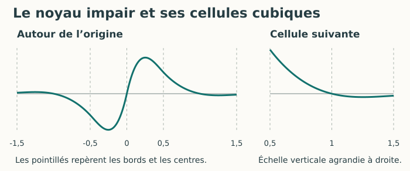

# École polytechnique — Première composition de mathématiques P′ 1994 · Corrigé guidé

*Corrigé rédigé par IA, non officiel. Signalez toute erreur.*

**Rédaction** · GPT-6.2 Astra Ultra · vitesse non renseignée

[Fac-similé UPS](https://prepas.org/index.php?module=Sujets&voir=get&file=doc-f236d8d7fad5ef871c51) · [Second exemplaire](https://www.sujetsetcorriges.fr/dl/X/Maths/PC/sec-x-1994-maths1-PC.pdf) · [Instruction du concours de 1994](https://www.legifrance.gouv.fr/jorf/id/JORFTEXT000000180352)

La norme est la norme uniforme sur $\mathbb R$. Les fonctions $\varphi$ de $F_N$ et leurs dérivées jusqu’à l’ordre $N+1$ sont bornées et continues. La première estimation porte sur $N=1$. Pour $N=3$, nous construirons un noyau à morceaux cubiques qui isole $\varphi'(0)$ dans une identité intégrale.

## I. Une estimation par Taylor

### Question 1

> [!INDICATION]
> Écrire les développements en $t+1$ et en $t-1$, puis soustraire.

#### Solution

La formule à reste intégral donne, pour $\varepsilon=\pm1$,
$$\varphi(t+\varepsilon)=\varphi(t)+\varepsilon\varphi'(t)+\int_0^1(1-s)\varphi''(t+\varepsilon s)\,ds.$$
Chaque reste a un module au plus égal à $\|\varphi''\|/2$. Par différence, $2|\varphi'(t)|\le2\|\varphi\|+\|\varphi''\|$. En prenant le supremum, on obtient les constantes $C_1=1$ et $C_2=1/2$.

## II. Matrices de changement d’échelle

### Question 2

> [!INDICATION]
> Sur la ligne $i$, la multiplication à gauche introduit le facteur $x^{-i}$.

#### Solution

Soit $X(x)=\operatorname{diag}(x,x^2,\ldots,x^N)$. Le coefficient $(i,j)$ de $xX(x)^{-1}AX(x)$ est $x^{j-i+1}a_{ij}$, exactement celui de $T(x)$. D’où
$$T(x)=xX(x)^{-1}AX(x),\qquad \det T(x)=x^N\det A.$$
C’est en particulier une matrice inversible pour tout $x\ne0$.

### Question 3

> [!INDICATION]
> Le produit des racines, multiplicités comprises, est le déterminant.

#### Solution

Pour $x,y\ne0$, le produit des valeurs propres de $T(x)^{-1}T(y)$ vaut $\det T(y)/\det T(x)=(y/x)^N$. Cette relation ne demande aucune hypothèse de diagonalisation.

### Question 4

> [!INDICATION]
> Exploiter $X(-x)=J_NX(x)$ et $J_N^{-1}=J_N$.

#### Solution

En posant $X=X(x)$ et $J=J_N=\operatorname{diag}((-1)^i)_{1\le i\le N}$, on a $T(-x)=-xX^{-1}J^{-1}AJX$. Le produit vaut donc
$$T(-x)^{-1}T(x)=-X^{-1}J^{-1}A^{-1}JAX.$$
Les matrices de part et d’autre de la conjugaison par $X$ ont le même polynôme caractéristique. Ainsi $\det(\lambda I-T(-x)^{-1}T(x))=\det(\lambda I+J^{-1}A^{-1}JA)$.

## III. Polynômes caractéristiques

### Question 5

> [!INDICATION]
> Écrire les lignes successives comme $1$, puis $j$, puis $j(j-1)$.

#### Solution

Les deux matrices sont
$$A_2=\begin{pmatrix}1&1\\1&2\end{pmatrix},\qquad
A_3=\begin{pmatrix}1&1&1\\1&2&3\\0&2&6\end{pmatrix}.$$
Leurs déterminants valent respectivement $1$ et $1(12-6)-6+2=2$.

### Question 6

> [!INDICATION]
> Les polynômes en $j$ qui décrivent les lignes sont unitaires et de degrés successifs.

#### Solution

Posons $p_0=1$ et $p_r(t)=t(t-1)\cdots(t-r+1)$ pour $r\ge1$. On a $(A_N)_{ij}=p_{i-1}(j)$, y compris quand ce produit contient un facteur nul. Le changement des lignes $j^{i-1}$ vers les lignes $p_{i-1}(j)$ est triangulaire inférieur de diagonale unité. Le déterminant de Vandermonde aux points $1,\ldots,N$ donne donc
$$\det A_N=\prod_{1\le i<j\le N}(j-i)=\prod_{j=1}^{N-1}j!\ne0.$$

### Question 7

> [!INDICATION]
> Former le produit des deux matrices $2\times2$ et en prendre la trace et le déterminant.

#### Solution

On obtient $T_2(-1)=\left(\begin{smallmatrix}-1&1\\1&-2\end{smallmatrix}\right)$ et $T_2(1)=A_2$, d’où
$$T_2(-1)^{-1}T_2(1)=\begin{pmatrix}-3&-4\\-2&-3\end{pmatrix},\qquad P_2(\lambda)=\lambda^2+6\lambda+1.$$

### Question 8

> [!INDICATION]
> Comparer la matrice de transfert à son inverse en remplaçant $x$ par $-x$ dans la question 4.

#### Solution

Soit $B=T_N(-1)^{-1}T_N(1)$. La question 4 appliquée en $x=1$ puis en $x=-1$ montre que $B$ et $B^{-1}$ ont le même polynôme caractéristique. De plus $\det B=(-1)^N$. Pour $\lambda\ne0$,
$$\lambda^N P_N(1/\lambda)=\det(I-\lambda B)
=\det(-B)\det(\lambda I-B^{-1})=P_N(\lambda).$$
Si $N$ est impair, $P_N(-1)=-P_N(-1)$ et $-1$ est racine.

### Question 9.a

> [!INDICATION]
> Utiliser les trois lignes explicites de $A_3$ et conserver l’alternance des signes dans $T_3(-1)$.

#### Solution

L’inversion, que l’on peut vérifier par multiplication, donne
$$T_3(-1)=\begin{pmatrix}-1&1&-1\\1&-2&3\\0&2&-6\end{pmatrix},\quad
T_3(-1)^{-1}=\begin{pmatrix}-3&-2&-1/2\\-3&-3&-1\\-1&-1&-1/2\end{pmatrix}.$$
Son produit avec $A_3$ est
$$B=\begin{pmatrix}-5&-8&-12\\-6&-11&-18\\-2&-4&-7\end{pmatrix}.$$
La trace vaut $-5-11-7=-23$.

### Question 9.b

> [!INDICATION]
> Une racine est déjà connue. Les deux autres ont un produit égal à $1$.

#### Solution

Le produit des trois racines vaut $-1$ et leur somme vaut $-23$. En retirant la racine $-1$, les deux autres ont pour somme $-22$ et produit $1$. Elles sont $-11\pm2\sqrt{30}$. Par suite
$$P_3(\lambda)=(\lambda+1)(\lambda^2+22\lambda+1)=\lambda^3+23\lambda^2+23\lambda+1.$$
On notera $\alpha=-11+2\sqrt{30}\in(-1,0)$, l’autre racine étant $1/\alpha$.

## IV. Raccords et estimation du premier ordre

### Question 10

> [!INDICATION]
> Évaluer le même jet de dérivées au raccord vu depuis les deux centres consécutifs.

#### Solution

Sur la cellule de centre $k$, écrivons $f(k+x)=p_k(x)=\sum_{j=1}^Nc_{j,k}x^j$ et $v_k=(c_{j,k})_j$. La ligne $i$ de $T_N(x)v_k$ est $p_k^{(i-1)}(x)$, car la dérivée du monôme est $a_{ij}x^{j-i+1}$ lorsque $j\ge i-1$ et nulle sinon. L’égalité des valeurs et des $N-1$ premières dérivées à $k+1/2$ donne
$$T_N(1/2)v_k=T_N(-1/2)v_{k+1}\quad(k\ge0).$$
La cellule de centre $0$ commence à $0$ et possède bien le raccord de droite requis.

### Question 11

> [!INDICATION]
> Un choix de $v_0$ fixe tous les coefficients. Vérifier également la réciproque au bord de chaque cellule.

#### Solution

Posons $H=T_N(-1/2)^{-1}T_N(1/2)$. Pour $v\in\mathbb C^N$, formons $v_k=H^kv$ puis les polynômes $p_k$ correspondants. Collons-les sur $[0,1/2]$ puis sur $[k-1/2,k+1/2]$, en utilisant $p_k(t-k)$. La relation de la question 10 identifie les valeurs et toutes les dérivées jusqu’à l’ordre $N-1$, ce qui donne un élément de $E_N$. L’application est linéaire. Réciproquement les coefficients de chaque polynôme sont uniques sur son intervalle, et la question 10 les détermine à partir de $v_0$. L’extraction de $v_0$ est l’inverse demandé.

### Question 12

> [!INDICATION]
> Traduire la décroissance de la fonction en décroissance des trois coefficients en l’évaluant à trois abscisses fixes.

#### Solution

Si $f(t)\to0$, choisissons trois réels distincts $x_1,x_2,x_3\in(0,1/2)$. Le vecteur des $f(k+x_i)$ tend vers zéro. La matrice $(x_i^j)_{1\le i,j\le3}$ est inversible par Vandermonde et $x_i\ne0$, donc $v_k\to0$. Réciproquement $v_k\to0$ entraîne la convergence uniforme des $p_k$ vers zéro sur $[-1/2,1/2]$, donc $f(t)\to0$.
La question 4 donne le même polynôme $P_3$ pour $H$. Ses trois racines sont simples. Dans une base propre, la composante de $H^kv_0$ associée à $-1$ conserve son module, celle associée à $1/\alpha$ croît en module si elle est non nulle, et celle associée à $\alpha$ tend vers zéro. L’espace cherché correspond donc à la seule droite $\mathbb Cw$. Un générateur est
$$f_0(k+x)=\alpha^k(w_1x+w_2x^2+w_3x^3),$$
sur les cellules du sujet. Il est non nul car $w\ne0$. Pour tracer la figure, la matrice de transfert à la demi-unité est
$$H=\begin{pmatrix}-5&-4&-3\\-12&-11&-9\\-8&-8&-7\end{pmatrix}.$$
La multiplication vérifie $Hw=\alpha w$ pour $w=(1/2,-\sqrt{30}/4,1)^T$.

### Question 13

> [!INDICATION]
> Faire quatre intégrations par parties sur chaque morceau. À l’origine, la dérivée seconde change de signe ; aux demi-entiers, c’est la dérivée troisième qui saute.

#### Solution

Prolongeons $f_0$ par imparité, avec $f(0)=0$. Sur chaque cellule positive, les modules des dérivées polynomiales jusqu’à l’ordre trois sont majorés par $C|\alpha|^k$ pour une constante $C$. La même estimation vaut par symétrie du côté négatif. En particulier $f\in L^1(\mathbb R)$, ce qui donne la convergence absolue de $I$ puisque $\varphi^{(4)}$ est bornée.
Sur chaque morceau cubique, l’intégration de $\varphi^{(4)}f$ donne la variation de
$$\varphi'''f-\varphi''f'+\varphi'f''-\varphi f''' .$$
Sommons d’abord sur un intervalle symétrique tronqué aux centres entiers, puis faisons tendre la borne vers l’infini. Les termes extérieurs tendent vers zéro grâce à la décroissance géométrique de $f$ et de ses dérivées par morceaux. À zéro, $f$ et $f'$ sont continus, $f'''(0-)=f'''(0+)=6w_3$ et $f''(0-)-f''(0+)=-4w_2$. Il reste $-4w_2\varphi'(0)$.
À $t_k=k+1/2$, les trois premiers termes se raccordent. La contribution du dernier est $\varphi(t_k)(f'''(t_k+)-f'''(t_k-))=6w_3(\alpha-1)\alpha^k\varphi(t_k)$. Comme $f'''$ est pair par morceaux, le saut en $-t_k$ est opposé. Ainsi
$$I=\lambda\varphi'(0)+\mu\sum_{k\ge0}\alpha^k\bigl(\varphi(k+1/2)-\varphi(-k-1/2)\bigr),\quad
\lambda=-4w_2,\quad \mu=6w_3(\alpha-1).$$
La série converge absolument car $|\alpha|<1$.

### Question 14

> [!INDICATION]
> Translater la fonction test avant de prendre le supremum.

#### Solution

Appliquons l’identité précédente à $s\mapsto\varphi(t+s)$. L’intégrale est majorée en module par $\|f\|_1\|\varphi^{(4)}\|$ et la série sans son facteur $\mu$ par $2\|\varphi\|/(1-|\alpha|)$. Comme $w_2\ne0$ (fait admis dans l’énoncé), on obtient pour tout $t$, puis en norme uniforme,
$$\|\varphi'\|\le\frac{2|\mu|}{|\lambda|(1-|\alpha|)}\|\varphi\|+
\frac{\|f\|_1}{|\lambda|}\|\varphi^{(4)}\|.$$
Les constantes ne dépendent que du noyau choisi. Pour le choix $w=(1/2,-\sqrt{30}/4,1)$ de la figure, elles sont toutes deux strictement positives.
