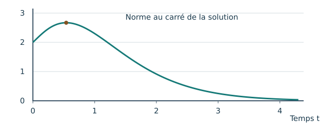

# École polytechnique — Deuxième composition de mathématiques · Option M′ 1995 · Corrigé brut

*Corrigé rédigé par IA, non officiel. Signalez toute erreur.*

**Rédaction** · GPT-6.2 Astra Ultra · vitesse non renseignée

Soit $E$ l’espace complexe des matrices symétriques de taille $N$ et $E_0$ son analogue réel. La transposition est notée $t$ en exposant et la barre désigne la conjugaison. Pour une matrice $M$, on pose $\widehat M(B)=M^tB+BM$. Si $B$ est réelle symétrique, $Q_B(x)=x^tBx$.

## I. Une base de matrices symétriques

### Question 1

Une matrice symétrique est déterminée par ses $N$ coefficients diagonaux et ses $N(N-1)/2$ coefficients strictement au-dessus. Ces choix sont indépendants sur $\mathbb C$. Donc $\dim_{\mathbb C}E=N(N+1)/2$.

### Question 2.a

Dans la base orthonormée $(v_i)$, $v_j^t\overline v_k=\delta_{jk}$. Avec $B_{ij}=v_iv_j^t+v_jv_i^t$, il en résulte
$$
B_{ij}\overline v_k=\delta_{jk}v_i+\delta_{ik}v_j.
$$
En particulier $B_{ii}\overline v_i=2v_i$.

### Question 2.b

Les $B_{ij}$ appartiennent à $E$. Si $\sum_{i\le j}c_{ij}B_{ij}=0$, appliquons à $\overline v_k$. Pour $\ell\ne k$, la composante sur $v_\ell$ vaut $c_{\min(k,\ell),\max(k,\ell)}$. Pour $\ell=k$, elle vaut $2c_{kk}$. Tous les coefficients sont donc nuls. La famille libre a exactement $N(N+1)/2$ termes, ce qui en fait une base.

## II. Spectre sur les matrices symétriques

### Question 3

Dans la base de l’énoncé, $M^t v_i=\sum_{j\ge i}\mu_{ij}v_j$, de sorte que la matrice est triangulaire inférieure de diagonale $(\mu_{11},\ldots,\mu_{NN})$. Ainsi $\det(XI-M)=\det(XI-M^t)=\prod_i(X-\mu_{ii})$. Les $\mu_{ii}$ constituent les valeurs propres de $M$, répétées selon leurs multiplicités algébriques et dans l’ordre de cette base.

### Question 4

Par développement et transposition, avec $B_{ij}=B_{ji}$ par convention,
$$
\widehat M(B_{ij})=\sum_h\bigl(\mu_{ih}B_{hj}+\mu_{jh}B_{ih}\bigr).
$$
La formule de 2.a donne alors la composante sur $v_\ell$ de $\widehat M(B_{ij})\overline v_k$,
$$
X_{ijk\ell}=\delta_{jk}\mu_{i\ell}+\delta_{ik}\mu_{j\ell}
+\delta_{i\ell}\mu_{jk}+\delta_{j\ell}\mu_{ik}.
$$
Les quatre contributions subsistent avec leur multiplicité si certains indices coïncident.

### Question 5.a

Par la question 2.b, il existe des coefficients uniques tels que $\widehat M(B_{ij})=\sum_{k\le\ell}\alpha_{ijk\ell}B_{k\ell}$. Pour $k<\ell$, seule $B_{k\ell}$ contribue à la composante sur $v_\ell$ après application à $\overline v_k$, avec facteur $1$. Pour $k=\ell$, le facteur est $2$. D’où
$$
\alpha_{ijk\ell}=\frac{X_{ijk\ell}}{1+\delta_{k\ell}}\qquad (k\le\ell).
$$

### Question 5.b

Les termes $\mu_{ih}B_{hj}$ n’interviennent que pour $h\ge i$, et les $\mu_{jh}B_{ih}$ pour $h\ge j$. Dès que le nouvel indice augmente strictement, la somme des deux indices augmente, même après les avoir remis dans l’ordre croissant. À somme inchangée ne restent que $\mu_{ii} B_{ij}+\mu_{jj}B_{ij}$. Ainsi tout autre coefficient non nul vérifie $k+\ell>i+j$, et $\alpha_{ijij}=\mu_{ii}+\mu_{jj}$, y compris pour $i=j$.

### Question 6.a

Ordonnons les couples par ordre lexicographique de $(i+j,i)$. Ces deux nombres déterminent aussi $j$, donc il s’agit d’un ordre total. La question 5.b montre que si $\alpha_{ijk\ell}\ne0$, le couple d’arrivée est l’entrée elle-même ou a une somme strictement supérieure. L’inégalité $(i,j)>(k,\ell)$ entraîne donc $\alpha_{ijk\ell}=0$.

### Question 6.b

Si $\lambda_i=\mu_{ii}$, la matrice de $\widehat M$ dans la base ordonnée des $B_{ij}$ est triangulaire inférieure et sa diagonale vaut $\lambda_i+\lambda_j$ pour $i\le j$. Le polynôme caractéristique est donc
$$
\prod_{1\le i\le j\le N}\bigl(X-(\lambda_i+\lambda_j)\bigr).
$$
Les valeurs propres et leurs multiplicités algébriques se lisent sur ce produit, même lorsque plusieurs couples ont la même somme.

## III. Formes quadratiques et stabilité

### Question 7

Pour la solution réelle $X=X(M,a,t)$, on a $(X^t)'=X^t M^t$. La règle du produit donne
$$
\frac{d}{dt}Q_B(X)=X^tM^tBX+X^tBMX=Q_{\widehat M(B)}(X).
$$

### Question 8.a

Supposons toutes les parties réelles des valeurs propres de $M$ strictement négatives. Pour $a\ne0$, $X(t)=e^{tM}a$ ne s’annule jamais, car $e^{tM}$ est inversible. Si $\widehat M(B)$ est définie négative, la question 7 donne une dérivée strictement négative pour $Q_B(X(t))$. Sa limite est $Q_B(0)=0$, puisque $X(t)\to0$ par le résultat admis. Il s’ensuit que $Q_B(a)>0$ pour tout $a\ne0$.

### Question 8.b

Chaque somme $\lambda_i+\lambda_j$ a une partie réelle strictement négative. D’après 6.b, $\widehat M$ est inversible sur $E$. L’équation $\widehat M(B)=-I$ a donc une unique solution symétrique complexe. $M$ et $-I$ étant réelles, $\overline B$ est aussi solution et l’unicité impose $B=\overline B$. Comme $-I$ est définie négative, 8.a donne $B$ définie positive.

### Question 9.a

Sur la sphère unité réelle, $x\mapsto -Q_{\widehat M(B)}(x)/Q_B(x)$ est continue et strictement positive. Son minimum $k$ est strictement positif par compacité. L’homogénéité des formes étend $kQ_B(x)\le -Q_{\widehat M(B)}(x)$ à tout $x$, y compris l’origine.

### Question 9.b

Avec $g(t)=Q_B(X(t))$, les questions 7 et 9.a donnent $g'\le-kg$. Ainsi $e^{kt}g(t)$ décroît et $0\le g(t)\le e^{-kt}Q_B(a)$ pour $t\ge0$. Le minimum $m>0$ de $Q_B$ sur la sphère unité donne $m\|X(t)\|^2\le g(t)$. Il en résulte $X(M,a,t)\to0$ pour toute donnée initiale réelle $a$.

### Question 9.c

Pour un vecteur propre complexe $z=u+iv\ne0$ associé à $\lambda$, la réalité de $M$ et 9.b donnent $e^{tM}z=e^{tM}u+i e^{tM}v\to0$. Ce vecteur vaut aussi $e^{t\lambda}z$, dont la norme est $e^{t\operatorname{Re}\lambda}\|z\|$. La limite force $\operatorname{Re}\lambda<0$. Cela donne la réciproque du critère d’existence de 8.b.

### Question 10

Prenons $B=I_2$ et
$$
M=\begin{pmatrix}-1&3\\0&-1\end{pmatrix},\qquad
\widehat M(B)=M^t+M=\begin{pmatrix}-2&3\\3&-2\end{pmatrix}.
$$
$M$ a pour seule valeur propre $-1$ et $B$ est définie positive. Pourtant pour $a=(1,1)^t$ on obtient $a^t\widehat M(B)a=2>0$. Cette matrice symétrique a d’ailleurs les valeurs propres $1$ et $-5$. La solution $e^{-t}(1+3t,1)^t$ illustre le signe positif de la dérivée initiale, tout en tendant vers zéro.

