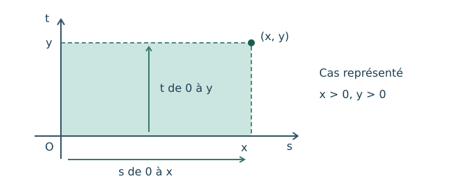

# École polytechnique — Première composition de mathématiques · Option M′ 1995 · Corrigé guidé

*Corrigé rédigé par IA, non officiel. Signalez toute erreur.*

**Rédaction** · GPT-6.2 Astra Ultra · vitesse non renseignée

On écrit $D_j=\partial/\partial x_j$, $D^\alpha=D_1^{\alpha_1}D_2^{\alpha_2}$ et $|\alpha|=\alpha_1+\alpha_2$. Sur un ouvert $\Omega$ contenant l’origine, $E_M^L$ rassemble les fonctions lisses complexes dont toutes les dérivées vérifient un majorant commun $\|D^\alpha u\|_\infty\le c L^{|\alpha|}M_{|\alpha|}$, avec $L>0$ et $M_n>0$. Le système étudié est $D_1D_2u-aD_1u-bD_2u=v$, avec $u$ nulle sur les deux axes.

## I. Espaces à dérivées pondérées

### Question 1

> [!INDICATION]
> Écrire le meilleur majorant comme un supremum. Quelle dérivée suffit pour séparer la fonction nulle ?

#### Solution

L’infimum des constantes admissibles vaut
$$
\|u\|_M^L=\sup_\alpha\frac{\|D^\alpha u\|_\infty}{L^{|\alpha|}M_{|\alpha|}}.
$$
La linéarité des dérivées et l’inégalité triangulaire du supremum rendent cette quantité sous-additive et absolument homogène. Les fonctions pour lesquelles elle est finie forment donc un espace vectoriel complexe. Le terme d’ordre zéro vaut $\|u\|_\infty/M_0$, donc une norme nulle force $u=0$. Ces propriétés prouvent que c’est une norme.

### Question 2

> [!INDICATION]
> Comparer les dénominateurs à chaque ordre pris séparément.

#### Solution

Si $L'\le L''$ et $M'_n\le M''_n$ pour tout $n$, alors $(L')^nM'_n\le(L'')^nM''_n$. Ainsi $E_{M'}^{L'}\subset E_{M''}^{L''}$ et, pour tout $u$ du premier espace, $\|u\|_{M''}^{L''}\le\|u\|_{M'}^{L'}$.

### Question 3

> [!INDICATION]
> Le poids peut dépendre arbitrairement de l’ordre de dérivation. À chaque ordre, combien de dérivées doit-il contrôler ?

#### Solution

La réunion est l’ensemble des $u\in C^\infty(\Omega)$ telles que chacune de leurs dérivées, y compris $u$, soit bornée sur $\Omega$. La nécessité suit de la définition. Réciproquement, si ces bornes sont finies, on peut poser $M_n=1+L^{-n}\max_{|\alpha|=n}\|D^\alpha u\|_\infty$, car le maximum porte sur $n+1$ indices. On obtient $\|u\|_M^L\le1$.

### Question 4

> [!INDICATION]
> Dans le quotient pondéré appliqué à $D^\beta u$, comparer les indices $|\alpha+\beta|$ et $|\alpha|$.

#### Solution

Pour $M'_n=M_{n+|\beta|}$, on a
$$
\frac{\|D^\alpha D^\beta u\|_\infty}{L^{|\alpha|}M'_{|\alpha|}}
\le L^{|\beta|}\|u\|_M^L.
$$
Prendre le supremum prouve que la dérivation linéaire $D^\beta:E_M^L\to E_{M'}^L$ est continue, de norme au plus $L^{|\beta|}$.

### Question 5.a

> [!INDICATION]
> La partie réelle de l’exposant commande la norme uniforme sur la bande et les dérivations introduisent seulement des facteurs constants.

#### Solution

Pour $u_h(x)=e^{h(x_1+i x_2)}$, $D^\alpha u_h=h^{|\alpha|}i^{\alpha_2}u_h$. Sur $|x_1|<r$, le supremum de $|u_h|$ est $e^{hr}$. La condition $u_h\in E_M^L$ avec $\|u_h\|_M^L\le1$ équivaut donc à
$$
M_n\ge e^{hr}(h/L)^n\qquad(n\ge0).
$$
Le terme $n=0$ impose déjà $M_0\ge e^{hr}$.

### Question 5.b

> [!INDICATION]
> Distinguer l’ordre zéro et les racines $n$-ièmes pour $n\ge1$. Ensuite prendre $h$ assez petit pour contrôler les deux.

#### Solution

Les conditions nécessaires et suffisantes sont $M_0>1$ et $d=\inf_{n\ge1}M_n^{1/n}>0$. En effet, 5.a donne $M_0\ge e^{hr}>1$ et $M_n^{1/n}\ge h/L$. Réciproquement choisissons $h>0$ avec $e^{hr}\le\min(M_0,2)$ et $h/L\le d/2$. Pour $n\ge1$, $e^{hr}(h/L)^n\le2(d/2)^n\le d^n\le M_n$, et l’ordre zéro est assuré. Puisque les $M_n$ sont tous strictement positifs, la condition sur $d$ équivaut aussi à $\liminf_{n\to\infty}M_n^{1/n}>0$.

### Question 6

> [!INDICATION]
> Passer à la limite uniformément pour chaque dérivée, identifier les limites entre elles sur des rectangles intérieurs, puis revenir à la norme commune.

#### Solution

Pour une suite de Cauchy $(u_j)$ dans $E_M^L$, les $D^\alpha u_j$ sont uniformément de Cauchy pour tout $\alpha$ et convergent vers une fonction continue bornée $g_\alpha$. Sur chaque petit rectangle fermé de $\Omega$, l’identité des accroissements le long d’une direction s’écrit comme une intégrale de $D^{\alpha+e_i}u_j$. Le passage à la limite uniforme donne $\partial_i g_\alpha=g_{\alpha+e_i}$. Ainsi $u=g_0$ est lisse et $D^\alpha u=g_\alpha$ partout. Si $\|u_j-u_\ell\|_M^L\le\varepsilon$ dès $j,\ell\ge J$, le passage à la limite $\ell\to\infty$ donne, pour chaque $\alpha$, $\|D^\alpha(u_j-u)\|_\infty\le\varepsilon L^{|\alpha|}M_{|\alpha|}$. Le supremum est donc au plus $\varepsilon$, ce qui donne $u\in E_M^L$ et la convergence requise.

## II. Résolution sur un carré

### Question 7.a

> [!INDICATION]
> Intégrer une fois suivant chaque coordonnée. Pour estimer la norme, distinguer les dérivées mixtes, les dérivées pures et l’ordre zéro.

#### Solution

Sur $\Omega_r=(-r,r)^2$, l’unique solution de $D_1D_2u=v$ avec traces nulles est
$$
T(v)(x,y)=\int_0^x\int_0^y v(s,t)\,dt\,ds.
$$
La formule donne l’existence lisse et découle nécessairement de deux intégrations de l’équation et des deux conditions d’axe. Soit $N=\|v\|_{M'}^L$, où $M'_n=M_{n+1}$, $M$ croît, $M_0=M_1$ et $rL<1$. Si $\alpha_1,\alpha_2\ge1$ et $|\alpha|=n$, $D^\alpha Tv=D^{\alpha-(1,1)}v$ est bornée par $NL^{n-2}M_{n-1}\le NL^{n-2}M_n$. Pour une dérivée pure d’ordre $n\ge1$, il reste une intégrale de longueur au plus $r$ d’une dérivée d’ordre $n-1$, d’où la borne $rNL^{n-1}M_n\le NL^{n-2}M_n$. Enfin $\|Tv\|_\infty\le r^2NM_1\le NL^{-2}M_0$. La linéarité et ces trois bornes donnent $\|T\|_{E_{M'}^L\to E_M^L}\le L^{-2}$.

### Question 7.b

> [!INDICATION]
> Composer la borne précédente avec les deux estimations de dérivation d’ordre un.

#### Solution

Par la question 4, $\|aD_1u+bD_2u\|_{M'}^L\le L(|a|+|b|)\|u\|_M^L$. L’application $K:u\mapsto T(aD_1u+bD_2u)$ a donc pour norme au plus $(|a|+|b|)/L$. L’hypothèse $|a|+|b|<L$ rend cette borne strictement inférieure à $1$.

### Question 7.c

> [!INDICATION]
> Réécrire le système comme une équation de point fixe, conditions sur les axes comprises.

#### Solution

Pour $v\in E_{M'}^L$, le problème équivaut à $u=Ku+Tv$. En effet $T$ impose les deux traces nulles et inverse la dérivation mixte avec ces traces. L’application affine $u\mapsto Ku+Tv$ envoie le Banach $E_M^L$ dans lui-même et y est contractante d’après 7.b. Son unique point fixe est la solution cherchée. Il est aussi donné par $\sum_{j\ge0}K^jTv$, série convergente dans cette norme.

### Question 8

> [!INDICATION]
> Les dérivées d’une fonction lisse peuvent être non bornées près du bord du carré ouvert. Résoudre et comparer les solutions sur des carrés intérieurs.

#### Solution

Fixons $L$ tel que $|a|+|b|<L<1/r$. Pour $s<r$, $s>0$, chaque dérivée de $v$ est bornée sur $\overline{\Omega_s}$. On dispose donc sur $\Omega_s$ d’un poids croissant $M$ vérifiant $M_0=M_1$ et $v\in E_{M'}^L$. Par exemple posons $M_{n+1}=1+\max_{j\le n}L^{-j}\max_{|\alpha|=j}\|D^\alpha v\|_{\infty,\Omega_s}$, puis $M_0=M_1$. La question 7.c fournit une solution lisse sur $\Omega_s$.

Pour comparer deux solutions lisses sur un même carré ouvert, fixons un carré strictement intérieur. Les dérivées des deux solutions et de $v$ y sont bornées. On peut prendre un poids croissant commun, en majorant à chaque ordre les bornes pondérées de ces trois fonctions et en imposant $M_0=M_1$ (augmenter les deux premiers poids si nécessaire). Les deux solutions sont alors dans $E_M^L$ et $v$ dans $E_{M'}^L$. La question 7.c les identifie sur ce carré, donc sur tout leur domaine commun en l’épuisant par ces carrés. Les solutions locales ainsi compatibles se recollent en une solution lisse sur $\Omega_r$. Le même argument assure l’unicité globale.

## III. Dérivées en zéro et solution explicite

### Question 9

> [!INDICATION]
> Utiliser les traces pour les dérivées pures, puis abaisser le second indice dans l’équation dérivée.

#### Solution

Prenons $a=1,b=0$ et notons $a_{i,j}=D_1^iD_2^ju(0,0)$, $b_{i,j}=D_1^iD_2^jv(0,0)$. Les traces imposent $a_{i,0}=a_{0,j}=0$. Pour $i,j\ge1$, l’équation dérivée $i-1$ et $j-1$ fois donne $a_{i,j}=b_{i-1,j-1}+a_{i,j-1}$. Une somme télescopique livre
$$
a_{i,j}=\sum_{\ell=0}^{j-1} b_{i-1,\ell}\quad (i,j\ge1).
$$

### Question 10

> [!INDICATION]
> Regrouper les monômes autour de la variable $z=x_1x_2$ et essayer une fonction $u=F(z)$ nulle pour $z=0$.

#### Solution

Écrivons $x=x_1$, $y=x_2$, $z=xy$. Pour $u=F(z)$ on a $D_1D_2u-D_1u=(1-y)F'(z)+zF''(z)$. Le second membre donné est $(1-y+3z-yz+z^2)e^z$. Son coefficient de $-y$ propose $F'(z)=(1+z)e^z$, donc $F(z)=ze^z$ avec $F(0)=0$. Alors $F''(z)=(2+z)e^z$, ce qui restitue bien tous les termes du second membre. La solution est $u(x_1,x_2)=x_1x_2e^{x_1x_2}$. Elle s’annule sur les deux axes et l’unicité établie en 8 conclut.
