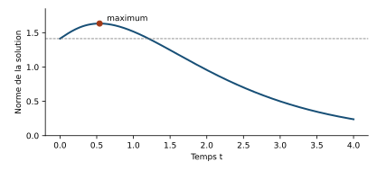

# École polytechnique — Deuxième composition de mathématiques P′ 1995 · Corrigé brut

*Corrigé rédigé par IA, non officiel. Signalez toute erreur.*

**Rédaction** · GPT-6.2 Astra Ultra · vitesse non renseignée

On distingue deux opérations sur $\mathbb C^N$. Le produit hermitien est $(x\mid y)=\bar x^Ty$, tandis que $B$ appartient à l’espace complexe $E$ des matrices symétriques si $B^T=B$, avec une transposition sans conjugaison. On note $E_0$ son sous-espace réel formé des matrices symétriques réelles.

## I. Une base de matrices symétriques

### Question 1

Une matrice symétrique est entièrement déterminée par ses $N$ coefficients diagonaux et ses $N(N-1)/2$ coefficients strictement au-dessus de la diagonale. Ces paramètres complexes sont indépendants, d’où $\dim_{\mathbb C} E=N(N+1)/2$.

### Question 2.a

Pour $B_{ij}=v_i v_j^T+v_jv_i^T$, l’orthonormalité hermitienne donne $v_j^T\bar v_k=\delta_{jk}$ et $v_i^T\bar v_k=\delta_{ik}$. Ainsi
$$B_{ij}\bar v_k=\delta_{jk}v_i+\delta_{ik}v_j.$$
Si $i=j=k$, les deux termes se cumulent en $2v_i$.

### Question 2.b

Chaque $B_{ij}$ est symétrique. Si $\sum_{i\le j}c_{ij}B_{ij}=0$, son action sur $\bar v_k$ donne
$$\sum_{i<k}c_{ik}v_i+2c_{kk}v_k+\sum_{j>k}c_{kj}v_j=0.$$
La liberté des $v_i$ impose la nullité de tous ces coefficients pour chaque $k$. Les $N(N+1)/2$ matrices sont libres et leur nombre est la dimension de $E$. Elles en forment une base.

### Question 2.c

Posons $s_{ab}=v_a^Tv_b=s_{ba}$. Puisque $\operatorname{Tr}(xy^T)=y^Tx$, l’un des quatre termes vaut $\operatorname{Tr}(v_i v_j^T v_k v_l^T)=s_{jk}s_{li}$. En regroupant les quatre, on trouve
$$\operatorname{Tr}(B_{ij}B_{kl})=2(s_{jk}s_{il}+s_{jl}s_{ik}).$$
Dans une base réelle orthonormée, $s_{ab}=\delta_{ab}$. Pour une base complexe orthonormée, c’est $\bar v_a^Tv_b$ qui vaut $\delta_{ab}$. Par exemple pour $N=1$ et $v_1=e^{i\theta}$, la trace demandée vaut $4e^{4i\theta}$.

## II. Spectre de l’application de Lyapunov

### Question 3

L’application $\widehat M(B)=M^TB+BM$ est linéaire à valeurs dans $E$ par transposition. Les polynômes caractéristiques de $M^T$ et de $M$ sont égaux. Prenons des vecteurs non nuls $u,v$ tels que $M^Tu=\lambda u$, $M^Tv=\lambda'v$. Alors $B=uv^T+vu^T$ est symétrique et $\widehat M(B)=(\lambda+\lambda')B$. De plus $x^TBx=2(u^Tx)(v^Tx)$ est un polynôme non nul, car produit de deux formes linéaires non nulles sur $\mathbb C$. Donc $B\ne0$, même pour $\lambda=\lambda'$, et la somme est valeur propre.

### Question 4

Dans la base canonique,
$$B_{11}=\begin{pmatrix}2&0\\0&0\end{pmatrix},\quad
B_{12}=\begin{pmatrix}0&1\\1&0\end{pmatrix},\quad
B_{22}=\begin{pmatrix}0&0\\0&2\end{pmatrix}.$$
Les facteurs $2$ sur la diagonale interviennent dans les coordonnées de la question suivante.

### Question 5.a

Si $M=\left(\begin{smallmatrix}a&b\\c&d\end{smallmatrix}\right)$, les coordonnées $(x,y,z)$ de $B$ deviennent $(2ax+cy,\;2bx+(a+d)y+2cz,\;by+2dz)$ pour $\widehat M(B)$. La matrice demandée est
$$H=\begin{pmatrix}2a&c&0\\2b&a+d&2c\\0&b&2d\end{pmatrix}.$$

### Question 5.b

Posons $s=a+d$ et $\delta=ad-bc$. Le développement du déterminant donne
$$\det(tI-H)=(t-s)\big[(t-2a)(t-2d)-4bc\big]=(t-s)(t^2-2st+4\delta).$$
Puisque $\lambda_1+\lambda_2=s$, $\lambda_1\lambda_2=\delta$, ses racines avec multiplicité sont $2\lambda_1,\lambda_1+\lambda_2,2\lambda_2$. La factorisation couvre également les matrices non diagonalisables. Pour $N>2$, l’énoncé admet la description du spectre par les sommes.

## III. Stabilité et formes quadratiques

### Question 6

Pour $X'=MX$ réel et $Q_B(x)=x^TBx$,
$$\frac{d}{dt}Q_B(X(t))=(MX)^TBX+X^TBMX
=X^T(M^TB+BM)X=Q_{\widehat M(B)}(X(t)).$$

### Question 7.a

Pour $a\ne0$, $X(M,a,t)$ ne s’annule à aucun instant fini, par unicité du problème de Cauchy. Ainsi $t\mapsto Q_B(X(M,a,t))$ a une dérivée strictement négative d’après 6. Sa limite en $+\infty$ vaut zéro, en utilisant la convergence des trajectoires admise dans le sujet. Une fonction strictement décroissante de limite nulle est positive en chaque instant. En $t=0$ on obtient $Q_B(a)>0$ pour tout $a\ne0$.

### Question 7.b

Sous l’hypothèse de stabilité, chaque $\lambda_i+\lambda_j$ a une partie réelle strictement négative. Le spectre décrit en 5.b exclut donc $0$. L’application $\widehat M$ est inversible sur $E$. L’unique solution symétrique complexe $B$ de $\widehat M(B)=-I$ est réelle, car sa conjuguée vérifie la même équation avec $M$ réel. Son image $-I$ étant définie négative, 7.a impose $B$ définie positive.

### Question 8.a

Pour $x\ne0$, $h(x)=-Q_{\widehat M(B)}(x)/Q_B(x)$ est strictement positif. Sur la sphère unité il est continu, donc atteint un minimum $k>0$. Comme $h(cx)=h(x)$ pour $c\ne0$, on a $kQ_B(x)\le -Q_{\widehat M(B)}(x)$ pour tout $x\ne0$, et aussi pour $x=0$.

### Question 8.b

D’après 6 et 8.a, $q(t)=Q_B(X(t))$ vérifie $q'+kq\le0$. Ainsi $(e^{kt}q(t))'\le0$ et $q(t)\le e^{-kt}Q_B(a)$ pour $t\ge0$. Avec $\mu=\lambda_{\min}(B)>0$, il vient $\mu\|X(t)\|^2\le q(t)$, donc $X(M,a,t)\to0$ pour tout $a$.

### Question 8.c

Soient $\lambda\in\mathbb C$ valeur propre de $M$ et $v=u+iw$ un vecteur propre non nul. Par linéarité et unicité, $e^{tM}v=e^{\lambda t}v=e^{tM}u+i e^{tM}w$. La question 8.b montre que les deux termes réels tendent vers zéro. Or $\|e^{\lambda t}v\|=e^{t\Re\lambda}\|v\|$. Nécessairement $\Re\lambda<0$. Cela établit la réciproque du critère de Lyapunov pour cette équation.

### Question 9

Prenons $M=\left(\begin{smallmatrix}-1&3\\0&-1\end{smallmatrix}\right)$ et $B=I_2$. Les deux valeurs propres de $M$ sont $-1$ et $B$ est définie positive. Pourtant $\widehat M(B)=\left(\begin{smallmatrix}-2&3\\3&-2\end{smallmatrix}\right)$ a pour valeurs propres $1$ et $-5$. Au vecteur $(1,1)^T$, la dérivée du carré de la norme euclidienne vaut donc $2>0$ malgré la convergence finale vers zéro.

